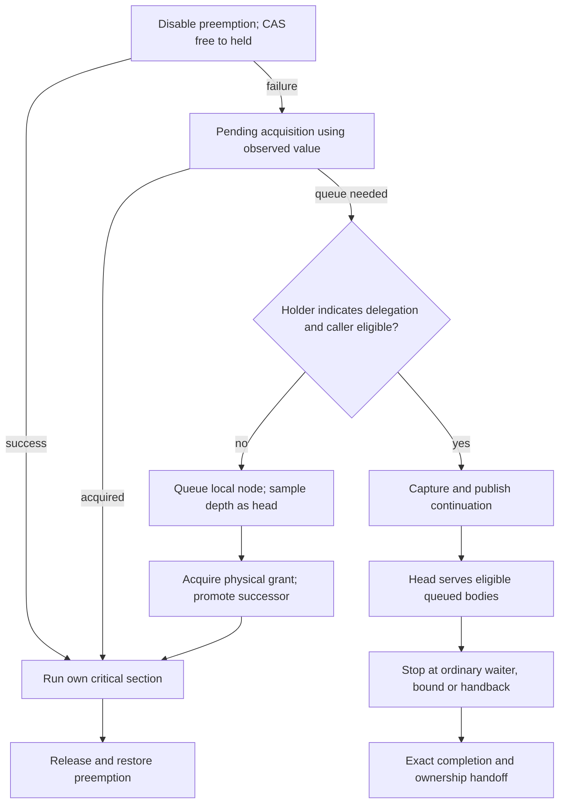

# Plain acquisition and short-section analysis

The local baseline is commit 4669a085 (core 20e9db0c). Five-worker standard
points have no offers, delegated bodies, sessions or mode transitions. They
still take KD's contended queue path; absence of delegation is not absence of
additional instructions. That path counts plain acquisitions, maintains KD
node state, checks adaptive mode and periodically examines successor depth.
Native queued spinlocks do not make the corresponding delegation decisions.
The queue-depth walk happens before ownership, which avoids extending the
current critical section but does not make its CPU/cache cost disappear.
No sample profile was collected, so individual cycle shares are not known.

Candidate 200c4eff passes the value already returned by the failed entry CAS
into the slow function, matching Native's initial-value convention. The
pending read-modify-write and queue-head operation still establish ownership;
the observation is only a path selector. The uncontended path and unlock are
unchanged. Other users retain the helper that reads the current value.
Compiled code removes the initial lock-word load and adds an entry register
move; register allocation and layout also differ. A timing change cannot be
attributed exclusively to that load without further controlled evidence.

At 8/32 workers, the baseline's short-section delegation sessions serve few
foreign bodies. At 8 workers there are 2,442 offers, 43 delegated bodies and
2,397 plain-stop events across three timed points; at 32 there are 2,360,
64 and 2,296 respectively. These are event totals, not measured physical
chain lengths or CPU-time shares. Ordinary queued nodes end a combining
session. The current holder's mode lives in the lock byte, and unlock clears
that byte; arrivals during the empty-byte handoff window may queue locally.
This is a source-supported opportunity for investigation, not a measured
fraction of the TCLock throughput gap. Persistent mode would require a
separate ownership/lifetime design and validation, not just retaining a stale
mode bit or bypassing ordinary waiters.

The 32-worker default is balanced across two NUMA nodes (CPUs 4–35).
Packed CPUs 0–31, daemon-off and zero outside-work controls are separate
cells. They must not be pooled with the standard workload or historical
single-node measurements. Native/KD/TCLock within each campaign share a boot;
baseline versus candidate use different boots with the same topology/config.
