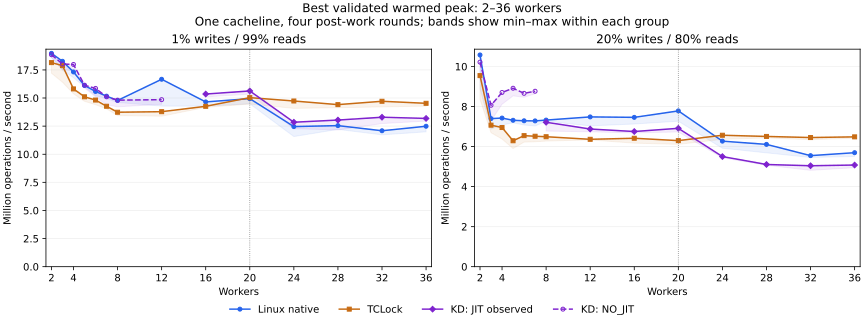

# Rwlock scaling: 1% and 20% writes

All **270 sessions passed**: one cacheline, two read/write mixes, three backends,
three rounds and the same 15 thread counts as the previous spin/mutex comparison:
`1 2 3 4 5 6 7 8 12 16 20 24 28 32 36`. These are now the rwlock runner defaults.
Each worker performs the specified mix; this is not a fixed population of reader
and writer threads. Rates count **reads plus writes**.

KD leads several lower-thread-count points. Once workers span both NUMA nodes,
TCLock leads both mixes; KD remains ahead of native at 1% writes but falls behind
it at 20%. The lock/runtime implementation is unchanged from the
[initial comparison](../20261009/README.md).

## Throughput

Selected points below are **best validated warmed peak / median whole-run Mops/s**.
Each entry has three valid rounds.

| Writes | Workers | Linux native | TCLock rwlock | KD rwlock |
| ---: | ---: | ---: | ---: | ---: |
| 1% | 8 | 14.785 / 14.524 | 13.737 / 13.640 | 14.811 / 14.658 |
| 1% | 16 | 14.654 / 14.309 | 14.263 / 14.157 | 15.357 / 15.210 |
| 1% | 24 | 12.460 / 12.087 | 14.737 / 14.319 | 12.849 / 12.327 |
| 1% | 36 | 12.490 / 11.788 | 14.531 / 14.079 | 13.185 / 13.020 |
| 20% | 8 | 7.324 / 7.220 | 6.492 / 6.431 | 7.214 / 6.973 |
| 20% | 16 | 7.460 / 7.213 | 6.416 / 6.247 | 6.752 / 6.702 |
| 20% | 24 | 6.271 / 5.870 | 6.566 / 6.355 | 5.501 / 5.371 |
| 20% | 36 | 5.695 / 5.450 | 6.485 / 6.389 | 5.078 / 4.930 |



The plot separates KD rounds with returned JIT bodies from those with none.
Every execution-status group contains three rounds in this sweep. Bands show
observed min–max within each group, not confidence intervals. The dotted line
marks twenty workers; larger cohorts include CPUs on NUMA node 1.

[All 15 thread counts](matrix.md), [peak including one worker](peak-scaling.svg),
[median whole-run curves](whole-scaling.svg), [full statistics](statistics.csv)
and [individual rounds](samples.csv) retain the complete comparison. PNG
companions are also provided for sharing. Peak and whole-run results can differ:
native at 1% writes and twelve workers reaches a 16.669 Mops/s selected peak,
while its median whole-run rate is 14.238 Mops/s.

## KD execution and scaling

At **1% writes**, KD executes no JIT bodies through twelve workers. From sixteen
workers onward JIT is observed, but its whole-run share remains small: 0.003–0.005%
of writes at sixteen, and 0.47–1.03% at thirty-six. The largest share anywhere in
this mix is 1.43%. The throughput here mainly measures local reader/native writer
behavior; it is not evidence of a large benefit from JIT. At thirty-six workers,
KD's best peak is 5.56% above native and 9.26% below TCLock.

At **20% writes**, KD remains native through seven workers and leads both other
backends at counts 1, 3, 4, 5, 6 and 7. Delegation starts at eight workers, covering
8.55–11.13% of writes. At larger counts it covers roughly 27–32%. KD trails native
from eight workers onward, and both comparators at every cross-NUMA point
(24, 28, 32 and 36 workers). At thirty-six its best peak is 10.83% below native
and 21.70% below TCLock, despite 27.92–28.98% writer JIT coverage.

This sweep does not isolate delegation's cost from changes in contention or NUMA
placement; it has no delegation-disabled arm. The earlier disabled controls used
different write mixes and remain in their separate report.

The one-worker baselines are KD 53.283 Mops/s at 1% writes and 51.081 at 20%,
with no JIT. Throughput drops sharply when a second CPU shares this short critical
section. Every reader still modifies the shared admission count. The observed
drop is consistent with coherence costs on that shared state; individual hardware
costs were not profiled. These measurements establish behavior for this payload
and placement, not general application speedups or acquisition latency.

## Progress across NUMA nodes

Workers occupy guest CPUs `0..N-1`: CPUs 0–19 are node 0 and 20–39 are node 1.
At thirty-six workers, node 1 supplies 16/36 (44.44%) of the workers. Their actual
whole-run operation shares are:

| Writes | Linux native | TCLock | KD |
| ---: | ---: | ---: | ---: |
| 1% | 35.13–37.96% | 18.57–19.19% | 37.73–38.00% |
| 20% | 37.21–37.97% | 50.09–50.39% | 41.06–41.71% |

TCLock's higher 1% throughput accompanies a much smaller contribution from node 1.
[Per-node progress](node-progress.csv) records peak-window and whole-run shares
for every round. All workers progressed in every accepted window and completed
their measured calls; that observation is not a starvation or fairness guarantee.

## Reproduction and evidence

The guest command, after verifying snapshot and kernel identity, was:

```sh
export PATH=/root/kdlock-evidence/clobber-20260918/venv/bin:$PATH
export LC_ALL=C KDLOCK_RECOVERY_CONFIRMED=1
export KDLOCK_SNAPSHOT_TAG=pre_mutex_priorities_20261008
timeout 3600s python3 -u bench/rwlock_compare/run.py \
  --backends native tclock kdlock --workloads cacheline --cachelines 1 \
  --write-percent 1 20 --full-matrix \
  --output /root/kdlock-evidence/rwlock-scaling-20261009/matrix
```

Use a new output directory for a rerun. The source is the isolated ext4 copy at
`/root/kdlock-evidence/rwlock-scaling-20261009/source`. Its captured inputs differ
from the previous control only in runner defaults and the existing test's added
20% mix coverage. Unrelated host spin-workload/mutex edits were preserved and
excluded, as recorded in [evidence.json](evidence.json).

Settings match the prior methodology: 48,000 warmup operations per worker, three
two-second rounds, four arithmetic rounds outside the lock, 256-operation progress
batches and 10 ms collector sampling. Each peak is the best observed full-cohort
300 ms window after 300 ms settling. The collector uses CPU 38. All backends use
the same payload and deterministic per-worker mix, and the backend order reverses
in the middle round. KD keeps NUMA on, batch 1,024, prefetch 2 and entry-ratio limit
2. TCLock uses its actual rwlock implementation, with unmeasured delegation share.
Benchmark modules disable UBSAN; the captured kernel is unchanged.

The verified kernel is `6.1.159-kdclobber2`, live Build ID
`5ca28058e156f34a2c7fe91e8e0fbf92f4e51960`, with `nokaslr`, `nopvspin` and voluntary
preemption. Live qspinlock dispatch matched native implementations. Host vCPU
affinity and 2.5 GHz frequency bounds were verified before and after measurement.
The actual recovery snapshot was confirmed through the QEMU monitor.

Fresh basic unit checks passed both groups; all ten rwlock runner/oracle tests
passed, including exact 20% operation mixes. The built TCLock assembly audit passed.
All 270 sessions passed business-result, timing, CPU/context, per-worker progress
and final drain checks. The 42 JIT-positive sessions returned **15,172,317** JIT
writer bodies; the other 48 KD sessions remained NO_JIT. No session was refused,
failed or left unrun. The runner exited zero and the final guest was idle with no
benchmark, daemon or project module left loaded. This is not a full unit-test-suite
pass, and it does not retest the previously refused hash writer.

The complete archive is identified in [evidence.json](evidence.json), SHA256
`66be26d6f6bcd8cc1defd76e3958011c30cfbd38431e5a09075618dda53f39c7`.
It retains frozen sources and binaries, commands/build logs, kernel identity,
translation images, raw measurements, source retirement and unload evidence.
[export.py](export.py) regenerates the report tables and plots from its
`matrix/records.json` without performing live benchmarks.
