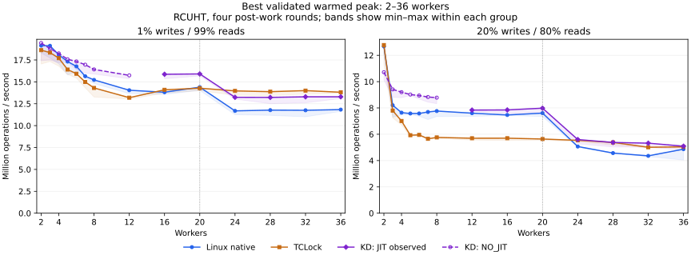

# RCUHT rwlock comparison

The requested **“KD must not be slower than Native or TCLock” target is not met**.
The completed comparison covers 1% and 20% writes, three backends, three rounds,
and all requested worker counts: `1 2 3 4 5 6 7 8 12 16 20 24 28 32 36`.
Rates count reads plus writes. Each worker performs the specified mix.

All **270 sessions passed correctness, progress and drain checks**. KD met the
strict peak-and-whole-run target at **21 of 30 configurations**; nine failed.
The runner deliberately exited **1 / PERFORMANCE_REGRESSION** after collecting
all results. All 90 backend/execution-status groups have three valid rounds.

This uses the existing adaptation of TCLock's `rcuhashbash_write_lock`: 1,024
buckets, 4,096 preallocated nodes and 8,192 possible keys. Readers look up keys;
writers move existing nodes. All backends use the same payload and structural
oracle under one global rwlock. It is not a lock-free RCU read-side benchmark,
and it makes no allocations or RCU service calls inside the protected body.

## Throughput and parity

Selected points are **best warmed peak / median whole-run Mops/s**. All rows
below have three rounds within one execution-status group.

| Writes | Workers | Linux native | TCLock rwlock | KD rwlock |
| ---: | ---: | ---: | ---: | ---: |
| 1% | 1 | 17.667 / 17.560 | 17.530 / 17.221 | 20.759 / 20.647 |
| 1% | 2 | 19.140 / 18.158 | 18.621 / 17.299 | 19.436 / 17.749 |
| 1% | 3 | 19.119 / 17.943 | 18.341 / 18.173 | 18.792 / 17.431 |
| 1% | 8 | 15.222 / 14.714 | 14.305 / 13.967 | 16.418 / 15.847 |
| 1% | 16 | 13.814 / 13.702 | 14.091 / 13.858 | 15.866 / 15.495 |
| 1% | 24 | 11.684 / 11.532 | 13.966 / 13.694 | 13.234 / 13.020 |
| 1% | 36 | 11.830 / 11.594 | 13.812 / 13.582 | 13.291 / 13.079 |
| 20% | 1 | 15.727 / 15.576 | 15.471 / 15.332 | 17.559 / 17.418 |
| 20% | 2 | 12.677 / 12.249 | 12.779 / 11.896 | 10.715 / 10.541 |
| 20% | 3 | 8.204 / 8.090 | 7.796 / 7.283 | 9.411 / 9.209 |
| 20% | 8 | 7.764 / 7.627 | 5.760 / 5.642 | 8.782 / 8.463 |
| 20% | 16 | 7.464 / 7.388 | 5.700 / 5.568 | 7.847 / 7.516 |
| 20% | 24 | 5.068 / 5.000 | 5.538 / 5.392 | 5.598 / 5.378 |
| 20% | 36 | 4.867 / 4.111 | 5.042 / 4.969 | 5.092 / 4.972 |



[All 15 thread counts](matrix.md), [strict parity at every point](parity.md),
[peak including one worker](peak-scaling.svg), [whole-run curves](whole-scaling.svg),
[full statistics](statistics.csv), and [individual rounds](samples.csv) retain
both wins and losses. Bands show observed min–max, not confidence intervals.
KD JIT-positive and NO_JIT groups are separate. TCLock uses its actual rwlock
stack-delegation backend; its delegation share is unmeasured.

The strict check requires KD's best warmed peak **and** median whole-run rate
to meet **both** comparators at every point. No tolerance is applied, and partial
JIT/NO_JIT groups cannot establish three-round parity. Small observed differences
are not automatically evidence of statistically significant regressions.

At **1% writes**, KD meets both metrics against both comparators at 1, 4, 5, 6,
7, 8, 12, 16 and 20 workers. Two workers miss Native's whole-run rate by 2.3%;
three workers miss Native's peak by 1.7% and TCLock's whole-run rate by 4.1%.
At 24–36 workers KD beats Native, but trails TCLock by 3.8–5.2% on peak and
3.2–4.9% on whole-run throughput. KD returns no JIT bodies through twelve workers;
its writer JIT share rises from 0.029–0.056% at sixteen to 23.28–28.44% at thirty-six.

At **20% writes**, KD meets strict parity everywhere except 2, 24 and 28 workers.
The largest gap is at two workers: KD is 16.2% below TCLock on peak and 13.9%
below Native on whole-run throughput. At twenty-four the failed whole-run
comparison with TCLock is only 0.26%; at twenty-eight the peak difference is
0.019% and whole-run difference is 1.85%. At thirty-six KD leads both, but its
whole-run lead over TCLock is only 0.056%, within the observed variation. Native's
thirty-six-worker peak spread is 20.4%, so its best peak needs particular care.
KD remains NO_JIT through eight workers. JIT covers 11.87–12.53% of writes at
twelve and 7.21–7.98% at thirty-six.

The **39 JIT-positive sessions returned 6,281,152 writer bodies**; 51 KD sessions
were NO_JIT. Throughput at those low-contention points measures reader/native
writer behavior, not a demonstrated JIT speedup. This final matrix does not
isolate JIT overhead with a timed delegation-disabled arm. Each reader still
modifies a shared count; coherence costs are a plausible scaling limit, not a
hardware-profiled attribution.

At thirty-six workers, node 1 supplies 16/36 (44.44%) of the workers. Its observed
whole-run operation shares are:

| Writes | Linux native | TCLock | KD |
| ---: | ---: | ---: | ---: |
| 1% | 35.62–37.54% | 19.29–19.64% | 37.13–39.20% |
| 20% | 35.21–53.88% | 49.67–49.71% | 40.63–41.33% |

TCLock's higher 1% throughput accompanies substantially less work from node 1.
[Per-node progress](node-progress.csv) retains every peak-window and whole-run
share. Every worker progressed in accepted windows and completed its measured
call; that observation does not establish starvation freedom or general fairness.

## Implementation and validation

The earlier hash writer could not pass JIT address admission with writer-count
atomics inside the prepared body. The new **ABI3** performs writer admission in
the native caller or combiner before dispatching that body. Unstarted refusal
cancels admission; native retry reacquires it. Completed bodies release their
writer byte once, before the existing spin completion endpoint. Strict payload
admission, source leases, exact ownership references and final ACKs remain in
place. Existing ABI1 rwlock callers must be rebuilt.

The retained optimization adds an ungated native writer path with exact drain
accounting, separates the count and queue gate into different cache lines,
avoids failed fast-writer CAS operations when the count is already busy, and
uses a release-ordered SUB at reader unlock. The lock grows from **8 to 128 bytes**.
The [protocol guide](../../../../docs/design/rwlock_implementation.md) describes
ordering and lifetime requirements. The [candidate trials](trials.md) retain
both improvements and rejected reader-retry/NUMA-counter designs.

Two basic unit programs and five affected groups passed: rwlock protocol,
clobber entry admission, generated ABI1/2/3 completion/refusal, execution entry
scope, and actual shadow wait/restoration. The benchmark's 13 focused tests
passed. The execution fixture checked 4,359 assertions and detected all 30
injected mutations. The compiled TCLock context audit passed before loading.

Fresh KD-native and KD-JIT correctness sessions on CPUs `0–7,20–27` each completed
4,801,000 operations, observed 16 concurrent readers, preserved exact updates and
writer exclusion, and drained cleanly. The JIT session returned 523,035 JIT bodies
in its writers-only phase and 141,651 in its 50/50 phase. Native controls returned
none. Final RCUHT functional probes at 16 and 36 workers also passed, returning
23,021 and 26,964 JIT writers respectively. These functional operations are not
performance samples; see the [test record](../../../../tests/kernel/rwlock/README.md).

## Reproduction and evidence

The final comparison ran from the isolated ext4 guest source at
`/root/kdlock-evidence/rwlock-rcuht-20261009/source`, with a verified monitor
snapshot and kernel identity:

```sh
export PATH=/root/kdlock-evidence/clobber-20260918/venv/bin:$PATH
export LC_ALL=C KDLOCK_RECOVERY_CONFIRMED=1
export KDLOCK_SNAPSHOT_TAG=pre_mutex_priorities_20261008
timeout 4100s python3 -u bench/rwlock_compare/run.py \
  --kernel-source /root/linux-6.1.159-kdclobber2 \
  --kernel-baseline /root/kdlock-kernel-baselines/mutex-clobber2-20260919 \
  --workloads rcuht --write-percent 1 20 \
  --threads 1 2 3 4 5 6 7 8 12 16 20 24 28 32 36 --require-parity \
  --output /root/kdlock-evidence/rwlock-rcuht-20261009/matrix
```

Use a new output directory when rerunning. Measurement follows the earlier
spin/mutex methodology: 48,000 warmup operations per worker, three two-second
rounds, four arithmetic rounds outside the lock, 256-operation progress batches,
and 10 ms collector sampling. Each peak is the highest observed full-cohort
300 ms window after 300 ms settling. Whole-run rates include start/tail and
collector/join overhead. The middle round reverses backend order. Translation
finishes and the daemon exits before warmup and measurement.

Workers use CPUs `0..N-1`; node 0 contains 0–19 and node 1 contains 20–39. Collector
CPU 38 is separate. Host vCPUs are pinned one-to-one; measured host CPUs 0–35 and
collector 38 have fixed 2.5 GHz frequency bounds. KD uses NUMA on, batch 1,024,
prefetch 2 and entry-ratio limit 2. TCLock uses NUMA on and batch 1,024. Benchmark
modules disable UBSAN; kernel mitigations and configuration are unchanged.

Kernel `6.1.159-kdclobber2` has live Build ID
`5ca28058e156f34a2c7fe91e8e0fbf92f4e51960`, `nokaslr`, `nopvspin`, and voluntary
preemption. Live qspinlock dispatch was checked against native implementations.
All 221 actual frozen source inputs match the reviewed task changes or HEAD for
excluded unrelated host edits. The manifest additionally retains one unused
historical generated `jit.S`; it is not linked into any benchmark binary.

The complete host and guest archives have matching SHA256:
`a789e21b3c4401c8da7259f4a9cb8fda40f8f9ad99b13ddf439cba5b9822b304`.
Offline verification matched all 222 frozen file hashes and all seven binary
hashes. The sessions completed 6,178,949,632 measured operations. There were no
refused, failed or unrun sessions in the final matrix; its nonzero exit records
the performance misses. The final guest was idle with no project modules,
daemon or workers left loaded, and host placement/frequency checks were unchanged.

[evidence.json](evidence.json) identifies the archive, settings, excluded host
edits and outcome. It retains frozen sources/binaries, build/command logs, raw
samples, translator images, kernel logs, retirement and unload evidence, all
candidate screens, and unsuccessful admission/build attempts. No full test suite
or kernel modification was performed. [export.py](export.py) regenerates the
CSV tables and plots from the recorded `matrix/records.json` and `parity.json`.
