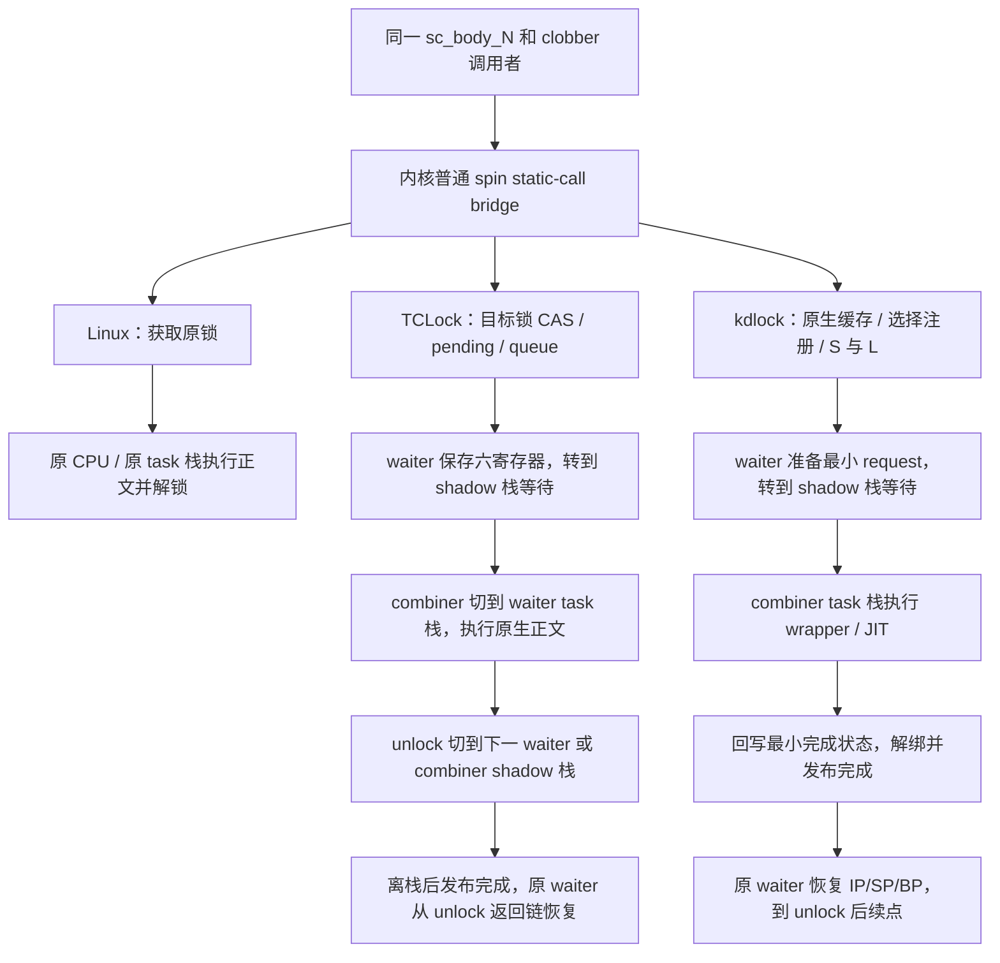

# spin_cacheline：kdlock、TCLock 与 Linux 的执行路径

本文按 **2026-09-19 当前工作树** 的实现维护，默认要求 `kdclobber2` 的
普通 spin caller-clobber v1 接口；旧调用者在同一内核上仍有兼容路径。
对照同一负载的 Linux 原生、完整 TCLock 原生栈委托、
kdlock JIT 三种后端，重点解释获取、排队、批次交接及现场保存/恢复。
伪代码合并低频错误分支，保留影响正常路径的状态访问和同步；函数名不表示
机器码必然保留一次 CALL。本文是源码说明，不是新的运行或采样结果。

范围为 x86_64 普通 IRQ-on task 入口、单锁 `sc_body_N`、全局计数器正文。
kdlock 按 `KDLOCK_SELFTEST=0 KDLOCK_NUMA=0 spin_native_cache=1 spin_prefetch=2`、
`bench_quiet=1 jit_timing=0` 展开。TCLock 保留 `WWJUMP`、`NUMA_AWARE` 和
六条 cacheline 预取，关闭 `KERNEL_SYNCSTRESS` 的调度等待分支；最近测量的
CPU 全在同一 NUMA 节点。两者批次参数均为 1024，实际批长不一定相同。

| 记号 | 含义 |
| --- | --- |
| `L` | workload 的原锁 `sc_lock`；Linux/kdlock 会话中由 Linux 原生协议管理 |
| `S` | kdlock 的 `gate->word`，只负责私有排队与调度；正文执行仍须持有 L |
| `Q` | TCLock 会话中的同一目标锁地址，由 TCLock 协议独占管理，无另一个 S |
| `IP/SP/BP` | 调用者 asm 的 CALL 后续地址、CALL 前 RSP、调用者 RBP |
| waiter | 提交请求的原线程及其 CPU；正文可能由另一个 CPU 代执行 |
| combiner | 在自己的 CPU 上持有物理互斥并服务多个 waiter 的线程 |
| 物理栈 / 逻辑栈 | CPU RSP 实际指向的栈 / JIT 模拟的原线程 RSP 所指向的栈 |

**TCLock 的委托执行是物理切换 RSP 后运行原生正文；kdlock 的普通 JIT 执行
保持 combiner 物理栈，只切换逻辑寄存器和栈。** 两者的原 waiter 都先离开
可被代理访问的 task 栈，等待完成后再回来；两者都不能在完成发布后继续使用
可复用的队列节点。



图中 TCLock/kdlock 展开的是排队后实际被代理的分支；CAS/pending 获取成功
以及批次末尾留下的 owner 均可能自己执行正文。源码入口：

| 环节 | kdlock | TCLock |
| --- | --- | --- |
| hook 分派、频率筛选与快路径 | [kd_lock.c](../../kernel_module/kd_lock.c)、[kd_spin_fast.h](../../include/kd_spin_fast.h) | [provider.c](../../tclock_backend/provider.c) |
| 获取、排队和等待 | [kd_spinlock.c](../../kernel_module/kd_spinlock.c)、[slowpath.inc](../../kernel_module/spin/slowpath.inc)、[wait.inc](../../kernel_module/spin/wait.inc) | [komb.c](../../tclock_backend/komb.c)：`komb_spin_lock` / `__komb_spin_lock_longjmp` |
| 批次与后继 | [combiner.inc](../../kernel_module/spin/combiner.inc)、[prefetch.inc](../../kernel_module/spin/prefetch.inc) | [komb.c](../../tclock_backend/komb.c)：`run_combiner` / `get_next_node` / `komb_spin_unlock` |
| 保存与恢复 | [wrapper.S](../../include/wrapper.S)、[kd_jit_batch.h](../../include/kd_jit_batch.h)、`kd_spin_restore_request` | [context.S](../../tclock_backend/context.S) |

阅读索引：[测量边界](#batch)、[调用入口与冷准备](#cold)、[无竞争路径](#native-fast)、
[kdlock 队列](#queue)、[TCLock 队列与 WWJUMP](#tclock-path)、
[现场保存/恢复](#jit)、[成本和性能对照](#tclock-cost-comparison)。

<a id="batch"></a>

## 1. 三方共用的负载与测量边界

对应 [client.c](client.c)、[module.c](../../workload_modules/spin_cacheline/module.c)、
[payload.h](../../workload_modules/spin_cacheline/payload.h) 和
[post_work.h](../../workload_modules/spin_cacheline/post_work.h)。

```text
主线程：创建 T 个 worker → 等待绑核/设置 comm/ready → 记录 wall_start → 放行
每个 worker：
    ioctl(SC_RUN, cachelines=N, iterations=I)       // 每线程每批一次 ioctl
        检查参数、整批准入
        repeat I 次：
            sc_body_N():
                spin_lock(sc_lock)
                对 N 个间距 64B 的计数器各做一次展开的读改写
                spin_unlock(sc_lock)
            sc_post_work()                       // 锁外四组依赖乘加
        归还批次引用，返回 completed
    记录 finished 与线程 CPU 时间
主线程：join → 核对全部 16 个槽 → 检查后端计数和排空
    wall_ns = max(finished) - wall_start
    ops/s = sum(completed) * 1e9 / wall_ns
```

锁内没有循环、时钟、syscall 或 helper；热循环不插入 sleep/yield。
完整操作包含获取、正文、解锁/恢复和锁外计算，`ns/op` 不是纯锁指令延迟。
代理批次不会替 waiter 执行 `sc_post_work`：它在原 waiter 恢复后执行；combiner
仍可持锁服务其他 waiter，所以锁外计算不保证相邻正文之间发生物理解锁。

当前三方运行器是 [run.py](../tclock_compare/run.py) 与
[session.py](../tclock_compare/session.py)。三方每场均先在一个 CPU 上预热 1 次，
随后连续准备 48000 次；kdlock 等待对应入口 NORMAL、生成物有效并停止 daemon/
translator，再开始 T 线程测量。准备、翻译、上传及共用 allocator guard 均在
计时外；单 CPU 准备不表示并发冷晋升停滞已修复。

TCLock 使用实际代理 unlock 与离栈完成数，kdlock 使用 wrapper 返回后的实际
正文 witness。`NORMAL` 只说明发布状态，不能代替 JIT 正文；TCLock 委托也不叫
JIT。具体数据、IRQ/preempt、正文和排空判定见[三方运行说明](../tclock_compare/README.md)。

<a id="cold"></a>

## 2. 调用者入口与 kdlock 冷准备

### 2.1 三方共用的 clobber 调用边界

[实验内核补丁](../../kernel_experiments/spin_clobber/guest-kernel.patch)把普通
`raw_spin_lock/unlock` 展开为内联 asm；`spin_lock/unlock` 经过相同边界。

```text
caller 编译器保存跨边界的活跃值
asm volatile:
    RDI = lock
    RSI = 当前 RSP
    RDX = 本段 asm 内 CALL 后的局部标签
    RCX = 当前 RBP
    CALL kd_raw_spin_lock_clobber_v1            // unlock 用对应的新符号
后续标签：caller 编译器重新装载需要的活跃值

内核 bridge：
    static_call(kd_clobber_lock_call)(lock, SP, IP, BP)
    Linux arm → __raw_spin_lock(lock)
    TCLock arm → tc_clobber_lock → tc_lock
    kdlock arm → kd_spin_dispatch_clobber_lock_v1
```

输入/输出约束与 clobber 覆盖除 RSP/RBP 外的 GPR，并有 `cc`、`memory` 和
`ASM_CALL_CONSTRAINT`。续点不是外层函数的 `_RET_IP_`；新 ABI 不解析编译器
序言。原生回退使用 `__raw_*`，不会重新进入宏。三方共用同一个 caller，因此
TCLock 也承担该 caller 的 spill 和函数级保存；它自己的六寄存器切栈协议仍在。

旧 `_raw_spin_lock` ABI、IRQ/BH/irqsave/trylock 不能据此使用精简包；普通 mutex 使用独立 ABI=2 和自己的终态检查。
旧请求与新请求按实际入口记录 `entry_abi`，翻译条目、生成物和 wrapper 校验
身份；两种 ABI 可以经过同一个 combiner C 循环，不能混用保存/恢复规则。

### 2.2 kdlock：CPU 频率、单锁频率通过后，才选择进程和注册

```text
kd_spin_dispatch_clobber_lock_v1(L, SP, IP, BP):
    if !kd_hotlock_record(L):                // CPU -> 单锁频率
        origin_raw_spin_lock(L); return
    result = kd_spin_fast_acquire(L, IP)      // 第 3 节：已发布站点的原生尝试
    if result == OWNED: return
    若缓存 miss 临时 pin 了 CPU：归还该 pin
    if !kd_spin_task_selected() or kd_spin_entry_native_active():
        origin_raw_spin_lock(L); return
    kd_exe_add_abi(0, IP, SPIN, CLOBBER_V1)
    kd_spin_lock_abi(L, SP, IP, BP, CLOBBER_V1)
```

[kd_hotlock.c](../../kernel_module/kd_hotlock.c) 的计数、起点和候选锁均在 per-CPU
对象中。首次起点之后每 10240 次读一次 TSC，同时检查 CPU 和 64 槽本地候选。
CPU 窗口折算为 400 亿 TSC；单锁本地 10000 次 / 不足 25 亿 TSC 才发布到全局
已晋升地址集合。未达标和正向缓存命中都不访问全局集合；本地过期重测，冲突
丢弃历史，其他 CPU 的冷样本不合并。全局约 1 MiB，每 CPU 约 1.6 KiB。

普通 spin/mutex 获取先供样后筛选进程，unlock 只按既有 owner/票据路由。
CPU 降温最多延迟 10239 次才关闭新准入，不影响在途释放和 owner ACK。
新 CPU 或正向缓存被逐出后需重新本地达标。单 CPU 准备不等于其他测量 CPU
也已晋升；不能把 JIT 比例下降导致的吞吐变化解释为代理加速。
[采样协议](../../docs/DESIGN.md#hotlock-monitoring) 记录完整近似边界。
此前性能表属于各自冻结版本，不代表本轮本地识别策略。

### 2.3 注册、翻译和准入是三个不同步骤

[registry_publish.inc](../../kernel_module/execution/registry_publish.inc) 中，
同 pid/IP/backend/ABI、代码指针存在且 source OPEN 的已有记录只读确认后返回。
miss/冲突等路径才进入全局 code gate、source pin 和来源模块查询。代码池在
模块初始化时预分配，不在每次锁操作里 `vmalloc`。

[daemon.c](../../daemon/daemon.c) 发现 UNINIT 条目后启动
[translator](../../disassem/disassem.py)，读取代码与符号、检查上下文、生成
`jit.S`，与 wrapper 汇编成 `jit.bin`，再通过设备发布 NORMAL。上传 mutex 在
控制面；稳态 benchmark 不把这些工作计作每次正文的开销。

精简入口另经 [entry_abi.py](../../disassem/entry_abi.py) 证明：除了 SP/BP，
未捕获的初始 GPR 不能影响地址、写入、控制流或锁参数；新 clobber 边界之后
不能沿用旧 callee-saved 事实。证明失败时拒绝翻译，不靠初始化垃圾寄存器
通过准入。运行时仍检查 source OPEN、条目身份/状态、frame 和 wrapper 身份。

TCLock 不经过这套热锁、注册表、daemon 和准入过程；其 provider 按目标锁
地址选择后端，非目标锁走 `__raw_*`。临界区是否适合借栈执行由实验范围约束，
没有 kdlock 的翻译筛查和受检 hostcall/native 续跑协议。

<a id="native-fast"></a>

## 3. 无竞争与轻竞争：谁自己执行正文

| 分支 | 获取成功后保留的状态 | unlock |
| --- | --- | --- |
| Linux 原生 | 原锁 L、原生 preempt 状态 | 原生释放 L 并归还 pin |
| TCLock CAS/pending | 目标锁 Q；provider 的 preempt pin | `komb_spin_unlock` 普通分支清 locked，`tc_unlock` 归还 pin |
| kdlock 缓存命中 | 实际 trylock 得到 L，per-CPU `fast.held/owner`；没有 S hold/ticket/request | `kd_spin_fast_unlock` 释放 L，清 hold 并归还 pin |
| kdlock root 首次 CAS S 成功 | S 加实际 L，per-CPU `fast.hold` 保存 gate/owner/generation；没有 ticket/request | 校验 hold 后先释放 L，再释放 S.locked，清 hold 并归还 pin |
| kdlock pending 或 queue head 获取 | S/L 和本次 ticket；未代理队头正常返回时归还 request | 按 ticket/gate 释放 L/S，结束 ticket/pin |

三方在这些分支都由原 CPU 自己执行原生正文；有请求或有已发布 JIT 不代表
这次操作一定代理。

### 3.1 kdlock 的可选原生站点缓存

```text
kd_spin_fast_acquire(L, IP):
    缓存开启，且满足无额外 preempt/migration pin 等条件
    preempt_disable()
    if cached_origin/IP 匹配 and 整个 S 为 0 and source OPEN:
        if do_raw_spin_trylock(L) 成功:
            记录 fast.held=L、owner=current；返回 OWNED
    返回 MISS_PINNED，由冷 helper 归还 pin
```

这是实际获取原锁的缓存，不是“看到 L 空闲就认为已获得锁”。S 空闲只是提示，
并发 combiner 也必须获取 L。缓存键可跨操作存活，物理 hold 只属于当前操作；
二者独立。缓存命中绕过本次 target/热锁/注册/gate 查找，但仍检查 OPEN 和 S。
新键只在 root、NORMAL/source OPEN 等条件下记住；相同键不重复查询注册表。
默认保留 `spin_native_cache=1`，不是上次关缓存试验的版本。

### 3.2 缓存未完成获取后的 root CAS

```text
kd_spin_lock_abi(L, SP, IP, BP, abi):
    检查 task/上下文；preempt_disable()
    gate = kd_spin_gate_get(L)
    不适用或无 gate：归还 pin，原生获取 L
    root 且缓存启用时记住合格的新键
    if root and cmpxchg_acquire(S, 0, LOCKED) 成功:
        kd_spin_fast_claim(gate)               // 保留 owner/代次，真正获取 L
        成功则返回；失败按原回退处理
    用同一 gate 和已有 pin 创建 ticket          // 竞争后才准备
    非 root：先建 ticket，再 CAS S
    若可走 pending：等待旧 owner，取 S 后 claim L，返回
    否则进入队列
```

TCLock 的顺序也是先 CAS Q，再 pending，最后准备队列/切栈；但它只管理 Q。
kdlock 已把 ticket/request 推迟到竞争后，入口前面的选择、注册和 gate 仍是
额外工作。Linux 原生 peer 只认识 L，因此取得 S 不能替代取得 L。

<a id="queue"></a>

## 4. 竞争、批次交接与原线程继续执行

### 4.1 kdlock：ticket 与原锁所有权

[kd_spin_entry.c](../../kernel_module/kd_spin_entry.c) 复用已有 gate/pin，在每 CPU
32 个 ticket 槽中检查活跃占用、同任务重复锁及 sequence；在 ticket guard 下
发布 task/L/gate/代次和 WAITING。容量不足不发布代理请求，按原生回退处理。
gate 已有项只读查找，创建仍在全局锁内复查和 release 发布。

```text
claim_origin(ticket):
    guard 下检查代次、任务、CPU 和状态
    已 OWNED：直接成功
    否则 WAITING → CLAIMING
    gate_claim：确认物理 owner，真正获取 Linux L，记录 generation/hold
    guard 下 CLAIMING → OWNED
```

pending、队列调度字操作和普通 unlock 复用该 gate，不每次重查 map。
稳定指针不授予 L 所有权；source lease、ticket pin 和 request 用户引用各有
不同寿命，不能相互代替。

### 4.2 发布请求、等待和恢复入口

[slowpath.inc](../../kernel_module/spin/slowpath.inc) 在 task 栈准备请求，
[wait.inc](../../kernel_module/spin/wait.inc) 只负责物理等待栈切换和发布/轮询。

```text
kd_spin_lock_slowpath：保存原 IRQ flags，关闭本 CPU IRQ
    从本 CPU 的四个 node 槽中领一个
    从十二个预分配 request 槽中 acquire 读取 users=0，置 users=1
    node.execution = request
    regs_ref = &request.frame.regs
    保存 IP/SP/BP、GS/task、origin ticket、原 IRQ flags
    frame.entry_abi = CLOBBER_V1；packet_state = MINIMAL
    native_regs_decoded = true                 // 表示准备完毕，新 ABI 没有解码旧序言
    初始化必要 frame/请求标志，不清零或捕获整个寄存器包
    prepare_prefetch(node, regs_ref)           // 第 5.4 节

入队：
    old_tail = xchg_tail(S, node.tail)
    request.diag = waiter_enter(L)             // 查 slot、原子加实时 waiter 数
    if 存在前驱：
        连续 asm：保存旧 C RSP → 换到本 CPU 8KB shadow 栈
        shadow 栈保存一个旧 C RSP
        发布 previous.next = node
        PAUSE 轮询 node.locked                 // 不调用 C、不触碰旧 task 栈
        若完成/native 唤醒：放弃旧 C 帧，进入安全恢复栈上的处理
        若仅队头唤醒：取回旧 C RSP，继续获取 S/L
    否则/成为队头后：等待 S 的 locked/pending 清除
    仅自己在队尾：CAS S 后 claim L，正常返回，由自己执行正文
    有后继：claim L，准备 combiner，进入 4.3
```

顺序上 **tail 交换先发生，真正允许前驱执行本请求的 `previous.next` 发布在
切离 task 栈之后**。不能把“先切栈再发布”误写为所有 tail 操作都在 shadow
栈上。首次 combiner 若从 tail 看见已有后继、但 next 尚未发布，会等到链接
可见；不能据此过早原生交接。

物理 waiter 的等待汇编只使用 shadow 栈，IRQ 仍关闭；node 耗尽/request 池满
时有获取 S 的回退，不动态分配。虚拟/嵌套 waiter 继续使用执行者 C 栈和既有
remote/owner 服务，不套用这段物理轮询汇编。

### 4.3 kdlock：一个 C 循环服务多个请求

```text
run_combiner(L, first_follower, ticket):         // 已持有 S/L
    next = linked_successor(S, first_follower)
    if 没有可留作 owner 的后继、IRQ 特殊节点或 source lease 失败：
        S.locked = LOCKED；只唤醒 first_follower 的队头资格；返回
    取得一次 source/provider batch lease
    batch.diag = 解析一次诊断 slot
    进入 kd_spin_batch_run，在同一个 C 栈帧内：
        选择 curr 及 next；预取 next 的已准备提示
        lookup 当前 exe 身份，可复用批内同 entry/SPIN 槽
        普通准入：最终 prepare 检查 OPEN/NORMAL、ABI/镜像、原始 root/包状态
        bind request.frame；标记 executed
        compiler-clobber asm 调用对应 wrapper
        if 精确正常完成：
            检查分类/witness；retire_single_spin 合并终态验证与物理解绑
        else：
            物化必要复杂状态，execute_cs 消费已返回出口；不重放前缀
        if 未执行的拒绝/失败：将 curr 留作 owner，结束本批
        if 非 NATIVE_DONE：release 发布 curr.completed=1、locked=0
        此后不再读取 curr node
        若 outer 已提前释放：按原协议 reclaim，结束本批
        若后继不足或到达 batch 上限：结束本批
        否则下一请求仍回到这个 C 循环
    S.locked = LOCKED；唤醒留下的后继队头
    归还 batch lease
    返回 combiner 自己原先的 lock 调用
```

普通生产 root 完成走 `kd_exec_frame_retire_single_spin`，检查物理
owner/top/depth、batch lease、非 complex 及原有终态；不是旧的逐项
`complete → pop` 重复检查。SELFTEST 为观察 ledger 保留 complete/observe/pop。
绑定仍检查 source OPEN；批内缓存仅缓存槽身份，没有缓存准入结果或代码版本。

**普通批次一直持有 L。** waiter 的逻辑 unlock 只产生完成结果，不释放 L。
combiner 服务完 follower 后，自己再执行一次原生正文，按 hold/ticket 释放
L、S 并归还 pin。提前唤醒的下任 owner 仍须等 S/L，不能立即并行访问正文。
正常启动批次需一个可代理 follower 加一个后继 owner；1024 是限制参数，
不是实际批长保证。当前普通循环没有 TCLock 同样的 `need_resched()` 退出条件。

<a id="tclock-path"></a>

### 4.4 TCLock：先保存原生续点，再在 shadow 栈排队

`tc_lock` 对目标锁执行 `preempt_disable()`，然后调用 `komb_spin_lock(Q)`。
非目标锁回退 Linux。CAS/pending 失败后的普通 task 分支如下：
该分支要求本 CPU 没有占用中的 node、IRQ 开启且没有 migration-disable；
其他上下文走源码中的特殊节点路径，不在本次单锁展开范围内。

```text
komb_spin_lock_slowpath（context.S，在原 waiter task 栈上）：
    push RBP, RBX, R12, R13, R14, R15
    R12 暂存 lock，跨普通 C helper 调用保留
    node[0].rsp = 当前 RSP                     // 指向六寄存器保存区
    RSP = 本 CPU local_shadow_stack_ptr
    CALL __komb_spin_lock_slowpath(Q)          // C 慢路径和等待都在 shadow 栈
        初始化 node 的 next/locked/completed/CPU/NUMA/lock/task 等
        old_tail = xchg_tail(Q, node.tail)
        若有前驱：链接 previous.next，轮询 node.locked
        若 completed：归还 node 占用并返回
        否则作为队头等待 Q.locked/pending
        唯一队尾成功获取：归还 node 占用并返回
        否则取得 combiner 状态，服务 follower（4.5）
    保存 shadow RSP；RSP = node[0].rsp
    pop R15, R14, R13, R12, RBX, RBP
    RET
```

最后的 RET 去向取决于 `node.rsp` 是否已被代理 unlock 更新：

- 没有代理正文：仍指向 lock 入口保存区，返回 lock 后自己执行正文。
- 已代理完成：已指向 unlock 内的保存区，从 unlock 返回链继续，跳过已执行正文。

节点本身不放 `pt_regs`。寄存器与 CALL 返回地址留在原生栈中，`rsp` 是续点
存储的地址；它在 lock 时写入，在代理 unlock 时改为另一处保存区。
本移植固定保留六寄存器协议，没有改为 kdlock 的三个逻辑字段。

### 4.5 TCLock：WWJUMP 从当前 unlock 直接接下一 lock

以下是当前 `WWJUMP=1` 的分支，而不是 `#ifndef WWJUMP` 的逐次返回循环。

```text
run_combiner(Q, W1)：                         // 在 combiner 自己的 shadow 栈
    若 follower/后继不足或 IRQ 特殊节点：只交接队头资格
    建立 curr_cs_cpu、counter、lock_addr 等 per-CPU 状态
    execute_cs(Q, W1):
        komb_context_switch(&W1.rsp, &combiner.shadow_rsp)
            在当前栈保存六寄存器和 CALL 续点，记到 outgoing_rsp
            RSP = *incoming_rsp；恢复六寄存器；RET

combiner CPU 现在在 W1 的 task 栈：
    RET 抵达 W1 的 komb_spin_lock_slowpath 返回链
    komb_spin_lock 的 WWJUMP 部分：
        get_next_node(W1)，保存 next_node_ptr，预取后继原生栈
        若有上一已离栈 waiter：发布上一 waiter 完成
    返回 caller，执行 W1 的原生临界区
    进入 W1 的 komb_spin_unlock(Q)：
        确认当前代理锁；tc_delegated++
        if 后继/其后继不足、IRQ、counter 达上限或 need_resched()：
            incoming_rsp = combiner.shadow_rsp
        else：
            incoming_rsp = W2.rsp；更新 curr/prev CPU 与 counter
        komb_context_switch(incoming_rsp, &W1.rsp)
            在 W1 栈保存六寄存器及 unlock 的 CALL 后续点
            记住 W1 新 rsp，然后切到 W2 lock 续点或 combiner shadow 栈

若切到 W2：W2 的 lock 返回链发布 W1 完成，然后执行 W2 正文
若返回 combiner：run_combiner 发布最后一个 waiter 完成
    拼回 NUMA 暂存队列，交接下一 owner，恢复自身获取过程
    combiner 回自己 task 栈，执行自己的原生正文并解锁 Q
```

这条路径中，相邻代理正文之间不用回到外层 `run_combiner`；选择后继、结束
条件和切栈调用在原生 lock/unlock 代码中执行。kdlock 的连续处理则每次回到
同一个 `kd_spin_batch_run` C 循环；wrapper 内没有队列调度器。

TCLock 的 `get_next_node` 按 NUMA 选择/暂存后继；符合预取分支时读取
`per_cpu(komb_nodes[0], next->cpuid).rsp`，预取从该 RSP 起的六条 64B 行，并预取
后继节点。它也有 node→CPU→per-CPU RSP 的读取，不是完全没有依赖访问。
当前实测同 NUMA，不能把保留 NUMA 代码等同于已验证跨 NUMA 收益。

### 4.6 完成发布：为什么必须先离开 waiter 栈

以 W1 → W2 为例，所有“代理侧”步骤都在 combiner 的 CPU 上发生：

| 时刻 | TCLock | kdlock clobber |
| --- | --- | --- |
| W1 等待 | W1 CPU 在其 shadow 栈运行等待 C 代码 | W1 CPU 在其 shadow 栈的连续 asm 中轮询，IRQ-off |
| 执行 W1 正文 | combiner 的 RSP 真正指向 W1 task 栈 | combiner 的 RSP 在自己 task 栈；JIT 以虚拟 SP 访问 W1 栈 |
| W1 到 unlock | 原生 unlock 保存六寄存器和返回链到 W1 栈 | wrapper 核对精确 unlock 边界，写回 IP/SP/BP 和 COMPLETE |
| 停止访问 W1 执行状态 | `komb_context_switch` 已切到 W2 或 combiner shadow 栈 | wrapper 已返回，frame 终态验证及物理解绑已完成 |
| 发布 W1 完成 | 新栈上 `clear_locked_set_completed(W1)`，release store | 锁侧 C 循环 release store 完成标记 |
| W1 CPU 恢复 | shadow C 返回后加载更新的 W1.rsp，恢复六寄存器，从 unlock 返回链继续 | 放弃旧 C 帧，结束 ticket，直接从共享 request 恢复三个字段和原 IRQ flags |
| W2 执行 | 接 W2 的 lock 原生返回链 | 校验/bind W2 frame，调用 W2 wrapper |

TCLock 的 `tc_completed` 在离栈完成发布时增加，排空后须与 `tc_delegated`
相等。若在还用 W1 栈时就唤醒 W1，两个 CPU 会同时使用它；因此不能把完成
发布随意前移到 unlock 刚入口。kdlock 虽不物理借栈，JIT 仍可能改写 W1 的
逻辑栈，故也不能让原 waiter 沿已被覆盖的旧 C 返回链继续。

<a id="jit"></a>

## 5. 现场到底保存在什么地方

### 5.1 三种需要区分的状态

| 状态 | kdlock | TCLock |
| --- | --- | --- |
| 原线程跨调用的活跃值 | clobber caller 编译器按需保存，跨 lock/unlock 后重新装载 | 同一 benchmark caller 做相同工作；后端内部还遵守普通 C ABI |
| 委托请求的继续执行位置 | request 中唯一的 frame/regs；新普通入口只初始化 IP/SP/BP | waiter 原生栈上的六寄存器和 CALL 返回地址，node.rsp 定位 |
| 物理 combiner 的继续执行位置 | resident C 循环的编译器现场、wrapper 物理栈帧；复杂控制另有独立 owner 状态 | combiner shadow 栈上的 C 帧和 `komb_context_switch` 保存区 |

这些是不同线程/执行者的状态，不能因为都叫“现场”就合并成一份。kdlock
已经共用逻辑请求和寄存器 backing；物理 owner/combiner 必须同时存活的状态
仍独立。TCLock 没有 `pt_regs` 包，但并非没有保存：其保存区就是原生栈。

### 5.2 kdlock wrapper：精简入口与完整中间出口

[wrapper.S](../../include/wrapper.S) 的目录保留三种入口：

| 偏移 | 调用契约 | 物理 combiner 保存 | 逻辑 waiter 输入 |
| --- | --- | --- | --- |
| 0 | 普通 C ABI 的旧入口 | wrapper 保存/恢复 RBP、RBX、R12–R15 | FULL 逻辑寄存器包 |
| 16 | `KDWB001` 旧 ABI 批次入口 | 编译器负责活跃 GPR；内联适配另保护 RBP | FULL 包，仍导入 CPU 中执行的逻辑值 |
| 32 | `KDWC001` clobber v1 入口 | 编译器负责活跃 GPR；wrapper 只保护 RBP、建立必要栈帧 | MINIMAL 包：IP/SP/BP、GS/task 和出口元数据 |

两个批次入口都不是可直接当普通 C 函数调用的符号；必须使用
[kd_jit_batch.h](../../include/kd_jit_batch.h) 的 asm clobber 边界。编译器仍可能
在函数序言保存 callee-saved，或在调用附近 spill 活跃局部值；“删除手写成组
保护”不等于“机器码中没有 push/pop”。

```text
clobber wrapper 入口：
    核对 entry ABI 和 MINIMAL 状态
    保护物理 RBP，建立 wrapper 栈帧，保留控制/暂存槽
    R11 = regs backing 基址
    R12 = 逻辑 BP；R13 = 逻辑 SP
    args[0/1] 的 GS/task 存入控制槽；witness = 0
    进入对应生成正文；不导入整包 GPR

到达精确正常 outer unlock：
    要求普通 root 的 complete 资格
    核对 exit、unlock 符号和锁地址
    核对 unlock 元数据：RSI = 虚拟 CALL 栈顶 + 8
                       RCX = 逻辑 BP
                       RDX = 虚拟 CALL 栈上的返回地址
    regs.ip = unlock 后续点；regs.sp = 调用后 SP；regs.bp = 逻辑 BP
    packet_state = COMPLETE
    args[0] = KD_EXE_CLOBBER_COMPLETE；args[1] = witness
    恢复物理 RBP/RSP，返回锁侧 C 循环
```

两元素 `args` 仍用于输入 GS/task、输出分类/witness；batch 元数据是独立描述
指针，没有把 args 扩成第三个元素。`PT_GS/PT_TASK` 名称指向 args，不是向
`pt_regs` 增加字段。物理 GS/current 并不随 wrapper 切换；受支持的 GS/task
语义通过生成代码和逻辑元数据实现。

| 新 ABI 请求状态 | 允许读取/恢复什么 | 后续处理 |
| --- | --- | --- |
| MINIMAL，尚未执行 | IP/SP/BP 与必要元数据；其他初始 GPR 未定义 | 不准入时原生获取后回 lock 续点；wrapper 入口拒绝须证明零正文、原 IP/SP 和专用分类 |
| COMPLETE，正常最终 unlock | unlock 后续 IP、调用后 SP、逻辑 BP | 锁侧校验/解绑/完成发布；原 waiter 恢复最小状态 |
| FULL，已执行的中间出口 | 当前所有有效逻辑 GPR、虚拟 IP/SP/BP | 消费 hostcall/nested/native/续跑协议，不能从入口重放 |
| legacy | 保留已有完整入口和恢复契约 | 即使使用偏移 16 的精简最终写回，也不能冒充新 ABI COMPLETE |

中间出口要在进入 C 处理前 spill 仍在 CPU 中的逻辑值，已有 backing 值不需
再次搬运。这里的 FULL 是受支持的逻辑 GPR 包，**不表示完整硬件上下文**：
当前 wrapper 不回写 live RFLAGS，物理 waiter 的 IRQ flags 另存另恢复；不能
据此声称任意 flags-live 指令边界都可安全续跑。

### 5.3 `PT_*` 与 `Stack_*` 已经共用的部分

定义见 [asm_head.h](../../include/asm_head.h)。历史 `Stack_*` 名称不一定表示
combiner 栈地址；下列寄存器 backing 已直接指向同一 request 包：

| 逻辑状态 | 共享位置 | JIT 执行时的物理职责 |
| --- | --- | --- |
| R11 | `Stack_R11` 与 `PT_R11` 对应同一 regs 字段 | 物理 R11 固定为包基址，逻辑 R11 需虚拟化 |
| R12–R15 | `Stack_R12`…`Stack_R15` 与对应 PT 字段共享 | 物理 R12/R13 保持逻辑 BP/SP；R14/R15 作生成器临时状态 |
| BP/SP | `Stack_RBP/Stack_RSP` 与 PT 字段共享 | CPU 中的 R12/R13 如已更新，出口仍须写回有效值 |
| 其他 CPU 驻留逻辑 GPR | 对应 PT 字段在 spill/完整出口时更新 | 新普通入口不先加载未捕获值；正文定义后按需使用 |
| GS/task、出口分类、witness、block budget、batch 指针 | wrapper 独立控制槽 | 是执行控制信息，不可与任意逻辑 GPR 覆盖复用 |

因此普通新路径没有“入口整包捕获 → 复制到 Stack 槽 → 出口复制回 PT → 最终
整包恢复”。入口快照与正文中逐步产生的 backing 值也不是同一有效性状态；
不能因存储共用就在 MINIMAL 阶段读取尚未定义的字段。

当前布局为 node **128B/64B 对齐**、request **768B/64B 对齐**、frame **672B**。
node 首行放链接与执行/预取元数据，通知字节 completed/locked 位于 64/65，
数组步长保证四个槽的通知行互不重叠；gate 则为 **64B/64B 对齐**，隔离不同锁。
request 的 frame 从偏移 24 开始，frame 热头部为 72B，内嵌 regs 从 request
偏移 96 开始；普通标志与 ABI/包分类集中在前两条缓存行。每 CPU 十二个
request 共 9216B，与四个可复用 node 独立；对象预分配，没有逐请求整包清零。
数组/remote/control 冷区由首次复杂出口启用，不表示总对象变小。

### 5.4 预取提示与权威状态分开

```text
producer，仍独占 request：
    node.prefetch_regs = 当前实际 regs 指针
    node.prefetch_full / prefetch_complex = 当前分类提示
    SP 在保留的 logical_task 栈范围内才记录 node.prefetch_sp
    普通请求直接传内嵌包；虚拟请求传仍被引用的父包

combiner，执行当前正文之前：
    只读 next node 的 execution / prefetch_regs / SP / 标志
    预热 next request 前两条元数据行
    按 FULL/MINIMAL 提示预热寄存器，必要时预热复杂 ledger
    预热受检 SP 和一个 push 槽
    不为决定预取地址再加载 next frame、task 或 regs 内容
```

`spin_prefetch=0/1/2` 分别为关闭后继预取、consumer 查地址、producer 提示。
这是只读装载参数；不关闭其他既有队列返回栈预取。提示在排队期间不变，只作
缓存预热，不参与准入/恢复，也不增加引用或覆盖真实 SP。node 回收或 outer
提前释放后不得跟随旧提示。TCLock 则围绕真实原生保存栈预取，无 frame/包
分类；kdlock 的请求/包布局不同，不能机械复制六条原生栈预取。

### 5.5 TCLock 六寄存器保存区与恢复链

[context.S](../../tclock_backend/context.S) 中 `komb_context_switch(in, out)`
的核心动作是：

```text
CALL 已将返回地址压入当前栈
push rbp; push rbx; push r12; push r13; push r14; push r15
*out = rsp
rsp = *in
pop r15; pop r14; pop r13; pop r12; pop rbx; pop rbp
RET 到新栈中原先保存的 CALL 后续点
```

从保存的 RSP 向高地址依次为 **R15、R14、R13、R12、RBX、RBP、返回地址**。
RIP 通过 CALL/RET 链保留，不作为独立字段装入节点；caller-saved 活跃值由
普通 C 调用者编译器处理。实际调用链还可能有编译器序言保存，不能把所有成本
简化成“每次操作恰好六 push 六 pop”。

一个被代理的 waiter 有两个续点：lock 时的保存区让 combiner 进入其原生正文；
unlock 时的新保存区让原 waiter 跳过正文继续返回。combiner 自己的续点在
shadow 栈，只有批次结束或特定控制路径才回到那里。原 waiter 的
`tc_unlock → preempt_enable()` 在它恢复自己的 unlock 返回链后执行，不能在
代理 CPU 上提前归还另一个物理 waiter 的 pin。

切换 RSP 不切换 CPU、Linux `current`、GS 或 per-CPU 身份。当前实验正文只
访问全局计数器；不能据此将 TCLock 描述为任意 task/per-CPU 临界区的透明
替换。其普通等待为纯轮询，但与 kdlock 的 IRQ-off 连续汇编等待不是同一机制。

### 5.6 kdlock 原 waiter 的最终恢复与中途续跑

正常完成后，等待汇编将恢复 C 栈放到原保存 RSP 和最终逻辑 SP 的较低处，
向下对齐；它不再沿原先的 hook/queue C 返回链展开。

```text
kd_spin_resume_completed / kd_spin_resume_waiter：
    归还 node 计数，复用 request.diag 原子减少实时 waiter 数
    取出仍存活的 request、原 IRQ flags 和 origin ticket
    正常完成：entry_end，结束 ticket/pin
    native 后缀：mark_native，保留必要所有权和 ACK 关系
    之后不再读取旧 node 或 per-CPU 槽

kd_spin_restore_request，新 ABI MINIMAL/COMPLETE：
    RSP = regs.sp；把目标 IP 和原 IRQ flags 放到返回栈
    RBP = regs.bp
    所有包读取结束后归还 request user
        pristine 单锁：release store users=0
        共享/复杂：原子递减，保留其他使用者
    恢复 IRQ flags；RET 到目标后续点
    caller 编译器重新加载自己的活跃值
```

FULL/legacy 走对应完整 GPR 恢复。IRQ 状态属于原物理 waiter，不把 combiner
当前 IF 当作另一个 CPU 的恢复状态。完成后的 node 可复用，也不等于 request
可释放；request 必须存活到最后一次读取与必要 owner/ACK 结束。

hostcall、嵌套锁、native 后缀或其他已执行出口由
`kd_exe_spin_batch_resume`/通用 dispatcher 先消费当前 FULL 出口，再服务或续跑。
它不能先重新调用 wrapper 重跑前缀。提前 outer unlock 的 owner 回调、后续
reclaim、source/remote ACK 沿原协议处理；本单锁 benchmark 不测这些分支的成本。

<a id="costs"></a>

## 6. 按执行阶段对比成本

<a id="tclock-cost-comparison"></a>

### 6.1 TCLock 与 kdlock 的对应步骤

| 阶段 | TCLock 原生委托 | 当前 kdlock clobber | 成本含义 |
| --- | --- | --- | --- |
| 目标获取入口 | 锁地址匹配，preempt pin，Q 的 CAS/pending | 可选原生缓存；miss 后选择、晋升/注册、gate、S CAS，竞争后 ticket | kdlock 在真正排队前有更多元数据工作；缓存命中可绕过多数步骤 |
| 物理互斥 | Q 的单套协议 | 私有 S 加真实 Linux L | L 保留原生 peer 排斥；普通批次内不会每个正文重新获取 L |
| 请求保存 | 六寄存器与 CALL 续点在原生栈，node 记 RSP | 编译器保存活跃值，request 只捕获 IP/SP/BP 及元数据 | 显式保存集合更小，但 compiler spill、请求准备和生命周期仍有成本 |
| 等待 | 原线程在 per-CPU shadow 栈轮询 | 原线程在 IRQ-off shadow 汇编中轮询 | 两者均腾出可被代理使用的原栈；等待采样高不等于 PAUSE 本身昂贵 |
| 后继预取 | 从后继 CPU 的 node-zero RSP 预热六条原生栈行 | 从 node 提示预热 request 头、逻辑包与受检 SP/push 槽 | kdlock 已删除 consumer 为选地址而追读 frame/task/regs 的链，producer 准备仍有成本 |
| 正文入口 | 物理切栈，沿 lock 原生返回链进入正文 | prepare/bind、版本化 wrapper、JIT 入口和地址/寄存器重写 | TCLock 没有翻译状态与 frame 准入；kdlock 不需要逐 waiter 物理切栈 |
| 正文出口 | 原生 unlock 选择后继，保存续点并切栈 | wrapper 验证精确 unlock，写三个字段，返回锁侧循环 | 两者均持物理互斥跨多个正文；出口验证和恢复表示不同 |
| 连续执行 | WWJUMP：当前 unlock 直接切到下一 lock 返回链 | 同一个 C 栈帧：retire、发布、下一 prepare/bind | kdlock 已去掉旧外层 callback/shell 往返，但逐请求管理仍在 |
| 完成发布 | 离开借用栈后 release 通知 | wrapper 返回、终态检查和解绑后 release 通知 | 都必须先结束代理对当前执行状态的使用 |
| 原线程恢复 | 六寄存器恢复到原生 unlock 返回链 | 结束 ticket，恢复最小三字段/IRQ，最后归还 request | kdlock 请求存活与 node 复用分开；复杂路径另有 owner/ACK |
| 批次结束 | 后继/IRQ/上限/need_resched 等 | 后继/上限/准入结果/outer release 等 | 参数相同不意味着批长、代理比例或调度行为相同 |
| 观察计数 | 直接 per-CPU batches/delegated/completed | per-CPU 事件和正文观察，加共享实时 waiter_count、禁用 latch | 身份复用和计数行分离已实现，实时共享原子更新尚在 |

TCLock 的 `need_resched()` 在此用于结束代理批次，不表示本移植会在 shadow
等待循环中调用 `schedule()`。普通 kdlock 循环没有同一终止条件；吞吐差距
包含批次策略，不能只用寄存器保存条数解释。

### 6.2 哪些成本可以摊销，哪些仍逐请求发生

| 频率 | kdlock 当前工作 | 与 TCLock 的差别 |
| --- | --- | --- |
| 会话初始化/首次准备 | 分配池、hotlock 采样、首次注册/source pin、翻译上传 | TC 分配 shadow 状态并安装目标 hook，无翻译；这些不在稳态计时内 |
| 每次已晋升慢入口 | 已注册条目只读确认、gate/上下文检查；非缓存 fast 获取仍需真实 L | TC 直接围绕目标 Q；不能把注册确认误算成每次编译或全局写锁 |
| 每个排队请求 | ticket guard、node/request 准备、SLOWPATH 与 waiter-enter 诊断解析、实时 waiter 数增减 | TC 使用 node/原生栈；KD 退出复用 slot，未删除入口所有解析 |
| 每个 combiner 批次 | 一次 source/provider lease、一次 batch 诊断身份解析；物理 L 跨批内正文保留 | TC 保留 combiner shadow 续点，无 kdlock source lease |
| 每个被代理正文 | 最终 readiness/ABI/frame 准入、bind、wrapper、终态解绑/发布；必要时实际 JIT 观察 | TC 运行原生 lock/unlock 续链、切栈及完成观察 |
| 每个返回线程 | 原子 waiter 数减；结束 ticket/pin；读取并归还 request；恢复续点 | TC 恢复已保存的原生 unlock 链，归还自己的 preempt pin |
| 中途控制出口 | FULL 物化、dispatcher、服务/嵌套/native/ACK | 不属于当前 TC 单锁计数器对照，不能当作正常 KD 每次必经成本 |

诊断 slot 为 128B，身份/禁用与 waiter_count 位于不同缓存行；slot 在受控排空
前不回收。batch/request 缓存其身份，禁用仍逐次 acquire 读取，waiter 数仍实时
原子更新。不能把它们当纯日志直接删除，也不能说布局分行已经消除了共享 RMW。

此前布局审计发现 KD 的 `next=0` 与 `locked=33` 共行、40B gate 项跨锁共行。
[隔离修复](results/20260919-cacheline-isolation.md)已把 node 通知移到独立第二行、
node 步长扩为 128B，并把每个 gate 对齐为 64B。TC 常用 node 0 的 `next=0`、
`locked=69` 分行，但其 120B 数组步长不能保证相邻 node 互不共行。
768B request 池和上述诊断 slot 也已隔离相邻项。
source 状态与 frame 计数实际分行；frame 计数和 waiter_count 的共享 RMW 属于
真共享。旧布局的字段偏移与访问角色见
[修复前审计](../tclock_compare/results/20260919-thread-scaling.md#false-sharing)；
新旧布局 A/B 不等于分别量化 node 和 gate 的收益，也没有测跨锁 gate 吞吐。

`PT/Stack` 共用减少搬运；R11 包基址和内存 block budget、生成器虚拟栈操作、
caller spill 仍可能抵消一部分收益。预分配减少分配成本，但对齐 request 增大
总空间；缓存复用减少查找，但不能跳过可变 readiness/source 检查。
完整操作实测才回答这些取舍的净效果。

### 6.3 当前结果与历史热点分开看

最新 [node/gate 隔离对照](results/20260919-cacheline-isolation.md)交替重跑旧、新
两臂，40 场均正确排空。20 线程、1/16 cacheline 的新版本为 3.208/3.109 Mops/s，
比同场旧版本高 6.55%/7.56%，JIT 约 99.7%；4 线程下降 6.49%/5.91%。
增加访问行数有成本，不能承诺普遍提速。该轮没有重测 TCLock/Linux，下面完整
三方表属于隔离前基线，不能与新 kdlock 混用。

[2026-09-19 五档线程复测](../tclock_compare/results/20260919-thread-scaling.md)中，
三方共用 clobber caller，每配置交替五次取中位数；单位 Mops/s。完整结果页
另含单线程、五轮范围和布局审计；以下只列竞争档位：

| cacheline | 线程 | Linux | TCLock | kdlock | TC 委托 | KD JIT |
| --- | --- | --- | --- | --- | --- | --- |
| 1 | 4 | 2.925 | 1.652 | 0.875 | 48.50% | 53.61% |
| 1 | 8 | 3.076 | 2.023 | 1.879 | 66.78% | 91.62% |
| 1 | 16 | 3.137 | 2.319 | 2.938 | 76.25% | 99.56% |
| 1 | 20 | 3.030 | 2.770 | 2.990 | 94.22% | 99.75% |
| 16 | 4 | 1.906 | 1.202 | 0.863 | 45.69% | 52.23% |
| 16 | 8 | 1.745 | 1.492 | 1.917 | 59.12% | 92.52% |
| 16 | 16 | 1.758 | 1.855 | 2.893 | 97.06% | 99.62% |
| 16 | 20 | 1.794 | 1.518 | 2.894 | 53.98% | 99.80% |

150 场全部正确排空。16/20 线程的 kdlock JIT 超过 99%；1 cacheline 仍略低于
Linux，16 cacheline 则高约 65%/61%。4 线程明显落后；8 线程的两个正文规模
已呈现不同净收益。TC 的批长与委托比例波动仍大，不能把不同批次策略当成
单项保存/恢复的因果实验。

[此前同日独立长批次](../tclock_compare/results/20260919-state-access.md#单线程长批次)
中，KD 比 Linux 多约 8 ns、比 TC 少约 7–8 ns；均未代理，反映完整无竞争
操作而非 JIT/wrapper 成本。这 30 场是历史证据，本轮没有重测长单线程。

[预取四路对照](results/20260918-prefetch.md)和
[状态访问五阶段对照](results/20260918-state-access.md)分别冻结输入，提供
改造前后证据，不与本轮 TC 样本拼接。
[更早的三方采样](../tclock_compare/results/20260918-native-stack.md#为什么当前-kdlock-仍慢)
发现诊断共享行和后继元数据读取热点；这些机制随后已修改，原采样百分比不能
作为当前占比。大量 worker 的等待样本还会放大分母，不能由“JIT 映像占比小”
直接推导 wrapper 串行服务开销可忽略。

本轮四十场多线程 kdlock 的日志显示：4 线程平均每批约 2 个 JIT 正文，8 线程
约 12–14 个，16 线程约 337/348 个，20 线程约 572/689 个（后两项分别为
1/16 cacheline，逐场平均后取五轮中位数）。目标锁均已晋升且
`jit_not_ready=0`，因此不是简单的翻译准备不足。短批次更频繁承担交接成本，
但未分别计数结束原因，不能据此断言单一瓶颈。公式、计数等式及限制见
[日志复算](../tclock_compare/results/20260919-thread-scaling.md#batch-length)。

### 6.4 保留的协议差别和后续测量边界

TCLock 与 Linux 的 tail 虽都编码 CPU/index，分别解码到 `komb_nodes` 和
Linux `qnodes`，且 unlock/完成含义不同。TCLock 目标锁须统一使用其协议；
三方是在独立会话切换后端，不是同一时刻混用一把锁。kdlock 的 L/S 分工用于
兼容原生 peer，删除 L 需要另一个经过验证的协议。详细边界见
[TCLock 后端](../../tclock_backend/README.md#与-linux-原生-spinlock-的协议兼容边界)。

已落地的是先 CAS 后建竞争请求、共享寄存器 backing、驻留 C 循环、producer
预取提示、诊断引用复用/分行、热字段布局及普通 root 准入/完成合并。
仍可独立测量共享计数 RMW、真实批长/结束原因、生成正文和 wrapper 的串行
服务成本，以及四线程混合原生/JIT 路径；这不是本次文档更新已执行的新实验。

本对照不解决既有并发冷晋升停滞，也不证明任意 task/per-CPU、嵌套 TCLock 或
跨 NUMA 临界区适用。kdlock 的中途续跑、原生互操作和 owner/ACK 验证范围继续
以[测试记录](../../tests/README.md#spin-state-access)及[执行协议](../../docs/JIT_EXECUTION.md)
为准。本次只重写说明，没有改运行代码或重跑 benchmark。
