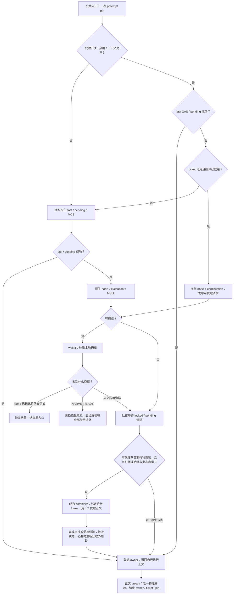
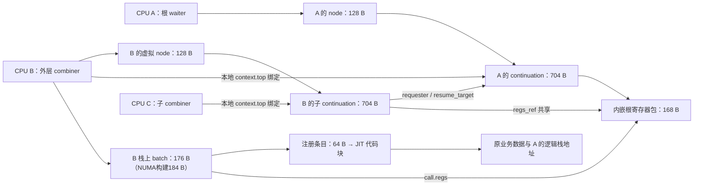

# TCLock 与 KDLock 当前执行路径、对象和数据流

本文描述当前直接 API 的 **spin** 执行路径：CPU 热值 C `if` 获取、统一 clobber
解锁、实际 MCS 发布采样、continuation 错位/紧凑前缀布局及单原子字 ticket。
对象尺寸沿用各阶段 ELF 复核，并按当前源码布局更新；历史尺寸与成绩仅属于对应冻结输入。
普通 spin 保持 IRQ/BH 状态，continuation 为 704 B；语义验证见
[普通 spin 报告](../tclock_compare/results/HISTORY.md#20260922-plain-spin)。
热表为每 CPU/type 256 桶/256 记录，task 统计复用或取得 CPU pin，非 task 上下文跳过统计。
TCLock 指仓库中的外部模块适配版 `tclock_backend/`；KD 指显式 `kd_spinlock_t`
API，不是整个内核锁的替换。mutex 只涉及下述共享执行设施及分类型热表，其互斥
协议见 [locking](../../docs/design/locking.md)，不能套用这里的 spin 流程。

三臂使用同一负载源码、分别编译为不同 ELF。完整操作包括获取、正文、释放、
锁外计算和循环，`ns/op` 不是单独获取锁的延迟。Linux 臂调用
`__raw_spin_lock/unlock`，使用独立 Linux 锁对象。

## 1. 阅读口径与构建差异

大小单位均为字节，指 x86_64 的 `sizeof` 或明确请求的分配长度，不含分配器
填充、vmalloc 页表/管理开销。“占用对象”通常是借用预分配槽，不代表临界区内
分配内存。内嵌对象已经计入外层大小，不能重复相加；64 字节地址对齐也不等于
对象大小为 64。C 局部对象可能被优化进寄存器或复用栈槽，不能把其 `sizeof`
之和当作函数最大栈深。

| 构建 | 当前启用项与边界 |
| --- | --- |
| TCLock backend | `NUMA_AWARE=1`、`WWJUMP=1`；`ENABLE_IRQS_CHECK` 关闭。当前对照限 task context、IRQ 开启的单锁调用者，不作为通用 IRQ/嵌套锁替代 |
| KD normal | `KDLOCK_SELFTEST` 默认关闭，`KDLOCK_NUMA=1`、`KDLOCK_SPIN_BATCH=512`；可显式关闭NUMA或启用探针 |
| KD 策略 | `spin_delegate=0` 关闭公共入口代理并跳过其热度记录，默认 `1`。只保留adaptive热度准入；`spin_entry_ratio_limit=0`仅绕过比例，仍受CPU/单锁热度和上下文/JIT安全检查约束 |

选择 `KD_SPIN_DIRECT_LOCK/UNLOCK` 配对壳后，调用端只按 CPU 热值分流；
`spin_delegate` 在 provider 内控制代理/采样。CPU 热度仅统计实际 MCS 发布，
已删除队列深度策略及其参数；配对宏的 C `if` 仍只判断 CPU 热值。

对象尺寸的初始核对来自已完成性能矩阵的 normal 观察 provider 和 TCLock backend 的 DWARF，
2026-09-20 通过 guest `pahole -C <类型> <ELF>` 只读复核。
下表按当前源码更新后续布局变化；2026-09-27把ticket私有guard及分散状态合为原子控制字，
ticket从48缩为32字节，匹配构建和验证见[全链路报告](../tclock_compare/results/20260927-flow.md)。
ELF 位于 guest `/root/kdlock-evidence/continuation-perf-20260920/matrix/binaries/`。
NUMA/SELFTEST 的源码布局增量另列，不能拿带探针的总内存当作 normal 成本。

| 已核对的冻结 ELF | SHA256 |
| --- | --- |
| `kdlock_km.ko` | `4283130ba2194106017a860739b338b1936a573033a62aea8819dd6c74b9f305` |
| `tclock_backend_km.ko` | `ad5f4baca2868ec13dddc17bab06203201bbe4a92ce1169ed3824cc50faf2393` |

这里的“每 CPU”均指 `for_each_possible_cpu`/per-CPU 存储口径，未参与本场负载的
possible CPU 也预留。业务数组和锁、预分配对象、已有任务栈、翻译代码池是不同层次；
以下不统计完整 `task_struct`、内核任务栈、用户态 daemon/翻译器或整个模块 RSS。

## 2. 锁对象和公共负载

| 对象 | 大小与位置 | 创建与使用 |
| --- | --- | --- |
| KD `kd_spinlock_t` | 4；workload 模块静态 `sc_lock`，地址按 64 对齐 | 模块初始化清零；同一锁字承载 locked、pending、tail 及 combiner 仲裁 |
| TCLock `qspinlock` | 4；当前 workload 静态 `spinlock_t sc_lock` 的锁字，地址按 64 对齐 | backend 直接使用该对象，调用端管理抢占；当前内核无额外 debug lock 布局，不能推广到任意 `spinlock_t` 配置 |
| `sc_slot` | 64，含 8 字节计数器及填充；静态 `sc_data[16]` 共 1024 | workload 模块载入时存在；各路径更新所选 N 个槽的计数器，不是读写每条 cacheline 的全部 64 字节 |

锁对象不内嵌节点、request、frame 或热表。节点属于 CPU，执行记录属于请求，
翻译条目属于代码入口；同一代码入口可以服务不同锁地址。KD 没有 gate 映射、
独立 S、Linux L 二次获取或旧 spin 统一分发。
来源：[payload.h](../../workload_modules/spin_cacheline/payload.h)、
[调用壳](../../workload_modules/spin_cacheline/direct.h)。

## 3. TCLock：对象、栈切换和完成交接

### 3.1 对象在哪里创建

| 对象 | 大小/数量 | 存储与生命周期 |
| --- | --- | --- |
| `komb_node` | 120 × 4 = 480 / possible CPU | `komb.c` 静态 per-CPU 数组，模块存活期间保留。数组基址对齐，元素步长仍为 120；通知偏移 68/69，不保证每个节点的通知独占 cacheline |
| `shadow_stack` 元数据 | 128 / possible CPU | 静态 per-CPU；含 `lock_addr[8]`、栈顶、当前/前一 waiter CPU、WWJUMP 计数及 NUMA 暂存链表 |
| shadow 栈内存 | 8192 / possible CPU | `komb_init()` 逐 CPU `vzalloc`；`ptr` 指向末端，初始 `local_shadow_stack_ptr=末端-8`；排空后 `komb_free()` 释放 |
| 保存的机器上下文 | 每次显式保存 6 个寄存器，共 48；另有 CALL 返回地址及 C 栈帧 | 写入已有任务栈或 shadow 栈；`rsp` 指向保存点。不分配 `pt_regs`、稳定 request 或 JIT frame |
| combiner 检查点 | 若干 C 局部变量，非独立堆对象 | `__komb_spin_lock_longjmp()` 在本 CPU shadow 栈的 C 帧中保存旧 `rsp`、CPU、计数、next 及 NUMA 链表；实际栈帧大小由编译决定 |

节点的 `next/tail` 组织队列，`count` 管理占用，`socket_id/cpuid` 定位与选队，
`rsp` 保存真实栈续点，`lock/task_struct_ptr` 关联锁和逻辑调用者，
`completed/locked` 通知原 waiter。`irqs_disabled` 字段保留，但不会使已关闭的
IRQ 检查代码自动启用。
来源：[节点定义](../../tclock_backend/include/spinlock/komb.h)、
[队列与初始化](../../tclock_backend/komb.c)、
[上下文切换](../../tclock_backend/combiner.c)。

`komb_init()` 只创建额外的 shadow 栈，原任务栈由内核任务生命周期提供，TCLock
不再为每个 waiter 创建一份任务栈。换栈保存的 48 字节是六个 callee-saved 寄存器，
CALL 的 8 字节返回地址也留在原栈；caller-saved 活跃值由调用者编译器按需保存。
`node->rsp` 只是 8 字节指针，不包含或复制这些栈内容。
换栈只加载寄存器和 RSP，不复制业务内存，也不切换内核 `current`/GS；节点中的
`task_struct_ptr` 保留逻辑调用者身份，代码需要时经 `komb_get_current()` 查询。
本轮普通 cacheline 正文只更新共享槽，不使用这些 task 身份辅助接口。

### 3.2 当前默认路径

1. 调用壳 `preempt_disable()` → `komb_spin_lock()`。先 CAS 获取锁字，失败后
   尝试 pending。成功均返回自己的正文，不占用排队节点、不换栈。
2. 排队进入 `komb_spin_lock_slowpath()`：RBP/RBX/R12–R15 压入原任务栈，
   保存 RSP 到本 CPU 节点，切到预分配 shadow 栈。当前普通可代理路径使用
   `komb_nodes[0]`，不能把“预留 4 个节点”理解为普通路径支持四槽任意嵌套。
3. 初始化节点、交换锁字 tail、向前驱 `next` 发布自己，在本地 `locked` 轮询。
   队首才等待共享锁字的 locked/pending 清除。
4. 队首独占时获取锁、归还节点占用，回原任务栈自行执行。有可代理后继时，
   队首保存检查点进入 combiner；节点计数可先归还，被暂停的栈和续点仍须保活。
5. `execute_cs()` 通过 `komb_context_switch()` 切到 waiter 的 `rsp`，从其
   lock 返回位置执行原始正文。原 waiter CPU 留在自己的 shadow 栈轮询；
   逻辑调用者与当前物理执行者不同。
6. 代理正文的 `komb_spin_unlock()` 将 unlock 续点保存回当前 waiter 的 `rsp`。
   WWJUMP 切到下一 waiter 的栈，或回 combiner 的 shadow 栈；NUMA 选择可暂存
   其他 socket 节点。批次由后继、可代理边界及预算决定，`komb_batch_size`
   默认 1024；没有恢复已删除的调度检查。
7. 离开借用栈后用 `completed/locked` 通知原 waiter。它恢复更新后的 `rsp`，
   从 unlock 续点返回，不再次执行正文。批次结束交接后继，combiner 自身仍回到
   自己的 lock 调用流程。普通持锁者 unlock release 清除 locked，调用壳最终
   `preempt_enable()`。

```text
waiter CPU                         combiner CPU
任务栈：保存 6 寄存器、RSP
切 CPU shadow 栈 → 发布 node ─────→ 读取 node->rsp
本地轮询 locked                    切入 waiter 任务栈，执行原正文
                                   unlock：保存新 rsp，离开该栈
恢复 node->rsp ← completed/locked ← 通知完成
从 unlock 后继续
```

源码保留 `ENABLE_IRQS_CHECK` 下的不可代理 MCS 分支：为嵌套/IRQ 等上下文选择
节点，不借出栈，队首获取后通知后继并自行执行，真正四槽耗尽才轮询锁字。
**当前 backend 没有编入该分支**。`lock_addr[8]` 和 OOO 标记也不等于当前单锁
对照已验证任意嵌套与乱序解锁。

## 4. KDLock：对象分层与创建位置

### 4.1 模块启动时预留的对象

| 对象 | 大小/数量 | 分配点、用途和回收 |
| --- | --- | --- |
| `kd_spin_node` | 128 × 4 = 512 / CPU | `spin/state.inc` 静态 per-CPU 数组；每节点按 64 对齐、CPU数组按128对齐，`completed/locked` 偏移 64/65；原生与代理共用四槽 |
| `kd_spin_cpu_state` | normal 80 / CPU；NUMA 增加 16 | 静态 per-CPU；`lock_addr[8]`、当前代理 CPU、`node_count`、等待栈顶；NUMA 再有暂存链表头尾 |
| continuation/等待栈共享预留区 | 20480 / CPU | `kd_spinlock_init()` 每 CPU 一次分配；NUMA构建用 `vzalloc_node(..., cpu_to_node(cpu))` 请求所属节点（允许回退），其他构建用 `vzalloc`；低端 12 KiB 放 continuation，高端 8 KiB 为物理等待栈，两区不重叠 |
| `kd_spin_continuation_stack` | 8512 / CPU，包含 704 × 12 条记录 | 初始化时按 CPU 在低端预留区选择 64 字节对齐起点；只按 top 分配，退休后收缩连续已退休栈顶；活动记录不搬移 |
| `kd_spin_continuation` | 704 × 12，已包含在存储栈中 | `spin/request.inc` 按 top 借用槽；包含 frame、恢复结果、调用者上下文；不是 C 自动局部对象 |
| `kd_exec_frame` | 648，已包含在 continuation 中 | 生产者准备，combiner 原地 bind/pop，不为同一 spin 请求另分配第二个 frame |
| `pt_regs` | 168，已包含在 frame 中 | 根请求拥有寄存器包；虚拟子请求 `regs_ref` 可指向根包，不按层复制整包 |
| `kd_spin_jit_context` | 16，已包含在 continuation 中 | 虚拟请求的 `requester` 与锁深度；跟随 continuation 存活，不绑定可复用 node 槽 |
| `kd_exec_context` | 5208 / CPU | `kd_exec.c` 静态 per-CPU，含 8 × 648 的旧 frame 数组及 top/owner/depth。spin 的 continuation 内嵌 frame 绑定到 top；数组仍服务 mutex/其他 push 路径，不是每个 spin 请求新增一份 |
| 三个 per-CPU 指针 | 8 × 3 = 24 / CPU | `spin/state.inc` 静态 `kd_spin_resume_nodes`、`kd_spin_continuations`、`kd_spin_native_root`；分别记录本地恢复节点、存储栈基址、等待最终 native 退休的根记录 |
| `kd_spin_fast_cpu` | 24 / CPU | 静态 per-CPU；单一 task 持锁的 held/owner，以及原生嵌套/IRQ及配对冷根持有者的排空计数 nondelegated |
| `kd_spin_entry` / pool | 32 × 32 + 16 = 1040 / CPU | `kd_spin_entries_init()` 一次 `alloc_percpu`；task/CPU/origin身份加64位代际/阶段/kind/native借用控制字，无私有guard；物理释放、native借用全部退休及end后归还槽，保持自然对齐 |
| spin CPU热值 | 4 / CPU | 唯一静态per-CPU unsigned-int标量；直接读取，无动态表指针或热度副本 |
| 热表 entry/table/cpu | 24 / 6680 / 13376 | `kd_hotlock_init()` 一次 `alloc_percpu`；每 CPU spin、mutex 各 256 桶、256 精确地址记录，另含唯一mutex CPU热值及对齐填充；无候选淘汰，不是 owner 存储 |
| `kd_spin_diag_slot` | 128 × 32 = 4096，全局 | 静态数组，按128字节对齐；锁地址及禁用标志，旧共享waiter占位字段已删除，槽身份在模块会话内稳定；不是热锁晋升集合 |
| `kd_spin_diag_cpu` | 3104 / CPU | spin 初始化时 `alloc_percpu`；事件/批次及waiter进入/退出总数，live余额近似，独立排空后精确汇总并释放；SELFTEST 额外探针存储不计入 normal 表 |

这些是对象请求长度，不是模块总 RSS。例如 20 KiB 预留区由 vmalloc 按页支撑，
实际占用还有页取整和管理开销；静态 per-CPU 符号间也可能有填充。
来源：[spin 布局](../../include/kd_spinlock.h)、
[CPU 状态](../../kernel_module/spin/state.inc)、
[初始化/销毁](../../kernel_module/spin/lifecycle.inc)、
[frame 布局](../../include/kd_exec.h)、
[ticket](../../kernel_module/kd_spin_entry.c)、
[热表](../../kernel_module/kd_hotlock.c)。

### 4.2 调用栈对象与全局翻译对象

| 对象 | 大小 | 创建位置与数据流 |
| --- | --- | --- |
| `kd_spin_ref` | 16 | ticket 指针 + sequence；内嵌于请求/frame/ACK，用于代际检查，不另分配 |
| `kd_spin_request` | 24 | `kd_spin_lock_contended()` 等慢路径调用栈局部；顶层 fast 成功不创建；ref + KD word 指针，传给队列/batch，早释放后仍用原 ticket 重新获取 |
| `kd_spin_native_input` | 40 | `kd_spin_lock_slowpath()` 栈局部；物理 RSP、逻辑 SP/IP/BP、ABI，发布前写入 continuation |
| `kd_spin_batch` | normal 184；NUMA 或 SELFTEST 单开 192，两者开 200 | `run_combiner()` 栈局部，含外层释放 hook、后继、request、翻译及进度；覆盖整批和同步 ACK 等待 |
| `kd_jit_batch_call` | 96，已包含在 batch 中 | wrapper 描述，含寄存器指针、两元素 args、代码/入口/完成信息，不是另一份寄存器包 |
| `kd_combiner_state` | 88，已包含在 frame 中 | 首次进入复杂路径时保存 combiner 锁账本与队列检查点；简单路径避免完整检查点保存 |
| `kd_exec_outer_unlock` | 16，已包含在 batch 中 | frame 通过指针调用 release hook，released 防止重复物理释放 |
| `kd_remote_request` | 24 | 子执行者 `kd_exec_remote_unlock()` 栈局部；指针发给父 frame mailbox，等待 done ACK 后才可退出作用域 |
| `kd_native_request` | 32 | 原 waiter `kd_exec_native_unlock()` 栈局部；发给物理 owner，ACK 后该消息可结束；最后解锁还须等待所有执行者退休，才可回收根记录 |
| wrapper 固定物理栈区 | 176，另有 CALL 返回地址 8 | `include/wrapper.S` 在执行者现有栈上建立；含 48 字节保存/保留槽、16 字节参数指针及 112 字节私有区；不是堆分配，也不是 waiter 的 168 字节寄存器包 |
| `kd_exe_info` 注册表 | 64 × 511 = 32704，全局 | `kd_exe_init()` 一次 `vzalloc`；按代码入口登记，不按锁或每次获取创建 |
| JIT code block 池 | 每块 655360（640 KiB），最多 64 块 = 40 MiB | provider 初始化逐块 `vmalloc` 并设置执行权限，至少一块成功才可启动；入口登记取预留块，实际块数看启动日志 |

caller-clobber 调用壳由编译器保存活跃值，保存量取决于调用点，不是每次固定
保存 168 字节。wrapper/生成代码还使用已有执行栈，详见
[寄存器 ABI](../../docs/JIT_REGISTER_ABI.md)。翻译分配见
[registry_lifecycle.inc](../../kernel_module/execution/registry_lifecycle.inc)。

24 字节的 `kd_spin_request` 是调用栈上的 ticket/锁字描述，704 字节的
`kd_spin_continuation` 才是节点指向的长期现场；它们不是同一个对象。
前者随所属 C 调用结束，后者必须显式退休，不能随着函数返回或 node 复用消失。

wrapper 的 176 字节是入口建立的固定区域，不是整个 JIT 最大物理栈深；生成代码的
临时压栈、服务调用、C 调用帧及编译器保存活跃值另计。当前 clobber-v1 入口只实际
保存物理 RBP，保留另五个槽以兼容布局；普通 legacy 入口保存六个寄存器。R12/R13
承载逻辑 BP/SP，R11 指向共享寄存器包，物理 RSP/RBP 始终属于执行者。
根包虽然预留完整 168 字节，MINIMAL 路径只初始化/回写所需 IP/SP/BP，不等于每次
复制 168 字节；完整寄存器恢复和复杂出口另走 FULL 路径。

代码池是全局翻译存储，不按 CPU 或 waiter 分配。511 个注册槽和最多 64 个代码块
是两个容量限制；每块预留 640 KiB 不代表生成代码实际长度。上传/翻译发生在准备
阶段，执行时 batch 持有 source lease，通过稳定注册条目取得代码指针。
lease 是已有来源状态上的引用，不为每个 frame 分配一个独立对象；批内 frame
借用同一 lease，直到所有嵌套/native frame 已 pop 才结束 batch lease。

### 4.3 20 KiB 区域和单条记录布局

```text
每 CPU 一次 vzalloc(20480)，base 按页对齐
base              ┌ 起点前余量：skew 字节
base + skew       ├ top：4 字节 + 对齐填充 60 字节
base + skew + 64  ├ records[0..11]：704 × 12 = 8448 字节
base + skew +8512 ├ 起点后余量：3776 - skew 字节
base + 12288      ├ 高端 waiter 等待栈：8192 字节，向低地址增长
base + 20480      └ wait_stack_top：初始栈顶
```

当前 `skew = ((cpu * 13) % 60) * 64`，只在初始化计算。60 个合法起点由低端
12 KiB 容量和实际结构大小推导；所有记录仍在低端区域内。退出或局部初始化失败
时通过 `wait_stack_top - 20480` 释放原始基址，不能释放错位后的内部指针。
该布局保持分配和记录数量，不新增请求期偏移计算或分配；详细约束见
[frame 存储](../../docs/design/frames.md#91-frames-and-lock-ledger)。

| continuation 内部成员 | 偏移 / 大小 | 用途 |
| --- | --- | --- |
| `diag`、`storage` | 0 / 8、8 / 8 | 指向诊断槽及所属 CPU 存储栈 |
| `result`、`kind` | 16 / 4、20 / 1 | 汇编轮询的32位恢复结果；仅内部ROOT/VIRTUAL类型使用单字节 |
| `retired`、`native_regs_decoded` | 21 / 1、22 / 1 | 回收标记、入口包准备标记 |
| `frame` | 24 / 648 | 前 72 字节为热字段，随后 168 字节 `regs`，其余 408 字节为复杂路径存储 |
| `frame.regs` | 96 / 168 | 根包的实际存储；虚拟子 frame 的 `regs_ref` 指向根包，而非自己的这片空间 |
| `jit_context` | 672 / 16 | 虚拟请求的父执行者及锁深度 |
| `queued_at_ns` | 688 / 8 | 可选队列计时；普通 spin 不保存 IRQ flags |
| 记录末端 | 704 | 末尾8字节填充；下一条记录仍按64字节对齐 |

普通MINIMAL包的BP/IP/SP相对记录起点为128/224/248；IP/SP共用同一缓存行。
连同前两行请求/header及BP行，简单路径涉及四条continuation行，原布局为五条。
这是地址几何，不代表实际每请求发生四次cache miss或跨节点传输；node、ticket、
waiter栈及payload另计。producer提示仍在执行前一个正文时预取下一请求，保留FULL和借用包处理。

记录使用 `records[top++]`；退休先置标记，再由所属 CPU 收缩连续已退休栈顶。
例如 0/1/2 在用、1 先退休时，下一次仍从 3 分配，不复用 1；2 退休后才可一并
收缩 2 和 1。远端只发布退休标记，不改 top，不搬移活记录。记录容量 12、节点
容量 4、frame 嵌套上限 8、每 frame 锁账本上限 8 是不同限制。

### 4.4 continuation 状态与回收

| 字段 | 当前用途与写入方 |
| --- | --- |
| `kind` | ROOT 或 VIRTUAL，明确区分物理入口与嵌套虚拟请求 |
| `result` | QUEUED、RETRY、NATIVE_READY；RETRY 只允许未执行正文的入口恢复 |
| `storage` / `retired` | 指向所属 CPU 的存储栈及退休标记；仅所属 CPU 更新 top，远端 native 子执行者在 pop 后发布标记 |
| `native_regs_decoded` | 物理入口寄存器包已准备完成 |

`users`、`packet_owner`、`jit_waiter`、`jit_retry`、`native_resume`、
`pinned_context` 已移除。额外抢占嵌套的检查前移到代理发布前，拒绝走 KD 原生
MCS。原生 MCS 节点仍为 `execution=NULL`，不申请 continuation。

`result` 不单独表达全部完成状态：普通代理完成仍由节点的 `completed/locked`
交接；`locked=0, completed=0` 可以只是未执行正文的队首交接。NATIVE_READY
通过 `result` 区分，即使节点已经唤醒，执行 frame 仍可能等待物理 ACK 和退休。
`frame.state` 描述执行/退休，`retired` 描述存储可回收，不能互相替代。
来源：[存储栈](../../kernel_module/spin/request.inc)、
[发布与等待](../../kernel_module/spin/wait.inc)、
[最终恢复](../../kernel_module/kd_spinlock.c)。

## 5. KDLock 按阶段执行

### 5.1 准备、热度与快速获取

1. 计时前 `kd_spin_prepare(lock, post_call_ip, ABI)` 登记入口。provider 使用
   既有注册表/代码池；daemon 经 `/dev/kd_dev` 取得代码与元数据，翻译、组装、
   上传并发布。NORMAL 只表示可尝试执行，不能当作正文执行证据。
2. 配对获取壳 `KD_SPIN_DIRECT_LOCK` 在 pin 后用 C `if` 读取 CPU 热值。
   冷分支内联首次CAS和已有per-CPU计数，nondelegated覆盖获取及持锁；失败时调用
   `kd_spin_direct_native_contended()`完成pending/MCS，保留CPU升温/降温采样。冷态持有用低字节5
   标识。热获取分支使用 clobber-v1 协议，
   continuation 位于 CALL 后；宽 clobber 仅声明在该分支的 asm，未手工 push/pop。
   编译器决定保存哪些活跃值及保存位置，可以将部分保存放在 `if` 之前，不能保证
   冷分支完全没有寄存器保存。cookie 是唯一静态per-CPU unsigned-int热值，一个 CPU 一份、
   所有锁共享，由`this_cpu_read`直接读取。导出符号由指针改为标量，provider及直接调用者
   须一起重编译。`KD_SPIN_DIRECT_UNLOCK` 无条件使用 broad-clobber 调用
   `kd_spin_unlock_clobber_v1()`，冷/热获取均传 lock/SP/IP/BP，调用端不读锁字或 CPU 热度。
   provider 先检查低字节 5：命中时 release 低字节、减 nondelegated、unpin 后返回，
   否则进入原有 fast owner/native ACK/ticket 解锁核心。JIT 正文只有一个解锁完成入口，
   不再包含调用端冷/热解锁分支；request/frame 仍只在慢路径准备。
   当前仅保留adaptive，CPU热后继续判断单锁；
   provider 仍检查代理开关和安全条件，曾热 CPU 仍需后续 MCS 样本才能降温。
   保留壳 `KD_SPIN_DIRECT_CALL` 传 lock、pre-CALL SP、post-CALL IP、BP 给 clobber v1
   入口，编译器按调用壳的 clobber 声明保存活跃值。
3. 保留壳的 `kd_spin_lock_abi()` 首先执行一次 `preempt_disable()`；配对热壳的
   `kd_spin_lock_pinned_clobber_v1()` 复用调用端的 pin，两者进入同一 pinned core。
   代理开关开启时调用
   `kd_hotlock_record_spin_pinned()` 按缓存 CPU 热值记录单锁调用并判断准入，再检查 task/softirq、迁移和
   执行 context。关闭代理、冷锁或上下文拒绝均转入完整原生 fast/pending/MCS，
   复用入口 pin；关闭代理的公共入口跳过统计。统计独立调用仅在未 pin 时临时 pin。
4. 准入后的普通根入口先 CAS，再尝试 pending；成功使用 per-CPU fast owner，
   不占 ticket/node/continuation。物理嵌套入口保留独立 ticket，先 reserve 再尝试
   fast/pending，不能覆盖外层 fast owner。被准入拒绝的嵌套/IRQ 使用独立
   `nondelegated` 排空计数；保留接口的普通单层task原生获取转换为fast owner，
   新配对冷根保留计数，不做这次owner转换。
5. 普通根 fast/pending 失败进入 queue 后才 reserve ticket，并检查翻译就绪。
   ticket 不足转完整原生获取；已有 ticket 但翻译未就绪时登记入口，并保留 ticket
   走完整原生获取。此回退可能再次尝试 fast/pending，不再记录第二个热度样本。
   准备好翻译后才进入代理 slowpath，按需占 node/continuation。
6. slowpath 的正常返回已经 claim/reclaim，公共入口不再重复提交 ticket 状态。
   continuation 容量不足保留 ticket 走原生 MCS；节点/context 失败沿用受检出口。
7. JIT 嵌套 CALL 先用 `record_spin` 得到 promoted，再校验 CALL/锁账本和 shadow
   容量。热路径可登记嵌套续点，并进入 `kd_spin_nested_lock()`：独立虚拟 ticket
   → fast CAS → 虚拟排队；这里没有共享 pending helper 或 MCS 后置热度判定。
   冷路径通过原生 bridge 获取 KD 字并登记 NATIVE 锁账本。已发布的虚拟 waiter
   继续轮询父 mailbox；已执行的正文只能沿已有受检续点继续，禁止从头重跑。

这次按性能验收结果恢复入口准入；此前“只在 MCS 判断代理、在 admit 更新时间域”
的实验已撤回。差异、同期数据和限制见
[回退报告](https://github.com/hailongeric/kdlock/blob/175d73bcc2faaa5ee9f9ab28a20491680d834043/bench/tclock_compare/results/20260921-mcs-recovery.md)。

当前 API 遵循普通 `raw_spin_lock`：只配对抢占，不保存/关闭/恢复 IRQ，也不关闭 BH。
需要 IRQ/BH 保护的调用者在外层选择相应语义；本次未新增 KD irqsave/bh API。

原生和代理节点均以单指令 per-CPU 计数操作占用/归还。combiner 先保存节点信息
再借出槽位，批次返回时重新占用后才能写回；生产者最后读取恢复信息后才归还节点。
完成路径用 `kd_spin_entry_end_pinned()` 退休 ticket 元数据，读完/退休 continuation
后才由 `kd_spin_restore_unpin()` 解除抢占；重试及有锁 native 续跑保留获取 pin。

ticket reserve 由原CPU的pinned task初始化身份后release发布控制字；所有竞争状态变更
以完整64位CAS提交，远端get/put只访问该字，最终借用等待使用acquire读与PAUSE。
claim/reclaim与release内部都不获取私有spinlock或执行物理释放；实际释放仍由调度方
单次release store完成。字段、有限上限及完整退休顺序统一见
[ticket协议](../../docs/design/locking.md#42-acquisition-tickets-and-node-lifetime)。

spin/mutex 的单锁记录与准入使用入口处的直接哈希计数。模块初始化时
`alloc_percpu` 为每 CPU 预分配 13376 字节、64 字节对齐的对象，包含两个
6680 字节类型表、4字节mutex CPU热值及对齐填充；表内不再存CPU热值。
每表 256 桶、256 条 24 字节记录，桶和冲突链使用 `u16` 槽索引；
`0` 为空，`1..256` 对应记录。每条记录只保存完整锁地址、时间戳、计数、hot 标记
和 next；删除候选排名、score/error、最小分数扫描和替换。初始化一次采时建立
所有 CPU/type 的时间起点，锁路径不分配；调用者保证地址有效及初始化/排空生命周期。

spin复用per-CPU获取/MCS计数；MCS达到512时，以`(spin_entries >> 9) < 2`判断本批比例，
清零两计数再采一次TSC。不再保存16字节历史快照，4字节唯一spin CPU热值保持。
fast/pending成功只计获取；实际MCS发布才增加MCS计数。统计及IRQ边界允许近似；
busy跳过不清计数，下一次MCS发布重试。首批包含先前获取，没有首次免比较逻辑。
`spin_entry_ratio_limit`默认2，0仅关闭比例过滤；CPU窗口严格小于400亿TSC ticks。

只有CPU热才查完整锁地址；spin单锁达到512次检查12.5亿TSC窗口，mutex保持第1025次/25亿。
降温、仍冷或重新变热均清除单锁计数/热值并保留地址映射，满表不淘汰既有身份。
当前只保留adaptive；query只读缓存，不计数、采时或插入。普通获取不额外读时钟，
已有缓存热值可能持续到后续MCS检查。这些近似统计不承担锁所有权和排空职责。
完整规则及近似计数限制统一见[JIT执行流](../../docs/JIT_EXECUTION.md#21-热度与角色)。

热表仅给准入建议；解锁不查询它。窗口重置、表满或 CPU 迁移不能改变已有
owner、frame 或 ACK 归属。统计与锁协议是独立数据流。

每次实际嵌套 lock 获取仍有自己的一次 pin，与对应 unlock 配对。普通自执行在
物理释放及 owner/ticket 清理后 `preempt_enable()`；被完整代理的原调用者在
完成恢复路径结束其 ticket/pin；native 续跑在最后 owner ACK 后继续等待所有执行者退休，才结束原 ticket。
远端执行者不能替另一个 CPU 恢复抢占。批次提前释放再重新获取仍保留原入口 pin。

### 5.2 无 JIT / 无代理：原生 MCS

公共入口拒绝、显式 native bridge 及外层重新获取调用完整
`kd_spin_acquire_nondelegated()`，内部重试/重新获取不再采样：

1. 同一 KD 字 fast CAS → pending → MCS。只有需要排队才占一个预分配节点；
   设置 `socket_id=IRQ_NUMA_NODE` 表示不可代理，`execution=NULL`。该标记也
   用于普通 task，不表示调用一定来自 IRQ。
2. 交换 tail、向前驱发布 next，在自己的 locked 轮询；队首才等共享锁字。
3. 队首取得物理锁后，把队首资格交给后继并归还 node_count。后继仍等物理锁
   释放；**唤醒后继不等于释放自己的临界区锁**。
4. 原线程执行正文；保留接口普通根请求转入fast owner，嵌套/IRQ及新配对冷根保留独立排空计数。
   已有 ticket 的回退保留 ticket。unlock release 清除 locked、保留 pending/
   tail，并结束对应 owner/ticket/pin。

此路径不 reserve continuation、不绑定 frame、不准备寄存器包、不换等待栈、不建立
代理 source lease，也不调用 Linux 锁协议。发布前 continuation 容量不足仍走此 MCS 路径。
真正四节点全占用才轮询 KD 字：原生 helper 使用 read-before-CAS；代理 slowpath
自身的节点耗尽分支目前仍是 trylock/CAS 循环，不能写成所有极端分支已经统一。
来源：[nondelegated.inc](../../kernel_module/spin/nondelegated.inc)。

### 5.3 可代理请求发布与执行

1. `kd_spin_lock_slowpath()` 保持 IRQ/BH 状态，准备 input，reserve
   node/continuation。根请求令 `regs_ref=&frame.regs`；clobber v1 只初始化 IP/SP/BP
   的 MINIMAL 包，复杂出口才物化 FULL GPR 包。
2. 初始化逻辑 task、GS、ABI、ticket 等。物理 waiter 有前驱时，**先切到 8 KiB
   等待栈，再发布前驱 next**，随后汇编 PAUSE 轮询。JIT 会使用原 waiter 的
   逻辑栈地址，原 CPU 不能继续在借出的栈上压入 C 帧。
3. 队首独占时自行获取并归还排队资源；有可代理后继时保存状态、创建栈上 batch，
   取得 source lease 后执行。不可代理节点既是批次入口边界，也是批内边界，
   不能解引用其空 execution。
4. combiner 使用 `node->execution` 的现成 frame/包。简单路径走批量 wrapper，
   两类路径均把同一 frame bind 到本 CPU exec context。`batch.call.regs` 指向同一逻辑包，
   不复制 waiter frame 给 combiner。wrapper 入参 `args[0/1]` 分别传逻辑 GS 和
   task，返回时承载出口结果；寄存器包提供逻辑 IP/SP。与 TCLock 不同，KD
   wrapper 的物理 RSP 保持在执行者栈上，生成代码通过逻辑 SP 访问 waiter 栈。
   FULL 出口读完全部私有元数据后才释放物理栈区，避免 IRQ 覆盖仍在使用的槽位。
5. wrapper 执行生成代码，业务内存直接读写 workload 原始共享地址。普通完成
   回写 post-unlock IP/SP/BP；中间出口保存 FULL 包与续点，按锁账本/控制 CALL
   状态决定嵌套、完成或受检原生续跑。
6. 正常完成先退休相应 frame，再通知 waiter。物理 waiter 丢弃可能被覆盖的旧
   hook/queue C 帧，从稳定 continuation 恢复；最后一次寄存器读取后才标记退休并收缩栈顶，
   完成请求通过保留 GPR 的 helper 解除原入口 pin，再跳到续点；不加载 RFLAGS。未执行正文的队首交接才可返回旧 C 调用链。

```text
物理 waiter CPU                    combiner CPU
input → reserve continuation
continuation.frame.regs ← IP/SP/BP
node.execution → continuation
切等待栈 → 发布 next ─────────────→ node → 同一 continuation/frame
PAUSE 轮询                          batch.call.regs → 根寄存器包
                                   wrapper/JIT → 原业务内存、逻辑栈
                                   完成包/续点 → 同一寄存器包
恢复 continuation ← 完成/原生通知 ←───── frame 退休或保留 owner 等 ACK
最后一次包读取后标记退休并收缩 top（native 有剩余锁时保留至最终解锁）
```

来源：[入口](../../kernel_module/kd_spinlock.c)、
[发布等待](../../kernel_module/spin/wait.inc)、
[队列](../../kernel_module/spin/slowpath.inc)、
[批次](../../kernel_module/spin/combiner.inc)、
[复杂执行](../../kernel_module/spin/execute.inc)。

### 5.4 嵌套代理、提前释放和 ACK

| 场景 | 对象与数据流 | 结束条件 |
| --- | --- | --- |
| JIT A 遇到 B | 嵌套入口先记录/判断热度；热路径占独立 ticket，fast CAS 成功更新锁账本，否则占 node/continuation；冷路径走原生 bridge。子 frame 有独立锁账本，regs_ref 共享根包，requester 指向直接父 frame | 子 frame pop 后才允许父请求继续；无需整包复制或根包引用计数 |
| B 由另一 CPU 代理 | A 执行者保留自己的 C 栈等待并轮询 remote mailbox，不切物理 waiter 专用等待栈 | 子执行者发布完成/原生结果，父执行者处理恢复；B 是 A 已准入代码的续点，不是独立词法深度 1 入口 |
| 持 B 提前释放 A / OOO | jit_lock 数组记录 kind、node、released；需远端 owner 释放时发送 24 字节栈上 remote request | owner 完成唯一物理释放并更新账本，最后 release-store done；发送者收到 ACK 才销毁栈对象 |
| batch 外层锁提前释放 | frame 调用 batch 内嵌 outer hook，released 记录释放；批次收尾经原生 MCS 重新取得同一 KD 字，原 ticket reclaim | 重新取得后再回调用者，不新增另一份外层 frame/ticket，不重复释放已放开的字 |
| JIT 受检续点转原生 | 每个执行者（含无锁 relay）登记根 ticket 借用，再发布 NATIVE_READY | 原 waiter 经栈上 request 请求 owner 解锁；物理 ACK 与退休分开，清理/pop 后解除借用；最终解锁等待全部退休再释放根现场与入口抢占保护 |
| 未执行正文就拒绝 JIT | 可退回 KD 获取/原入口恢复，result=RETRY 区分恢复方式；虚拟请求取消本次远端绑定后继续父执行 | 不允许把已执行正文的失败当作从头 retry，只支持已有受检续跑边界 |

**node 复用、NATIVE_READY、物理解锁 ACK、frame pop、存储回收及 source lease
释放是不同事件。** 无剩余锁的 native 续跑在恢复前等待全部退休；普通恢复汇编
完成全部现场读取后才回收根记录。OWNER/WAITER/COMBINER/DONE 仍保存在稳定
owner/ticket/frame 中，不依赖热表。

TCLock 通过真实栈续点及节点完成交接表达执行进度；KD 还需要显式包、frame 和
受检恢复状态。不能因为 TCLock 无同名字段就删掉生命周期，也不能让这些代理
状态成为原生 MCS 路径的每次调用成本。

### 5.4.1 获取、waiter 和 combiner 决策



图示普通公共入口；物理嵌套获准路径在 F 前占 ticket，普通根在 F 失败后占用。
JIT 虚拟入口走第 5.1 节的独立路由。continuation 容量不足转 N，保留已有 ticket。
原生节点是 batch 边界，不执行别人的正文。队首资格通知不等于物理锁已释放；
fast owner 解锁也不会自动变成 combiner。虚拟 waiter 保留执行者 C 栈并服务 ACK，
物理 waiter **先切到专用等待栈，再向前驱发布自己**。

### 5.5 根 waiter、两个执行者之间的数据流

下图中 A 是原线程，B/C 是先后处理外层/子锁的物理执行者。节点、记录的存储归属
由生产者 CPU 决定，frame 的 bind/pop 则在执行者 CPU 进行，二者不一定相同。
`frame.parent` 是执行者本地 frame 链，`resume_target`/`jit_context.requester`
才是跨 CPU 的逻辑父请求；不能把两条链混用。



队列只传 node 指针；node 传 continuation 指针；bind 与 wrapper 传 frame/寄存器包
指针，不把同一份 frame 或整包复制到执行者的另一个对象。子 frame 复制父锁账本的
有效前缀并添加自己的锁，用于独立 owner/释放判断；88 字节 combiner 检查点保存
执行者自己的队列状态，这两者均不能用“共享根包”替代。

实际正文直接读写 workload 原始地址；不存在 request 私有的业务数据副本，也没有
在完成时把整块业务数据复制回原线程。逻辑 task/GS 通过 wrapper 参数传入，物理
执行者、物理栈和锁 owner 仍按各自协议管理。源 lease 保活来源模块/代码；ticket
保留获取代际与借用；二者不代替 continuation 的退休规则。

### 5.5.1 无竞争入口的局部对象准备

`kd_spin_lock_abi()` 先持有一次 acquisition pin，执行原有热度与上下文准入。
`kd_exec_context_occupied()` 一次读取本地 context，等价于原来的
`current_frame() || context_busy()`：`depth && (owner != current || top)`。
检查既有 native ticket 的路由仍在。顶层 CAS 成功只发布 fast owner，正文原生执行。
CAS 失败才将读到的锁字和 SP/IP/BP/ABI 传给 `kd_spin_lock_contended()`，不重新
尝试一次 CAS；后者在当前执行者 C 栈创建 24 B request，再走 pending/MCS。
物理嵌套入口直接进入该 helper，保留先借 ticket 再尝试 CAS 的顺序。

`kd_spin_unlock()` 先核对 fast owner；失败才调用 `kd_spin_unlock_slow()`，
在其 C 栈创建 16 B ref，依次处理 native ACK、ticket 和 nondelegated 解锁。
新 helper 不分配堆内存，不改变 ticket、node、continuation 的个数与存活期。
guest ELF 已确认两个公共快速入口不再初始化上述局部对象，也不再携带对应的
stack canary；有地址逃逸对象的慢路径仍有 canary。
[历史 ELF 与测量证据](../tclock_compare/results/HISTORY.md#20260921-fast-path-optimization)保留了代码尺寸和开销变化。调用者寄存器保存、owner
身份核对、IRQ/preempt 恢复及编译缓解配置继续保留。

热度计数和时钟规则统一见[热度与角色](../../docs/JIT_EXECUTION.md#21-热度与角色)。
NUMA默认启用，KD每batch最多代理512个正文，独立扫描预算同样初始化为512；
两者使用构建时的`KDLOCK_SPIN_BATCH`值（1–1024）并分别消耗。直接本地后继不先读取next-next。
延期远端节点优先接回交接链。continuation/等待栈初始化时请求所属CPU节点内存，允许回退。
这些限制约束工作量，不保证任意调度下的等待时间。

### 5.6 完成通知、ACK 和回收的次序

| 路径 | 发布前完成的工作 | 接收方可以做什么 | 最终回收位置 |
| --- | --- | --- | --- |
| 普通根代理完成 | wrapper 写回结果 → 完成子工作 → frame complete/pop → 通知节点完成 | waiter 恢复最终现场；执行者不得再读该 frame/包 | 原 CPU 恢复汇编读完全部字段后标记记录退休并收缩 top，再解除原入口抢占保护并跳转 |
| 普通虚拟子请求完成 | 清理远端关系 → 子 frame pop → 父 `remote_result=DONE` → 节点完成 | 父执行者处理返回点并继续 JIT；根包不复制 | 生产者执行完 `kd_spin_finish_remote_node()` 的最后读取后 release 子记录 |
| native 有剩余锁 | 各执行者登记根 ticket borrow 和必要的物理锁路由 → NATIVE_READY → 唤醒原线程 | 原线程按受检 IP 继续；节点可复用，根记录由 `kd_spin_native_root` 保留 | 最后解锁经物理 ACK 后等待所有 borrow 归零，由原 CPU `kd_spin_native_retire()` 回收根并 end ticket/pin |
| native 无剩余锁 | 无锁 relay 仍登记 borrow；执行者清理/pop 后解除 | 原线程等待全部退休后才恢复受检 IP | 最终恢复汇编完成全部读取后回收根；不等待一个不存在的解锁 |
| 未执行正文的队首自执行 | 队首获得物理锁/交接队列，不发布“正文已完成” | 回完整的旧 C 调用链，自行执行一次正文 | slowpath 在本 CPU release 记录；ticket 随实际 unlock 结束 |

native 有锁执行者先处理物理解锁并 ACK；无锁 relay 无须等待解锁消息。两者最后
都须清理 → frame pop → 虚拟记录发布 retired/父 DONE（如有）→ 解除根 ticket borrow。
原线程看到 ACK 不等于这一链已经走完，只有 borrow 全部归零才允许根现场失效。最终汇编先将
所需值全部装入寄存器/目标栈，再发布 retired；不能让回收后的槽继续参与恢复读取。
来源：[虚拟子请求](../../kernel_module/spin/nested.inc)、
[远端退休](../../kernel_module/execution/remote.inc)、
[native 路由与 ACK](../../kernel_module/execution/native.inc)、
[执行者清理](../../kernel_module/spin/execute.inc)、
[wrapper](../../include/wrapper.S)。

## 6. 两种实现的存储与路径对照

| 场景 | TCLock 当前 backend | KDLock 当前 spin |
| --- | --- | --- |
| 初始化 | 每 possible CPU 四个 120 B node、128 B 元数据及一次 8192 B shadow 栈分配 | 每 possible CPU 四个 128 B node、20 KiB continuation/等待栈区，加 ticket、执行 context、热表与诊断存储；全局预留翻译池 |
| fast/pending 自执行 | 使用锁字及已有任务栈；无节点/换栈 | 使用锁字及 fast owner 或既有 ticket；无 continuation/JIT frame |
| 普通排队 | 节点 0 + 原任务栈续点；C 队列等待在 shadow 栈 | 一个 node + 一个 continuation；仅已发布物理 waiter 的汇编轮询切 8 KiB 等待栈 |
| combiner 物理栈 | 调度 C 帧在自己的 shadow 栈，正文切入各 waiter 的真实任务栈 | 队首回到自己的完整 C 栈运行 batch，wrapper/JIT 保持该执行者栈，只切逻辑 SP/包指针 |
| 传递执行现场 | node.rsp 指向栈上的寄存器保存区与返回地址 | node.execution 指向稳定记录；共享 packet 存逻辑 GPR/IP/SP，frame 存 owner/账本/续点状态 |
| 完成与复用 | 保存 unlock 续点并离开 waiter 栈后，再通知恢复 | frame 先退休再通知；节点复用不回收记录，普通恢复最后读完才回收，native 另等 ticket 借用退休 |
| 当前不可代理排队 | IRQ/嵌套专用 MCS 分支存在但未编入本轮 backend | 启用同字 native MCS，`execution=NULL`；continuation 容量不足也走此路径 |

两者的任务栈都是原有内核任务存储，不计入模块新增分配。TCLock 当前实现没有
KD 的翻译准备、寄存器包、frame/source lease、native 路由及 ticket 借用；其
真实栈交接不能直接替代 KD 的逻辑 SP/受检续跑约束。表中只是对象与执行步骤，
不能把节省的字段或分配次数直接换算成性能提升。

## 7. 验证与结果解释

当前完整三轮性能矩阵见 [1/8 cacheline峰值复测](../tclock_compare/results/20260925-c1-c8-warmed-peak.md)，
历史元数据精简、continuation 布局及长批次对照见 [布局调查](../tclock_compare/results/HISTORY.md#20260923-spin-single-hot-balance)。
单元和功能验证按冻结版本列在 [测试入口](../../tests/README.md)；
已撤回候选及旧统计口径集中在 [历史索引](../tclock_compare/results/HISTORY.md)。

真实 JIT 须有 wrapper 返回后的正文证据；NORMAL、原生完成、排空均不能单独
代替。TCLock 对照验证业务数据与排空，没有实际委托计数，不能把剩余调用数
当作委托比例。未测的 IRQ/任意嵌套、远端 native 强制时序等边界按各报告保留。

运行入口见 [benchmark README](README.md)；准入/续跑边界见
[JIT 执行流](../../docs/JIT_EXECUTION.md)、[frame 协议](../../docs/design/frames.md)。

## 8. 单线程无竞争路径与抢占责任

普通 Linux `__raw_spin_lock()` 内部关闭抢占；本测试 TCLock 在 workload 宏内
关闭抢占。KD 保留壳在 `kd_spin_lock_abi()` 内关闭抢占；配对壳在 C `if` 前
关闭抢占，冷/热 provider 入口复用该 pin，均在对应解锁时恢复。
KD 不经过 Linux 的 `spin_lock()` 包装，热度记录器复用已有
pin，不重复增减。不能因 Linux 内部协议已被 pin 就删除 KD 显式 API 的 pin。

配对壳在新加载的冷 CPU 上，单线程路径为：调用端 pin → C `if` 读取 CPU 热值
→ 内联nondelegated/获取计数及CAS → 正文 → broad-clobber解锁调用
（传 lock/SP/IP/BP）→ provider 检查低字节 5 → release 低字节 → nondelegated 减少
→ unpin。没有MCS，CPU热值保持冷；不进入单锁热表或实际JIT。
寄存器保存由编译器决定，不承诺全部省略。

保留clobber壳同样使用adaptive：入口pin后查询缓存CPU热值，冷态沿完整原生获取完成，
不准备可代理continuation。移除observe不改变该接口的寄存器和抢占契约。
新加载的冷CPU只有无竞争调用时始终不变热，因此不进入单锁哈希查找/计数。

长批次诊断不替代短批次三方吞吐。旧版本指令计数与单轮成绩见
[历史索引](../tclock_compare/results/HISTORY.md)，当前测试与结果见
[三方 README](../tclock_compare/README.md)。
