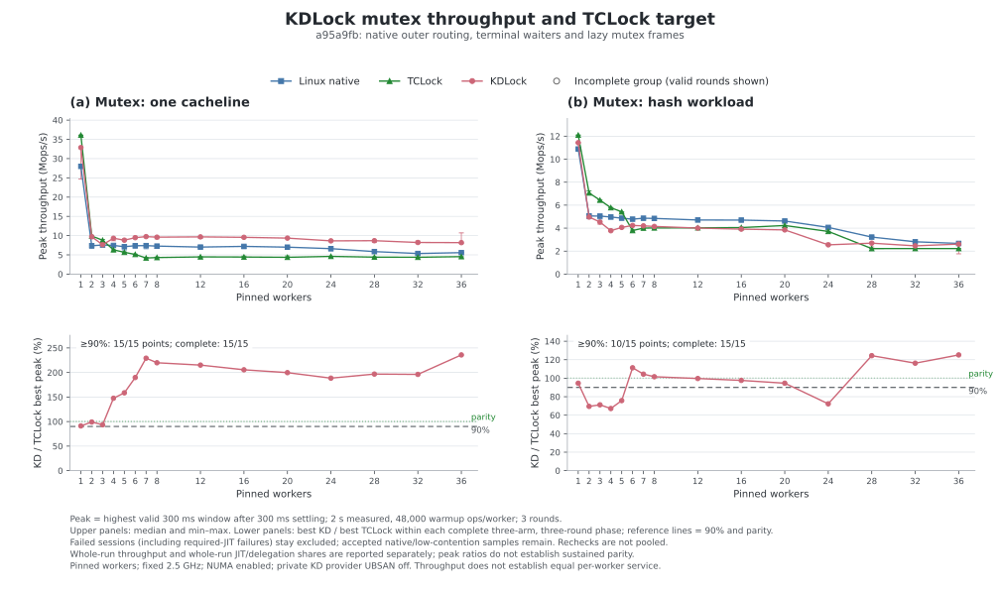

# Mutex follow-up: full thread set and execution costs (2026-10-03)

The acceptance set is 1, 2, 3, 4, 5, 6, 7, 8, 12, 16, 20, 24, 28, 32 and 36 workers. The goal is to avoid falling below TCLock across this set; a successful 16/36 screen is not full acceptance. This follow-up starts at `51493f2`, with the native-first pin and published-shadow read changes retained from the [earlier run](https://github.com/hailongeric/kdlock/blob/e533214/bench/tclock_compare/results/20261003-mutex-optimization.md).

All new builds and execution use the existing recovery guest, kernel `6.1.159-kdclobber2`, Build ID `5ca28058e156f34a2c7fe91e8e0fbf92f4e51960`. The private KD benchmark provider defaults to UBSAN off. NUMA stays on; mutex queue order remains FIFO. The unchanged mutex heat policy is `mutex_contention1024_ratio256`, with a 1,024-body batch limit. Each scored group has three rounds, 48,000 warmup operations per worker, two seconds of measurement, and the highest valid 300 ms full-cohort window after 300 ms settling. Worker CPUs and collector CPU38 remain pinned at 2.5 GHz; unused guest CPUs are not claimed frequency-fixed. Linux Native and the actual TCLock mutex port accompany every performance screen.

## Final 15-point result and acceptance decision

The final production source is `52abad1`; `a95a9fb` adds a matching test-fixture correction. Both final matrices use the same production implementation. `mutex-final2-c1` and `mutex-final2-hash` contain **270/270 valid scored sessions**, with all 15 requested thread counts, all three locks and three rounds each. No final sample is excluded for missing JIT. Every worker progresses, every contended KD positive has returned-body JIT evidence, TCLock delegation is observed where contended, and all final sessions retire and unload normally.

Specifically, all KD sessions at 3–36 threads return JIT bodies. One thread runs natively; at two threads cacheline has 0/0/0 returned bodies and hash has 0/1/1. Zero-body two-thread runs remain accepted under the existing `NO_JIT_LOW_CONTENTION` rule, and are not represented as JIT positives.

**Global performance acceptance is rejected.** Cacheline reaches at least 90% of TCLock's best valid peak at 15/15 points and parity at 12/15 (4–36 threads). Hash reaches 90% at 10/15 and parity at 6/15 (6/7/8/28/32/36). Hash misses 90% at 2/3/4/5/24, and repeated protected median regressions remain. This branch is an experimental performance checkpoint, not an accepted replacement across both workloads. Independently measured incremental gains do not override the cumulative regression gate. There is no measured rollback combination that both removes these losses and preserves all native/cacheline gains.

[Full three-arm statistics](20261003-mutex-followup-statistics.md) include every peak and whole-run min/median/max/spread, JIT/delegation share, minimum worker progress and NUMA-node share. The figure shows medians with min/max ranges; the lower panels use the requested best-peak ratio. The targeted rechecks below are separate groups and are not pooled into these matrices.

Best valid settled 300 ms peaks, Mops/s:

| Threads | Cacheline KD | Cacheline TC | KD / TC | Hash KD | Hash TC | KD / TC |
|---:|---:|---:|---:|---:|---:|---:|
| 1 | 32.898 | 36.111 | 91.10% | 11.440 | 12.098 | 94.56% |
| 2 | 9.959 | 10.052 | 99.07% | 5.037 | 7.248 | 69.50% |
| 3 | 8.398 | 8.983 | 93.49% | 4.605 | 6.467 | 71.21% |
| 4 | 9.353 | 6.341 | 147.51% | 3.901 | 5.806 | 67.19% |
| 5 | 9.124 | 5.754 | 158.56% | 4.108 | 5.421 | 75.77% |
| 6 | 9.835 | 5.184 | 189.71% | 4.270 | 3.838 | 111.27% |
| 7 | 9.884 | 4.314 | 229.14% | 4.238 | 4.060 | 104.40% |
| 8 | 9.766 | 4.443 | 219.81% | 4.189 | 4.124 | 101.57% |
| 12 | 9.693 | 4.507 | 215.06% | 4.018 | 4.031 | 99.66% |
| 16 | 9.625 | 4.684 | 205.49% | 3.985 | 4.082 | 97.62% |
| 20 | 9.434 | 4.725 | 199.67% | 4.013 | 4.243 | 94.58% |
| 24 | 8.779 | 4.658 | 188.46% | 2.690 | 3.721 | 72.28% |
| 28 | 8.778 | 4.461 | 196.77% | 2.769 | 2.226 | 124.38% |
| 32 | 8.594 | 4.382 | 196.12% | 2.583 | 2.222 | 116.25% |
| 36 | 10.719 | 4.546 | 235.80% | 2.789 | 2.228 | 125.19% |

At 36 threads, cacheline KD peak min/median/max is **7.919/8.175/10.719** Mops/s versus TCLock **4.236/4.538/4.546**. Its whole-run medians are **8.104 versus 4.370**. Hash KD peaks are **1.766/2.612/2.789** versus TCLock **2.199/2.225/2.228**, but whole-run medians are **2.023 versus 2.216**: KD remains **8.71% lower** over the whole run. Hash peak spread is **39.19%**, versus TCLock's **1.30%**. A winning short window is not sustained parity.

The valid 36-thread cacheline maximum deserves qualification: CPU20 contributes **31.56%** of the selected window's operations. The window still has positive progress from every worker, so it is retained under the original rule. Its whole-run JIT count, even if entirely assigned to that peak window, bounds returned JIT bodies at only **10.18%** of its published operation count (10.21% allowing the checkpoint-count bound). This is an upper bound, not its measured window JIT fraction. It does not establish uniform 36-worker scaling. The valid 1-thread KD low sample (24.698 versus 32.862/32.898) is also retained; worker CPU time is 99.9926% of wall time, so a corresponding loss of accounted CPU time does not explain it. Its cause is unresolved.

### Regression rechecks

`mutex-final2-recheck-c1` (9 sessions) and `mutex-final2-recheck-hash` (45) all pass the same data/JIT/delegation/progress/drain checks. No source changes occur between the final matrices and these rechecks. The three-thread cacheline median falls from the earlier terminal screen's 8.575094 to 7.630435 in the final matrix and 7.995702 in the recheck (**−11.02%/−6.76%**). All final cacheline medians still improve over the earlier complete `60879dd` matrix; the later terminal screen is a distinct incremental checkpoint, not a substitute full-matrix baseline.

The following comparisons use the fixed historical `51493f2` full-hash medians. They are historical references, not reruns of old KD. Rates are Mops/s; each new value comes from its own three-round group.

| Threads | Historical KD median | Final KD median | Change | Recheck KD median | Change |
|---:|---:|---:|---:|---:|---:|
| 4 | 4.150594 | 3.774763 | -9.05% | 4.025164 | -3.02% |
| 5 | 4.383569 | 4.064442 | -7.28% | 3.998693 | -8.78% |
| 16 | 4.249548 | 3.914204 | -7.89% | 3.925328 (prior same-source screen) | −7.63% |
| 24 | 3.850742 | 2.547617 | -33.84% | 2.682210 | -30.35% |
| 28 | 3.605329 | 2.693097 | -25.30% | 2.724376 | -24.43% |
| 36 | 2.509651 | 2.611624 | +4.06% | 2.823258 | +12.50% |

Hash 4/5/16/24/28 remain repeated losses above 3%. At 4 threads, the recheck is **−3.0220%**, only 0.022 percentage points beyond the decision boundary; this is a threshold failure, not evidence of a precisely known 3% causal effect. The 36-thread loss relative to the immediately preceding pristine-frame screen does not repeat: its recheck median is 2.823258 versus 2.738335 in that screen. All high and low samples remain in their original groups. Historical hash7/32 have only two valid KD rounds and hash12 has none, so their incomplete references cannot supply formal three-round regression decisions.

### What improved, and what still costs time

The retained changes shorten actual work while keeping Linux physical ownership, source leases and final ACK semantics: caller-side native acquisition with exact unlock routing; exact per-CPU lifecycle balances; terminal MINIMAL waiter execution with safe tail retirement; direct preparation of admitted wrapper transport; and lazy initialization of cold mutex-frame recovery fields. The final constructor reserves context ownership before exposing the frame and generic recovery materializes the deferred fields before reading them. The existing two-word input ABI is unchanged.

The earlier separate flat-cycle profiles show substantial kernel queued-spin waiting on the contended KD path (83.48% of worker sample weight at 36 threads in the outer-route cacheline profile). Current code still allocates acquisition task records and serializes their insertion/reference retirement through one registry writer lock. These are concrete remaining costs, but the flat profile cannot assign every queued-spin sample to that lock, quantify remote-memory latency, or serve as a final-source hash profile. The previously tested task-lock sharding/stable-cache candidate increased delegation yet lost throughput, so removing a coordination bottleneck alone did not improve end-to-end execution.

Low-thread hash also loses without substantial delegation: at two threads TCLock delegates no bodies and KD essentially none, yet KD reaches only 69.50% of TCLock's best peak. This gap occurs within one NUMA node and cannot be attributed to JIT code or cross-node memory alone. KD preserves Linux mutex ownership and uses a shadow gate for admitted contention; TCLock's own mutex protocol has different acquisition/handoff costs. The native/contended transition needs attention, not only generated body speed.

Matched frozen workload ELFs rule out an added spill explanation: both old and current hash callers save the same five callee-saved GPRs plus RBP, reserve 24 bytes, use the same five stack slots, and have identical instruction/memory-operand counts in the main source and destination traversal loops. The route cookie stays in RBX. Failed-CAS caller control has extra routing instructions, while successful native acquisition bypasses provider work; static instruction counts do not measure their net dynamic cost. Generated hash traversal likewise remains unchanged, with nine extra ordinary-root route instructions (eleven on the empty path), but most operations are native. Those instructions cannot explain the full observed loss by themselves without additional dynamic evidence.

Locality and progress remain uneven. In final hash24, the four node1 workers supply **5.512%–5.872%** of whole-run operations and **4.182%–4.820%** of selected peaks, against a 16.667% worker share. TCLock is even more node-biased there while faster, so imbalance alone does not explain the ranking. KD cacheline24 is much closer to the worker share (15.292%–15.778% whole). All workers' positive counts establish observed progress only; bounded batches do not prove starvation freedom.

The current mutex successor prefetch remains narrow: header, saved SP/BP, and caller-stack addresses SP and SP−64, issued while the successor is known live before the current body. SP/BP share one record line, so five hints cover two distinct node lines plus two stack lines. There is no full register/frame sweep. Packing mutex identity/state and RIP/RSP/RBP into the first line was tried and reverted after repeatable hash losses; putting more fields together can also couple polling to completion writes. Lazy frame construction instead removes ten cold initialization assignments without changing the packet layout. The separate spin compact prefix remains; Linux `pt_regs` is unchanged.

### Separate JIT activity diagnostic

Three additional hash36 sessions sample the existing returned-body counter approximately every 10 ms on collector CPU38. They have **no accepted performance scores** and are not pooled into any matrix. Each preserves 209 reads, with start/end timestamps, affinity and join-before-cleanup evidence. All 419 eligible overlapping windows have independently checked endpoint brackets. The sampler is stopped before source retirement and unload.

The table compares each run's slowest eligible window with its runner-selected fast window. Rates are diagnostic observations only. The percentage is a bound on returned-body events divided by published operations, **not an exact JIT fraction for the same operation cohort**.

| Repeat | Slow window Mops/s | Slow returned-body proxy | Fast window Mops/s | Fast returned-body proxy |
|---:|---:|---:|---:|---:|
| 0 | 1.731405 | 25.09%–26.83% | 2.142548 | 15.25%–16.22% |
| 1 | 1.716033 | 25.60%–27.38% | 2.724189 | 1.58%–1.71% |
| 2 | 1.738759 | 22.79%–24.41% | 1.815850 | 19.59%–21.09% |

Slower windows coincide with more returned-body activity in all three runs, including higher absolute body-return rates. This association remains in five nonoverlapping windows per run, though those windows still belong to the same execution. It supports investigating the transition between native and delegated execution; it does not establish that JIT activity causes the slowdown. The third run has a much smaller throughput range. Counter sums are non-atomic, returned bodies can precede waiter progress publication, and the sampler adds sysfs/coherence/output work on CPU38. Bounds, raw timestamps, every worker delta and descriptive correlations are preserved in `kd-mutex-jit-series-aligned-1003b.{json,csv}` and `kd-final2-hash-review-1003b.{md,json}` in the host analysis bundle.

The remaining implementation questions are distinct: reduce low-thread acquisition/handoff overhead without changing Linux owner semantics; reduce the total cost of a delegated request before increasing delegation; and improve cross-node service without repeating the rejected grouping policy. One narrowly scoped future experiment is to isolate stable task-record retention from writer-lock sharding. It is unimplemented here and has no claimed benefit, especially at two threads. Current results do not identify one change that fixes all three problems.

### Verification and preserved evidence

The final matrices, both rechecks and counter diagnostic have identical **311-entry declared source manifests**, verified against archived file bytes. All **209 recorded tracked inputs match `a95a9fb`**. The other declared inputs are the private provider's 80 prepared files and manifest plus 21 historical Markdown files. Independent in-memory application of the existing observation overlay reproduces all 80 private files: 66 unchanged, 12 patched and two observer files added. The observation patch SHA256 is `43c27e2309bcab4b37e7e98df080825a35b534fe151a330b334b13ee7bb27a31`.

Each phase also captures 20 Python bytecode cache files outside its source manifest; their differing hashes are indexed separately, with no claim of semantic or execution equivalence. Every declared ELF in the six audited final/pristine phases matches its own frozen manifest (45 instances). Raw ELF hashes differ between builds; source equality does not establish identical binaries or a reproducible source-to-ELF build. The earlier disassembly conclusions refer to their explicitly named screen artifacts, not an unperformed disassembly of every final module.

Final cacheline/hash provider SHA256 values are respectively `dc92580693f03cecf14d8f352a99dfab44a0fba14ef80509e47dda850fc1e146` and `733962b0ccd8b026b5a113250edc23b278c82cb5427caffc3838dfeb2273cedf`. Their KD workload ELF hashes are `1c6bcc3f942d96acc773d80a602a747d7e47f8cd875ed4d98c66b59a991e3c6c` and `854906e76bb1411d73067ee188375e38401e5d3062c554d9a4d02cc1a4adffd0`. UBSAN-off imports, kernel Build ID and the captured source/binary manifests pass the archive audit. Final host evidence reconfirms all 40 QEMU vCPU pins and 2.5 GHz limits on worker CPUs0–35 and collector38. Final guest boot is `dac375e3-30d1-4a77-b704-734d7bc88084`; the runner is idle and all task modules are unloaded.

The complete follow-up archive contains **66 phases**, classified as 909 valid scored sessions, 15 valid diagnostics, five valid functional sessions and 72 planned but unrun slots. Separately, 16 unit phases pass and seven fail; six real owner/ACK probes pass with JIT=0 and one fails. All failures remain failures. In particular, the pristine-frame ACK probe's kernel fault remains failed with original drain unverified; later recovery and the corrected probe do not repair that verdict. The implementation history below records targeted fixtures for terminal/FULL refusal, source closure, exact balances, native/remote owner routing and final ACK. New ordinary mutex timing supplies returned JIT evidence; this round does not claim a new actual nested/early mutex benchmark or a full unit-suite run.

Raw guest evidence is [`mutex-20261003b-evidence.tar.gz`](../../.tmp/mutex-20261003b/mutex-20261003b-evidence.tar.gz), 197,084,298 bytes, SHA256 **`4155fde490cf78e9700b0e79f9dab7b3dc6cd9a8bc0fdca4c9f491dfa1011b3b`**. The adjacent `mutex-20261003b-audit.json` records zero integrity issues; this verifies preserved evidence, not overall performance acceptance. Host controllers, analyses, failed drafts, incident logs and static audits are separately preserved under `host-analysis-final`; its index maps the `/tmp/...` paths used throughout this report to durable copied files.

The [host analysis archive](../../.tmp/mutex-20261003b/host-analysis-final.tar.gz) preserves 2,025 files, with each copied payload rechecked from the archive. SHA256: **`bd12cee25b88686e8672d1de48adfb3373ae85e1d38bd2ca43189c2d28b2f435`**. Its [index](../../.tmp/mutex-20261003b/host-analysis-final/index.json) locates the [source identity audit](../../.tmp/mutex-20261003b/host-analysis-final/files/tmp/kd-final2-source-identity-1003b.md), [independent result/diagnostic review](../../.tmp/mutex-20261003b/host-analysis-final/files/tmp/kd-final2-hash-review-1003b.md), and [matched native hash disassembly audit](../../.tmp/mutex-20261003b/host-analysis-final/files/tmp/kd-mutex-native-hash-audit-1003.txt). Unexecuted drafts remain labeled as such; preservation does not validate them.

The recorded host controller invokes the guest runner under a 2,400-second timeout and SSH under a 2,500-second timeout. The final cacheline invocation selects `--cachelines 1 --threads 1 2 3 4 5 6 7 8 12 16 20 24 28 32 36`; hash selects `--workload rcuht` and the same thread list. Both use `--duration-ms 2000 --peak-window-ms 300 --collector-cpu 38 --repeats 3 --keep-going-no-jit`, the captured kdclobber2 source/baseline and distinct output directories. The recorded defaults supply NUMA-on, UBSAN-off, 10 ms observation, 300 ms settling and 48,000 warmup operations per worker. No missing-JIT failure occurs in either final matrix. Exact commands/build logs, each original session, client measurements, per-worker counters and all previous failures are retained in the raw archive.

## Implementation history

The detailed screens, rejected NUMA/packing/native-retry candidates, intermediate
matrices and original source identities remain in the fixed
[implementation record](https://github.com/hailongeric/kdlock/blob/e533214/bench/tclock_compare/results/20261003-mutex-followup.md#independently-screened-implementation-history).
Current distributions remain in the [statistics](20261003-mutex-followup-statistics.md)
and [machine-readable results](20261003-mutex-followup.json).
