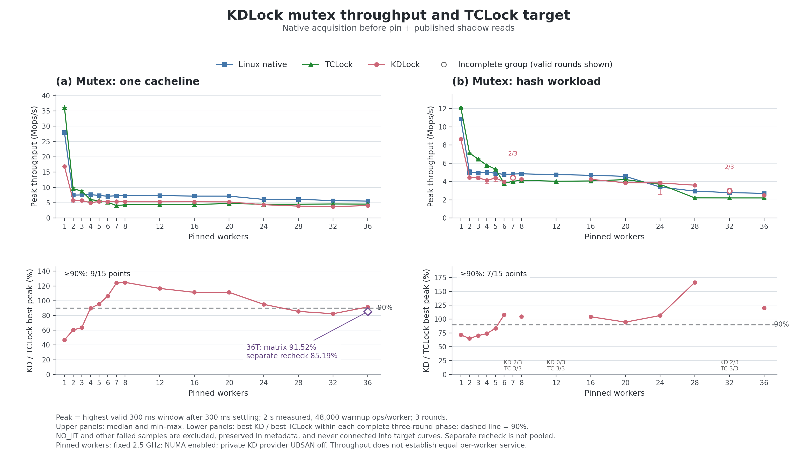

# Mutex optimization, 2026-10-03

The retained changes improve KD's native and contended mutex paths, but do not
establish consistent TCLock parity. Native CAS before the counting pin (`278734e`)
and acquire/release-published shadow reads (`cc75cc1`) remain. Three independent
slower candidates were tested, preserved and reverted. The original task registry,
physical-owner protocol, ABI2 and pinned waiter policy remain.

At 36 threads (Mops/s):

| Phase | KD best peak | TCLock best peak | KD/TCLock peak | KD whole median | TCLock whole median |
|---|---:|---:|---:|---:|---:|
| Final cacheline matrix | 4.236 | 4.628 | 91.52% | 3.787 | 4.532 |
| Separate cacheline recheck | 3.852 | 4.522 | 85.19% | 3.680 | 4.429 |
| Final hash matrix | 2.654 | 2.213 | 119.91% | 2.045 | 2.197 |

The final 36-thread cacheline KD peak-window median is 28.39% above this turn's starting baseline;
the later recheck is still improved but does not reproduce the 90% threshold.
Hash's selected peak exceeds TCLock, while its whole-run median is 6.94% lower.
Five hash sessions fail the returned-body JIT requirement and remain excluded;
minority-node/individual-worker progress can be very uneven. These are mixed
native/delegated KD results, not evidence of pure JIT service matching TCLock.

[Vector figure](20261003-mutex-optimization.svg). Curves do not bridge incomplete
three-round groups; the separate cacheline recheck is explicitly marked.

This continues from `3332e25` using the default UBSAN-off private KD provider.
All builds, tests and measurements ran in the recovery guest on the existing
`6.1.159-kdclobber2` kernel (Build ID
`5ca28058e156f34a2c7fe91e8e0fbf92f4e51960`). Host CPU placement and the recovery
snapshot were freshly checked. Worker CPUs 0–35 and collector CPU 38 have
2.5 GHz minimum/maximum frequency; QEMU vCPUs map one-to-one to host CPUs.
Workers 0–19 are on node 0, 20–35 on node 1. NUMA builds stay enabled;
the current KD mutex queue itself remains FIFO. KD waiters stay pinned;
TCLock retains its parking implementation.

Each scored configuration has three rounds, 48,000 warmup operations per worker,
2 seconds measurement, and the highest valid 300 ms window after 300 ms settling.
All samples, including variation in Linux/TCLock, are retained. Initial screens
cover 1, 2, 16 and 36 threads, one cacheline; the later full matrix is separate.

## Baseline diagnosis

The baseline reaches only 66.29% of TCLock's corresponding best 36-thread peak
(3.222 versus 4.860 Mops/s), although its 16-thread peak exceeds TCLock.
At one thread it reaches 15.123 versus 36.140 Mops/s, without any JIT execution.
Thus neither cross-node accesses nor generated code alone explains the gap.
KD delegates 4.42–6.48% of measured operations at 16 threads and 6.28–7.35% at 36;
TCLock delegates 98.71–98.88% and 96.12–98.11%, respectively.

A separate flat-IP cycles profile (499 Hz, no lost samples, exact kernel/module
ELF ranges) attributes 40.38% of KD worker event-period weight at 16 threads and
70.21% at 36 to `__pv_queued_spin_lock_slowpath`. KD queue polling accounts for
35.80%/12.03%. The task registry and shadow map both have global writer locks;
flat samples alone do not identify which lock caused every wait. At one thread,
RCU read lock/unlock account for 7.79%, and task rerouting another 5.36%.
TCLock at 36 spends 93.30% in its own queued waiter slowpath. These are worker-task sampled
cycle-period weights, not isolated executor costs or remote-memory latency.

Separate one-event diagnostics at 36 threads counted instructions and cycles
with 100% running time. Per completed operation they include every worker's
polling and client setup: instructions KD ~1,428 versus TCLock ~2,059;
cycles KD ~11,060 versus TCLock ~21,042. Different diagnostic sessions must not
be divided into a purported per-body IPC. Lower aggregate KD counts do not mean
higher throughput: parking, global lock waits and useful-work distribution differ.
No remote-latency or cache-miss attribution is inferred from these counters.

Historical stable-task-cache failures used the kernel UBSAN policy and greatly
increased JIT coverage/batch length. They do not establish that task caching
itself is expensive, but they do rule out assuming that higher JIT coverage is
necessarily faster. Their failed samples remain in the September report.

## Native acquisition before the counting pin

Successful original-owner CAS now precedes preemption disabling. Its approximate
entry observation is one x86 `this_cpu_inc`; failed acquisition still pins entry
and contention sampling together, and unpins before any sleeping native path.
No ownership, task reference, admission threshold, wrapper ABI or waiter policy
changes. This is independent of subsequent registry/shadow experiments.

The guest's two basic tests plus mutex resource and hotlock sampling drivers
passed (four drivers total). The resource fixture checks native success never
pins and failed-acquisition sampling remains pinned. All 36 timed sessions passed
business/JIT requirements and drained; 1/2-thread sessions correctly report JIT=0,
while every 16/36-thread KD session has returned-body evidence.
KD median changes versus the fresh baseline: +10.19% (1), +7.96% (2), +5.73% (16),
+2.47% (36). The 36-thread spread is 9.50%, so its small median gain is not a claim
of a stable isolated cross-node speedup. Its best peak remains only 75.47% of
same-phase TCLock. The overall target is not met.

## Scored samples

Values are Mops/s. Each triple is minimum / median / maximum. Spread is
(maximum − minimum) / median for peak throughput. Whole-run values remain
separate from selected windows.

### baseline

| Threads | Arm | Peak min/median/max | Whole min/median/max | Peak spread |
|---:|---|---|---|---:|
| 1 | native | 27.801/27.986/27.994 | 27.788/27.970/27.984 | 0.69% |
| 1 | tclock | 36.132/36.137/36.140 | 36.107/36.109/36.122 | 0.02% |
| 1 | kdlock | 15.110/15.112/15.123 | 15.091/15.105/15.115 | 0.09% |
| 2 | native | 6.653/6.985/7.256 | 6.627/6.960/7.236 | 8.63% |
| 2 | tclock | 9.652/10.195/11.012 | 9.617/10.163/10.960 | 13.35% |
| 2 | kdlock | 5.126/5.128/5.841 | 5.122/5.127/5.754 | 13.94% |
| 16 | native | 6.975/7.227/7.407 | 6.902/7.136/7.361 | 5.98% |
| 16 | tclock | 4.366/4.435/4.701 | 4.333/4.416/4.687 | 7.56% |
| 16 | kdlock | 4.855/4.862/5.026 | 4.839/4.888/4.958 | 3.53% |
| 36 | native | 5.304/5.498/5.704 | 5.156/5.158/5.187 | 7.26% |
| 36 | tclock | 4.471/4.484/4.860 | 4.417/4.462/4.495 | 8.67% |
| 36 | kdlock | 3.106/3.182/3.222 | 2.764/2.840/2.875 | 3.63% |

### native-pin

| Threads | Arm | Peak min/median/max | Whole min/median/max | Peak spread |
|---:|---|---|---|---:|
| 1 | native | 27.979/27.979/27.988 | 27.911/27.964/27.975 | 0.03% |
| 1 | tclock | 36.132/36.135/36.143 | 36.092/36.100/36.113 | 0.03% |
| 1 | kdlock | 16.647/16.652/16.791 | 16.642/16.648/16.783 | 0.86% |
| 2 | native | 6.441/6.577/7.143 | 6.408/6.558/7.130 | 10.68% |
| 2 | tclock | 10.215/10.341/11.108 | 10.186/10.324/11.062 | 8.63% |
| 2 | kdlock | 5.421/5.536/6.138 | 5.219/5.527/6.125 | 12.95% |
| 16 | native | 6.944/7.199/7.317 | 6.821/7.103/7.271 | 5.18% |
| 16 | tclock | 4.571/4.613/4.689 | 4.548/4.605/4.662 | 2.57% |
| 16 | kdlock | 5.134/5.141/5.432 | 5.159/5.192/5.331 | 5.80% |
| 36 | native | 5.447/5.714/5.777 | 4.931/5.530/5.639 | 5.77% |
| 36 | tclock | 4.454/4.491/4.539 | 4.429/4.474/4.475 | 1.89% |
| 36 | kdlock | 3.116/3.260/3.426 | 3.009/3.021/3.375 | 9.50% |

## Published shadow hits without the insertion lock

The existing-key path now acquire-loads the immutable original-address key.
Only cold insertion takes the original global lock, rechecks the table, initializes
the gate, and release-publishes its key. Hashing, 1024-slot capacity, entry layout,
no-reuse lifetime, physical owner state and native fallback remain unchanged.
This is narrower than the historical fully lock-free shadow/task-cache experiment.

The 16/36-thread screen passed all 18 sessions. KD medians rose from 5.141/3.260
to 5.451/4.205 Mops/s (+6.03%/+28.97%). A separate 1/2/36-thread recheck passed all
27 sessions; its 36-thread median was 4.361, with a wide 4.051–5.002 range.
Screen/recheck best KD peaks were 91.55%/108.93% of their corresponding TCLock
peaks. Both exceed 90%, but the high recheck peak is not representative of its
4.141 Mops/s whole-run median. Neither small-thread median regressed relative
to the preceding native-pin change. The later full matrix and recheck are reported below.

Two basic tests and the affected resource driver passed before each screen.
The second fixture additionally injects same-key/colliding-key publication
between the read miss and insertion lock, checks exact-key uniqueness and
preservation of an already-owned gate, and detects removal of the locked recheck.
The existing 1024-capacity, native-peer, slot and FULL/native recovery fixture
checks remain enabled. The initializer's zero key store is explicitly WRITE_ONCE.
These deterministic primitives do not by themselves prove kernel memory ordering;
release/acquire publication was reviewed and live concurrent JIT sessions passed.

An additional frame-pointer callchain diagnostic failed with a kernel unwinder
warning (`kernel stack frame pointer ... bad value 0`), involving
`kd_mutex_resume_completed`/`kd_mutex_task_put`. The assembly intentionally clears
RBP at that switched-stack entry. This is consistent with a frame-chain limitation,
not proof of data corruption or proof that perf caused it: the warning timestamp
precedes the measured phase. Its 11,290,112 measured operations completed with
correct data, but the session remains KERNEL_FAULT and is excluded from results.
After verifying no worker/daemon, active operation, source frame or writer remained,
manual retirement succeeded and both modules unloaded normally. The initial manual
cleanup attempt used the wrong client path and made no retirement/unload changes;
both attempts are preserved. No forced unload or warning-filter changes occurred.
Normal performance rechecks above passed afterward; no callchain attribution is used.

### shadow-hit

| Threads | Arm | Peak min/median/max | Whole min/median/max | Peak spread |
|---:|---|---|---|---:|
| 16 | native | 6.723/6.974/7.349 | 6.669/6.912/7.301 | 8.98% |
| 16 | tclock | 4.567/4.634/4.657 | 4.554/4.616/4.637 | 1.95% |
| 16 | kdlock | 5.380/5.451/5.529 | 5.373/5.392/5.431 | 2.72% |
| 36 | native | 5.351/5.612/5.712 | 5.100/5.481/5.511 | 6.43% |
| 36 | tclock | 4.443/4.459/4.600 | 4.413/4.422/4.562 | 3.52% |
| 36 | kdlock | 3.717/4.205/4.212 | 3.708/3.932/4.150 | 11.77% |

### shadow-recheck

| Threads | Arm | Peak min/median/max | Whole min/median/max | Peak spread |
|---:|---|---|---|---:|
| 1 | native | 27.359/27.977/28.005 | 27.349/27.969/27.987 | 2.31% |
| 1 | tclock | 36.123/36.125/36.142 | 36.108/36.111/36.123 | 0.05% |
| 1 | kdlock | 16.895/16.904/16.912 | 16.840/16.897/16.904 | 0.10% |
| 2 | native | 6.827/7.159/7.556 | 6.781/7.151/7.545 | 10.18% |
| 2 | tclock | 9.552/9.898/10.432 | 9.530/9.865/10.401 | 8.89% |
| 2 | kdlock | 5.293/5.594/6.538 | 5.280/5.575/6.517 | 22.27% |
| 36 | native | 4.861/4.953/5.102 | 4.211/4.465/4.734 | 4.86% |
| 36 | tclock | 4.541/4.565/4.592 | 4.258/4.498/4.563 | 1.11% |
| 36 | kdlock | 4.051/4.361/5.002 | 3.834/4.141/4.170 | 21.81% |

## Rejected empty task-bucket shortcut

The candidate read the permanent task-hash bucket head before entering RCU;
empty buckets returned false, while nonempty buckets reloaded inside the existing
RCU traversal. The real task/RCU/physical-owner probe passed both orders, four
ACKs and deferred frees (explicitly JIT=0), including a new cross-task publication
assertion. All 45 timed screen/recheck sessions passed data/JIT/drain checks.

It improved native small-thread medians to 18.549/6.740 Mops/s at 1/2 threads.
However, against the most recent accepted shadow recheck's 36-thread median,
both the initial screen and prescribed recheck lost more than 3%. The candidate
was preserved on `perf/mutex-empty-bucket-rejected-20261003` and reverted; these
small-thread gains are not part of the accepted implementation. This is another
case where a smaller lookup path does not guarantee better mixed-workload timing.

| Phase | KD36 peak min/median/max | Whole min/median/max | Median change |
|---|---|---|---:|
| empty-bucket | 4.079/4.090/4.273 | 3.925/3.932/4.093 | -6.22% |
| empty-recheck | 3.847/4.038/4.101 | 3.805/3.818/3.833 | -7.42% |

Raw evidence: guest `mutex-20261003-empty-bucket-ack`,
`mutex-20261003-mutex-empty-bucket-c1`, `mutex-20261003-mutex-empty-recheck-c1`.
All native/TCLock/KD samples remain in their frozen records; no candidates are
merged into the accepted score set.

## Rejected disabled-injection read guard

A separate candidate avoided locked CMPXCHG on the normally zero task-allocation
fault-injection flag; an observed set flag still used CAS for one-shot consumption.
The real allocation-refusal/task/owner-ACK probe passed, followed by 27 correct,
drained timed sessions. It nevertheless failed the same protected 36-thread
comparison twice and was reverted. The code remains on
`perf/mutex-fail-read-rejected-20261003`. A statically unnecessary atomic operation
was identified, but these measurements do not establish a throughput benefit from
removing it, nor isolate why mixed-path timing changed. Do not count this as an
accepted optimization or combine its best samples with the retained version.

| Phase | KD36 peak min/median/max | Whole min/median/max | Median change |
|---|---|---|---:|
| fail-read | 3.753/3.816/4.141 | 3.638/3.655/3.814 | -12.52% |
| fail-recheck | 3.646/4.132/4.260 | 3.596/3.901/3.913 | -5.26% |

Evidence: guest `mutex-20261003-fail-read-ack`,
`mutex-20261003-mutex-fail-read-c1`, `mutex-20261003-mutex-fail-recheck-c1`.
The retained source behavior is native CAS before the counting pin plus published
shadow reads; task-registry lookup/allocation/locking remain as before this turn.

## Full cacheline matrix and same-source 36-thread recheck

These phases retain the two accepted changes: native acquisition before the counting pin (`278734e`) and published shadow reads (`cc75cc1`). The task registry remains the original RCU registry with its global lock. The full matrix and subsequent 36-thread recheck are separate phases; no cross-phase maxima are pooled. They are a checkpoint before any later bucket-lock experiment.

The full 15-point matrix passed all 135 sessions, and the separate 36-thread recheck passed all 9. An offline audit recomputed exact payload/worker totals, whole-run throughput, and the highest eligible full-cohort peak from every raw progress sample. All 2,160 worker observations had positive whole-run and selected-window progress, correct CPU placement, and no worker errors. Every KD session with four or more workers returned JIT bodies; three-worker sessions also returned bodies, while one/two-worker sessions correctly retained zero-JIT status. TCLock delegation was positive at every contended point with four or more workers. All records report a drained provider/backend, KD source retirement state 2 with zero modules/frames/writers, and UBSAN-off. This downloaded-record audit does not substitute for the final frozen-source/ELF and raw-log archive audit.

The full matrix reaches at least 90% of corresponding TCLock best peak at 5, 6, 7, 8, 12, 16, 20, 24, 36 threads (9/15 points). Four threads reaches only 89.75% and remains below target. At 36 threads the full matrix reaches 91.52%, but the independent recheck reaches only 85.19%. Thus the 36-thread 90% threshold is not repeatable, and the overall target is not met.

KD peak-median changes versus the initial UBSAN-off baseline (threads: change): 1: +11.86%, 2: +13.17%, 16: +9.92%, 36: +28.39%. Compared with the immediate native-pin-only phase: 1: +1.51%, 2: +4.82%, 16: +3.95%, 36: +25.30%. These comparisons support retaining the two accepted changes but do not turn phase variability into an isolated per-change causal estimate.

The full-matrix 16-thread median is 5.344 Mops/s, -1.96% versus the earlier same-source screen. At 36 threads the full-matrix and latest recheck medians are 4.085/3.828, versus 4.361 in the earlier same-source recheck. The later 36-thread rates are lower without a source change; this is variability to preserve and investigate, not a new-code regression.

Values below are Mops/s, min / median / max of the three peak windows; the ratio compares each arm’s best peak within this phase.

| Threads | Linux peak | TCLock peak | KD peak | KD/TCLock best | KD peak spread |
|---:|---|---|---|---:|---:|
| 1 | 27.665/27.984/27.985 | 36.111/36.133/36.136 | 16.895/16.904/16.906 | 46.78% | 0.06% |
| 2 | 5.247/7.498/7.596 | 9.466/9.587/10.031 | 5.758/5.803/6.046 | 60.28% | 4.96% |
| 3 | 7.515/7.569/7.642 | 8.507/8.834/9.138 | 5.520/5.773/5.816 | 63.65% | 5.13% |
| 4 | 5.954/7.688/7.709 | 5.912/5.994/6.013 | 4.901/5.009/5.396 | 89.75% | 9.90% |
| 5 | 7.233/7.379/7.381 | 5.476/5.732/5.841 | 5.279/5.420/5.582 | 95.56% | 5.59% |
| 6 | 7.127/7.151/7.501 | 5.094/5.166/5.371 | 5.298/5.354/5.714 | 106.39% | 7.76% |
| 7 | 6.796/7.297/7.450 | 4.076/4.105/4.355 | 5.277/5.394/5.400 | 123.98% | 2.28% |
| 8 | 6.706/7.323/7.354 | 4.288/4.340/4.398 | 5.295/5.326/5.492 | 124.88% | 3.70% |
| 12 | 6.790/7.355/7.578 | 4.396/4.409/4.636 | 5.156/5.320/5.407 | 116.64% | 4.73% |
| 16 | 7.133/7.182/7.228 | 4.308/4.426/4.800 | 5.343/5.344/5.345 | 111.37% | 0.06% |
| 20 | 6.757/7.172/7.200 | 4.715/4.773/4.830 | 5.274/5.285/5.380 | 111.40% | 2.02% |
| 24 | 6.081/6.099/6.808 | 4.495/4.524/4.606 | 4.308/4.372/4.378 | 95.05% | 1.60% |
| 28 | 5.525/6.141/6.232 | 4.398/4.527/4.605 | 3.775/3.910/3.937 | 85.49% | 4.16% |
| 32 | 5.393/5.712/5.751 | 4.476/4.617/4.641 | 3.672/3.750/3.822 | 82.35% | 4.00% |
| 36 | 5.152/5.546/5.783 | 4.389/4.571/4.628 | 3.725/4.085/4.236 | 91.52% | 12.51% |

Whole-run rates use the exact completed count and measured wall time, separately from selected peaks.

| Threads | Linux whole | TCLock whole | KD whole |
|---:|---|---|---|
| 1 | 27.654/27.971/27.973 | 36.087/36.122/36.123 | 16.882/16.890/16.895 |
| 2 | 5.241/7.489/7.576 | 9.442/9.564/9.996 | 5.748/5.790/6.039 |
| 3 | 7.486/7.542/7.597 | 8.458/8.772/9.043 | 5.518/5.756/5.771 |
| 4 | 5.911/7.658/7.681 | 5.891/5.978/5.997 | 4.861/4.928/5.358 |
| 5 | 7.191/7.353/7.358 | 5.451/5.712/5.812 | 5.242/5.319/5.515 |
| 6 | 7.100/7.134/7.457 | 4.994/5.098/5.354 | 5.244/5.348/5.680 |
| 7 | 6.696/7.257/7.399 | 4.021/4.079/4.327 | 5.202/5.362/5.370 |
| 8 | 6.622/7.297/7.322 | 4.253/4.311/4.360 | 5.278/5.288/5.472 |
| 12 | 6.656/7.290/7.526 | 4.378/4.392/4.582 | 5.102/5.279/5.395 |
| 16 | 7.086/7.093/7.133 | 4.285/4.403/4.773 | 5.319/5.330/5.355 |
| 20 | 6.525/7.102/7.154 | 4.688/4.753/4.789 | 5.308/5.313/5.378 |
| 24 | 5.920/5.962/6.636 | 4.478/4.506/4.595 | 4.302/4.402/4.468 |
| 28 | 5.341/5.960/6.049 | 4.386/4.511/4.575 | 3.877/3.897/4.053 |
| 32 | 5.151/5.540/5.590 | 4.458/4.595/4.613 | 3.652/3.653/3.791 |
| 36 | 4.984/5.458/5.627 | 4.380/4.532/4.613 | 3.721/3.787/4.029 |

Separate 36-thread recheck:

| Arm | Peak min/median/max | Whole min/median/max | Peak spread |
|---|---|---|---:|
| native | 5.406/5.686/5.801 | 5.267/5.552/5.570 | 6.95% |
| tclock | 4.357/4.442/4.522 | 4.343/4.429/4.486 | 3.72% |
| kdlock | 3.663/3.828/3.852 | 3.627/3.680/3.825 | 4.95% |

### Worker progress and NUMA shares

At 24 threads, CPUs 20–23 form a four-worker minority on node 1 (16.67% of workers). Positive progress does not establish equal service or starvation freedom. TCLock’s very low minority-node share is material when interpreting its aggregate throughput. KD also underserves that node relative to equal per-worker progress.

| Phase / threads | Arm | Node 1 whole share | Node 1 peak share | Minimum whole worker ops | Minimum peak worker ops |
|---|---|---:|---:|---:|---:|
| final-c1 / 24 | native | 14.85–18.90% | 14.99–19.84% | 323,328 | 49,152 |
| final-c1 / 24 | tclock | 1.26–1.41% | 1.24–1.43% | 25,600 | 3,840 |
| final-c1 / 24 | kdlock | 10.55–12.61% | 12.12–13.52% | 226,048 | 39,168 |
| final-c1 / 36 | native | 45.64–50.68% | 47.78–52.92% | 192,768 | 26,624 |
| final-c1 / 36 | tclock | 49.60–49.90% | 49.61–49.98% | 217,344 | 32,256 |
| final-c1 / 36 | kdlock | 37.02–42.35% | 36.21–43.62% | 164,352 | 23,552 |
| final-recheck-c1 / 36 | native | 34.61–51.54% | 32.92–53.10% | 169,472 | 23,552 |
| final-recheck-c1 / 36 | tclock | 50.03–50.45% | 49.96–50.60% | 213,760 | 32,768 |
| final-recheck-c1 / 36 | kdlock | 41.18–42.67% | 41.16–45.51% | 166,400 | 24,576 |

Each range spans three sessions. At 36 threads node 1 holds 16/36 workers (44.44%). Minimum operation counts refer to any individual worker, not node sums. Cohort validity requires progress in the selected window; it provides no hard waiting-time bound.

The full-matrix KD36 measured JIT share is 3.52–5.29%, versus TCLock delegation 98.32–98.77%. The recheck has KD 4.66–5.42% versus TCLock 97.79–98.61%. These remain mixed native/delegated KD measurements, not pure generated-body throughput.

Downloaded-record SHA256:

- `final-c1-records.json`: `659b0d0b6825f7151b6eb3adeb6ecb6b379d881804e2e95ced6bb5bf2d901fa5`
- `final-recheck-c1-records.json`: `94d8f88f2857da308a582692db2a8379c7dc2b16e01063ac74f978ecebc7bb8c`

A fresh six-session flat profile passed with zero lost samples. At 36 threads,
61.28% of KD worker cycle-period weight remains in the kernel queued-spinlock
slowpath, versus 70.21% before the retained changes. At one thread, RCU lock/unlock
is 9.08% and task routing 6.28%. Both profiles use exact symbol ranges and leave
unresolved samples unassigned; neither identifies each queued lock or remote
memory latency. The task registry still allocates per routed acquisition and
serializes all hash chains with one lock. The following bucket-lock experiment
tests this cost without changing exact task references, counts or RCU lifetime.

Evidence: `mutex-20261003-mutex-final-c1`,
`mutex-20261003-mutex-final-recheck-c1`, `mutex-20261003-final-profile`.
The directory name `final-profile` identifies this two-change checkpoint;
it does not imply that later experiments share its source or measurements.
The matching `mutex-20261003-final-ack` owner/RCU probe also passed, explicitly
JIT=0, two orders/four ACKs/two deferred frees.

## Rejected task-registry bucket locks

The candidate replaced one task-registry writer lock with 256 statically initialized,
cacheline-separated bucket locks. Hash-chain membership, exact reference updates,
global live count, allocation, RCU reclamation and final ACK ownership stayed intact.
Two basic unit programs and the real owner/RCU probe passed. The added SELFTEST
checks 1,024 synthetic native-width hash keys, collisions, alignment and all 256
initial locks; it never creates synthetic task references. Both real owner orders,
four ACKs and two deferred frees passed, explicitly JIT=0.

All 36 screen/recheck sessions passed data, returned-JIT and drain checks, but
throughput fell sharply. The candidate is preserved as `781ef6c` on
`perf/mutex-task-buckets-rejected-20261003` and reverted by `30e3850`.
Comparisons use the preceding full-matrix 16-thread median (5.344) and latest
same-source 36-thread recheck (3.828); the older, higher 4.361 median is also
preserved above. The candidate loses by more than 50% against either reference.

| Phase | Threads | KD peak min/median/max | Whole min/median/max | JIT share |
|---|---:|---|---|---:|
| task-buckets | 16 | 2.478/2.496/2.555 | 2.570/2.770/2.943 | 65.00–82.45% |
| task-buckets | 36 | 1.349/1.369/1.746 | 1.332/1.343/1.654 | 67.60–94.66% |
| task-buckets-recheck | 16 | 2.400/2.421/2.454 | 2.649/2.698/2.768 | 70.64–79.13% |
| task-buckets-recheck | 36 | 1.273/1.357/1.431 | 1.264/1.317/1.362 | 90.59–96.91% |

A separate two-session flat profile passed with no lost samples. Kernel queued
spinlock waiting fell to 0.004%/0.035% at 16/36, while worker cycle weight moved
primarily into KD's own waiter slowpath: 75.60% at 16 and 89.79% at 36.
This is evidence against treating removal of registry serialization as sufficient
to improve throughput. It also demonstrates that increased JIT coverage alone is
not a performance result. This experiment uses the same generated-body machinery.
It does not isolate individual executor instructions or remote load latency.

The source provides a plausible explanation for the changed mix: registry get
occurs after heat admission but before queue publication, and combining needs two
waiting successors. Removing cross-task serialization can increase simultaneous
queue occupancy and delegation opportunity. Native acquisition still bypasses the
queue when the original mutex is free. Queue occupancy and heat transitions were
not directly measured, so this mechanism remains an inference.

The retained implementation still has the original task registry. Further work
must reduce the cost of actual delegated service as well as coordination; blindly
removing another global lock or forcing more delegation is not supported by these
results. No approximate statistic replaced an exact ownership/lifetime field.

Evidence: `mutex-20261003-task-buckets-unit`, `mutex-20261003-task-buckets-ack`,
`mutex-20261003-mutex-task-buckets-c1`,
`mutex-20261003-mutex-task-buckets-recheck-c1`,
`mutex-20261003-task-buckets-profile`.

## Full mutex hash matrix

This matrix uses the two retained changes (`278734e` and `cc75cc1`) after reverting the bucket-lock experiment. It is independent of the cacheline phases; no phase maxima are pooled. The hash payload and its operation mix use the existing runner configuration.

Of 135 sessions, 130 passed and five KD sessions failed the returned-body requirement with explicit `NO_JIT`: 7 threads round 2, all three 12-thread rounds, and 32 threads round 2. Every failed session had correct raw workload data, positive worker progress and complete drain, but zero measured JIT bodies; its published throughput fields remain null. These samples are retained as failures and excluded from scored throughput. Thus 7 and 32 threads have only two accepted KD rounds; 12 has none. They cannot satisfy the three-round performance target.

Offline validation recomputed all raw payload/worker totals, whole-run rates and highest eligible peaks. All 1,836 worker observations had positive whole-run and selected-window counts with the requested CPU placement; 1,761 belong to accepted sessions. All KD sources retired to state 2 with zero modules/frames/writers; TCLock drained quiescently and executed delegation at every contended point. The record/derived-summary comparison found no discrepancy. Frozen-source/ELF and raw kernel-log verification also passed the final archive audit below.

Complete three-round points reach 90% at 6, 8, 16, 20, 24, 28, 36 threads (7/15 planned points; 12 points have complete KD/TCLock triplets). At 36 threads KD’s best peak is 2.654 versus TCLock’s 2.213 Mops/s (119.91%). However, KD’s whole-run median is 2.045 versus TCLock’s 2.197 (-6.94%). The peak result meets this phase’s specified metric; it does not establish a whole-run advantage or repeatability across independent phases.

Peak rates below are Mops/s, min / median / max over accepted rounds only. Incomplete groups are explicitly marked and excluded from target acceptance.

| Threads | Linux peak | TCLock peak | KD peak | KD valid | KD/TCLock best | KD spread |
|---:|---|---|---|---:|---:|---:|
| 1 | 10.859/10.864/10.869 | 12.113/12.117/12.120 | 8.651/8.653/8.657 | 3/3 | 71.42% | 0.07% |
| 2 | 4.849/5.006/5.323 | 7.081/7.131/7.261 | 4.315/4.457/4.730 | 3/3 | 65.14% | 9.31% |
| 3 | 4.768/4.937/5.025 | 6.395/6.462/6.516 | 4.199/4.402/4.572 | 3/3 | 70.16% | 8.47% |
| 4 | 4.807/5.024/5.063 | 5.771/5.789/5.813 | 3.820/4.151/4.293 | 3/3 | 73.86% | 11.42% |
| 5 | 4.787/4.914/4.931 | 5.339/5.363/5.369 | 4.021/4.384/4.482 | 3/3 | 83.48% | 10.53% |
| 6 | 4.783/4.785/4.938 | 3.759/3.804/3.816 | 3.966/3.978/4.112 | 3/3 | 107.75% | 3.67% |
| 7 | 4.725/4.829/4.900 | 3.988/4.034/4.059 | 4.382/4.431/4.480 | 2/3 | — incomplete | 2.22% |
| 8 | 4.720/4.850/4.893 | 4.064/4.132/4.146 | 4.156/4.261/4.343 | 3/3 | 104.75% | 4.39% |
| 12 | 4.685/4.767/4.773 | 4.009/4.040/4.086 | — | 0/3 | — incomplete | — |
| 16 | 4.609/4.692/4.740 | 4.044/4.068/4.080 | 4.209/4.250/4.253 | 3/3 | 104.23% | 1.03% |
| 20 | 4.573/4.574/4.598 | 4.208/4.217/4.253 | 3.786/3.866/4.020 | 3/3 | 94.52% | 6.05% |
| 24 | 3.332/3.405/3.627 | 3.690/3.702/3.781 | 2.591/3.851/4.025 | 3/3 | 106.46% | 37.25% |
| 28 | 2.939/2.953/3.029 | 2.213/2.213/2.224 | 3.126/3.605/3.700 | 3/3 | 166.37% | 15.90% |
| 32 | 2.745/2.792/2.813 | 2.205/2.208/2.228 | 2.687/2.975/3.264 | 2/3 | — incomplete | 19.38% |
| 36 | 2.701/2.710/2.740 | 2.200/2.207/2.213 | 2.430/2.510/2.654 | 3/3 | 119.91% | 8.94% |

Whole-run rates use exact completed work and measured wall time.

| Threads | Linux whole | TCLock whole | KD whole | KD valid |
|---:|---|---|---|---:|
| 1 | 10.849/10.850/10.856 | 12.104/12.105/12.109 | 8.550/8.640/8.645 | 3/3 |
| 2 | 4.835/4.997/5.317 | 7.072/7.115/7.238 | 4.309/4.455/4.723 | 3/3 |
| 3 | 4.761/4.923/5.009 | 6.387/6.449/6.507 | 4.200/4.398/4.537 | 3/3 |
| 4 | 4.799/5.005/5.047 | 5.756/5.776/5.798 | 3.835/4.161/4.309 | 3/3 |
| 5 | 4.777/4.901/4.918 | 5.324/5.351/5.354 | 4.055/4.218/4.297 | 3/3 |
| 6 | 4.772/4.775/4.912 | 3.736/3.788/3.795 | 3.965/3.988/4.022 | 3/3 |
| 7 | 4.710/4.808/4.881 | 3.955/4.020/4.051 | 4.334/4.347/4.360 | 2/3 |
| 8 | 4.708/4.834/4.878 | 4.054/4.121/4.129 | 3.940/3.989/4.101 | 3/3 |
| 12 | 4.673/4.753/4.764 | 3.997/4.032/4.073 | — | 0/3 |
| 16 | 4.586/4.678/4.718 | 4.029/4.054/4.064 | 4.107/4.118/4.209 | 3/3 |
| 20 | 4.524/4.549/4.564 | 4.177/4.199/4.233 | 3.770/3.787/3.835 | 3/3 |
| 24 | 3.264/3.329/3.499 | 3.655/3.679/3.762 | 2.730/3.205/3.312 | 3/3 |
| 28 | 2.810/2.928/2.928 | 2.203/2.203/2.212 | 2.725/2.745/2.755 | 3/3 |
| 32 | 2.714/2.763/2.778 | 2.192/2.195/2.217 | 2.290/2.393/2.496 | 2/3 |
| 36 | 2.667/2.670/2.696 | 2.188/2.197/2.202 | 1.925/2.045/2.525 | 3/3 |

### Hash worker progress and node shares

The 24-thread placement has 20 workers on node 0 and four on node 1. KD node 1 receives only 2.85–4.30% of whole-run operations and 0.424–4.939% of selected-window operations, far below its 16.67% worker share. The fastest KD24 peak (4.025 Mops/s) has a 0.424% node-1 share, and its slowest worker completes only 768 operations in that selected window. TCLock is also imbalanced (1.55–1.63% whole-run share); aggregate throughput therefore needs this service-distribution context.

At 36 threads, broadly plausible node totals hide severe per-worker imbalance: the best KD peak (2.654 Mops/s) has a worker with only 4,608 whole-run operations and 256 selected-window operations. Every worker progresses, but 256 is just one published progress batch. Positive accepted-window progress and a bounded delegation batch do not establish a starvation or waiting-time guarantee.

| Threads | Arm | Node 1 whole share | Node 1 peak share | Min whole worker ops | Min peak worker ops |
|---:|---|---:|---:|---:|---:|
| 24 | native | 7.784–9.622% | 5.859–7.845% | 127,232 | 7,680 |
| 24 | tclock | 1.547–1.635% | 1.512–1.573% | 28,160 | 3,840 |
| 24 | kdlock | 2.853–4.296% | 0.424–4.939% | 31,232 | 768 |
| 36 | native | 42.462–43.000% | 43.128–43.945% | 89,088 | 8,960 |
| 36 | tclock | 49.573–49.706% | 49.535–49.794% | 105,984 | 15,104 |
| 36 | kdlock | 39.121–45.267% | 39.952–48.708% | 4,608 | 256 |

Ranges span accepted rounds. Node 1 has 16/36 workers (44.44%) at 36 threads. Counts are minima over individual workers, not node sums.

### Measured returned/delegated body fractions

These fractions use exact measurement-phase returned bodies divided by all completed operations. Small nonzero KD values prove execution but do not mean most work ran through JIT. The fastest KD36 peak’s session has only 0.4053% JIT work; the three KD36 sessions span 0.4053–9.0573%. TCLock’s corresponding range is 97.3875–97.6863%. Therefore this phase compares the complete mixed-path implementations, not isolated executor throughput.

| Threads | KD JIT share | KD valid rounds | TCLock delegated share |
|---:|---:|---:|---:|
| 1 | 0.0000–0.0000% | 3/3 | 0.0000–0.0000% |
| 2 | 0.0000–0.0000% | 3/3 | 0.0000–0.0000% |
| 3 | 0.0004–0.0005% | 3/3 | 0.0373–0.2081% |
| 4 | 0.6252–1.8446% | 3/3 | 7.0253–7.2465% |
| 5 | 0.9067–1.8773% | 3/3 | 12.5534–12.9492% |
| 6 | 2.1369–2.7229% | 3/3 | 72.6569–74.4827% |
| 7 | 0.0657–0.5599% | 2/3 | 97.0444–97.5141% |
| 8 | 2.2730–2.9661% | 3/3 | 97.4665–97.5792% |
| 12 | — (all NO_JIT) | 0/3 | 97.4068–97.5078% |
| 16 | 0.0674–1.3418% | 3/3 | 97.3665–97.5609% |
| 20 | 4.8798–5.6153% | 3/3 | 97.3891–97.6187% |
| 24 | 3.0313–8.1058% | 3/3 | 93.5990–94.4898% |
| 28 | 2.8053–4.0504% | 3/3 | 97.6246–97.7178% |
| 32 | 2.5462–4.9965% | 2/3 | 97.6007–97.8857% |
| 36 | 0.4053–9.0573% | 3/3 | 97.3875–97.6863% |

Evidence: host `final-hash-records.json`, SHA256 `7db646213ac93855d1f1eb01f792acb602fb0f81abbae8a65c249f4a511f6c1f`. All five `NO_JIT` records and their raw measurements remain preserved. The archive index provides the exact originating guest directory.

## What remains expensive

The single-thread gap is native-path overhead: neither arm delegates there.
In the full cacheline matrix KD's best rate is 16.906 Mops/s (59.15 ns/op),
versus TCLock's 36.136 (27.67 ns/op). KD performs an RCU task-routing lookup on
unlock and preserves Linux's original owner validation/CAS. TCLock's registered
context fast path releases its own lock byte with a store. The archived caller
ELFs also show KD saving/restoring five extra registers and constructing the
ABI2 SP/IP/BP arguments. These are source/assembly differences; their individual
nanosecond costs were not isolated. They cannot be attributed to JIT or NUMA.

For admitted requests, task allocation, reference publication/removal and RCU
freeing remain. Queue/node lifecycle also updates exact shared counters. Each
delegated body initializes and checks a frame/lock ledger, enters the wrapper,
checks completion, retires the frame and eventually restores its originating
worker. The physical executor acquires the original Linux mutex once per ownership
interval, across the batch and its own body; it does not acquire it anew for every
delegated body. Likewise, ordinary COMPLETE does not require a complex native-suffix
ACK on every body. Per-body ownership checks and exact lifetime work remain.

These fixed costs are plausible reasons delegation loses on a one-cacheline
payload. The rejected bucket experiment demonstrates this on one NUMA node at
16 workers, so cross-node locality cannot explain the entire loss. FIFO handoffs
and shared counter traffic can add cost at 36, but no remote-memory latency was
measured. Do not replace ownership or lifetime fields with approximate statistics
to remove this work.

Source references: `kernel_module/lock/mutex_calls.inc`,
`kernel_module/kd_mutex_tasks.c`, `kernel_module/mutex/{queue,combiner,clobber}.inc`,
`kernel_module/execution/{wrapper_entry,frame_lifecycle}.inc`,
`include/kd_mutex_direct.h`, and `tclock_backend/komb_mutex.c`.

## Separate cache-event diagnostics

Both selected events first counted successfully on an idle guest, then ran in
separate 36-thread one-cacheline KD/TCLock sessions on the retained source.
Every event had a positive count/runtime and 100% running time; four diagnostic
sessions passed data/JIT/drain checks. They are excluded from throughput scores.

| Event | Arm | Count | Completed operations | Count / completed operation |
|---|---|---:|---:|---:|
| cache-misses | TCLock | 3,529,610 | 13,049,344 | 0.270 |
| cache-misses | KD | 122,672,996 | 11,431,424 | 10.731 |
| L1-dcache-load-misses | TCLock | 542,883,274 | 13,710,848 | 39.595 |
| L1-dcache-load-misses | KD | 134,346,554 | 11,825,920 | 11.360 |

These counts cover the measured client and inherited workers, including polling,
and use different invocations for each event. They show different cache behavior,
not a uniform increase at every level for KD. Do not divide them into a miss rate,
assign them to individual request fields, or interpret them as remote-memory
latency. The counter contrast does not justify an unmeasured broad-prefetch change.
Evidence: `mutex-20261003-final-cache-misses` and
`mutex-20261003-final-L1-dcache-load-misses`; event-availability logs are retained
in the host evidence directory.

## Evidence

Guest directories under `/root/kdlock-evidence/`:
`mutex-20261003-mutex-baseline-c1`, `mutex-20261003-native-pin-unit`,
`mutex-20261003-mutex-native-pin-c1`, `mutex-20261003-baseline-profile`,
`mutex-20261003-baseline-instructions`, `mutex-20261003-baseline-cycles`.
Each benchmark directory retains frozen source/ELF identities, commands, kernel
identity, all session records and cleanup logs. Host observations and downloaded
records are under `bench/.tmp/mutex-20261003/`; diagnostic throughput is excluded
from scored results. No guest kernel changes or full test suite were run.

Final integrity collection covers 29 phase directories and 527 benchmark/diagnostic
sessions: 499 valid timed samples (including preserved rejected implementations),
22 valid diagnostics, five drained NO_JIT failures and one failed kernel-unwinder
diagnostic with separately verified manual drain. Four unit phases passed (12
drivers total), and four real owner/RCU/ACK probes passed with JIT=0. Frozen
source/ELF/diagnostic-tool hashes, UBSAN-off imports, payload/worker/peak totals,
returned-body/delegation evidence and recorded retirement were revalidated with
zero integrity issues. Failed results were not promoted to passes. Basic unit
phases retain command/log/status but did not capture frozen source manifests;
the matching benchmark/ACK phases do retain frozen sources. All guest work drained
and modules unloaded normally. No force unload, kernel changes or warning filters
were used.

Guest and downloaded archive:
`/root/kdlock-evidence/mutex-20261003-evidence.tar.gz` and
`bench/.tmp/mutex-20261003/mutex-20261003-evidence.tar.gz` (179,458,010 bytes).
SHA256: `795fccac28d8f50b93efea4d891e58d625334c62aa3ee5339f121ffda52f41a7`.
The adjacent `mutex-20261003-audit.json` and `mutex-20261003-records.json` retain
phase-separated decisions and every planned session. Final host observations
reconfirmed all 40 vCPU pins and 2.5 GHz limits for workers 0–35/collector 38.
Host controllers, offline audit/plot scripts, event-availability logs and CPU
observations are separately preserved in `bench/.tmp/mutex-20261003/host-analysis.tar.gz`
(15,638,653 bytes), SHA256
`946ab11f6b1d90e5ba78d1bf6ffe7d535e1686acb07f78f9c59ccd4c7eda866d`.
This includes its own per-file manifest; the report figures retain full raw-record
hashes in `final-plot-provenance.json` within that archive.

Record SHA256 (downloaded directly from completed guest outputs):

- `baseline-records.json`: `ada4d660f9a04f87522748a81b1e5fa47dbf48ccff3673d1e292897c0560a8e1`
- `native-pin-records.json`: `ef418e38c81dad834b217a0903040b32c41455424e15505d3e4ce026e4a1b3cc`
- `instructions-records.json`: `565103878074b84288a7b2f9afd9faf97b71f9e4c7146b6f6c4626a4ab104690`
- `cycles-records.json`: `4d359f61b3b39494adbc320060ce4b1ca98fa2829e28d4b1255583247f025c5d`

Shadow evidence: `mutex-20261003-shadow-hit-unit`, `mutex-20261003-shadow-race-unit`,
`mutex-20261003-mutex-shadow-hit-c1`, `mutex-20261003-mutex-shadow-recheck-c1`;
failed diagnostic and explicit later drain: `mutex-20261003-shadow-callchain`.

- `shadow-hit-records.json`: `782cab03784d0f50426375c079bd0be32f4dd0df7aa425819a1c4f9562b6b46a`

- `shadow-recheck-records.json`: `ecc53018327963a89b157875f9d69860d9586eb334d667394259b446e59b9d40`
