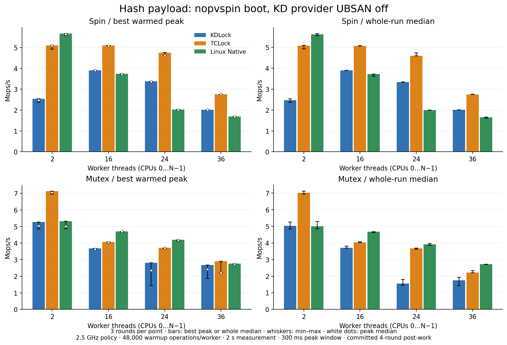

# 2026-10-08: why KD hash is slow

The evidence points to three contributors: native acquisition/handoff at small cohorts,
translated traversal plus request execution at large spin cohorts, and expensive
mixed native/delegated coordination for mutex. NUMA placement amplifies them.
The optimization target is the faster of TCLock and Linux Native, using both
warmed peak and sustained throughput. Matching TCLock alone would leave mutex
behind Native at several points.

## Current measurements

Rates are Mops/s; whole means the median whole-run throughput. The best reference
is selected independently for peak and whole. Full three-arm distributions and
worker shares are in [statistics](20261008-hash-diagnosis-statistics.md).

| Lock / threads | KD peak | Best reference peak | KD whole | Best reference whole |
| --- | ---: | ---: | ---: | ---: |
| Spin / 2 | 2.541 | 5.673 Native | 2.475 | 5.610 Native |
| Spin / 16 | 3.908 | 5.099 TCLock | 3.898 | 5.058 TCLock |
| Spin / 24 | 3.376 | 4.758 TCLock | 3.333 | 4.595 TCLock |
| Spin / 36 | 2.017 | 2.765 TCLock | 2.006 | 2.739 TCLock |
| Mutex / 2 | 5.266 | 7.136 TCLock | 5.039 | 7.023 TCLock |
| Mutex / 16 | 3.686 | 4.703 Native | 3.702 | 4.680 Native |
| Mutex / 24 | 2.800 | 4.195 Native | 1.557 | 3.922 Native |
| Mutex / 36 | 2.678 | 2.904 TCLock | 1.746 | 2.717 Native |

At 36, spin reaches 72.95% of the best peak; matching TCLock requires 37.08% more
throughput. Mutex reaches 92.21% of the best peak but only 64.27% of the best whole-run
median. Mutex 24 reaches just 39.69% of Native’s whole median. The target remains unmet.

Mutex variability is substantial: KD peak spread is 57.31% at 24 and 33.52% at 36;
TCLock 36 peak spread is 31.16%. All valid high and low samples are retained.

These are 90 new, unprofiled samples at committed `11c8e72` under `nopvspin`:
2/16/24/36 threads plus a fixed 16 split-node control, all three arms and three
rounds. Production code is unchanged from `009e8e3`; the uncommitted 64-round
outside-lock payload is excluded. All workers use the committed four rounds.
The earlier 540-sample matrix used the prior boot policy and is kept separate.

Conditions: existing `6.1.159-kdclobber2`, Build ID
`5ca28058e156f34a2c7fe91e8e0fbf92f4e51960`, fixed 2.5 GHz policy, verified vCPU pinning,
NUMA-on, UBSAN-off KD provider, batch 1024, spin prefetch 2 and ratio 2. Each worker
warms up for 48000 operations; measurement is 2 s with the highest valid 300 ms
full-cohort window after 300 ms settling. Collector 38 is outside the workers.

## What explains the gap

**Spin execution adds work inside the dependent traversal.** The hash has 1024
buckets and 4096 preallocated nodes, about 320 KiB. A source-chain iteration expands
from 12 to 15 instructions; a destination-chain iteration expands from 5 to 9.
Generated block-budget checks and virtual-register packet reloads repeat inside
these loops. KD's clobber caller spills payload inputs to the waiter's stack;
TCLock keeps them in callee-saved registers restored by its native stack switch.
The current generated images contain no per-body LOCK/MFENCE/LFENCE/SFENCE to remove.

Separate profiles put KD’s generated spin image at 896 sampled cycle-period units
per completed operation versus 706 for TCLock’s native body, a 27% difference.
KD’s combiner contributes another 297 units/op. The image includes its wrapper and
the native symbol has a different boundary, so these are not isolated function
timings or an additive wall-time decomposition. KD returns 99.897–99.899% of the
unprofiled 36-thread bodies through JIT: lack of translation is not the spin issue.
See [emission](../../../disassem/translation_image.py),
[caller ABI](../../../include/kd_spin_direct.h) and
[combiner](../../../kernel_module/spin/combiner.inc).

Separate event counts show spin KD/TC ratios of 1.375 for cycles and 1.714 for
instructions, but 0.989 for L1-load misses. Mutex KD/TC L1 misses are also similar
(1.010×); KD/Native is 2.967×. These totals include waiting workers and client work.
They do not support blaming more total L1 misses for the gap against TCLock,
or establish remote-memory latency. All 54 event runs had 100% running time;
all 18 flat profiles had zero lost samples. [Diagnostic details](20261008-hash-diagnosis-diagnostics.md)
retain every round separately from performance scores.

**Small-thread spin needs a native-path optimization.** At two workers KD executes
no returned JIT bodies. Its physical path still checks heat, maintains the exact
nondelegated acquisition count, records approximate observations and prepares a
clobber unlock CALL. Optimizing the generated loop cannot fix this cohort. A
caller/fast-unlock experiment must retain exact acquisition provenance, preemption
pairing and a recognizable translated completion endpoint.

**Mutex pays for two coordinated ownership paths.** Successful outer owner CAS
already bypasses shadow/task/JIT work. An admitted caller looks up a
shadow and allocates/registers an exact task record. A queue owner acquires both
the private KD gate and original Linux mutex; eligible followers execute under
that physical owner. This preserves native-peer exclusion
and physical ownership. TCLock uses its own mutex protocol and preallocated worker
contexts; its native waiter-to-waiter jumps amortize batch-return work.

Current 36-thread KD mutex JIT share varies from 21.99% to 49.78%; at 24 it is
36.06–52.84%. Its lifetime average is 45–105 delegated bodies per combiner at 36,
versus TCLock’s 1019–1022 measured bodies per returned batch. KD’s counters include
warmup, so this is a queue-regime comparison, not an exact matched-period cost ratio.
The 1024 ceiling is not the apparent limiting factor. Current figures supersede
the earlier, different-boot observation of roughly 15 KD bodies per combiner.

KD mutex profiles contain 30.44–54.07% worker cycle weight in the kernel qspinlock
slowpath, 30.70–34.25% in KD’s pinned notification loop and 7.11–27.39% in Linux’s
optimistic-spin queue. These locate competing wait paths; they do not assign all
kernel spin waiting to the task registry. Profiled KD JIT share is 23.08–37.54%,
different from baseline; sampling changes the route mix.
All 15 baseline KD mutex sessions have zero readiness/JIT/frame/capacity/handoff
errors, zero task allocation failures and balanced original-owner acquire/release.
See [contention routing](../../../kernel_module/lock/mutex_calls.inc),
[task records](../../../kernel_module/kd_mutex_tasks.c),
[batch execution](../../../kernel_module/mutex/combiner.inc) and
[retained counters](20261008-hash-diagnosis-batches.json).

The warmed single-lock shadow hit is already lock-free, and a simple batch already
holds one source lease. Replacing these again is not a new optimization. Normal
COMPLETE does not execute native-suffix owner ACK; the zero native-suffix counters
exclude that particular slow path as the observed cause here, not ordinary owner checks. Flat queued-spin samples do
not identify which lock instance caused the wait.

**Placement changes matter, but do not establish remote-load latency.**
With 16 workers, moving from CPUs 0–15 to 0–7,20–27 cuts spin peak medians by
47.80% for KD and 45.76% for TCLock. Mutex whole medians fall 59.07% for KD,
44.81% for TCLock and 41.54% for Native. This control keeps worker count fixed.
At 24 threads, KD’s four node1 workers produce only 1.89–1.97% of spin operations
and 7.94–10.30% of mutex operations, compared with 16.67% of workers. TCLock is
also skewed; Native mutex gives node1 only 3.67–5.21%. Throughput alone can reward
an uneven service distribution.
The local 16 spin gap remains substantial. The experiment measures the effect of
worker placement and sharing patterns, not a count or latency of remote transfers.
Every worker progressed in each run and selected peak. This does not establish a
starvation bound; minority-node shares remain part of acceptance.

**More prefetch or tighter packing is not automatically better.** Spin already
places request identity/state and IP/SP/BP on one line. Default producer hints
cover three minimal frame/packet lines, the return-slot area and up to four upward
caller-stack lines before the next body executes. Clobber still needs the virtual
GPR backing slots used by translated code. Mutex already prefetches the known-live
successor header, SP/BP and nearby stack, and allocates waiter stacks by CPU node.
Packing completion writes onto a line polled by another CPU can increase sharing;
the prior packed-mutex experiment regressed. New layout work should separate
polling/completion traffic from executor-only state and target measured misses.

## Proposed experiments, in order

| Priority | Change | Expected scope and proof needed |
| --- | --- | --- |
| 1 | Eliminate a dead packet read before a proved 32/64-bit MOV overwrite; prove a contiguous terminal metadata suffix and omit redundant comparisons | Small isolated translator changes. Preserve partial-register/self-addressing reads, resume entry points, dynamic lock/endpoint checks and exact-once FULL CALL construction. These are unlikely to close the whole gap alone. |
| 2 | Reduce repeated traversal-budget work using proved single-entry regions | Larger spin/hash opportunity. Preserve a finite bound, correct exit RIP and logical state; never replay side effects. Account for every entry, cycle and side exit; prove flags requirements. |
| 3 | Shorten simple mutex/spin batch service and the native caller path independently | Profile frame construction, admission and retirement. Hoist only proved batch-invariant state; keep per-request publication/OPEN, identity, ownership and COMPLETE checks. Retain generic FULL recovery. |
| 4 | Diagnose mutex route and batch exits, then isolate reusable exact task storage from admission changes | Diagnostic per-CPU counts for initial native success, admission rejection, gate winner, enqueue, delegate and exit reason; stage-specific wait samples. Exact acquisition refs survive final ACK; zero refs must be inactive. Do not force delegation before its service cost improves. |
| 5 | Revisit NUMA service policy with measured queue residence and node shares | Improve executor locality together with minority-node service. Keep body/scan bounds and deferred remote priority. Do not repeat rejected grouping or packing changes without new evidence. |

Prior broad-prefetch and cross-block register-residency trials did not give a
repeatable win. Mutex task-lock sharding removed queued-spin sample weight but
lost more than 50% throughput while increasing delegation; this disproves higher
JIT coverage as an optimization objective by itself. Bounded mutex grouping,
post-admission native retry and packed-node candidates also regressed. Even the
disabled fault-injection read guard lost 12.52%/5.26% on its earlier screen/recheck;
removing an atomic instruction alone is not evidence of an end-to-end gain. Their
[retained evidence](HISTORY.md) remains relevant; none is presented as a new fix.

Screen each candidate separately at 16/36, plus 2 for caller changes and 24 for
fairness. Recheck apparent regressions once; reject repeatable median losses above 3%.
Then run all 15 requested thread counts and both cacheline/hash controls. Require
returned-body JIT, actual TCLock mutex delegation, exact business results and full
drain. Keep all samples and failures. Parity means KD meets the stronger comparator
at each point; peak parity alone must not conceal sustained losses.

## Evidence and limits

All 90 unprofiled and 72 diagnostic sessions passed business/context/progress and
drain checks. The independent [identity audit](20261008-hash-diagnosis-audit.json)
checks the 401-file committed archive, 63 private `.inc` files, reconstructed
provider overlays, frozen ELF/JIT identities, returned bodies, source retirement,
unload order and host/guest controls. Executable/data/runtime-relocation sections
match between phases; BTF and verified build-directory metadata differences are
recorded explicitly. No unit suite was run because production code is unchanged.

The guest is idle, modules unloaded, source unchanged, and final host pinning and
frequency policy match preflight. The confirmed snapshot is
`pre_hash_nopvspin_20261008`. Raw commands, logs, frozen inputs and diagnostics are
preserved under host `bench/.tmp/hash-diagnosis-20261008/` and guest
`/root/kdlock-evidence/hash-diagnosis-20261008/`. The guest archive SHA256 is
`57e8c0e0fbad050c0c44ef7d76c31ca71416a7df2debf4d74d9ae92e35e2295b`.
[Evidence manifest](20261008-hash-diagnosis-evidence.json) identifies the archives
and analysis helpers. Large raw archives remain local and do not ship with Git.

This is a targeted diagnosis, not a new 15-point acceptance matrix. Sampling changes
route mixes and throughput; diagnostic timings are never scored. Flat cycles and
aggregate cache counters do not identify remote-transfer latency or prove the
individual cause of every throughput difference.
No production protocol or kernel code changed in this investigation. The proposed
gains remain unmeasured; this report does not claim the target has been reached.
