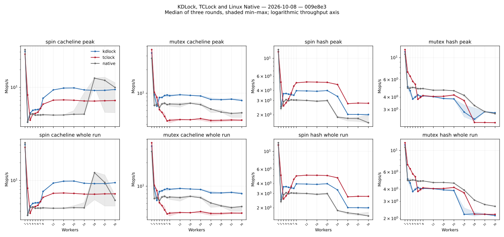
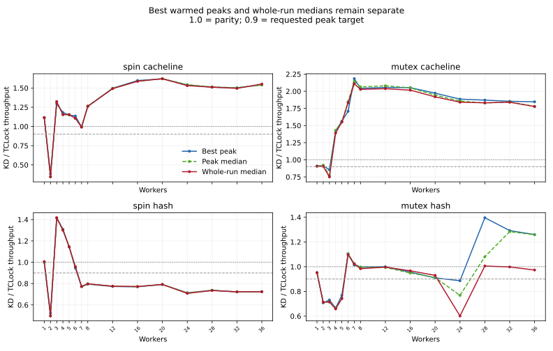

# Spin and mutex comparison (2026-10-08)

Source commit: `009e8e303e0e5f3d78aadec1c7c5103259194f06`. This rerun contains **540/540 accepted sessions**, across four payload/lock combinations, 15 thread counts, three backends and three rounds.

Boot policy: all 540 samples ran before the later `nopvspin` activation. These
scores and their raw evidence describe that earlier environment; they are not
results for the [current native-qspinlock boot](../../../docs/PROJECT_GUIDE.md#native-qspinlocks-in-the-vm).

Worker CPUs are the recorded prefixes of CPU0–35; collector CPU38 is separate. The setup uses a fixed 2.5 GHz frequency policy, NUMA on, KD provider UBSAN off, KD body limit 1,024, spin prefetch mode 2, adaptive ratio limit 2, 48,000 warmup operations per worker, and two-second measurements sampled every 10 ms. The scored peak is the highest observed full-cohort window of at least 300 ms after 300 ms settling.

Cacheline updates one cacheline. Hash uses 1,024 buckets, 4,096 preallocated nodes, 8,192 keys and writes in every operation. Each operation includes four dependent multiply/add rounds after unlocking. The uncommitted 64-round change was excluded. These are separate workloads. KD published waiters remain pinned; TCLock mutex supports parking. KD mutex uses its current FIFO queue. TCLock is configured for 1,024; its zero-based upstream jump rule can execute 1,025 bodies.

[CSV statistics](20261008-threeway-spin-mutex-statistics.csv), [all sample verdicts](20261008-threeway-spin-mutex-samples.csv), [JSON](20261008-threeway-spin-mutex.json) and [distribution details](20261008-threeway-spin-mutex-statistics.md) retain min/median/max/spread for peaks and whole runs, worker/node progress and execution evidence.

Each table shows the best valid peak of three rounds in Mops/s. KD/TC is best peak divided by best peak. A partial group remains diagnostic and cannot meet the three-round target. Three rounds provide observed variation, not a confidence interval.

## Spin cacheline

Accepted sessions: 135/135. KD reaches 90% of TCLock at 14/15 points and parity at 13/15. Below 90%: 2. Incomplete or unaudited: none.

| Threads | KD peak | TCLock peak | Native peak | KD / TC | Whole median KD / TC |
|---:|---:|---:|---:|---:|---:|
| 1 | 40.884 | 36.651 | 43.820 | 111.551% | 111.596% |
| 2 | 2.990 | 7.809 | 2.615 | 38.291% | 34.624% |
| 3 | 3.667 | 2.831 | 3.544 | 129.523% | 132.230% |
| 4 | 4.164 | 3.525 | 3.604 | 118.148% | 115.426% |
| 5 | 4.175 | 3.631 | 3.401 | 114.987% | 115.448% |
| 6 | 4.359 | 3.837 | 3.410 | 113.585% | 110.540% |
| 7 | 4.384 | 4.408 | 3.402 | 99.458% | 99.084% |
| 8 | 6.545 | 5.193 | 3.442 | 126.046% | 126.269% |
| 12 | 9.105 | 6.081 | 3.401 | 149.714% | 149.128% |
| 16 | 9.797 | 6.135 | 3.419 | 159.687% | 158.750% |
| 20 | 9.787 | 6.043 | 4.020 | 161.951% | 162.072% |
| 24 | 9.057 | 5.885 | 8.071 | 153.913% | 153.083% |
| 28 | 8.861 | 5.867 | 14.460 | 151.017% | 151.142% |
| 32 | 8.904 | 5.924 | 14.849 | 150.287% | 149.511% |
| 36 | 9.204 | 5.968 | 12.004 | 154.207% | 155.182% |

## Mutex cacheline

Accepted sessions: 135/135. KD reaches 90% of TCLock at 14/15 points and parity at 12/15. Below 90%: 3. Incomplete or unaudited: none.

| Threads | KD peak | TCLock peak | Native peak | KD / TC | Whole median KD / TC |
|---:|---:|---:|---:|---:|---:|
| 1 | 32.797 | 36.141 | 28.000 | 90.749% | 90.652% |
| 2 | 9.537 | 10.461 | 7.252 | 91.159% | 90.360% |
| 3 | 7.907 | 9.249 | 7.665 | 85.486% | 74.998% |
| 4 | 8.899 | 6.246 | 7.119 | 142.463% | 139.031% |
| 5 | 9.041 | 5.784 | 7.545 | 156.315% | 155.038% |
| 6 | 9.524 | 5.577 | 7.726 | 170.754% | 183.041% |
| 7 | 9.692 | 4.439 | 7.191 | 218.339% | 210.947% |
| 8 | 9.555 | 4.678 | 7.466 | 204.248% | 202.741% |
| 12 | 9.654 | 4.696 | 7.508 | 205.581% | 203.779% |
| 16 | 9.478 | 4.617 | 7.635 | 205.265% | 201.614% |
| 20 | 9.408 | 4.771 | 7.496 | 197.184% | 191.826% |
| 24 | 8.704 | 4.617 | 6.309 | 188.516% | 184.034% |
| 28 | 8.476 | 4.530 | 6.094 | 187.094% | 183.124% |
| 32 | 8.566 | 4.622 | 5.548 | 185.343% | 183.982% |
| 36 | 8.421 | 4.561 | 5.657 | 184.624% | 177.697% |

## Spin hash

Accepted sessions: 135/135. KD reaches 90% of TCLock at 5/15 points and parity at 3/15. Below 90%: 2, 7, 8, 12, 16, 20, 24, 28, 32, 36. Incomplete or unaudited: none.

| Threads | KD peak | TCLock peak | Native peak | KD / TC | Whole median KD / TC |
|---:|---:|---:|---:|---:|---:|
| 1 | 12.078 | 12.085 | 12.826 | 99.941% | 100.581% |
| 2 | 2.657 | 5.092 | 2.588 | 52.191% | 49.651% |
| 3 | 3.691 | 2.604 | 2.918 | 141.742% | 141.648% |
| 4 | 3.707 | 2.831 | 3.090 | 130.929% | 130.072% |
| 5 | 3.610 | 3.150 | 3.036 | 114.601% | 114.374% |
| 6 | 3.558 | 3.764 | 3.072 | 94.518% | 95.855% |
| 7 | 3.500 | 4.538 | 3.063 | 77.135% | 77.286% |
| 8 | 3.981 | 5.007 | 3.063 | 79.501% | 79.793% |
| 12 | 3.956 | 5.119 | 3.026 | 77.284% | 77.546% |
| 16 | 3.923 | 5.094 | 2.984 | 76.998% | 77.246% |
| 20 | 4.002 | 5.056 | 3.043 | 79.156% | 79.211% |
| 24 | 3.387 | 4.750 | 1.930 | 71.319% | 70.799% |
| 28 | 2.031 | 2.754 | 1.822 | 73.753% | 73.503% |
| 32 | 2.022 | 2.799 | 1.884 | 72.224% | 72.239% |
| 36 | 2.019 | 2.789 | 1.985 | 72.387% | 72.371% |

## Mutex hash

Accepted sessions: 135/135. KD reaches 90% of TCLock at 10/15 points and parity at 5/15. Below 90%: 2, 3, 4, 5, 24. Incomplete or unaudited: none.

| Threads | KD peak | TCLock peak | Native peak | KD / TC | Whole median KD / TC |
|---:|---:|---:|---:|---:|---:|
| 1 | 11.440 | 12.027 | 10.844 | 95.118% | 95.163% |
| 2 | 5.135 | 7.262 | 5.117 | 70.717% | 71.323% |
| 3 | 4.778 | 6.540 | 5.190 | 73.059% | 71.472% |
| 4 | 3.881 | 5.832 | 5.059 | 66.556% | 65.811% |
| 5 | 4.162 | 5.417 | 4.979 | 76.833% | 74.160% |
| 6 | 4.261 | 3.861 | 4.874 | 110.359% | 109.712% |
| 7 | 4.086 | 4.032 | 4.919 | 101.344% | 102.212% |
| 8 | 4.154 | 4.167 | 4.896 | 99.689% | 98.375% |
| 12 | 4.073 | 4.076 | 4.759 | 99.918% | 99.631% |
| 16 | 3.920 | 4.101 | 4.724 | 95.588% | 96.673% |
| 20 | 3.840 | 4.223 | 4.668 | 90.929% | 92.961% |
| 24 | 3.338 | 3.767 | 4.186 | 88.617% | 60.128% |
| 28 | 3.117 | 2.232 | 3.297 | 139.612% | 100.562% |
| 32 | 2.875 | 2.225 | 2.870 | 129.171% | 99.778% |
| 36 | 2.799 | 2.222 | 2.769 | 125.958% | 97.297% |

## Execution evidence and limitations

Frozen source and binary copy hashes: PASS. Source manifests across all four matrices: identical. Kernel/topology/timing environment across phases: matches.

KD JIT body counts and TCLock mutex delegation counters span the whole measured run; they do not identify the execution mix inside the selected peak. TCLock spin is uninstrumented, so its delegation counts remain UNMEASURED. Zero-body low-contention KD samples remain distinct from contended JIT positives. Failed, incorrect or undrained sessions have no accepted timing score.

All per-worker and NUMA-node shares remain in the JSON and raw evidence. Positive progress in a finite run does not prove a starvation bound. Check 24-thread minority-node shares when interpreting throughput. Checkpoint quantization and non-simultaneous collector reads remain sampling limitations; reported windows use actual timestamps.

## What the results establish

Cacheline favors KD at larger thread counts, but small-thread parity is incomplete. Spin/hash is the clearest remaining gap: at 36 threads KD delivers 72.39% of TCLock's best peak and 72.37% of its whole-run median. KD returned 99.898–99.900% of measured spin/hash bodies through JIT there. The gap persists with JIT executing; these timings do not isolate generated instruction cost, request handling or remote-memory latency.

Mutex/hash has a different execution mix. At 36 threads KD returns only 12.56–13.02% of bodies through JIT, while TCLock delegates 97.40–97.94%. KD's 2.799 Mops/s peak exceeds TCLock's 2.222, but whole-run medians are 2.143 versus 2.202, a 2.70% KD loss. At 24 threads the KD peak ratio is 88.62% and the whole median ratio is 60.13%. Admission/native contention and delegated execution need separate investigation; the counters alone do not establish a causal bottleneck. Mutex/cacheline's 36-thread KD JIT share is only 2.17–2.39%. Most measured KD mutex/cacheline bodies execute natively.

Native spin/cacheline is especially variable across nodes. At 36 threads its best peak is 12.004 Mops/s, but its whole-run median is 4.584. Peak spread is 83.42%; the 24-thread peak spread is 131.46%. Keep those valid samples and their distributions when comparing a best peak with sustained throughput.

Comparing KD's two lock kinds at 36 threads, whole-run medians are 9.164 Mops/s for spin/cacheline and 8.019 for mutex/cacheline. Hash medians are 2.008 for spin and 2.143 for mutex. Mutex's hash peak advantage over spin is much larger than its sustained advantage; the lock kind alone does not determine the winner across payloads and thread counts.

At 24 threads, node1 contains four of 24 workers (16.67%). The following ranges are its share of all whole-run operations across three rounds. Every worker progressed, including in every selected peak window; these unequal shares still matter.

| Payload and lock | KD node1 share | TCLock node1 share |
| --- | ---: | ---: |
| Spin cacheline | 0.495–0.590% | 0.392–0.394% |
| Mutex cacheline | 16.319–16.796% | 1.696–5.519% |
| Spin hash | 1.936–2.006% | 0.685–0.707% |
| Mutex hash | 5.572–10.061% | 1.771–2.096% |

No overall parity claim is supported. Further work must address both the hash gaps and minority-node progress, while preserving exact ownership and drain.

## Reproduction and evidence

All compilation and live measurements ran in the recovery guest on the existing `6.1.159-kdclobber2` kernel, Build ID `5ca28058e156f34a2c7fe91e8e0fbf92f4e51960`. No kernel changes or full unit-suite run were part of this performance rerun. Host CPU frequency policies and all 40 vCPU affinities matched before and after. The actual monitor snapshot was `pre_mutex_jit_required_20261008`.

Use [the runner](../README.md) with the full 15-point thread list, `--backends native tclock kdlock --repeats 3 --duration-ms 2000 --peak-window-ms 300 --peak-settle-ms 300 --sample-ms 10 --collector-cpu 38 --cpus 0-35 --numa on --kd-batch-size 1024 --spin-prefetch 2 --spin-entry-ratio-limit 2 --kd-provider-ubsan off`. Run `run.py` and `run_mutex.py` for both `--workload cacheline --cachelines 1` and `--workload rcuht`, each with a new external output directory and the verified kernel source/baseline. The raw control files preserve the exact commands and exit statuses.

The full 389-file Git source archive, including 63 `.inc` files, exactly matches `009e8e3`. All compiled/translator/JIT source inputs match that commit. Guest inventories also retained 21 unused historical Markdown reports, frozen unchanged across all four phases; these are listed in the [independent audit](20261008-threeway-spin-mutex-audit.json). Fresh KD provider ELFs differ only in `.BTF` type-order metadata; all remaining bytes, including code, data and relocations, are identical. Each original ELF and JIT artifact retains its own SHA256.

The raw guest archive is `bench/.tmp/threeway-20261008-009e8e3/guest-evidence.tar.gz` on the host and `/root/kdlock-evidence/threeway-20261008-009e8e3-guest-evidence.tar.gz` in the guest. Its SHA256 is `48ef18f53b1fc131720ae3181af4e034ddf30fa0b49954bc6de79ba625256eeb`. It retains every sample, source/ELF/image, command, kernel log, warmup, progress checkpoint and retirement result. Offline export relocates 360 internal source symlinks without changing the archive or file bytes.

The host evidence directory also retains setup/controllers, frequency/snapshot records and both initial and final audits; the [evidence manifest](20261008-threeway-spin-mutex-evidence.json) identifies its separate control archive and SHA256. The first controller's post-matrix assertion used the wrong status spelling; it stopped after the completed spin/cacheline matrix, and the corrected controller resumed after an independent idle check. No benchmark sample failed or changed. An initial export rejected internal absolute symlinks; a separate offline extractor remapped them. These control corrections and the initial stricter metadata audit remain preserved.
