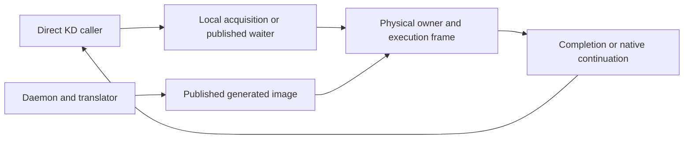

# KD design

KD lets a physical lock holder execute a waiting caller's protected body. The
caller resumes after its completed body, or at a supported native continuation
with prior effects retained. The [roadmap](ROADMAP.md) places this mechanism
before scoped MM acceptance and broader kernel replacement. Provider loading
does not replace unrelated Linux locks.

## Terms used in these guides

| Term | Meaning |
| --- | --- |
| Origin / waiter | The task that requested the operation |
| Executor / combiner | The task holding the physical lock and serving queued requests |
| Frame / packet | Exact request ownership and its logical machine state |
| Source lease | A reference retaining source text through inspection and execution |
| Unlock ACK | Confirmation that the physical owner handled a logical unlock |
| Drain / retirement | Completion of every owner, queued request, continuation, lease and frame before reuse |

An ACK, a completed body and final physical release are distinct events. The
[terminology guide](TERMINOLOGY.md) defines the remaining terms.

## Components

The provider owns physical exclusion, request queues and execution state. The
daemon decodes leased source and publishes generated images. The wrapper executes
that code through the unchanged two-word ABI: origin kernel GS base and logical
task pointer. Hardware `current`, GS, IRQ state and the executor's stack do not
become the origin's context. See the [code map](CODE_MAP.md).

## Lock and ownership boundaries

| Family | Physical protocol and execution |
| --- | --- |
| Spin | Four-byte KD lock word; pinned ordinary callers; eligible exclusive bodies may delegate |
| Mutex | KD-owned 32-byte native-aligned object; direct blocking calls use ABI2; callable and task-sensitive APIs execute locally |
| Rwlock | Concurrent local readers; exclusive writers use the spin engine after writer admission, ABI3 |
| Rwsem | Concurrent local readers and ordinary local writers; explicit outer writers reserve admission and drain readers before mutex delegation |

Mutex OSQ and delegation memberships share preallocated CPU/slot storage with
separate links and retirement rules. The total batch cap defaults to 1024 and
the NUMA locality boundary to 768. At the boundary, eight or more deferred
requests receive handoff; a smaller prefix is serviced before a bounded FIFO
remainder. This policy does not change physical ownership or promise fairness.

All users of an object must use one protocol. Local KD execution uses KD
exclusion; it is not a switch to a Linux lock. Public mutex unlock routes every
successful acquisition through its exact provider ownership record.
[Locking](design/locking.md) and [frames](design/frames.md) specify nesting,
native acknowledgements, cancellation and release ordering.

## Translation and execution

Production uses `trusted_source=True` for kernel and module code. It skips
semantic safety admission, context/memory/alias and loop-value analysis,
constant-path specialization and entry-input proofs. The compiler clobber-entry
agreement is assumed; only IP/SP/BP are imported for ABI1/2/3.

Source trust still requires complete selected text, supported decoding and
faithful lowering, actual CALL/RET words and exact return routing. String
functions, including `strscpy_pad`, `strnlen`, `sized_strscpy`, `strcmp` and
`memcpy`, are ordinary decoded callees. Current translation selects no named
string models, services or direct native bridges. Optional
`trusted_source=False` exists for checked regression fixtures.

A missing ordinary callee may transfer the remaining invocation to the origin
and be learned for a later image. Supported lock controls and scalar services
have separate runtime contracts. A progressed body cannot restart: continuation
retains its stores, acquisitions and unlock obligations. Generated dispatch,
budget checks, RET lookup and synthetic LEA lowering preserve arithmetic flags;
generic native recovery does not capture arbitrary processor state.

The packet states are MINIMAL (declared entry state), COMPLETE (finished return
triple) and FULL (current logical GPRs materialized before generic recovery).
The [execution guide](JIT_EXECUTION.md), [register ABI](JIT_REGISTER_ABI.md) and
[translation policy](design/admission.md) own those details.

## Publication and lifetime

Mutex frames bind immutable image generations. Ordinary spin/rwlock entries may
still use in-place replacement; supported root instruction-marker images and
historical checked/service images transition their entry to immutable versions.
A bound descriptor alone does not make ordinary image bytes immutable.

Source pins, image descriptors, physical acquisitions, native executors and
frame retirement protect different resources. Stop and join callers, retire
sources and drain all obligations before unloading or reusing storage.
[Lifetimes](design/lifetimes.md) defines this order. A `NORMAL` image is publication
evidence, not proof that any generated body returned.

## MM integration and limits

The ordinary `kdlock1` kernel disables the mmap backend. The separate Linux 7
`kdmm1` image provides explicit Native/KD modes for the actual mmap-lock adapter.
That integration changes only the lock backend and minimal API/lifetime wrappers.
Native mmap, munmap, advice and fault bodies execute on their original task.
Operation-specific MM delegation and prepared teardown are retired.

The [module-owned mapping experiment](design/mmap_fault.md) instead changes a
private backing lock while the actual mmap lock stays Native. Its results are
a different experiment. Current shared-MM timings lose to Native at all 21
worker counts; exact `mmap1` and generic actual-backend fault throughput remain
future work. See [performance](PERFORMANCE.md) and [validation](VALIDATION.md).

Whole-kernel replacement, RT/ww_mutex/lockdep integration, broad oversubscription,
general native flags recovery and full mitigation coverage remain unvalidated.
Published mutex waiters poll pinned even though physical owners may sleep.
[Open work](TODO.md) records these limits.
