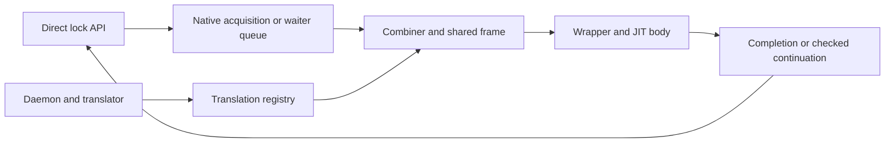

# KD design

KD lets one thread run a waiting thread's critical section while holding the
required lock. The waiting thread then continues after that critical section,
without running it again. A background daemon translates the original machine
code, and the lock holder runs the generated code through the JIT engine.

KD supports spinlocks, ordinary mutexes and read-write locks on x86_64. Callers
use explicit KD APIs, built against the recorded caller-clobber kernel interfaces.
Loading the provider does not intercept other Linux locks.
The separate [sleeping rwsem](design/rwsem_implementation.md) provides ordinary
local readers/writers and explicit outer writers using the existing mutex ABI2.
Writer reservations drain readers before the unchanged mutex queue can publish
and pin a caller. This does not replace the kernel's mmap rwsem.

## Terms used in these guides

| Term | Meaning |
| --- | --- |
| Combiner | The thread that holds a lock and executes queued work for other threads. |
| Waiter / logical task | The original caller whose critical section is being executed. It may differ from the thread currently running the code. |
| Native execution | The caller runs the original compiled code rather than delegated JIT code. |
| Admission | Checks that decide whether KD can delegate a request. **Rwlock writer admission** is a different check: it waits for readers and acquires exclusive write access. |
| Frame and packet | A frame tracks a request and its owned locks. Its register packet holds the caller's logical execution state. |
| Continuation | The saved instruction and stack state needed to resume the caller at the correct point. A **native suffix** is the remaining part of a partially executed body, resumed in native code. |
| Source lease | A reference that keeps inspected or executing source modules loaded until the relevant work finishes. |
| ACK | An acknowledgement that the physical owner handled an unlock request. A logical unlock ACK does not by itself mean the whole batch has released the lock or the request can be freed. |
| Drain / retirement | Drain waits for callers, queues, owners and frames to finish. Retirement marks a resource as no longer usable and releases its references when safe. Each resource has its own retirement rule. |

The [register ABI](JIT_REGISTER_ABI.md) defines the exact saved state. IP is the
instruction pointer, SP the stack pointer and BP the frame pointer. The
**caller-clobber** interface tells the compiler which registers a lock call may
overwrite, so the compiler saves values that the caller will need afterward.

## Components

| Component | What it does |
| --- | --- |
| Lock backend | Acquires the actual lock, queues waiting requests and performs the final unlock. |
| Ticket/task record | Identifies one specific acquisition and keeps track of native execution and unlock acknowledgements. |
| Execution frame | Records the original task, saved execution state and which locks are still held. |
| Registry/translator | Matches an entry address to its backend and ABI, checks the code, and records whether an image is ready. |
| Wrapper | Runs generated code using the two-word input ABI and returns its execution state. |
| Source session | Keeps source modules loaded during inspection and execution, until they can be retired. |

The [code map](CODE_MAP.md) shows where each component is implemented.

## Lock and ownership boundaries

Each lock type has its own ownership rules:

- KD spin uses one KD lock word for native acquisition and delegated execution.
- KD mutex owns physical exclusion and an embedded legacy scheduling gate. Every
  delegation executor must own the KD physical primitive as well as that gate.
  See the [KD-only object and API contract](design/kd_only_mutex.md).
- KD rwlock uses a reader/writer count and a KD spin gate. Readers run locally;
  every writer must exclude readers, whether it runs natively or through JIT.
- KD rwsem uses a reader count, sleeping drain wait queue and exact writer-phase
  reservations around the KD mutex gate. Sleeping readers run locally; outer
  writers may delegate after reader drain. Ordinary writers retain cancellation
  and downgrade; outer writers support neither operation.

The frame's lock ledger records acquisitions and releases that actually happened.
Changing the ledger does not itself acquire or release a lock. See
[all nine protocols](design/lock_protocols.md) and [KD ownership](design/locking.md).

KD's heat counters help decide whether a new request is worth delegating. If a
request is cold or refused, it uses the appropriate native path. Once a request
has been published to the queue, later heat changes cannot cancel its completion,
owner acknowledgements or cleanup obligations.

Rwlock ABI3 acquires exclusive write access in native code **before** entering
the translated body. If JIT refuses before the body starts, KD releases that
write access while still holding the gate; a native retry must acquire it again.
If the body has already made progress, native execution resumes from that point
while preserving write access. The body clears the writer byte before spin
completion, which must not clear it a second time. The
[rwlock guide](design/rwlock_implementation.md) explains this order in detail.
This uses the existing spin engine and needs no new guest-kernel interface.

## Translation and execution

The translator checks the code it may emit, including memory accesses, calls and
context-sensitive operations. It also checks any required conditions at JIT entry.
[Admission](design/admission.md) documents these checks and their limits.

If generated code calls an ordinary function that has not been translated, the
original waiter runs that function and the rest of the invocation natively. A
later compilation may include the function. Known lock operations and approved
services can instead return to JIT at a registered continuation.

Provider capability version 9 includes separately negotiated ABI1 spin services
for the original [`strcmp`](design/admission.md#bounded-original-strcmp-service)
and [`strscpy_pad`](design/admission.md#bounded-original-strscpy_pad-writing-service)
helpers. A service is a checked call executed by the current lock holder. These
services require one outer spin owner and a caller that keeps their ordinary
source strings valid and unchanged. Their checks do not establish those object
lifetimes or replace the physical locking protocol.

The register packet has three states:

| State | What KD may read |
| --- | --- |
| MINIMAL | Only the captured IP/SP/BP and declared metadata. |
| COMPLETE | The checked IP/SP/BP needed to return after a finished body. |
| FULL | The current logical general-purpose registers, saved before generic C recovery reads them. |

A native continuation must preserve work already done. It cannot replay earlier
stores, acquisitions or releases. [Execution flow](JIT_EXECUTION.md) follows the
normal path; [register ABI](JIT_REGISTER_ABI.md) gives the exact layout and exits.

Finishing a body, acknowledging an unlock and freeing a request are separate
steps. KD removes the frame from the active execution stack before announcing
completion. Any native executor still using the root request must finish before
that storage is reused or the original preemption pin is released. See
[frames](design/frames.md) for the full ordering rules.

## Publication and lifetime

A simple batch can hold one source lease across all its bodies, including native
or remote waits. KD still checks each request's image readiness. Holding source
modules loaded does not itself make a generated image immutable. Frames bind an
image descriptor, which identifies their generated code independently of the
entry's current publication. Mutex images are immutable after publication.

The registry has 511 slots. Provider initialization allocates up to 64 page-aligned
code blocks of 640 KiB each, or 40 MiB in total. The daemon uploads an image in
chunks and marks it NORMAL after the last complete chunk. NORMAL means that code
was published; it does not mean a request executed that code.

Mutex recompilation publishes a new immutable generation; existing mutex frames
retain their bound generation through continuations and retirement. Ordinary
spin/rwlock recompilation still overwrites the entry's allocated code block.
Publishing the first ABI1 image with [checked pointer loads](design/admission.md#checked-spin-pointer-loads),
the bounded `strcmp` service or the bounded `strscpy_pad` service instead allocates
a separate immutable block. Existing spin frames retain their
earlier descriptor and code; every later image for that entry is also immutable,
even if it needs no guards or typed services. All versions remain in the same bounded pool
until session teardown. [Lifetimes](design/lifetimes.md#executable-images-and-guarded-spin-transition)
explains publication, source pins and frame leases.

## Limits and evidence

KD remains experimental. Its checks do not cover all runtime pointers or
concurrent pointer changes. Processor flags and SIMD/FPU state are not fully
restored; ordinary spin/rwlock entries still permit in-place image replacement,
and pinned waiters can block progress when there are more runnable tasks than
available CPUs. The limited spin pointer-load checks do not establish a general
runtime address or object-lifetime policy.
[TODO](TODO.md) records known failures and work explicitly left for later.

Keep these results distinct: a fixture passed, an image was published, JIT code
actually ran, and a benchmark met its performance target. One does not establish
the others. Use [tests](../tests/README.md) for check selection,
[benchmarks](../bench/README.md) for commands and reports, and
[performance status](PERFORMANCE.md) for the measured outcomes.
Historical results apply to their recorded source and environment;
[operations](operations/VM.md) defines how to run new checks.
