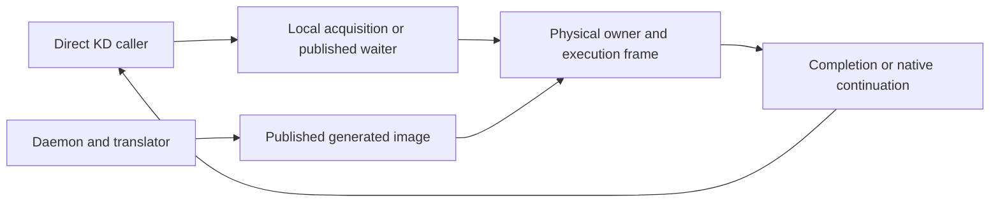

# KD design

KD lets a physical lock holder execute a waiting caller's protected body. The
caller resumes after its completed body, or at a supported native continuation
with prior effects retained. The [roadmap](ROADMAP.md) places this mechanism
before scoped MM acceptance and broader kernel replacement. Provider loading
does not replace unrelated Linux locks.

The active [kdlock lock replacement contract](design/kdlock_lock_replacement_contract.md)
on `codex/mmap-reached-jit` selects the original JIT pipeline and current-position
waiter handback for untranslated code. Its source status and pending work are
separate from master, ordinary family behavior and historical MM experiments.

## Terms used in these guides

| Term | Meaning |
| --- | --- |
| Origin / waiter (O) | The task that requested the operation |
| Executor / combiner (E) | The task holding the physical lock and serving queued requests |
| Frame / packet | Exact request ownership and its logical machine state |
| Source lease | A reference retaining source text through inspection and execution |
| Unlock ACK | Confirmation that the physical owner handled a logical unlock |
| Drain / retirement | Completion of every owner, queued request, continuation, lease and frame before reuse |

An ACK, a completed body and final physical release are distinct events. The
[terminology guide](TERMINOLOGY.md) defines the remaining terms.

## Components

The provider owns physical exclusion, request queues and execution state. The
daemon decodes leased source and publishes generated images. The wrapper executes
that code through the unchanged two-word ABI: origin kernel GS base and logical
task pointer. Hardware `current`, GS, IRQ state and the executor's stack do not
become the origin's context. See the [code map](CODE_MAP.md).
Ordinary GS operands retain the original saved-origin lowering; logical
`current_task` uses the supplied task pointer. A GS prefix alone does not make
an operation an original-task service. GS mutations and specific context
operations still require their declared execution contracts.

## Lock and ownership boundaries

The table describes ordinary family interfaces. Separately activated retained
service capture on the isolated candidate has its own root and owner lifetimes,
as recorded in the lock replacement contract.

| Family | Physical protocol and execution |
| --- | --- |
| Spin | Four-byte KD lock word; pinned ordinary callers; eligible exclusive bodies may delegate |
| Mutex | KD-owned 32-byte native-aligned object; direct blocking calls use ABI2; callable and task-sensitive APIs execute locally |
| Rwlock | Concurrent local readers; exclusive writers use the spin engine after writer admission, ABI3 |
| Rwsem | Concurrent local readers and ordinary local writers; explicit preparation enables ordinary writer calls to reserve admission and drain readers before mutex delegation |

Mutex OSQ and delegation memberships share preallocated CPU/slot storage with
separate links and retirement rules. The total batch cap defaults to 1024 and
the NUMA locality boundary to 1024. Equal limits remove the earlier count-based
local cutoff. At an earlier terminal boundary, eight or more deferred requests
receive handoff; a smaller prefix is serviced before a bounded FIFO remainder.
Deferred requests still rejoin on every exit. This policy does not change
physical ownership or promise fairness.

All users of an object must use one protocol. Local KD execution uses KD
exclusion; it is not a switch to a Linux lock. Public mutex unlock routes every
successful acquisition through its exact provider ownership record.
[Locking](design/locking.md) and [frames](design/frames.md) specify nesting,
native acknowledgements, cancellation and release ordering.

## Translation and execution

Production uses `trusted_source=True` for kernel and module code. It skips
semantic safety admission, context/memory/alias and loop-value analysis,
constant-path specialization and entry-input proofs. The compiler clobber-entry
agreement is assumed; only IP/SP/BP are imported for ABI1/2/3.

Source trust still requires complete selected text, supported decoding and
faithful lowering, actual CALL/RET words and exact return routing. String
functions, including `strscpy_pad`, `strnlen`, `sized_strscpy`, `strcmp` and
`memcpy`, are ordinary decoded callees. Current translation selects no named
string models, services or direct native bridges. Optional
`trusted_source=False` exists for checked regression fixtures.

The original translator explores a bounded selected CFG and learned CALL/IJ
edges. It does not require a complete kernel CFG or eager ordinary-callee
closure. A missing ordinary callee can transfer the remaining invocation to
the origin and be learned for a later image. Declared lock controls and
returning services retain their separate runtime contracts.

The selected correction requires general untranslated-code handback at the first
instruction E has not executed, using current IP/GPR/SP/BP and preserving prior
stores, acquisitions, CALL pushes and RET pops. It cannot restart a progressed
body. Checkpoint `ebae17c1` adds negotiated ordinary miss handback; `10ef078a`
removes the separate instruction backend and corrects extended-header selection.
Runtime checkpoint `a6fe0bb2` wires retained-worker handback, packet acceptance,
Native owner routing and synchronous cleanup. Its first build/component receipt
fails overall, and central acceptance/final-ACK coverage remains pending.
Generic IJ errors are not evidence of successful handback.

The selected follow-up keeps the three mmap state/assertion query bodies in the
original JIT, preserving a narrow `ATOMIC_ORIGIN` Native service only for the
exact `kd_service_write_owned` custody proof. Other services and bounded callee
learning retain their policies. Existing downgraded read credit transfers to
Native custody without a decrement, and pooled slots retire through synchronous
E-side home-CPU cleanup with an explicit serialized already-offline path. These
are resolved designs with source wiring in `a6fe0bb2`; final validation remains
incomplete. Component fixtures are distinct from loaded-provider execution; see
the [contract](design/kdlock_lock_replacement_contract.md#selected-state-query-execution)
and [lifetime ordering](design/lifetimes.md#selected-retained-handback-retirement).

Generated dispatch, budget checks, RET lookup and synthetic LEA lowering have
their existing arithmetic-flags contracts. General flags/SIMD restoration and
IRQ/NMI conflict handling are deferred for this correction; limited existing
flags paths do not establish arbitrary processor-state restoration.

The packet states are MINIMAL (declared entry state), COMPLETE (finished return
triple) and FULL (current logical GPRs materialized before generic recovery).
The [execution guide](JIT_EXECUTION.md), [register ABI](JIT_REGISTER_ABI.md) and
[translation policy](design/admission.md) own those details.

## Publication and lifetime

Mutex frames bind immutable image generations. Ordinary spin/rwlock entries may
still use in-place replacement; supported root instruction-marker images and
historical checked/service images transition their entry to immutable versions.
A bound descriptor alone does not make ordinary image bytes immutable.

Source pins, image descriptors, physical acquisitions, native executors and
frame retirement protect different resources. Stop and join callers, retire
sources and drain all obligations before unloading or reusing storage.
[Lifetimes](design/lifetimes.md) defines this order. A `NORMAL` image is publication
evidence, not proof that any generated body returned.

## MM integration and limits

The ordinary `kdlock1` image and historical local mmap-lock adapter are distinct
from retained execution experiments. The local adapter changes only the lock
backend and minimal API/lifetime wrappers; its native MM bodies execute on the
original task. Later retained candidates execute unchanged native bodies on E
through general lock/service routing. The selected original JIT correction is
part of kdlock lock replacement, with runtime handback wiring committed and
final validation still pending.
Operation-specific MM algorithms and prepared teardown remain retired.

The [module-owned mapping experiment](design/mmap_fault.md) changes a private
backing lock while the actual mmap lock stays Native. It is a different
experiment. The [November 1 comparison](../bench/results/10.176.26.71/bench/master-native-20261101/README.md)
includes actual unchanged mmap1 and both positive and negative observations;
older shared-device-MM losses do not describe every subsequent workload.
The [indexed reached JIT record](../bench/results/10.176.26.71/tests/reached-mm-jit-indexed-20261104/README.md)
contains later focused MM execution proofs, failed performance acceptance and
unrun Nano coverage for its separate emitter. Neither record validates the
restored original JIT correction. Generic fault-throughput and broader coverage
claims still require their own evidence.

Whole-kernel replacement, ww_mutex, broad oversubscription, general native flags
recovery and full mitigation coverage remain unvalidated. RT, debug mutexes,
debug lock allocation and lockdep are explicitly refused by the shared build
contract; they are not pending integration milestones.
Published mutex waiters poll pinned even though physical owners may sleep.
[Open work](TODO.md) records these limits.
