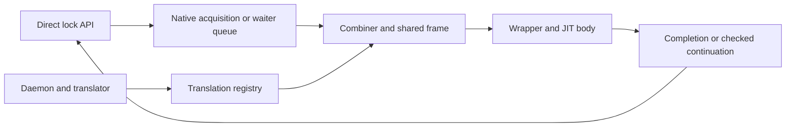

# KD design

KD executes a waiting caller's existing critical-section machine code on a
combiner. Spin uses an explicit KD word; mutex retains Linux's original mutex
and exact physical owner. The supported scope is x86_64 with the captured
caller-clobber interfaces. Loading the provider does not intercept global locks.

## Components

| Layer | Contract |
| --- | --- |
| Lock backend | Physical exclusion, queue publication and final unlock |
| Ticket/task record | Exact acquisition identity, native routing and ACK lifetime |
| Execution frame | Logical task, continuation, packet, roles and held-lock ledger |
| Registry/translator | Entry/backend/ABI identity, selected scope and image readiness |
| Wrapper | Two-word input, private register packet and COMPLETE/FULL exits |
| Source session | Keep inspected and executed module text resident until retirement |

The [code map](CODE_MAP.md) locates implementations. Detailed contracts are split
by responsibility rather than duplicated here.

## Lock and ownership boundaries

[Six lock protocols](design/lock_protocols.md) compares KD, TCLock and Native.
[KD locking](design/locking.md) describes exact tickets, original mutex ownership,
nested A/B operations and ACKs. Spin and mutex never share a physical protocol.
A ledger records real acquisitions/releases; it does not acquire a lock.

Admission affects future requests only. A cold or refused spin request uses
KD's native CAS/pending/MCS path. A refused mutex request uses the original Linux
mutex. A published request still owes its completion, owner ACKs and retirement,
regardless of later hotness.

See [spin implementation](design/spin_implementation.md) and
[mutex implementation](design/mutex_implementation.md) for layout, prefetch,
queue selection and backend-specific fast paths.

## Translation and execution

[Admission](design/admission.md) defines the selected JIT episode, context
screening, learned CALL/RET scope, entry predicates and checked mutex boundary.
An ordinary untranslated CALL transfers the remaining invocation to the original
waiter; a future compilation may learn its callee. Known controls and typed
services can return to JIT at registered continuations.

[Execution flow](JIT_EXECUTION.md) covers adaptive entry, binding, batch execution
and return. [Register ABI](JIT_REGISTER_ABI.md) specifies packet layout, virtual
register mapping, wrapper slots and terminal completion. MINIMAL captures
IP/SP/BP; COMPLETE returns that triple; FULL materializes current logical GPRs
before generic C recovery. Completed stores and lock operations are never replayed.

[Frames](design/frames.md) defines shared request storage, child frames, forward
native continuation and final reclamation. Frame pop precedes completion
publication. Physical unlock ACK is a separate event, and native executors must
retire before root storage or the entry preemption pin can be released.

## Publication and lifetime

[Lifetimes](design/lifetimes.md) distinguishes text pins, source admission, device
references, physical ownership and request storage. One eligible simple batch
holds one source lease through all wrappers, native/remote waits and unbinds.
Readiness is still checked per request; a cached registry pointer is not an
immutable executable version.

The registry has 511 slots; provider initialization eagerly allocates up to 64
page-aligned 640 KiB code blocks (40 MiB at full capacity). The daemon uploads
bounded chunks and publishes NORMAL only after the final complete chunk. Current
RIP-keyed recompilation overwrites the same block. Source residency does not
provide complete-image generation validation or protect simultaneous old execution.

## Limits and evidence

JIT is an experimental execution mechanism, not a security sandbox. Unresolved
runtime pointers/concurrent replacement, processor flags and SIMD/FPU state,
immutable code versions and oversubscribed pinned waiter dependencies remain
limits. [TODO](TODO.md) separates reproduced failures, supported contracts and
explicitly deferred work.

Published code, a fixture pass and actual returned-body JIT are different evidence.
[Tests](../tests/README.md) selects affected checks; [benchmarks](../bench/README.md)
records throughput and progress. Historical records stay tied to their frozen
source. Performance work and acceptance criteria live in
[PERFORMANCE_PLAN](PERFORMANCE_PLAN.md); environment rules live in [AGENTS](AGENTS.md).
