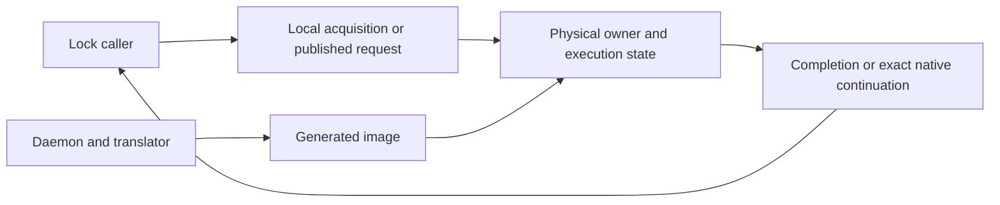

# KD design

kdlock is a lock implementation with optional execution of a waiting caller's
protected body by a physical lock holder. This guide describes source retained
on `master`; separate redesign proposals have their own review and implementation
status. The [roadmap](ROADMAP.md) defines project goals, [code map](CODE_MAP.md)
locates source, and [validation](VALIDATION.md) binds results to exact inputs.

## Terms used in these guides

| Term | Meaning |
| --- | --- |
| Origin / waiter (O) | Task whose source operation is being completed |
| Executor / combiner (E) | Task physically running the selected protected body |
| Frame / packet | Request ownership and logical machine state with explicit lifetimes |
| Source lease | Reference retaining source text through reading, compilation and execution |
| Unlock ACK | Confirmation that the exact physical owner handled a logical release |
| Drain / retirement | Completion of every owner, continuation, source and last-user obligation before reuse |

Body completion, release, acknowledgment and storage reuse are separate events.
[Terminology](TERMINOLOGY.md) defines the remaining vocabulary.

## Components

The lock/provider paths own physical exclusion, request selection and execution
state. The daemon compiles leased source and publishes images. Existing retained
service capture has a separate activation/lifetime contract; it does not make
a background execution worker a requirement for a future lock design.

The wrapper's two context words carry saved-origin GS and the logical task.
Source SP/BP and actual CALL/RET words represent that task's execution. Hardware
`current`, IRQ/RCU state and the physical wrapper stack remain the executor's.
Saved-origin GS lowering does not switch the complete kernel task context.
See [register ABI](JIT_REGISTER_ABI.md) and [execution](JIT_EXECUTION.md).

## Lock and ownership boundaries

| Family | Current ordinary protocol |
| --- | --- |
| Spin | Four-byte KD word; pinned callers; eligible exclusive bodies may delegate and cannot sleep |
| Mutex | KD-owned 32-byte object; direct blocking ABI2 calls may delegate; published ordinary delegation waiters poll pinned |
| Rwlock | Concurrent local readers; exclusive writers use the spin engine after writer admission |
| Rwsem | Concurrent local readers; local default writers; explicitly prepared source macros can enter the selected writer/capture protocol |

All users of one object follow one backend protocol. Public releases route by
the exact successful acquisition. Queue membership, physical ownership, logical
mode, source/image binding and frame retirement retain separate identities.
Mutex OSQ/delegation storage is shared with separate links; mutex cap/locality
and spin total cap remain 1024. These bounds do not establish fairness.
[Lock catalog](LOCKS.md), [ownership](design/locking.md), [frames](design/frames.md)
and the family guides own detailed API and lifetime rules.

## Translation and execution

Production trusts kernel/module source and assumes its clobber-entry agreement.
Optional semantic/context/value/input proofs are regression utilities. Leased
text, supported decoding, faithful lowering, actual source CALL/RET effects and
exact runtime ownership remain required. Strings use ordinary decoded callees.

The original translator constructs bounded selected graphs and learns reached
CALL/indirect edges for later images. Untranslated code hands the remaining
invocation to O at the first unexecuted instruction with current state and prior
effects retained. It does not replay a body prefix or wait for a replacement
image. Declared returning services have their own exact continuation contract.
See [translation policy](design/admission.md) and the
[retained execution contract](design/kdlock_lock_replacement_contract.md).

Retained ABI2 images stop source emission at recognized physical releases.
JIT-consumed rwsem downgrade is the narrow exception: logical read mode retains
the exact physical writer until matching typed read release. Native-first and
ordinary local downgrade create a real reader credit. Separate nested-image
activation remains additional work; source-operation boundaries in a redesign
proposal are not an implementation claim for this path.

## Publication and lifetime

Mutex/retained frames bind immutable generations. Ordinary spin/rwlock entries
may still replace code in place before an immutable transition. A published
NORMAL image proves publication, not a returned body. Source, data objects,
physical owners, frames and image storage need their own last-user accounting.
Stop/join callers and drain exact owners/releases before unload or reuse.
[Lifetimes](design/lifetimes.md) owns these contracts.

## MM integration and limits

Normal `7.0.0-38-kdlock1` disables the mmap backend. Local and retained MM profiles
have separate kernel/source identities. Native MM bodies and real userspace
syscall paths remain unchanged; retained execution uses general lock/service
routing. Module-owned backing faults are a different workload.

The latest [mmap1 process point](../bench/results/10.176.26.71/bench/mmap1-proxy-read-7e3c90b4-v3/README.md)
tested `7e3c90b4`: one compile-excluded, counter-enabled interval with both roots
returning every whole-application JIT entry. The merged combination with master's
flags-stack changes has static integration checks, without a new runtime run.
Quiet performance, repeated Native improvement and broader kernel coverage
remain open. The earlier failed targeted CALL/RET checker retains its own verdict.

Current support limits are in [open work](TODO.md). The complete pre-cleanup
architecture/status prose is retained in the
[archive](history/documentation-20261109/DESIGN.md).
