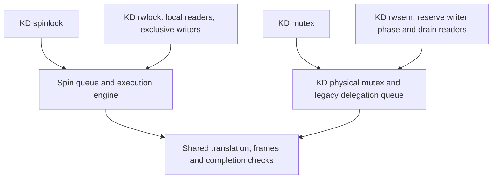

# Current KD lock catalog

The [project roadmap](ROADMAP.md) targets eventual replacement of the relevant
kernel locks. This catalog describes today's APIs: micro/nano consumers and the
scoped mmap adapter. A supported standalone API is a prerequisite for broader
integration, not evidence that all kernel callers already use it.

This is the entry point for the four lock families maintained on `master`.
The KD-only physical/delegation foundation selected at `d2a2304` and rwsem
waiting policy selected at `c21345b` remain the basis. Later storage and Linux 7
ports retain their ownership protocols. API support is distinct from a measured
performance result; [validation](VALIDATION.md) binds each checked source version.

**Delegation** means that a lock holder executes a waiting caller's protected
work. The **origin** is that caller; the **executor** runs the work. Local or
native execution in a KD API still uses the KD object. **Linux Native** names
the separate Linux implementation used as a benchmark comparator.

## Lock families

| KD family | Exclusion and object storage | Execution and waiting | Implementation guide |
| --- | --- | --- | --- |
| Spinlock | One four-byte `kd_spinlock_t` contains ownership, pending and queue-tail state | Exclusive body; callers poll with preemption disabled. An eligible body may delegate. The body must not sleep. | [Spinlock](design/spin_implementation.md) |
| Mutex | A 32-byte, native-aligned `struct kd_mutex` contains KD physical ownership, a sleeping-waiter ring head, and the embedded legacy delegation phase and encoded tail; reserved nodes hold exact waiter records | Direct public blocking calls permit delegation; callable lock symbols and task-sensitive variants execute locally. Published delegation waiters poll pinned; physical owners and supported service paths may sleep. | [Mutex](design/mutex_implementation.md) |
| Rwlock | A 128-byte `kd_rwlock_t` separates the reader/writer count from a KD spin gate | Readers run concurrently and locally. Writers exclude readers and may delegate through the spin engine. Neither body may sleep. | [Reader/writer spinlock](design/rwlock_implementation.md) |
| Rwsem | A 320-byte `struct kd_rwsem` contains a KD mutex, reader count, writer reservations and two sleeping waitqueues | Readers and default ordinary writers run locally. Explicitly prepared ordinary writers drain readers before entering mutex delegation. Published delegation waiters still poll pinned. | [Reader/writer semaphore](design/rwsem_implementation.md) |

Sizes describe the captured x86_64 configuration, not a portable binary
interface. They exclude per-CPU queues, stacks, execution frames and translated
code. The four implementation guides describe those additional resources.
Preemption is the scheduler's ability to pause a task; a pinned polling waiter
retains its CPU while waiting. This restriction matters even for a sleeping lock.

## Shared engines

The rwlock count grants read/write access; its gate orders contended admission.
The rwsem reservation blocks new readers, but does not grant physical mutex
ownership. Those layers have separate responsibilities and must all remain live
until their matching releases. Neither reader/writer lock adds a third JIT
engine. JIT means just-in-time translation of the original protected code.

Use [`include/kd_rwsem_api.h`](../include/kd_rwsem_api.h) and `struct kd_rwsem` for the unified concurrent-reader
API. Linux mmap callers retain their `mmap_*` wrappers. The internal
`kd_mutex_local_*` gate implements physical writer exclusion; bypassing rwsem
admission with that gate does not protect readers. Explicit quiescent preparation
permits delegation through the same ordinary writer names. Prepared macro acquisitions cannot downgrade; unprepared ordinary
and callable/signal/try/cleanup writer acquisitions remain local and can downgrade.
The mmap adapter selects the local protocol and keeps native MM bodies on their original task.

The provider builds both engines and shared execution helpers through
[`kd_spin_runtime.c`](../kernel_module/kd_spin_runtime.c). Ordinary mutex physical
locking and rwsem admission have separate compilation units. Private `.inc`
files are source fragments included by their parent; they are not separately
linked implementations. See the [code map](CODE_MAP.md).

## Caller interfaces and preparation

| Family | Ordinary/local interface | Interface that permits delegation | Preparation and entry ABI |
| --- | --- | --- | --- |
| Spinlock | The ordinary pair selects local execution when cold or refused. Explicit `kd_spin_lock_irqsave/irq/bh` pairs always execute locally. | `kd_spin_lock/unlock` source macros in `kd_spin_api.h`; named benchmark continuations retain `KD_SPIN_DIRECT_LOCK/UNLOCK` | Unified calls register their internal continuation on contention; named entries use `kd_spin_prepare(lock, entry, KD_ENTRY_ABI_SPIN_CLOBBER_V1)`; ABI1 |
| Mutex | `kd_mutex_local_lock/unlock`; callable lock symbol, trylock, interruptible, killable and I/O forms | Direct `kd_mutex_lock/unlock` calls and ordinary blocking aliases; explicit `KD_MUTEX_DIRECT_LOCK/UNLOCK`; `KD_MUTEX_OUTER_LOCK/UNLOCK` retains its outer cookie | Unified calls capture an internal continuation; explicit named entries use `kd_mutex_prepare(lock, entry, KD_ENTRY_ABI_MUTEX_CLOBBER_V1)`; ABI2 |
| Rwlock | `kd_read_lock/unlock`; `kd_write_lock/unlock`; local IRQ/BH and trylock forms | `KD_RWLOCK_DIRECT_WRITE_LOCK/UNLOCK`; writers only | `kd_rwlock_prepare(lock, entry, KD_ENTRY_ABI_RWLOCK_CLOBBER_V1)`; ABI3 |
| Rwsem | `kd_down_read/up_read`; default `kd_down_write/up_write`; callable/signal/try/cleanup acquisitions stay local with downgrade | Same ordinary writer names after explicit preparation; no downgrade or translated nesting for prepared macro acquisitions | `kd_rwsem_prepare(sem, entry, KD_ENTRY_ABI_MUTEX_CLOBBER_V1)` on a quiescent object; ABI2 |

An **ABI**, or application binary interface, specifies registers and data layout.
ABI1/2/3 are declared in [`exe_info.h`](../include/exe_info.h). ABI3 starts
after rwlock writer admission; rwsem uses the existing mutex ABI2 boundary.
The shared generated-code wrapper still receives two words: the origin's kernel
GS base and logical task pointer. GS is the x86 register used to address per-CPU
kernel data. ABI0 remains an internal legacy compatibility path, not the
recommended interface for new callers.

For explicit named entries, prepare a unique continuation after its source module
is live and before starting workload workers. A continuation identifies where the
protected body begins. The direct macros declare register clobbers so the compiler saves live
values; their containing function uses `noipa` to prevent cloning and other
interprocedural transformations. Registration is separate from successful
translation, publication and actual execution. Cold or unprepared calls can
still execute locally. An image marked `NORMAL` proves publication only.
Unified mutex calls use an internal numeric continuation; contention admission
registers that entry without requiring a caller-supplied label. Address-taking
and indirect lock calls retain the ordinary C ABI and execute locally.

The named DIRECT spin/rwlock macro's `cookie` names a shared per-CPU heat indicator; it is
not an ownership token. A mutex/rwsem outer cookie instead belongs to one exact,
same-task acquisition and must not be copied, transferred or reused before its
matching unlock. Follow the individual guide's paired API and initialization
rules. Ordinary `kd_spin_lock/unlock` emit the unpinned clobber control CALL;
the provider owns their native pin. Internal pinned spin helpers are not
interchangeable with public pairs.

## Compatibility and execution limits

The static audit at `6a7350291ebab8c50a43431561e11085098d628b` does not
qualify arbitrary Linux lock replacement. All users and containing objects must
adopt the same KD protocol; native object layouts and internal ownership fields
are not interchangeable with KD. Callable, signal, try and I/O mutex operations
retain local execution, including signal results and I/O accounting. Nested
mutex annotations match the non-lockdep configuration, not lockdep semantics.
`CONFIG_PREEMPT_RT`, `CONFIG_DEBUG_MUTEXES`, `CONFIG_DEBUG_LOCK_ALLOC` and lockdep
are explicitly outside support. The shared `kd_config.h` build contract refuses
all four, including `CONFIG_LOCKDEP`, through the public spin/mutex object
headers inherited by rwlock/rwsem and through provider initialization source.
The Linux 7 identity verifier independently requires these options to be off.
Whole-kernel replacement and `ww_mutex` remain unvalidated.

Same-backend nested mutex/spin mechanisms do not establish mixed-family support.
The current known-control handler refuses delegated mutex-to-spin and
spin-to-mutex calls. Production source trust skips the earlier mixed-kind
analysis, so this refusal is not guaranteed to occur before execution; an
already-progressed unsupported control can reach the backend fail-stop path.
There is no general nested rwlock/rwsem mode ledger. The Linux 7 basic tests cover
the four families separately, and the instruction-exit probes exclude nested
acquisition. See [ownership](design/locking.md) and the
[requested implementation sequence](TODO.md#october-29-api-and-execution-work).

All users of one object must use the same protocol. KD local and delegating
interfaces can share their corresponding KD object with matching unlocks.
Linux and TCLock operations cannot operate on that object. The source aliases
in [`kd_mutex_compat.h`](../include/kd_mutex_compat.h) require rebuilding every
containing object and caller; they do not convert existing Linux mutex memory.
See [mutex replacement](design/kd_only_mutex.md) and its
[semantic differences and replacement limits](design/kd_only_mutex.md#semantic-differences-and-replacement-limits)
for native-object compatibility, original-task execution and unsupported integration.

Ordinary spin and rwlock pairs preserve interrupt/bottom-half state and pair
preemption protection. Spin and rwlock explicit interrupt and bottom-half variants
stay on the calling CPU. Rwlock interrupt/BH readers bypass a waiting writer to
avoid blocking an interrupted reader; active writers still exclude them. Mutex
operations and sleeping rwsem acquisitions require task context. KD rwsem read trylock and matching read
unlock also preserve IRQ/preemption-disabled contexts; atomic final release is
observed through timed writer-drain rechecks. Source trust does not switch hardware task identity or make unsupported
execution/backend protocols available. Rwsem outer writers cannot cancel after publication,
downgrade, or appear as nested controls inside a translated body. Its ordinary
writer API retains cancellation and downgrade.

| Current rwsem behavior | Evidence / limit |
| --- | --- |
| Concurrent local readers, exclusive local writers, trylock, signal cancellation and downgrade | The [Linux 7 enabled-MM checkpoint](../bench/results/10.176.26.71/tests/linux70-kdmm1-20261027/README.md) records fresh bounded API/lifetime and actual-MM prerequisites in both modes. These are not full Linux equivalence claims. |
| Read trylock/rollback and matching release with IRQs/preemption disabled | Focused standalone and actual mmap checks; no synchronous wake from atomic final release. Writer drain rechecks after one jiffy. |
| Explicit outer writers | Separate mutex delegation protocol; no cancellation or downgrade after publication. |
| Teardown | Callers must stop/join all users and retire published work. An idle predicate alone does not establish object lifetime. |
| Fairness, starvation bounds, performance neutrality | Unestablished; completed shared-MM measurements remain exploratory and below Native. See [performance](PERFORMANCE.md). |
| Whole-kernel, RT/ww_mutex, lockdep integration | Separately unvalidated; nested/non-owner compatibility wrappers are not full lockdep support. |
| TCLock rwsem | Restricted ordinary registered-worker pairs only; no equivalent cancellation, downgrade or actual mmap arm. |

The atomic reader-release correction retains fully ordered count updates and
avoids a synchronous scheduler/waitqueue wake when IRQs or preemption are
disabled. Writers recheck reader drain after one jiffy (4 ms at the captured
HZ=250, with additional scheduling delay possible). This is an unmeasured latency
tradeoff. Ordinary uninterruptible acquisitions have bounded polling of at most
16,384 checks per stage; mmap's killable writer path bypasses that polling loop.
Neither mechanism establishes fairness or a maximum acquisition latency.

The current translator trusts kernel and module source. Semantic safety,
context/loop-value and entry-input proofs are bypassed; the compiler input
contract is assumed. Ordinary strings use decoded CALL/RET without named helper
models, services or direct native bridges. Source leases, complete selected
text, faithful lowering, actual return words and runtime ownership remain required.

Supported instruction exits preserve their documented original-waiter and
arithmetic-flags contract. Optional checked pointer-load guards and legacy string
routes are compatibility/regression features, not current production emission.
See [translation policy](design/admission.md) and [register ABI](JIT_REGISTER_ABI.md).
Sharing an engine does not expand an entry ABI or switch executor task/GS/IRQ state.

The accepted scope does not establish whole-kernel replacement, real-time (RT),
lock dependency checking (lockdep), wound/wait mutexes or arbitrary
oversubscription. The separate [Linux 7 mmap-lock adapter](../kernel_integration/linux70/MMAP.md)
replaces the guest's `mm_struct::mmap_lock` API in its tested configuration,
using local concurrent readers and original-task writers. Arbitrary MM-body
delegation remains unsupported. Oversubscription
means more runnable tasks than CPUs. Pinned waiters can prevent dependencies
from running; bounded batches alone provide no starvation guarantee.

## Completion, lifetime and reading order

Before execution, KD must hold the required physical lock and retain the
request's source and execution state. A successful delegated body completes
through its matching unlock boundary. The origin resumes after that boundary
and must not execute the body or unlock again. If execution has already made
progress, an allowed native continuation resumes that state; it cannot restart
the body. Exact ownership and unlock acknowledgements survive until all users
of the request have finished.

Stop new calls and join users before checking idle state. Queues, readers,
writer reservations, physical owners, native continuations and execution frames
must drain before freeing lock/data storage or unloading source/provider code.
An idle-object helper or throughput counter cannot substitute for those checks.

Use one guide for each responsibility:

| Question | Guide |
| --- | --- |
| How does each KD lock acquire, wait, delegate and release? | The four implementation guides in the first table |
| How does it differ from the benchmark comparators? | [KD, TCLock and Linux Native protocols](design/lock_protocols.md); original TCLock rwsem has narrower API support than Linux rwsem |
| Who owns a lock during nested execution or native recovery? | [Ownership](design/locking.md) |
| How are execution state and code retained? | [Frames](design/frames.md), [lifetimes](design/lifetimes.md) |
| What can translated code execute? | [Admission](design/admission.md), [register ABI](JIT_REGISTER_ABI.md) |
| What is tested and how fast is it? | [Validation](VALIDATION.md), [performance](PERFORMANCE.md), [workload catalog](BENCHMARK_WORKLOADS.md) |
| What do the terms mean? | [Terminology](TERMINOLOGY.md) |

Historical protocols and measurements stay in [history](history/README.md) and
their source-specific result records. This documentation organization makes no
new runtime or performance acceptance claim.
