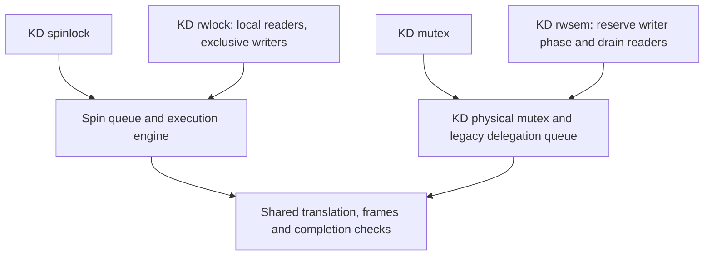

# Current KD lock catalog

This is the entry point for the four lock families maintained on `master`.
The protocol inventory was checked against implementation revision `05876a4`; its
documentation and benchmark checkpoint is `40a0f36`. The selected KD-only mutex
protocol comes from `d2a2304`, and the accepted rwsem waiting policy from
`c21345b`. Later translation changes and the compact mutex storage refactor do
not replace those lock protocols. Current object sizes below include that refactor.

**Delegation** means that a lock holder executes a waiting caller's protected
work. The **origin** is that caller; the **executor** runs the work. Local or
native execution in a KD API still uses the KD object. **Linux Native** names
the separate Linux implementation used as a benchmark comparator.

## Lock families

| KD family | Exclusion and object storage | Execution and waiting | Implementation guide |
| --- | --- | --- | --- |
| Spinlock | One four-byte `kd_spinlock_t` contains ownership, pending and queue-tail state | Exclusive body; callers poll with preemption disabled. An eligible body may delegate. The body must not sleep. | [Spinlock](design/spin_implementation.md) |
| Mutex | A 32-byte, native-aligned `struct kd_mutex` contains KD physical ownership, a sleeping-waiter ring head, and the embedded legacy delegation phase/count and encoded tail | Ordinary calls execute locally and may sleep. Explicit delegation callers can publish pinned polling requests; physical owners and supported service paths may sleep. | [Mutex](design/mutex_implementation.md) |
| Rwlock | A 128-byte `kd_rwlock_t` separates the reader/writer count from a KD spin gate | Readers run concurrently and locally. Writers exclude readers and may delegate through the spin engine. Neither body may sleep. | [Reader/writer spinlock](design/rwlock_implementation.md) |
| Rwsem | A 320-byte `struct kd_rwsem` contains a KD mutex, reader count, writer reservations and two sleeping waitqueues | Readers and ordinary writers run locally. Explicit outer writers drain readers before entering mutex delegation. Published delegation waiters still poll pinned. | [Reader/writer semaphore](design/rwsem_implementation.md) |

Sizes describe the captured x86_64 configuration, not a portable binary
interface. They exclude per-CPU queues, stacks, execution frames and translated
code. The four implementation guides describe those additional resources.
Preemption is the scheduler's ability to pause a task; a pinned polling waiter
retains its CPU while waiting. This restriction matters even for a sleeping lock.

## Shared engines

The rwlock count grants read/write access; its gate orders contended admission.
The rwsem reservation blocks new readers, but does not grant physical mutex
ownership. Those layers have separate responsibilities and must all remain live
until their matching releases. Neither reader/writer lock adds a third JIT
engine. JIT means just-in-time translation of the original protected code.

The provider builds both engines and shared execution helpers through
[`kd_spin_runtime.c`](../kernel_module/kd_spin_runtime.c). Ordinary mutex physical
locking and rwsem admission have separate compilation units. Private `.inc`
files are source fragments included by their parent; they are not separately
linked implementations. See the [code map](CODE_MAP.md).

## Caller interfaces and preparation

| Family | Ordinary/local interface | Interface that permits delegation | Preparation and entry ABI |
| --- | --- | --- | --- |
| Spinlock | The ordinary direct pair selects local execution when cold or refused. Explicit `kd_spin_lock_irqsave/irq/bh` pairs always execute locally. | `KD_SPIN_DIRECT_LOCK` / `KD_SPIN_DIRECT_UNLOCK` | `kd_spin_prepare(lock, entry, KD_ENTRY_ABI_SPIN_CLOBBER_V1)`; ABI1 |
| Mutex | `kd_mutex_local_lock/unlock`; trylock, interruptible, killable and I/O forms; ordinary source aliases | `KD_MUTEX_OUTER_LOCK/UNLOCK` for a lexical outer acquisition; `KD_MUTEX_DIRECT_LOCK/UNLOCK` for the general direct interface | `kd_mutex_prepare(lock, entry, KD_ENTRY_ABI_MUTEX_CLOBBER_V1)`; ABI2 |
| Rwlock | `kd_read_lock/unlock`; `kd_write_lock/unlock` | `KD_RWLOCK_DIRECT_WRITE_LOCK/UNLOCK`; writers only | `kd_rwlock_prepare(lock, entry, KD_ENTRY_ABI_RWLOCK_CLOBBER_V1)`; ABI3 |
| Rwsem | `kd_down_read/up_read`; `kd_down_write/up_write`; ordinary trylock, interruptible, killable and downgrade forms | `KD_RWSEM_OUTER_WRITE_LOCK/UNLOCK`; outer writers only | `kd_mutex_prepare(&sem->gate, entry, KD_ENTRY_ABI_MUTEX_CLOBBER_V1)`; ABI2 |

An **ABI**, or application binary interface, specifies registers and data layout.
ABI1/2/3 are declared in [`exe_info.h`](../include/exe_info.h). ABI3 starts
after rwlock writer admission; rwsem uses the existing mutex ABI2 boundary.
The shared generated-code wrapper still receives two words: the origin's kernel
GS base and logical task pointer. GS is the x86 register used to address per-CPU
kernel data. ABI0 remains an internal legacy compatibility path, not the
recommended interface for new callers.

Prepare a unique named continuation after its source module is live and before
starting workload workers. A continuation identifies where the protected body
begins. The direct macros declare register clobbers so the compiler saves live
values; their containing function uses `noipa` to prevent cloning and other
interprocedural transformations. Registration is separate from successful
translation, publication and actual execution. Cold or unprepared calls can
still execute locally. An image marked `NORMAL` proves publication only.

The spin/rwlock macro's `cookie` names a shared per-CPU heat indicator; it is
not an ownership token. A mutex/rwsem outer cookie instead belongs to one exact,
same-task acquisition and must not be copied, transferred or reused before its
matching unlock. Follow the individual guide's paired API and initialization
rules. Internal pinned spin helpers are not interchangeable with public pairs.

## Compatibility and execution limits

All users of one object must use the same protocol. KD local and delegating
interfaces can share their corresponding KD object with matching unlocks.
Linux and TCLock operations cannot operate on that object. The source aliases
in [`kd_mutex_compat.h`](../include/kd_mutex_compat.h) require rebuilding every
containing object and caller; they do not convert existing Linux mutex memory.
See [mutex replacement](design/kd_only_mutex.md).

Ordinary spin and rwlock pairs preserve interrupt/bottom-half state and pair
preemption protection. Spin's explicit interrupt and bottom-half variants stay
on the calling CPU. Rwlock has no such variants. Mutex and rwsem are task-context
APIs. A sleeping lock does not make every task-dependent or sleeping helper
eligible for translation. Rwsem outer writers cannot cancel after publication,
downgrade, or appear as nested controls inside a translated body. Its ordinary
writer API retains cancellation and downgrade.

The current translation features also have distinct scopes:

| Feature | Current scope and canonical contract |
| --- | --- |
| Reviewed instruction exits | [Mutex ABI2](design/admission.md#checked-instruction-exits): stop before a supported special instruction, resume the original waiter there, and disable future delegation of that entry for the source session |
| Checked pointer-load exits | [Restricted spin ABI1 bodies](design/admission.md#checked-spin-pointer-loads): validate the supported address relation before the load and resume the original waiter if it fails |
| Direct original `strcmp` / `strscpy_pad` calls | [Eligible spin ABI1 bodies](design/admission.md#direct-original-helper-calls): stay inside one generated invocation, with no helper-code scans or extra string/destination checks; source lifetime, return words and call quotas remain required |

Sharing an engine does not automatically extend an ABI1 feature to rwlock ABI3
or establish a new rwsem workload. Exact eligibility remains in the linked
admission contract. Hardware task identity, interrupt state and the executor's
stack do not become the origin's identity merely because work is delegated.

The accepted scope does not establish whole-kernel replacement, real-time (RT),
lock dependency checking (lockdep), wound/wait mutexes, arbitrary
oversubscription, or replacement of `mm_struct::mmap_lock`. Oversubscription
means more runnable tasks than CPUs. Pinned waiters can prevent dependencies
from running; bounded batches alone provide no starvation guarantee.

## Completion, lifetime and reading order

Before execution, KD must hold the required physical lock and retain the
request's source and execution state. A successful delegated body completes
through its matching unlock boundary. The origin resumes after that boundary
and must not execute the body or unlock again. If execution has already made
progress, an allowed native continuation resumes that state; it cannot restart
the body. Exact ownership and unlock acknowledgements survive until all users
of the request have finished.

Stop new calls and join users before checking idle state. Queues, readers,
writer reservations, physical owners, native continuations and execution frames
must drain before freeing lock/data storage or unloading source/provider code.
An idle-object helper or throughput counter cannot substitute for those checks.

Use one guide for each responsibility:

| Question | Guide |
| --- | --- |
| How does each KD lock acquire, wait, delegate and release? | The four implementation guides in the first table |
| How does it differ from the benchmark comparators? | [KD, TCLock and Linux Native protocols](design/lock_protocols.md); there is no TCLock sleeping-rwsem port |
| Who owns a lock during nested execution or native recovery? | [Ownership](design/locking.md) |
| How are execution state and code retained? | [Frames](design/frames.md), [lifetimes](design/lifetimes.md) |
| What can translated code execute? | [Admission](design/admission.md), [register ABI](JIT_REGISTER_ABI.md) |
| What is tested and how fast is it? | [Validation](VALIDATION.md), [performance](PERFORMANCE.md), [workload catalog](BENCHMARK_WORKLOADS.md) |
| What do the terms mean? | [Terminology](TERMINOLOGY.md) |

Historical protocols and measurements stay in [history](history/README.md) and
their source-specific result records. This documentation organization makes no
new runtime or performance acceptance claim.
