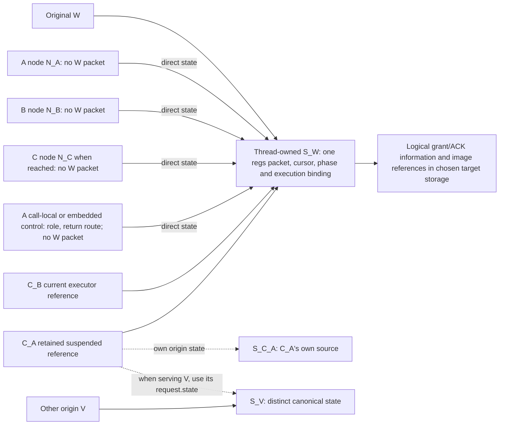
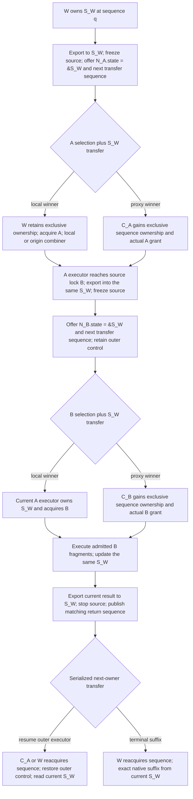

# kdlock lock protocol and state

Current build/boot, native checks, the earlier construction failure/recovery and
later returned generated prefix are scoped in the [current evidence checkpoint](04_evidence_and_reconciliation.md#current-evidenced-checkpoint).
Design requirements below do not establish complete generated-body or support evidence.

The [fixed-image fixture](../../../tests/evidence/runtime-recursive-20261110/README.md)
now records protected JIT completion across two distinct physical combiners,
with exact current-state return and separate physical-release/final-retirement
records. Its native C epilogue, general progress, full auxiliary context bounds
and broader API/workload support remain outside that evidence.

**Status:** proposed complete design contract  
**Applies to:** the independent redesign described in [the overview](00_overview.md)  
**Implementation boundary:** every function described here belongs to kdlock's lock, unlock, wait or combining implementation

Apply the [F/S/P/E authority rule](00_overview.md#authority-and-statement-origins). Fixed behavior and semantic obligations do not prescribe the current owner word, queues, pinning, pools or byte layouts. State/flow diagrams and storage examples are P; current paths are E and impose their actual constraints only when deliberately retained.

The approved first implementation lane is ordinary mutex lock/unlock in
sleepable task context on Linux 7.0 x86_64 without PREEMPT_RT. Integration rebuilds
affected source with fresh private layouts; old binary lock/object layouts are
not a compatibility promise. Other families follow later. This selects scope,
not a validated support lane. C03 now selects TCLock-style out-of-order outer
mutex unlock deferral with the responsible physical outer-combiner context
retained. The earlier transferable-grant proposal is superseded. C11 selects an
MCS queue; C04 retains the KD physical-R11 canonical-packet-base mapping. Private
local/proxy claims, persistent request/state bridges, ordinary native bootstrap
and recursive episodes are connected in source at `ce423858`. Managed task
lifecycle, source provider, fd control, executable loading and host/archive
composition have source through `c6becf81`. Exact target build/boot and limited
native/fork checks now have separate receipts. Complete deployment bounds and
runtime lifetime/progress proof remain outstanding. This selection
accepts extra waiting without generic native release-timing or progress parity.

## 1 Roles are temporary parts of the lock

W is the origin of a source continuation. C_A is a physical task combining A, which may itself be W. C_A can enter B's lock code while executing another origin's source and temporarily act as B's waiter or combiner. No dedicated task owns the combiner role.

The lock code has three responsibilities at a source lock boundary:

1. Preserve current continuation and operation phase.
2. Apply the selected lock family's acquisition, release or mode-change protocol.
3. Choose the next executor and admitted source continuation.

JIT code executes admitted source fragments between those operations. These are cooperating functions of one lock implementation, not a lock plus an independent execution service.

Keep four kinds of state distinct:

- **Request selection:** which participant may attempt this source operation/body.
- **Actual grant:** what physical backend protection was acquired.
- **Continuation authority:** which participant may advance the source program.
- **Storage lifetime:** which observers may still access records and notifications.

Publication, selection, acquisition, logical unlock, physical release and retirement are different events.

### 1.1 Original state and source-operation context

Each original W has exactly one canonical execution state S_W. When C_A executes W's source, its active-origin pointer resolves S_W. When it serves another origin V, the pointer resolves V's distinct S_V. C_A's own canonical state S_C_A remains distinct unless C_A is itself W. Saving C_A's lock-role control does not create another W state.

"Local" is relative to selection. A root local winner is W running its own source; a nested local B winner can be C_A continuing W's source through S_W. C_A does not become the logical origin. If origin-as-combiner W serves X, it uses S_X for X, then restores explicit current-node/parent-role routing to the same S_W for its own continuation.

Recognize a nested source operation from the active execution relationship, exact pending source API/phase and live-grant context. Neither `current != W` nor pointer equality alone identifies nesting: W can nest locally, and C_A can execute several origins. At W's nested lock(B), `N_B.state` must be `&S_W`, never `&S_C_A` merely because physical `current` is C_A.

Every-operation boundaries refer to the source program's lock/unlock/mode operations. Native helpers' internal queue, metadata and arbitration locks are implementation bookkeeping. They do not recursively enter source-operation dispatch or append grants to W's logical ledger. Define the source-operation versus internal-operation context in the wrapper/helper contract, rather than excluding particular application function names. Internal locks still impose their actual physical ordering, atomicity and scheduling obligations on the helper.

## 2 Optional publication and unique selection

### 2.1 Required behavior

Publishing a request offers delegation; it does not force it. While an offered request remains unclaimed, the origin can win the same lock's ordinary local path or become its combiner. Another combiner can instead select the request. The two outcomes must be mutually exclusive.

For each chosen backend, identify the transaction/ordering that makes these outcomes exclusive. The current mutex's shared wait-lock selection is E and a reuse candidate, not a required lock or owner-word protocol. A flag alone is insufficient unless the full queue/claim/result proof establishes:

- local acquisition selection;
- proxy selection;
- origin combiner election;
- cancellation or refusal;
- transfer and queue unlinking.

A successful local selection closes remote selection before the source body can run. A successful proxy selection closes the origin's local source-body path. A queue reservation or optimistic spinning membership does not by itself give either participant a successful source acquisition.

### 2.2 Proposed request states

These names describe semantics, not existing field names:

```text
PRIVATE
  -> OFFERED
       -> CLAIMED_LOCAL  -> ACQUIRING_LOCAL  -> ACQUIRED_LOCAL
       -> CLAIMED_PROXY  -> ACQUIRING_PROXY  -> ACQUIRED_PROXY
       -> CANCELLED or DECLINED
  -> RESULT_READY
  -> RESULT_CONSUMED
  -> RETIRABLE
```

Only one selection transition can win. Failure/interrupt results can also reach RESULT_READY without an acquired grant. RETIRABLE requires the final queue observer, grant operation, notification and continuation user to finish; it does not follow merely from RESULT_CONSUMED. For the selected mutex outer-unlock route, deferred acceptance is also not physical-release completion or retirement. The release phases in section 5 are separate from acquisition selection and from source-request/return completion.

The origin can acquire physically after local selection, combine selected other requests under a valid batching contract, then execute its own body locally. Its source body is not accidentally treated as a proxy request for itself. If C_A wins a nested B selection, it preserves its outer A execution state; the initial C07 implementation strategy below bounds unrelated B service.

A source request may be selected but still waiting for a physical grant. Keep that phase explicit so cancellation or handback cannot reacquire a completed operation or abandon an incomplete backend claim.

Lock-specific selection cooperates with S_W transfer. A participant advances W only with a valid live request/state, pending operation, selected endpoint, actual grant and exclusive execution. Stale nodes cannot regain authority. The selected ordinary-mutex MCS protocol still needs exact local/proxy/election serialization and checks for its actual reuse/cancellation races; historical arbitration is only a candidate proof.

Owner/sequence names express exclusive execution and required ordering, not a per-S_W lock/token framework or counter on every hop. The starting P is lock-local selection plus sender-stop, receiver-start and structured return ordering; select its primitive rather than inheriting the current wait lock/queue. Explicit incarnation/sequence checks are needed only for actual reuse, cancellation or escaping-reference races. Scoped grant identity must distinguish each acquisition and obsolete release without prescribing a ledger.

### 2.3 Publication sequence

1. Reserve the request's required completion, release and forward-continuation resources and retain S_W.
2. The current sequence holder exports resident logical registers, virtual stack/cursor and exact pending operation into S_W's one canonical packet/descriptor.
3. Freeze source advancement and finish the export before publishing READY. Initialize the node's `state = &S_W`, exact operation binding, transfer sequence, retained dependencies and queue links.
4. Publish OFFERED/READY with the family's required release ordering. The offering task can continue lock arbitration/wait code, not W's source suffix.
5. Local/proxy selection, origin election and cancellation serialize through the family protocol together with the declared state-transfer handshake.
6. The winner observes the ready state pointer through the family protocol, obtains the actual grant and establishes exclusive execution before source advancement; apply any identity/sequence checks needed by that protocol. Failed acquisition creates no grant and has its own serialized result route.
7. The authorized owner records the exact operation outcome in S_W, validates the next cursor/context and executes a fragment or transfers the exact suffix. Return transfers use the same export/freeze/sequence discipline on the same state.

No second task may write the canonical packet while its owner exports or executes it. If eligibility is published before export finishes, the chosen protocol must gate source execution on readiness; a separate READY field is one option. Export materializes the same canonical backing, without copying W's packet into a child node.

### 2.4 Cancellation and local reclamation

Cancellation of an OFFERED request races with selection at the same serialization point. If cancellation wins, close both source-execution routes and remove all temporary backend/queue claims before returning the error. If selection/acquisition wins, follow that operation's declared signal/API result contract; do not report cancellation and also execute the successful body.

A timeout is diagnostic. It cannot steal a grant, undo a selected body's effects or permit record reuse. "Remote did not respond" is not proof that remote selection never happened.

Local victory does not permit immediate reuse of published storage. Remote observers must either be excluded under the queue protocol or release retained references. Reuse needs the same exact identity and lifetime discipline as remote completion.

Transfer/cancellation metadata has a declared serialization authority distinct from permission to mutate W's running packet. A cancellation winner publishes its result through that protocol; the authorized S_W owner consumes it. A stale transfer/cancel sequence can neither change the packet nor select a new executor. Sequence rejection must occur while all inspected nodes/state remain retained, including the chosen wrap/reuse rule.

Delayed grant ACKs are imported by the current S_W owner only after the scoped state/request/acquisition identity and expected operation phase match, including explicit incarnation/sequence checks where the protocol needs them. An obsolete result cannot overwrite a newer operation, and a remote grant authority never writes S_W's packet directly.

An ACK for an older retained grant may still finish that grant's matching custody/retirement transaction. Validate it against that retained transaction, rather than treating it as the result of S_W's newer source operation. Rejecting an obsolete source-state update must not discard an outstanding physical release or last-reference duty.

## 3 Proposed records and their owners

**Fixed cardinality and physical target:** one thread-owned core S_W containing W's canonical regs packet once. The former invocation/continuation split is consolidated below. Nested entries, lock nodes and outer-control users point directly to that original core; none owns a duplicate source continuation or reserves another full W packet. C02 keeps active/nested lookup on each MCS node's direct S_W pointer; task-owned root backing supplies initial entry. Task-time provisioning of the selected persistent request records and exact reuse remain caller/integration duties, not another packet or state level.

Small synchronous role control can use the C stack only while its call remains alive through every remote access and final ACK; the unified ordinary local/proxy request contexts use task-owned preallocated persistent storage. The target core survives all admitted queue, grant, executor, return and native-suffix users. Nested relationships use the same S_W, not another execution state. The initial mutex core and referring actors have private source implementations; full kernel integration and runtime proof remain incomplete.

### Two storage/reference levels

```text
Level 1: thread-owned cores
  S_W   { canonical regs once; current cursor/phase; ownership and dependencies }
  S_C_A { C_A's own canonical regs; its own source state }

Level 2: referring users, with no full W packet or duplicate continuation
  N_A.state             ------> &S_W
  N_B.state             ------> &S_W
  N_C.state             ------> &S_W
  outer_control.state   ------> &S_W
  C_A active request.state ---> &S_W while executing W
```

Two levels describe storage/reference organization, not a maximum nesting depth of two. A -> B -> C and deeper admitted recursion retain direct pointers to the same S_W within proved stack/resource bounds. C_A uses S_C_A for its own program, but neither N_A nor nested N_B routes W through a packet owned by C_A's control record.

Keep only necessary selection/queue, family/mode/grant/operation identity, outer control and completion information under the proposed structured lifetime. A pointer alias is insufficient if users still reserve an unused full W packet or packet-sized owned/borrowed union. Preserve required per-lock authority/control and native call-stack saves. The fixed two-level target selects neither an allocator nor a private packet/frame layout and claims no measured saving.

### Minimal starting mechanism versus optional extensions

**P, starting proposal:** bounded structured recursion, call-local outer control and lock-local ordering in the target one-core/two-level model. The sketch names logical information and last-user obligations, not a required object graph. A fresh core/node layout is allowed; current sharing/queues are reuse evidence only. "Retain" means keep valid through the actual last user, not automatically increment a refcount. Extra machinery needs a concrete reason.

| Concern | Minimal starting mechanism | Condition requiring more machinery |
| --- | --- | --- |
| W execution and handback | One S_W/packet; users reference it; returning ownership changes its current binding/result | An actual reference escapes storage lifetime, requiring stable backing for the same S_W; no second packet or continuation/handback object merely for transfer |
| Nested outer control | Bounded recursive calls keep outer control call-local through child/release/result work | Return/nonlocal transfer invalidates referenced control or stack bounds fail: choose suitable stable target storage or a bounded explicit stack |
| Grants and identity | Exact authority, per-acquisition identity and results in chosen core/user fields or valid call-local control | A concrete non-LIFO/object/custody last user outlives that storage: retain necessary information independently of the invalidated storage |
| Results and ACKs | Chosen core/user fields, ordinary return and declared ordering; the retained parent handles deferred outer-unlock notification/unwind and its release duty | A callback/notification can access payload after its owner returns or permits reuse: extend its lifetime, finish notification before reuse, or use stable notification storage |
| Lifetime accounting | Structured call, queue ownership and return/ACK ordering prove last use without an added refcount | Independent asynchronous holders escape those proofs: select exact retention accounting, possibly a refcount; justify each extra holder/record rather than adding one per hop |

Materialization before source transfer, one active executor, optional selection and physical context legality remain mandatory. The selected ordinary-mutex non-LIFO route retains the responsible outer combiner and defers physical release to its normal batch/release protocol; it does not promise early availability. Other families receive no deferral exception. Sleeping alone does not invalidate a still-live task stack; migration does require a valid ownership/reservation rule for CPU-local storage. No sleep is permitted under a live atomic obligation. Bound recursive depth and kernel-stack use before enabling the route; an unproved bound needs a supported forward/local route or a separately justified bounded mechanism, not unbounded recursion.

### Selected task-owned persistent request storage

**Selected C05 storage:** the ordinary local/proxy path uses task-owned preallocated persistent request records rather than allocating request storage at each lock. Each simultaneously live request/control has a distinct record pointing directly to its original S_W. W's core/regs stays singular and is never copied into a request record. Normal local selection remains part of this unified path.

A persistent record becomes reusable only after its request and all relevant users finish. Queue scheduling membership, source completion, physical release and retained release/return duties are separate: detachment or a returned result alone does not permit reuse. Count every non-free record, including concurrently live nested requests and late physical-owner/release, grant, notification, return, image/binding and current-native-endpoint users after the logical scope ends. Nesting depth alone is insufficient.

The user guarantees an available record for every need of the supported workload. Capacity is finite and explicitly supplied by task attachment/resources; no deployment count or one-node sufficiency is configured here. Exhaustion is a documentation-only limitation of that support contract. It adds no exhaustion handler, recovery/local fallback or new special assertion, and does not imply a mathematically unbounded pool. The public ordinary lock API remains void; the capacity contract grants no public error result, fabricated success or source replay. Cold provisioning and managed lifecycle now have source through `c6becf81`; the actual deployment count and lifecycle/capacity proof remain outstanding.

**Selected C08 feedback storage is separate:** JIT misses use a preallocated fact
pool with explicit finite caller capacity sufficient for the supported workload,
without a numeric default or an unbounded-storage claim. Each fact preserves its
source site/resolved target, transfer/exit phase and exact producer/source-version
identity; retain every required epoch/metadata user through its final access.
Pending facts or an ongoing translation add no admission restriction to new
JIT/delegation: existing source/context/image checks still apply. Merge valid
same-version observations cumulatively before building. Fact recording, emitted
coverage, actual publication and ACK remain distinct; uncovered/later facts stay
pending. The reviewed kernel pool (`5989fbbb`) records COVERAGE_MISS only before consumption;
normal operation/resource/special exits are not automatically pooled. Exact
producer/source users retain copied facts after old code is released. Claims
bind record identity and incarnation; ending a claim can release earlier items
before a retry finishes and forbids further checks/ACK. The source-present
publication bridge binds only validated candidate inputs to actual commit, then
ACKs its exact emitted subset separately. Nonobservations/uncovered misses stay
pending normally. Selected shutdown archives exact facts/provenance with fsync
and a content receipt before kernel SETTLED, separately from coverage ACK, after
image/native/JIT drain. Kernel checks exact claim keys/incarnations and CLOSED
source/producer lifetimes; claim end later releases settled holds. This API has
source at `40ae39ce`; actual archival/transport/runtime composition has source
at `80095bfb`, without execution evidence.
Capacity covers those retained records too. The source-reviewed
host coordinator (`af997cb6`) accumulates valid observations before compilation
and keeps candidate input, emission, actual publication and ACK histories
separate; it supplies no transport or persistence. This does not change
request/grant authority or duplicate S_W.

| Persistent request information | Placement duty | Lifetime/layout condition |
| --- | --- | --- |
| Selected queue/claim status and polling fields | Candidate compact hot part of the node | Account for each logical membership's duties and last observer; choose links/topology rather than requiring current queues |
| Exact family/mode/acquisition identity and physical release endpoint/token | Necessary request-node fields | Acquisition identities stay distinct; authority remains actionable through successful grant/release duties and matching ACKs |
| Parent/child return route and request-specific control | Node fields only where the request needs them | Child/ancestor and native-handback users finish before reuse; ordinary saved outer combining control stays bounded call-local where its enclosing call proves lifetime |
| Result, cancellation, ACK and notification state | Chosen node fields where sufficient | Selection/cancel races serialize and final notification access ends before reuse; no automatic extra frame or refcount |
| W's regs and current source continuation | Only the one S_W core; node holds a direct pointer | No full W packet, duplicate source cursor/continuation or packet-sized owned/borrowed union in the node |

For the selected ordinary-mutex MCS queue, distinguish an acquisition scheduling slot from a **request-lifetime node**. Any other future queue needs the same distinction. Unlink, acquisition, source unlock, physical unlock and retirement differ. A request can be unlinked while its source-unlock request is deferred and an inner operation still needs its control. A marker is not physical release. That control remains retained through its actual users even when other logical grants exist in the held physical batch; a later request has distinct identity and cannot overwrite it before queue/cancel/ACK/notification/native users finish. No physical gate transition between every logical grant is implied. The persistent request record stays non-free until all those duties and observers finish, even after scheduling membership ends; normal local selection has the same exact retention duties. Other topologies need equivalent last-user proofs.

**Conditional spin example (E/P):** an acquisition-only MCS/qspinlock slot can become reusable before body unlock under its backend contract. It is not automatically a long-lived control owner. If per-CPU reservations/pools are selected, prove their chosen capacity and nested progress; never wait for a slot held by an ancestor waiting for that child. The rewrite need not use those nodes or pools.

**Sleepable locks (S/P):** chosen control storage stays valid across allowed scheduling/migration. The initial mutex uses preallocated persistent request records for normal local/proxy selection; its finite caller-supplied capacity and supported-workload availability guarantee have the scope above. Pinning and parking/waiting remain separate C01/C11 choices, not fixed by historical published-waiter code. If a backend uses both abortable OSQ and delegation memberships, discharge their separate selection/cancel/progress/retirement duties. Separate links are one solution. A merged protocol needs proof of all equivalent duties; neither OSQ nor two queues is required for every rewrite.

Normal local selection keeps exact acquisition/release provenance in its persistent record, independently of scheduling membership. Full source capture is required only by the declared entry contract. Optional delegation and mixed nesting preserve the same exact grant, source-phase and final-user duties. Other-family storage and capture policies remain separately scoped.

**Cache layout remains open and measured.** Keep contended queue/poll fields compact. Where access patterns require separation, isolate producer next-link writes from waiter polling and combiner control/result writes; W's regs stays in its separate core. Audit member offsets, alignment, pool stride and hot/cold writers/readers. An enriched node may span several cache lines and still be the simplest correct design; there is no 64-byte, performance-gain or measured-saving claim. C02/C05 and T49 gate retention/placement on concrete lifetime, progress, capacity and layout evidence.

The following field groups are a semantic inventory to map into persistent request records and the singular core. Reserving completion/release resources means ensuring that the required storage and progress route exist before effects; it need not allocate anything.

```text
canonical_thread_state S_W                 // exactly one for original W
  state_id, incarnation, original_task_ref  // scoped identity; encode only as needed
  invocation_id, invocation_phase
  canonical_regs_packet                   // physically once in this thread core
  packet_layout_id, valid_state_mask
  current_source_cursor, source_stack_and_return_map
  operation_descriptor                    // one current descriptor, below
  execution_owner_endpoint, execution_sequence // binding/order; counter optional
  transfer_phase, transfer_sequence        // chosen ordering or needed checks
  active_grant_index
  active_relationship_ref, retained_relationship_refs
  source_dependency_refs, bound_entry_image_refs
  native_suffix_state
  final_completion_state_or_binding

operation_descriptor                      // embedded in S_W
  operation_id, phase
  operation_domain = source_lock_API
  source_callsite, resolved_target, arguments
  family, API_variant, mode
  acquisition_ref_or_requested_object
  completed_result
  source_stack_transition_state
  next_source_cursor

execution_record                          // logical control; embedded/call-local
  relationship_id, incarnation
  state_ref = &S_W
  parent_ref, active_child_ref
  saved_outer_combining_control            // role/queue control, no W packet
  retained_entry_image_refs
  explicit_return_route
  relationship_phase
  completion_state_or_binding
  retained_release_duties
  responsible_outer_owner_context_if_required

grant                                     // logical information; may be embedded
  acquisition_id, incarnation
  retained_state_ref_if_required
  object_identity, live_object_ref
  family, mode
  backend_authority, backend_token
  release_route, release_sequence
  grant_state, logical_scope_state
  source_unlock_request_phase, deferred_outer_unlock_phase
  context_effect_tokens
  dependency_refs

per_lock_node N_L                          // request/queue state only
  node_id, incarnation
  state = &S_W
  expected_state_incarnation, expected_execution_sequence // only where needed
  offering_execution_ref
  target_lock_identity, family, requested_API, mode
  operation_identity, selected_entry_ref
  publication_and_selection_state
  selected_executor_endpoint
  transfer_sequence
  queue_membership_refs
  completion_state_or_binding

operation_mailbox                         // optional channel in target fields
  retained_state_identity, incarnation
  request_identity, acquisition_identity, operation_sequence
  operation, payload, result
  publication_word
  storage_owner_ref
```

Map this semantic sketch to the chosen concrete target fields/layout. `N_A.state == N_B.state == N_C.state == &S_W` is fixed, not an allocation option. User/control records carry needed role, identity, routing, references and results without a competing packet/cursor/phase or unused full packet-sized union. Grant information, optional mailboxes and code/image descriptors are not additional W states or intermediate packet owners; no current kdlock structure must be retained merely to match this sketch.

| Record or field | Sole mutation authority | Retention rule |
| --- | --- | --- |
| S_W packet, cursor and current operation | Exclusive current execution-sequence holder | Same backing remains valid through all executors, native continuation and remote references |
| S_W transfer metadata and node claim | Declared family/ownership arbitration protocol | State/node incarnations and matching sequences remain retained through selection/cancel/return |
| Selection state and queue transition | Chosen family arbitration protocol | Published observers drain before reuse |
| Physical grant/backend token | Actual family-specific authority | Remains actionable until every release/mode obligation ends |
| Logical live-grant lookup | Current executor consuming matching authority results | Chosen identity/reference bindings remain valid through non-LIFO release/reuse; index and slot layout are open |
| Saved outer combining control and active-origin pointer | Physical task's lock implementation under the transfer protocol | Restore role and borrowed-state reference, never W's old packet |
| Completion result | Selected producer | Final publication only after producer's last retiring-payload access |
| Image/code publication state | Chosen isolated/coherent publication protocol | Every code/return binding stays valid; update/reclamation follows C06/C09 |
| Source admission state | Defined source-provider protocol | Closing roots cannot strand admitted completion chains |

An executor endpoint is a retained task/request endpoint with a duty to respond, not a CPU number assumed stable across scheduling. A pointer or origin label alone does not confer physical unlock authority.

The selected grant authority services its release/mode protocol while another participant may execute S_W; it never overwrites a foreign running packet. Only the authorized current executor imports matching results into W's operation/packet/index. Grant/read-credit custody can outlive an executor/control record; target core/user storage suffices if its proved lifetime covers that custody. Extra storage needs an actual last user that outlives the chosen storage, not a current record type.

### 3.1 Direct request lookup and initial task-owned backing

**Latest C02 direction:** every MCS request points directly to the original
S_W. Nested B/C requests copy that pointer, never the source packet. The current
call/node and parent role are explicit dispatcher inputs; no external per-task
registry or redundant active-S_W task field is needed for borrowed execution.

Before its first MCS request, native W still needs stable own backing and its
selected auxiliary wait stack. The [task root](../../../kernel/task_state.c)
contains exactly one core, the initial native endpoint, task hold and auxiliary
bounds/cursor/reservation. A single task pointer locates that stable root header;
it is not a borrowed-source index. The [integration artifact](../../../kernel/integration/README.md)
contains an unapplied task-field/child-reset context template. The exact-target
installer's separate application/build receipts are linked in the current
checkpoint; the template itself is not that proof. The [setup composition](../../../kernel/task_setup.c)
at `57599619` validates caller-supplied known storage extents and composes
attach/resources/bind, with exact unused-root rollback and one-pass teardown.
It does not allocate backing or install automatic fork/exit/stack hooks.
The cold `task_storage.[ch]` wrapper (`40ae39ce`) now allocates explicit-sized
backing, composes setup/teardown and retains failed attached setup. Its native
lease spans the whole declared source activity; the independent source-stack
hold ends only after final actors. `lifecycle.[ch]` (`80095bfb`) supplies the
managed initial parent, independent unpublished-child construction/failure
cleanup and exact current-native exit drain. The task template includes those
hooks; the exact-target installer (`97130fe4`) has not applied them. Explicit
deployment capacity and full auxiliary-context compatibility remain duties.

Task copy clears its inherited header alias before publication without changing
the parent's core. Attach publishes initialized own backing. Before detach or
stack/storage reuse, close admission and drain every queue/grant/image/return/
notification/binding/lookup and auxiliary-frame user. Detach additionally checks
current origin/native ownership, no auxiliary occupancy, no grant or pending
image-use state and IDLE/RESUMABLE operation. Empty lists/cursors alone do not
prove that complete drain; failure is not permission to exit or free.

For C05 the prepared compiler-clobber prefix saves source SP, continuation IP and
BP, then switches to the task's auxiliary wait/control stack before source
publication. JIT virtual SP continues to address W's original source stack. This
retains the UB-derived JIT and GS lowering; it does not import TCLock's
borrowed-stack body engine. Exact entry phases, disjoint ranges, full callback/
recursion capacity, native context and last-user validity precede admission.
No origin-local JIT on overlapping C frames is enabled.

At reviewed source commit `ce423858`, the [ordinary source pair](../../../include/kd_mutex_api.h)
and [native bootstrap](../../../kernel/mutex_api.c) connect that prefix to the
[serial episode driver](../../../kernel/episode.c). It handles exact producing-image
exits, child return endpoints and deferred notifications after export. Native
unlock uses its exact existing grant/control and actual hardware CALL/RET;
it neither needs a new request slot nor restores old native packet SP/IP.
The final auxiliary actor survives root completion through the last entry/binding
read and closes before the native jump. [Task progress](../../../kernel/task_progress.c)
connects owner handling, episode/grant actors and pool collection. See the
[integration guide](../../../kernel/integration/README.md) for the caller setup and
drain contract. These private paths and the later managed allocation/fork/exit/
provider workflow through `c6becf81` have independent source review. Later exact
kernel build/boot, native-local and managed fork/exit results are scoped in the
current checkpoint. Live3's recorded prefix precedes inner B; later learning
results are scoped separately there. Complete recursive JIT and full
lifetime/progress proof remain unestablished.

Public unlock resolves its exact logical grant from current S_W, never only the
object address or physical task. Every source advance validates its retained
current execution binding. Lookup alone grants neither execution nor storage
ownership. Own-root lookup remains confined to native entry/handback; active
borrowed source remains the request's direct node->state.

The [source epoch](../../../kernel/source_epoch.c) (`a660342c`) and
[image owner](../../../kernel/image_owner.c) (`a23b82c1`) implement exact source
and code-provider retention records. They validate supplied source/configuration/
load/byte inputs and bind actual slot retirement transactions; they do not
by themselves establish source immutability, executable allocation or native-text
lifetime. The concrete source provider, compiled-image loader and managed
runtime now compose those holds. The caller still establishes the all-dependency
immutable-text contract, and retention closure alone does not close execution
admission.

### 3.2 Grant identity and native object lifetime

An object address is not an acquisition identity. Every logical source acquisition has a distinct referenced control and exact completion identity. A physical batch can retain exclusion while carrying multiple logical-grant controls; no physical gate transition between every logical grant is implied. A delayed completion must not mutate a later acquisition or overwrite control before its actual last user.

Identity must distinguish object destruction/reinitialization where the supported API contract permits it. Choose a concrete incarnation source or a protocol eliminating delayed object dereferences. A retained combiner/control record does not pin the caller's lock container. For the initial selected mutex lane, the caller must keep lock-object storage valid through actual physical release and the complete backend unlock's final object access. A deferred marker or owner-handled notification does not authorize destruction/reinitialization. After actual physical release and the relevant final object access, delayed bookkeeping uses retained identity/endpoint data and cannot touch a freed/reused lock object. Early destruction/reinitialization before that release/access boundary violates the selected object-lifetime contract. Availability-dependent handshakes retain their stated progress limits. This creates no instruction/source admission whitelist. Owner/control storage and its containing allocation must remain valid through their own exact last users after physical release; callback code remains retained through its return.

For imported ancestors acquired before delegated entry, capture exact provenance or enforce an actionable pre-entry exclusion. A logical task flag is not an inventory of all native locks.

### 3.3 Reference topology

The arrows below are retained references, not simultaneous execution rights or separate allocations. Every W node/control points directly to W's core, with no packet-owning middle level; grant/ACK/image metadata adds no W packet. Control, grant and ACK/result information may be embedded or call-local under the table's lifetime conditions. This snapshot has C_B owning S_W and C_A suspended. The dotted V route depicts an alternative allowed origin switch, not concurrent execution. Only the current sequence holder may advance S_W.



For W's A-to-B-to-C path, `N_A.state == N_B.state == N_C.state == &S_W` even when executors differ. For V's work, nodes directly reference S_V. No origin's packet is merged with another's, and saving the combiner role never snapshots W's running state.

### 3.4 Sequential ownership transfer

This proposed flow illustrates W -> C_A -> C_B -> C_A/W when proxy routes win, with optional local branches. Every S_W reference denotes the same target core. Sequence/grant/result labels are conceptual information in chosen fields or live call-local control, not required counters/objects. C11 selects the mutex MCS queue, whose optional local/proxy/election ordering still needs implementation/proof. Successful acquisitions are shown; failed/cancelled outcomes create no grant and retain exact result/lifetime duties.

An additional source lock C repeats the nested pattern with `N_C.state = &S_W`; the two storage/reference levels neither cap lock depth at two nor insert another packet-owning level.



Returning C_A acquire-observes B's completed current state in S_W. It restores only its outer lock-role control and admitted return binding. It does not reload a pre-B packet. If C_A must serve V during another allowed episode, it uses that request's direct state pointer under the same ownership/lifetime rules; C07 separately gates whether that scheduling is legal.

Retiring N_A, N_B or an execution relationship retires only that record's references. S_W reuse, incarnation change and task exit require every remote, grant/read-credit, source/image, return, notification and native-continuation reference to drain. Sequential invocation reuse cannot leave old nodes able to select a new S_W incarnation. Concrete storage, task-exit retention and synchronization remain C02/C11 mechanisms.

Reset/new invocation reuses S_W only after its chosen admission/last-user/reuse proof; it cannot clear live state. Task exit completes or retains duties before storage is freed. Nested source calls use S_W. Unsupported signal/IRQ/reentrant entry cannot allocate another W packet or steal ownership; use a valid pre-entry route/exclusion. General IRQ/NMI is unvalidated current support and unselected initial scope, not a permanent target ban; C10 must choose/prove any added lane.

## 4 Recursive acquisition inside lock functions

At any reached B acquisition, the JIT fragment has already ended with B pending. Lock code then chooses one supported route:

| Route | Meaning |
| --- | --- |
| Current task acquires B | C_A performs B's actual acquisition in a legal context, records the exact grant/result and resumes an admitted fragment with current state |
| C_A becomes B combiner | C_A saves outer combining state, obtains B's combining role, serves admissible work and executes W's B continuation |
| Another C_B selects child | C_A offers an optional child request, suspends source advancement and continues necessary wait/release handling; C_B exclusively selects and obtains B before running source |
| Origin continuation | A validated transfer gives W the current unfinished continuation and correctly routed live grants |
| Native from initial entry | Before delegated effects, decline an invocation whose later forward continuation cannot be supported |

Routes apply only to explicitly selected/admitted lanes. C_A-local selection of W's reader is still remote execution relative to W. Under the proposed origin-local initial policy, use a proved origin route or pre-effect restriction. C10 may select another placement only with concurrency/mode/API/context and continuation proof; this section neither permanently excludes nor enables remote readers.

An unavailable B image does not prevent B acquisition. Use a supported local/native continuation, never a wait for compilation. Executing arbitrary source natively on C_A is not a generic recovery engine; native execution on a non-origin task requires its own proven context/continuation contract.

### 4.1 Recursive helper sketch

**P:** this sketch uses the proposed structured call/control and conservative terminal-suffix outcome. C04/C06/C10 may instead select a separately proved resumable origin-service contract; no choice can replay effects or revive an invalid cursor automatically.

```text
lock-path helper reached_operation(active_state_ref, pending_operation):
    resolve original S_W through active execution relationship
    validate source-operation domain, operation identity and owner sequence
    validate operation phase and all live context obligations
    if pending_operation is acquire:
        choose family-specific optional arbitration route
        preserve outer combining state if roles nest
        if another combiner wins:
            suspend this execution relationship
            while child has not produced an outcome:
                handle required release/cancel/return messages
                wait or poll only as allowed by this context
            validate outcome identity, current phase and transfer sequence
            if exclusive terminal suffix ownership passed to W:
                close old source-resume rights
                retain responsible outer context until its physical release duty ends
            otherwise reacquire current S_W sequence ownership
            consume the exact matching outcome from current S_W
        else:
            perform or finish acquisition exactly once
            record grant on success or exact API failure
    else if pending_operation is unlock or mode change:
        resolve exact acquisition and physical authority
        if selected ordinary-mutex out-of-order outer unlock:
            record exact request and deferred marker once
            retain and notify/unwind to the responsible outer combiner
            distinguish deferred acceptance from actual physical completion
        else:
            perform locally or route through the declared lock-path endpoint
        observe the exact promised phase/result
    choose a validated route only under its current phase and lifetime contract
```

This sketch is documentation, not executable code. Start with bounded structured recursive lock calls and ordinary call-local outer control whose enclosing call remains alive through the child and required release/result handling. A bounded explicit stack or extra stable record is an option only when a concrete stack bound or escaping reference requires it. C05 must prove stack use and sleeping/atomic legality; recursion is not unbounded by default.

### 4.2 Return is an outcome, not an old snapshot

When B's operation or execution episode produces an outcome, choose an explicit outcome:

- **CONTINUE_FRAGMENT:** a validated current-state cursor and retained/admitted image, possibly back on C_A.
- **ACQUIRE_FAILED:** the exact return code and caller's failure branch, without an invented B grant or B body.
- **ORIGIN_SUFFIX:** exclusive native-suffix authority transfers to W; suspended ancestors lose their old JIT-resume rights.
- **CONTINUE_CHILD:** a still-live descendant/other grant determines the next valid execution route; a source-unlock request does not itself retire B.
- **DEFERRED_OUTER_UNLOCK:** the selected mutex source request is marked for the retained responsible outer combiner. Notification/unwind and owner handling are distinct from physical release; no old source cursor is revived.

The old A fragment ended when lock(B) was encountered. Returning from B does not authorize jumping into an unvalidated old A cursor. A retained A image can contain an admitted post-B fragment, but it reads B's resulting current state from the same S_W packet. No A/B packet restoration occurs.

**S:** materialize current state, close exclusive child execution/bindings and finish dependent producer accesses before a result permits reuse/resumption. Storage stays valid through its actual last user. **E, conditional migration:** a retained pop-based path keeps its detach/final-access discipline until replaced; the target need not use its pop/continuation array or exact mechanism. Structured calls/flags or another proved scheme can meet the same S obligations. A matching result permits exactly one resumption.

Only one child advances a source continuation at a time. No sibling fan-out is proposed.

## 5 Unlock and non-LIFO release

Every unlock ends the current fragment, regardless of which scope it releases. The lock's unlock helper resolves exact acquisition identity and API semantics.

**Selected ordinary-mutex policy (C03):** for `lock(A); lock(B); unlock(A); ...; unlock(B)`, an out-of-order outer unlock records a deferred request for the responsible physical outer combiner. Keep that combiner context and its exact per-acquisition controls retained, notify/unwind to it, let it handle the marker and continue its normal batch/release protocol. Extra waiting is accepted. This supersedes the earlier immediate outer-release requirement and transferable-grant recommendation only for this mutex route. C11 now selects MCS; optional local/proxy/origin-combiner claims and queue/request last-use ordering remain implementation/proof duties.

The current scope excludes reacquiring A while B is held after A's unlock was deferred and A's old physical batch remains held.

The source reference is TCLocks' pinned public kernel [out-of-order unlock path](https://github.com/rs3lab/TCLocks/blob/bbfb9f00a12af51dff6ca291cb9829a82960c2ef/src/kernel/linux-5.14.16/kernel/locking/mutex.c#L809-L855), [inner completion reporting a deferred parent](https://github.com/rs3lab/TCLocks/blob/bbfb9f00a12af51dff6ca291cb9829a82960c2ef/src/kernel/linux-5.14.16/kernel/locking/mutex.c#L475-L491) and [outer handling with continued batching](https://github.com/rs3lab/TCLocks/blob/bbfb9f00a12af51dff6ca291cb9829a82960c2ef/src/kernel/linux-5.14.16/kernel/locking/mutex.c#L295-L333). These historical source references select neither its borrowed-stack execution nor another kernel target.

The private [C protocol](../../../kernel/mutex_release.c) and [header](../../../kernel/mutex_release.h) record these distinct phases:

```text
HELD -> REQUESTED(route=OWNER) --------------------> OWNER_HANDLED
HELD -> REQUESTED(route=DEFERRED_OUTER) -> DEFERRED
     -> UNWIND_READY -> OWNER_HANDLED
OWNER_HANDLED -> PHYSICALLY_RELEASED -> RETIRED
```

- REQUESTED atomically publishes the exact source operation and typed OWNER or DEFERRED_OUTER route. The caller resolves the active execution relationship; task equality alone cannot classify a same-task outer unlock. It is not physical unlock.
- DEFERRED retains the marker and responsible physical-owner context only for DEFERRED_OUTER; deferral rejects the OWNER route.
- UNWIND_READY identifies the declared notification/return to that context. It does not itself switch stacks, advance a source cursor or restore an old S_W snapshot.
- OWNER_HANDLED requires the responsible current task and either OWNER+REQUESTED for normal handling or DEFERRED_OUTER+UNWIND_READY after marker/unwind publication. An outer REQUESTED cannot be consumed as normal owner handling. The normal batch can continue; handling is not physical release and this helper advances no source cursor. The selected contract permits a correctly materialized post-unlock continuation without a wait solely for physical release/object lifetime; its private bridge and managed source path are connected through `c6becf81`; complete runtime proof remains outstanding.
- At owner initialization, the caller has already acquired physical exclusion and binds its exact ordinary unlock callback/object. The owner-only finish validates all obligations as OWNER_HANDLED, closes the batch/binding and takes/clears the saved callback/object under its internal guard. It invokes that bound synchronous complete ordinary unlock exactly once outside the guard, then records PHYSICALLY_RELEASED on the obligations. A marker, an acceptance callback or an unlock callback chosen only at release time cannot stand for physical release.
- Exact source-request, return and notifier users, plus the physical release duty, gate RETIRED. Source return, a marker, owner handling and even physical release do not individually prove every last user has finished.

The helper retains one physical-owner context/list of exact per-acquisition controls and checks owner operations against the current task. Correct initial callback binding, synchronous complete ordinary-unlock behavior and callback code/object lifetime through return remain caller obligations; the protocol performs no late object dereference. Its internal guard protects owner/control transitions and is not the selected C11 MCS acquisition/claim protocol. The separate MCS, canonical-state/JIT, task-anchor, ordinary-bootstrap and recursive-episode sources connect those private components through `ce423858`. Managed provider/task wiring has source through `c6becf81`; exact kernel application/build and runtime proof require separate receipts. At that source checkpoint the helper had static review only. Later build and eight native-local lock/body/unlock iterations are recorded separately; they establish no deferred/proxy release proof.

A source unlock ending a logical scope is not a frame pop or physical batch release. The initial mutex lane requires stable lock-object storage through actual physical release and final backend object access. The caller establishes that validity; a retained context alone does not pin its lock container. If owner/control records share the containing allocation, keep that allocation through their later exact source-request/return/notifier last users, not merely physical release. Callback code remains retained through callback return. Record request/return, marker, unwind, outer handling, actual release and reclamation separately; acceptance is not physical completion or retirement. The selected stable-object contract permits a correctly materialized post-unlock continuation without waiting solely for physical release/object lifetime. The helper does not advance source. The private C04 bridge and its remaining integration must preserve the exact operation/CALL-return/cursor phase, exclusive executor, remaining logical grants and pending physical duties, once only; a marker alone authorizes no arbitrary execution.

Extra waiting is accepted without generic native timing/progress parity. Other families and downgrade keep their declared release/concurrency semantics.

A backend route that separately promises actual release before source advancement must still fulfill that promise, with a matching physical-release result and full ordering. That conditional route is not the selected outer-mutex deferral policy.

### 5.1 Composite and owner-sensitive locks

**S:** every acquisition has unique, actionable grant/release/mode authority and exact context/order effects. Moving S_W does not itself transfer that authority. The selected ordinary-mutex outer-unlock route retains its responsible physical owner and defers release through that owner's normal protocol. The prior explicitly transferable-grant proposal is superseded and unselected. An owner-sensitive backend still obeys its actual restrictions; a logical owner label supplies neither a release nor a lifetime proof.

For rwsem/rwlock preserve required reader concurrency, write exclusion, mode/API results and release/progress semantics. If the backend uses reader tokens, writer reservations, drain gates or an embedded mutex, account for its actual composite duties; releasing one part does not prove availability. The target need not copy those structures. Read credit is custody, not automatic permission for remote execution. Placement is C10; origin-local is only the conservative initial proposal.

Downgrade remains a separate target mode/lock-operation decision C10 with native API semantics and continuous write-to-read protection. Unlock/relock, indefinitely retaining write exclusion or merely relabelling it read mode is not generic equivalence. Target lock code handles the mode operation at its declared fragment boundary. The current test-specific proxy-downgrade exemption and retained writer gate are E only, recorded in [the newer receipt section](04_evidence_and_reconciliation.md#27-newer-proxy-downgrade-and-flags-stack-evidence); they neither override source-operation boundaries nor prove faithful native downgrade.

Trylock failure and interrupted acquisition create no successful grant. Temporary queue/reservation claims still need cleanup. Signalable APIs must observe W's intended signals/results rather than silently substituting C's signals.

## 6 Context legality and progress

For non-PREEMPT_RT spinlocks/rwlocks, preserve native atomic/preemption effects. Never sleep, allocate through a sleeping path or acquire a sleepable lock while any live spin/atomic obligation forbids it. IRQ/BH variants need separate local CPU effects and explicit admission.

Mutex/rwsem semantics alone do not disable preemption. Pinning or CPU-local reservation, if selected, adds constraints to prove. Sleepable control stays valid across allowed scheduling/migration; an unreserved per-CPU slot is not task-private. These S duties do not mandate current pinning, parking or pools.

At native handback, W needs the required native context guard while an applicable logical spin/rwlock grant remains live, even if its physical hold is elsewhere. In A-to-B then unlock(A), dropping A's pin must not make W preemptible while B still requires atomic context. Context tokens belong to the physical task/CPU that applied them; never restore remote IRQ state from the top frame.

Parents waiting for a child must handle the selected ancestor notification/unwind, release/cancellation and completion work. A responsible outer-mutex owner context remains retained through its deferred physical release duty. Same-task requests dispatch locally rather than waiting for themselves. Sleeping waits need predicate checks, registration and wake ordering that cannot lose an event. Atomic waits need every required participant to have a legal scheduling/CPU progress route.

**Initial C07 service-admission implementation strategy (P):** before publishing any root or recursive acquisition, the exact current S_W holder scans its grant index for an already `logical_open` grant. This includes a fresh native-root B request with an older open A grant; `frame.parent` alone does not identify nesting. If any such grant exists, that request's new locally won physical batch uses a zero proxy-service limit for its entire lifetime. Keep the same persistent request, ready/offer and local/proxy selection path: an existing external B combiner may still select W's request. No source grant or physical release authority changes.

This removes the extra scheduling edge where C_A holds A, locally wins B, then runs unrelated B waiter X before W receives its B grant, and X waits on C_A-held A. It is a conservative optional-service strategy with a private source implementation at `ce423858`, not a separately user-selected fixed policy or proof against arbitrary deadlock, timing changes or progress loss. Broader unrelated inner batching remains unselected. Logically closed records retained for physical release/return/image users are not open logical grants; their deferred notification, owner handling and physical/last-user duties remain separate. Necessary owner/queue progress still runs, and the responsible outer combiner follows its selected normal deferred-release protocol.

The accepted outer-mutex waiting policy and this inner scheduling restriction establish no generic native progress parity. Availability-dependent source handshakes retain their stated limits. This restriction alone is not a proof. Draw the wait-for graph including affinities, oversubscription, physical owners, retained grants and CPU reservations. Bounded metadata does not guarantee bounded native lock waits or scheduler fairness.

## 7 Ordering and retirement

| Edge | Producer obligation before release publication | Consumer obligation after acquire observation |
| --- | --- | --- |
| OFFERED/READY | Export into S_W, stop source and retain node/state/sequence | Validate the same state pointer and enter family/ownership arbitration |
| GRANTED | Actual acquire and exact grant initialization | Execute source only after grant/context validation |
| CHILD READY | Stop S_W source writes; retain the same state and bridge | Validate request/state sequence, select uniquely and acquire B before source advancement |
| Source unlock REQUESTED | Atomically publish exact source operation and OWNER/DEFERRED_OUTER route from the active relationship; retain its users | Match acquisition and route, not task equality alone; do not infer physical release |
| DEFERRED marker | Retain responsible outer owner and exact control before publication | Observe acceptance only; retain physical exclusion/release duties |
| UNWIND_READY | Stop/yield source under the chosen bridge and retain return/notification users | Return control to the responsible outer combiner, without an old packet restore |
| OWNER_HANDLED | Responsible current task handles the marker | Continue normal batch protocol; handling is not physical release |
| PHYSICALLY_RELEASED | Validate handled obligations; close/take/clear initial binding under guard; invoke bound synchronous complete ordinary unlock once outside guard; only then record completion, with no late object access | Rely on actual release only for matching acquisition/phase |
| RELEASED ACK on another promised route | Complete its promised actual release and retiring accesses | Never substitute deferred acceptance for actual release |
| Child result | Export into S_W; finish dependent accesses and close child binding, including detach/pop where used | Observe the valid result/return ordering, reacquire ownership and resume once from current S_W |
| Origin suffix transfer | Materialize the exact forward continuation; revoke old resume rights | W advances only after exclusive ownership transfer |

Use Linux ordering primitives with an LKMM argument even on x86_64. `volatile`, `READ_ONCE`, `WRITE_ONCE`, a wakeup or an arbitrary atomic counter alone does not supply the whole data/lifetime chain.

**P:** if a mailbox is chosen, start with one outstanding operation in target core/user/lock-local fields; synchronous return may supply the channel without an allocation. **S:** arbitrate any actual multiple producers and match requests/acquisitions/results under the chosen identity/order scheme. Numeric wrap/reuse rules apply if such fields are used. Rejecting a stale number cannot make an invalid pointer safe.

Deferred acceptance, owner handling and source return are not final ACK/DONE or permission to reuse owner/control storage. Exact source-request, return and notifier users must finish and physical release must occur before retirement. After a final ACK/DONE allows storage reuse, its producer cannot touch embedded wake state or payload. Finish notification before retirement, or retain independent notification storage.

Keep S_W, source/module, image, grant/read-credit, queue link, ticket, object and CPU pool lifetimes separate. Node dequeue, logical unlock, executor/frame completion and native return each retire only their own obligations. Closing source admission must leave admitted descendants and native suffixes a legal completion path; it cannot free S_W or custody still needed by a different executor.

## 8 Consolidated invariants

These retain audit identities and cover v0.6 topics under the current F/S/P authority rule, not every old mechanism/policy as a mandate. R15 marks the local-state preference P and its correctness proofs S; code/source lifetime and actual context duties remain requirements.

| ID | Target condition (F/S unless explicitly labelled P) |
| --- | --- |
| R01 | Protected source work runs only under the exact family/mode grant. A published request or queue reservation is not a grant. |
| R02 | One participant advances a logical continuation. Local selection, proxy selection, election and cancellation serialize through the lock's family protocol. |
| R03 | Publication offers optional execution. A legal local winner can execute itself or become combiner after closing the competing proxy route. |
| R04 | Every lock/unlock ends its fragment before the operation. The lock code performs the operation once and chooses the next current-state continuation. |
| R05 | No recovery replays completed effects, CALL stack transitions, acquisition or release. |
| R06 | Logical W and physical current/context remain distinct, including task/CPU-specific context restoration. |
| R07 | Release and mode change resolve exact acquisition/authority, including imported ancestors and acquisition-record reuse. |
| R08 | Source request/return, deferred marker, unwind, owner handling and physical release are distinct. RELEASED means actual physical release; selected mutex deferral carries no early-release promise. |
| R09 | Execution ancestry, live grants and source scope remain independent; referenced identities/bindings stay valid under the chosen storage/index scheme. |
| R10 | Final dependent access and child-binding closure precede final reuse permission; intermediate deferred/source-return results do not permit retirement. Retain responsible owner context and exact request/return/notifier users through their last use. |
| R11 | Waiting parents perform declared work without lost events, self-wait or sleep under atomic obligations. Other routes retain their no-added-wait-cycle duty. Analyze the selected outer-mutex deferral separately: extra waiting is accepted and availability-dependent handshakes remain unresolved, not generic native progress parity. |
| R12 | Failed/cancelled acquisition creates no successful grant; reader/writer and downgrade semantics remain exact. |
| R13 | Resources for completion/release/forward continuation are reserved before the effects that need them. |
| R14 | Source/image, object, request, queue, task/stack and CPU lifetimes have separate last users and retirement rules. |
| R15 | C02 uses direct MCS node state pointers, with stable task-owned initial/auxiliary backing and no active-S_W registry. Exact local grant/control lookup, publication, identity and last-user lifetime remain mandatory; no copied packet is introduced. |
| R16 | Lookup protection, source admission, candidate/publication isolation and execution lifetime have separate correctness proofs. |
| R17 | Current execution does not depend on learning success. Source epoch, image generation and feedback revision differ. |
| R18 | Translated coverage is acknowledged separately from settled capability/boundary dispositions; later pending observations survive publication. |
| R19 | Every admitted boundary has an exact current-state recipe and independently valid code/return binding. |
| R20 | Unsupported lowering, origin-required operations, ordinary misses and invariant failures have different outcomes/retry rules. |
| R21 | Cross-task publication has complete data ordering, matching identity/order and final-access-before-reuse; numeric sequences are conditional mechanisms. |
| R22 | Support claims name API/context/route and actual evidence. AS01 assumes general flags/SIMD correct without extra handling; it is not equivalence evidence and does not waive special frontiers, actual context/authority/fault or last-user duties. |
| R23 | Each original W has exactly one thread-owned S_W/regs backing. All nested nodes/controls reference it directly and reserve no duplicate W packet, continuation or packet-sized owned/borrowed union; two storage levels do not cap nesting depth at two. |
| R24 | Family selection, state transfer and cancellation preserve exact scoped identity and exclusive execution ordering, with incarnation/sequence checks where needed; stale nodes cannot regain continuation authority. |
| R25 | The active-origin pointer resolves the served origin, not physical current. Exact source-operation context identifies nesting; internal bookkeeping never becomes W's source grant. |
| R26 | General family/API/mode/source/ABI identities determine dispatch. Every successful source lock operation has a generic post-operation admission path; native suffix is fallback, not full JIT completion. |
| R27 | Reader concurrency/mode/API/context semantics hold under C10's explicitly chosen placement; origin-local is an initial proposal and no unselected remote lane is authorized. |
| R28 | Application, local, fragment, native-handback and whole-root completion evidence is distinct; attribution requires actual exit cursor/reason and ownership phase. |
| R29 | Canonical-state and grant/read-credit custody can outlive nonresponsible executor/frame/node completion. A responsible outer-mutex owner context remains retained through its physical release duty; reuse/task exit waits for every retained last user. |
