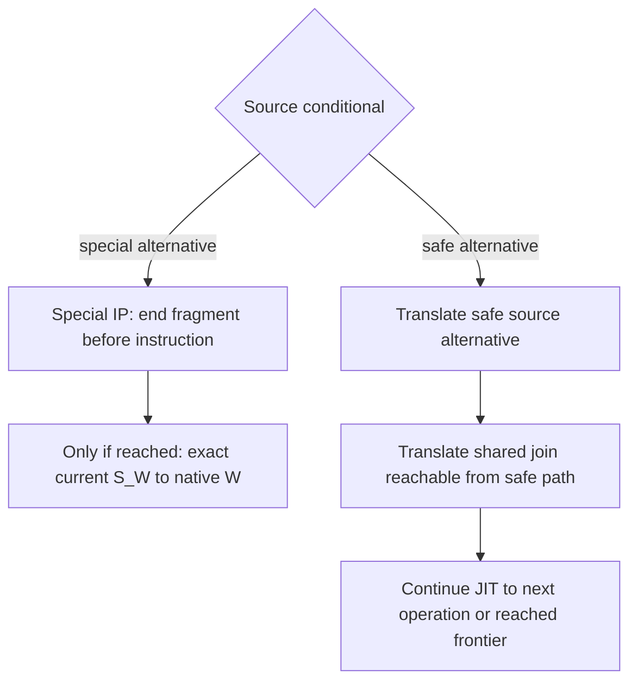

# kdlock original JIT contract

**Status:** proposed integration contract using the original UB-derived backend  
**Terminology:** lock helpers are functions inside kdlock's lock implementation, not an independent runtime component

Apply the [F/S/P/E authority rule](00_overview.md#authority-and-statement-origins). The original backend/GS lowering is fixed; a current private adapter ABI, storage format, capacity or publication interface is evidence until deliberately selected for the target.

**Current iteration scope:** ordinary trusted source is intended to translate; general flags/SIMD are assumed correct under [AS01](00_overview.md#current-iteration-policy-and-assumption), not separately captured/virtualized or used as a blanket admission gate. PUSHFQ/POPFQ have the explicit local lowering contract in section 3.5. None of these statements establishes universal instruction/kernel equivalence.

## 1 Fragment boundaries replace whole-scope JIT spans

A protected scope tracks the source-level acquisition and selected unlock/mode-operation phase. For the selected ordinary-mutex outer-unlock route, a deferred source request can leave physical batch exclusion and release duties live after that request; track them separately from the source scope. Other families retain their declared release semantics. A **JIT fragment** lasts only until the next dynamically reached lock or unlock operation, a supported frontier/terminal, or an admitted completion boundary.

For this redesign, all of the following terminate the current fragment before the operation itself:

- nested acquisition of B while A is held;
- failed trylock and signalable acquisition attempts;
- release of the innermost grant;
- non-LIFO release of an ancestor or imported grant;
- an encountered supported lock API variant, including indirect targets after resolution;
- a supported mode-change operation such as downgrade, handled as an explicit lock operation.

Mode changes remain explicit target lock operations under C10 and native API semantics. A candidate-specific typed proxy downgrade exempted from its release-unit cuts is E only; it does not select the target mode contract or weaken any source lock/unlock boundary. Unsupported API integration and a reached special-instruction frontier are distinct cases.

Lock code receives a typed operation descriptor, handles that source operation exactly once and records its exact phase/result and grant/context effects before choosing a supported route. For selected outer mutex unlocks, handling can record a deferred request and notify/unwind to the retained responsible combiner; it does not mean physical release. Ending generated execution does not imply returning to W immediately. The same physical combiner may continue through lock code into another fragment.

A lock boundary is intentional. It is not a missing callee to learn away. No future generation may compile across it merely because the target became known. Permanent capability frontiers likewise remain explicit dispositions until their generic lowering/context contract changes; ordinary target learning cannot remove them.

### 1.1 Reached-only and semantic recognition

An untaken branch containing a lock does not execute that lock or terminate the currently executing path. Static discovery can inspect both branches while emission stops each control-flow edge at its operation boundary.

Recognize supported APIs and exact call/operation metadata, not a substring search for "lock" or "unlock." Inlined forms, wrapper aliases and direct/indirect calls need an enforceable integration contract. Either the source wrappers/instrumentation expose every admitted lock operation, or admission excludes source whose operations can bypass the boundary. Trusted source does not make an unrecognized lock harmless.

That integration requirement is not a whole-region semantic whitelist. A recognized special instruction has the path-specific treatment in section 1.3; its mere presence in a function/root is not an admission failure. Any genuine inability to expose a source lock operation or materialize an exact forward continuation must identify that specific integration/correctness failure.

Recognition uses the active original S_W relationship and source-operation domain. kdlock's native queue/metadata locks belong to lock implementation control; they are not recursively translated source operations and do not add W grants. The distinction is generic operation context, not a list of application or helper function-name exceptions. Their physical context constraints still apply to lock code.

An unknown indirect target exits under its supported first-unexecuted recipe. Lock code classifies a resolved lock/unlock target before invoking it. An ordinary unknown code target is a learning miss; a recognized lock target becomes a lock operation boundary.

### 1.2 Discovery is not fragment execution

The user approved five direct-CALL discovery edges from an entry as the **current default (P, selected)**. Keep that default unless a deliberate target decision changes it; it is not an immutable property of the original backend. Whether to retain a compatibility depth mode is also a choice. Discovery depth is distinct from lock depth, control capacity and actual execution.

Apply fragment boundary clipping before expanding a lock/unlock target as ordinary body code. Discovery can identify the next fragment's source cursor and dependencies, but it cannot merge execution across the operation. A deeper observed ordinary frontier can still seed later learning.

Keep source-byte, decode-pass, CFG-transition, image-size and nesting limits distinct. Historical candidate constants are evidence for that candidate, not fixed requirements for this complete redesign.

Classify a refusal by the actual exhausted resource, selected limit, consumed quantity where known, source epoch and cursor. A reported CFG-expansion cap is not automatically text-cache, executable-image or runtime-frame exhaustion. C08/C05 select target source/CFG/image/control budgets and their evidence; current constants do not bind the rewrite. Finite compilation/backoff must not hold the current invocation waiting for learning. Before effects, choose a legal local route; after effects, use the reserved exact forward continuation. Application names do not select exceptions or another backend.

### 1.3 Path-specific special-instruction frontiers

**Target policy (F):** ordinary trusted critical-section source is intended to be translatable through the original backend. For a known unsupported special instruction, such as an instruction enabling user-memory access, stop source emission immediately before that instruction on the affected CFG path. Do not emit the instruction or its suffix through that edge into the fragment. Continue other branch alternatives and keep any join independently reachable from a safe alternative. Generating an exit stub is distinct from emitting source past the frontier.



The source special path may also lead to the shared join after native execution; that does not create a generated edge through the special instruction. Its suffix is absent through the frontier edge, while the safe edge still reaches translated join code. If the conditional bypasses the frontier, no handback occurs merely because that code was discovered.

Preserve prior stores/results, live locks and source CALL/RET effects once. If a callee has a safe returning alternative, retain that translated return and its caller fallthrough. A terminated special path cannot invent a translated return/fallthrough; if all callee paths terminate, no returning alternative is fabricated. Dynamically reaching the frontier transfers exclusive current-state authority to native W at the first-unexecuted special instruction, using the same S_W.

Unknown ordinary targets remain coverage/learning misses, and finite source/compiler limits remain resource boundaries. Neither is a new semantic whitelist. A proved impossibility of exact forward continuation remains a real correctness blocker to resolve, but the existence of a recognized special frontier does not justify rejecting an entire root/function or safe alternatives. AS01 does not remove selected special CPU-state frontiers.

## 2 Per-lock entries and separately admitted fragments

Separate nested entries/images remain part of the design. They use the same original backend. Do not revert to a mandatory parent-entry lookup for every child.

A per-lock/source entry can describe several fragment entry and continuation cursors:

```text
entry_A
  fragment A0 after acquired A -> pending lock(B)
  fragment A1 after completed B episode -> next operation or A release

entry_B
  fragment B0 after acquired B -> pending unlock(A)
  fragment B1 only under its validated post-unlock(A) phase bridge
              and selected stable-object lifetime contract
              with B live -> pending unlock(B)
```

This is a conceptual example, not a prescribed global naming scheme. Fragment identity must include enough source/ABI information to distinguish the actual cursor, operation phase, required input state and live-grant/context contract. Generic structures/dispatch combine lock family/API/mode, original S_W identity, operation phase, source cursor/dependency epoch and ABI compatibility. Reusable code-cache keys may omit W's identity only with proven input compatibility; each execution binding still names its exact S_W. A lock object's address or mmap/munmap root name is not a sufficient key or a protocol selector.

An entry associates source/dependency identity, publication state and fragment descriptors. An image is a versioned unit of code and metadata; coherent immutable descriptors are replaced through the selected quiesced RCU rule. One image may contain several fragments. A cursor can have no available fragment, in which case the operation still completes through its admitted local/native route. C06/C09 select quiesced RCU replacement and exact active-user retention. Source-epoch/input validation and code-owner retention now have private implementations; source snapshots/native holds under the selected all-dependency immutable-text contract now have source at `40ae39ce`. The actual provider/channel/executable/runtime composition now has source through `c6becf81`; exact target application/build and execution require separate receipts.

### 2.1 Bridge from A to B

At lock(B):

1. Export resident W registers and current cursor/phase into S_W's same canonical packet at the pending operation boundary. Record any already-evaluated target/arguments and source CALL-stack effects.
2. Retain A's relevant code/return dependencies and explicit post-B continuation description. The old A fragment has ended.
3. Lock code arbitrates B together with S_W sequence ownership and performs B acquisition or returns its actual failure. N_B references the original W's S_W even when C_A is the physical caller. Do not acquire B again in an image transition.
4. Select B's compatible entry/image/fragment for the completed-success state, if eligible. Enter through the C04 target adapter using S_W's one packet and the chosen valid-input contract.
5. On later operations and B completion, export into the same packet and transfer its ownership before selecting the explicit next route. C_A sees B's current result in S_W; it restores only its outer combining control, never a pre-B packet.
6. If A has a selected deferred outer-mutex unlock, retain its responsible combiner and physical-release duty until normal outer handling/release. A retained record alone proves no usable source grant, but the physical batch can still exclude A. Any next fragment must use the exact source-operation phase, remaining logical grants and pending physical duties; it cannot assume that the marker released A.
7. When no supported protected/delegated continuation remains, return the exact post-operation suffix to W. Do not run arbitrary unprotected source on a combiner by default.

Crossing images creates no source CALL or RET of its own. Any source call-stack transition belongs to the original operation and is accounted exactly once.

### 2.2 General post-operation reentry

After **any successfully handled source acquisition, unlock or supported mode operation**, lock code must provide a generic current-state route using S_W's exact cursor, operation phase, registers, logical grants, pending physical duties and context. For selected outer mutex unlocks, deferred acceptance, owner handling and physical release are distinct; no marker alone proves source-API return or authorizes cursor advancement. The selected stable-object contract permits a correctly materialized post-unlock continuation before physical release without waiting solely for object lifetime. The private C04 source bridge and its remaining whole-lane integration must preserve current logical registers/stack, exact CALL/return/cursor phase, exclusive executor, remaining logical grants and pending physical duties once only. The helper does not advance source, and its marker alone authorizes no arbitrary execution. Fragment admission remains body-independent, without an operation-specific application adapter. Failed operations instead select their actual result branch. An admitted next fragment never repeats the operation or infers protection from a retained outer frame.

Admission still validates that source execution is legal for the chosen physical task. After the last protected scope ends, an origin-local fragment can be eligible; arbitrary unprotected code does not thereby become eligible on a remote combiner. When coverage, capability, resource or context prevents admission, a correct terminal native suffix is the fallback. That fallback completes the application without demonstrating full JIT completion. No already-entered terminal suffix implicitly regains old JIT-resume rights.

Reader placement is open C10. Under the conservative origin-local initial lane, C_A-local acquisition does not authorize W's read body on C_A; use a proved origin route or pre-effect restriction. A separately selected remote lane would need its own concurrency/mode/API/context and continuation evidence. This document enables neither that lane nor general context equivalence.

### 2.3 Selected RCU replacement and retained users

C06/C09 select RCU pointer replacement after active users drain. Exact linked
execution, source and return records retain code/metadata beyond the RCU lookup
section, including sleeping/suspended episodes. Each JIT entry reserves a
separate claimed use for its exact producing image before executing code. A
pending pointer alone is not retention, and ordinary put cannot drop that claim.

Closing an entry prevents new roots. A still-live admitted parent can extend its
same-state/image use for an admitted child or return before dropping the parent;
closing cannot strand that completion. Publication requires the exact users list
to be empty, then swaps the coherent pointer and waits for old lookup readers to
pass a grace period before reclamation. Candidate/base transaction identities,
source/code validation and independent source holds remain exact.

A completed operation admits another fragment only from current canonical state
and valid remaining dependencies. No publication redirects a saved source/JIT
return into incompatible code or revives an old execution endpoint. RCU alone
neither serializes builders nor retains a sleeping episode.

The retained-input sources now include `source_epoch.[ch]` (`a660342c`),
artifact `kd_jit_image_inputs`/raw decoded bytes (`0c3ccb10`) and
`image_owner.[ch]` (`a23b82c1`). The epoch receives an already-owned coherent
lease; the owner validates exact epoch/configuration/load/version/GS/byte inputs,
derives IMAGE retention from BUILD and keeps the existing code hold through
actual slot retirement. NULL publication can remove the final image through
exact drain/grace. These checks do not acquire live provider/module/text holds,
allocate executable memory or automate publication. Epoch/owner closure is
retention-only; independent native suffix/return text and execution-admission
closure remain provider duties. Source checkpoint `40ae39ce` adds a concrete
provider which pins every supplied module dependency and copies actual bytes
under the selected immutable-text contract. All dependencies remain unchanged
from before capture through final native/JIT/feedback use; module_get alone
supplies no text freeze. Configuration/load/version and the exact current-task
GS offset remain explicit provider inputs. Independent NATIVE epoch memberships
retain the complete native suffix/return activity through task-storage teardown.
The final native-provider callback releases that hold; its code and active
finalizer/caller backing survive their separate final return.

## 3 Original backend and kdlock ABI

Original UB means `glarer/UserspaceBypass` at `1a5b98a06b058a7adce9805c8c6d061e2212f56a`. Its translation/feedback pattern is retained; its old userspace wrapper is not copied byte for byte into kdlock.

**Pinned evidence (E):** the register roles, packet fields/offsets, 168-byte size, two-word args and entry offsets below describe `20fde062729703208ac54445f51fc0f21f24e0e8`, with later checks in [the evidence file](04_evidence_and_reconciliation.md). C04 now retains the KD mapping in which physical R11 holds the same canonical packet base and logical R11 is virtualized. This does not freeze the old packet size/offsets or private entry ABI. Private entry, exit, capture, materialization and reentry sources now connect the ordinary/recursive path at `ce423858`; managed provider/task composition is source-connected through `c6becf81`, with exact target integration and runtime proof unrun under C12. Reusing the old adapter makes its actual constraints conditional obligations of that lane. A new adapter must keep the original backend/GS lowering and prove equivalent source effects without inventing absent input bits.

### 3.1 Physical and logical registers

| Physical register | Retained KD mapping/reference role |
| --- | --- |
| RSP/RBP | Physical combiner wrapper stack/frame, not W's logical SP/BP |
| R11 | Authoritative shared packet pointer; logical R11 is virtualized |
| R12/R13 | Stable caches for logical BP/SP, subject to allocator spill/restore |
| R14/R15 | Control/dispatch scratch or mapped logical values; setup aliases for packet/args |
| Other resident GPRs | Source register values, not generally free lock-helper scratch |

The selected baseline retains KD's physical-R11 canonical-packet-base convention and its logical-R11 virtualization. UB's old physical R11 was resident logical R11 and its spills used wrapper-stack backing; that pattern is deferred comparison material, not the active implementation choice. Both belong to the same original backend, and selecting the KD mapping does not freeze old packet offsets or create another W state.

The chosen mapper/save-restore contract must preserve every admitted live logical value. Native caller-saved classification alone does not authorize clobbering boundary state. Under the selected KD mapping, raw physical R11 through R15 cannot be copied as W's same-named GPRs. Consistent mapper/wrapper inputs and current-state export/reentry still need generated-code proof; the physical-R11 baseline is selected and its optimization discussion is deferred.

### 3.1.1 Deferred R11 mapping comparison

C04 retains the current KD physical-R11 canonical-packet-base mapping for this implementation. R11 optimization discussion is deferred; there is no active choice between packet-backed R11 and original-UB-style resident logical R11. T56 remains deferred, unrun future work and supplies no performance or equivalence evidence.

If that comparison is reopened later, keep the same original UB-derived backend/KD GS lowering, one thread-owned S_W and one canonical packet. Compare KD remap/spill work against the original-UB resident-R11/wrapper-backing pattern's boundary materialization/transfer work under matched source, admitted state, workload, generated code and nesting/miss/handoff frequency. Working spills/native saves are transient preservation, never another canonical W state or a packet-sized reserve in every nested user. Direct packet backing does not make all resident values current in memory.

Any future T56 result must separately establish local/fragment/handback/whole-root outcomes and report code size and memory/cache behavior. It cannot establish AS01/general flags/SIMD equivalence or authorize changing the selected mapping without a deliberate later decision. The current implementation target is the retained KD mapping and its required temporary-GPR PUSHFQ/POPFQ lowering; selecting it is not an implementation/validation claim and does not activate that optimization comparison.

### 3.2 Packet layout and inputs

**E:** pinned `kd_regs` layout 2 is a private 21-by-8-byte packet, 168 bytes, distinct from Linux `pt_regs`. The table is a reference for optional compatibility, not a target size/offset requirement.

| Offsets from packet base | Fields |
| --- | --- |
| 0, 8, 16 | IP, SP, BP |
| 24, 32, 40, 48, 56 | R15, R14, R13, R12, R11 |
| 64, 72, 80, 88 | BX, R10, R9, R8 |
| 96, 104, 112, 120, 128 | AX, CX, DX, SI, DI |
| 136, 144, 152, 160 | orig_AX, CS, FLAGS, SS |

S_W has the one canonical packet backing; queue nodes and execution records only reference it. Packet backing and shared pointer equality do not mean memory is always current. The current owner must materialize resident source registers and cached SP/BP before a consuming lock helper, transfer or handback needs them. No inactive observer may read a partially exported packet as completed state. The physical wrapper stack and logical source stack remain separate. Do not use a kernel red zone or repurpose reserved wrapper words without updating every dependent component.

The proposed physical layout stores that regs packet once in W's thread-owned core; every lock/control user references the original core directly. Setting `regs_ref` to the shared packet does not satisfy the layout goal if each referring record still reserves an unused full packet or packet-sized owned/borrowed union. C_A's own thread core serves its own program; executing W uses W's core without a packet-owning middle record. Required physical wrapper/call-stack register saves remain. A -> B -> C changes neither the backing count nor the source/ABI semantics, within the proved recursion/resource bound.

**E, conditional if reused:** the pinned wrapper receives a packet pointer and two-word args. Entry args contain origin kernel GS/task; return args contain exit kind/body witness. A compatibility lane must reload those overwritten inputs before reentry. C04 may choose another versioned private adapter under C12, with complete declared inputs/results and materialization. A witness is never permission to replay.

**E:** the pinned ABI0/ABI1/ABI2/ABI3 and MINIMAL/COMPLETE/FULL labels describe promised inputs/materialization. **S:** C04 states and validates the chosen GPR/stack/cursor/operation contract; no ABI label creates missing GPR state. General flags/SIMD use AS01's assumed-correct scope, without a new capture/virtualization contract or admission gate; PUSHFQ/POPFQ use the local exception in section 3.5.

Old offsets 0/16/32 and specialized clobber/batch adapters are E. If selected for compatibility, obey their entry contracts. Otherwise C04 defines target entry descriptors/adapters; arbitrary jumps into code do not replace a proved post-operation reentry contract.

### 3.3 Source stack and return mapping

The original backend virtualizes source SP; pinned physical R13 is E, not a permanent target reservation. A source CALL writes its actual source return word through the logical stack; RET consumes the logical target. The chosen mapping/dispatch must preserve those effects once.

The operation descriptor must distinguish:

- target/operand not yet evaluated;
- resolved target retained;
- source return word not yet staged;
- source return word already staged;
- native API call completed and returned;
- selected outer-mutex unlock requested/deferred, unwind-ready, owner-handled or physically released, separately from source CALL/return effects;
- next source cursor already selected.

For an indirect CALL, retain the resolved mutable target rather than rereading it. If generated preparation already pushed the source return word, the lock helper must not push it again. If it invokes a native lock API using its physical stack, the bridge must separately account for the source API's return/result state.

Every live return address/token, including source-to-JIT hybrid chains, needs a valid map. CALL, JMP and RET have different stack semantics; one CALL packet is not generic recovery.

### 3.4 GS and physical kernel context

C02 uses the active MCS request's direct node->state pointer. All nested
requests name the same original core. C05 keeps task-owned preallocated
persistent request records for unified normal local/proxy selection. Finite
caller-supplied capacity covers concurrently live nested requests and late
release/control, return, notification, image/binding and current-native-endpoint
users, not just depth. The supported workload guarantees a record whenever
needed; task attachment/resources supply the actual count, with no deployment
value or unbounded-capacity claim. Exhaustion is a documentation-only support
limitation, without a handler, recovery/local fallback or new special assertion.
Ordinary local selection still uses persistent controls. Current source phase,
exact authority and all last-user duties remain required. The [task root](../../../kernel/task_state.h)
supplies initial own backing and the selected auxiliary wait stack before a
first node exists; it is not a borrowed-source registry or active-S_W task field.
JIT entry/return still requires exact current binding and packet materialization.
The prepared prefix switches wait/control code off W's source stack before
publication; translated virtual SP still addresses that original source stack.

Native capture refreshes active MSR_GS_BASE under a short preemption-disabled
metadata interval before waiting, rather than inheriting attachment-time CPU
state. This is the original kernel GS base input, with no extra per-CPU offset.
It confers no per-CPU exclusion or episode-wide pinning. Linux 7 CPU setup
[writes cpu_kernelmode_gs_base directly to MSR_GS_BASE](https://github.com/torvalds/linux/blob/v7.0/arch/x86/kernel/cpu/common.c#L744-L762);
that active base needs no additional per-CPU offset. Exact Ubuntu-source,
stack-context and runtime equivalence remain unvalidated.

Retain kdlock's original software GS-base-plus-offset lowering and recognized logical-task replacement for `current_task` loads (F). The target adapter must deliver the required origin kernel GS/task inputs correctly; the old args placement is E, not the requirement. UB's historical userspace FS example is not the kernel input contract.

These rewrites do not switch hardware GS, scheduler `current`, CR3, IRQ state, RCU state or arbitrary task-owned resources. Native lock helpers run as the physical executor. Admission must establish any inherited task/CPU/RCU and recoverable-fault/fixup requirements separately.

AS01 explicitly assumes general flags/SIMD correct for this iteration, while current evidence does not prove comprehensive equivalence. Add no separate general capture, shadow state, virtualization or blanket flags/SIMD gate. Selected special CPU-state instructions and actual Linux IRQ/context/ownership obligations still require their declared reached-boundary or operation contract. Trusted-source translation is not a function-name helper model or whole-region whitelist.

The recorded STD pre-instruction SOURCE_FRONTIER in ordinary __memmove is E for that image/path. AS01 does not remove this deliberate special frontier or authorize running through selected CPU-state boundaries. Apply section 1.3's reached-only path cut and exact native handback without a memmove-specific model. Selecting a different local instruction contract later would be a separate change, not evidence of general flags/SIMD equivalence or a reason to add general handling now.

### 3.5 Local PUSHFQ and POPFQ lowering

**Explicit exception to AS01's no-extra-general-handling scope:** simulate PUSHFQ/POPFQ through an intermediate temporary GPR using the original backend mapper/save-restore contract and chosen C04 adapter. There is no second packet or general flags shadow state.

| Instruction | Local source-stack contract | Required temporary/ordering discipline |
| --- | --- | --- |
| PUSHFQ | Obtain the assumed-correct source flags representation through the chosen lowering; perform one logical source push, writing one flags word at the resulting virtual source SP | Reserve/map the temporary before use, write the source word once and commit the source SP change once; do not mistake physical combiner RSP for W's virtual SP |
| POPFQ | Read one flags word from virtual source SP through the temporary, advance source SP once, then apply the intended local flags operation through the chosen lowering | Preserve the read value and exact phase without a second pop/reload; the temporary and any displaced live logical value remain valid through the operation |

For the x86_64 word form, the source SP change is one eight-byte word per instruction. Preserve all live source values and virtual R11-R15 mappings as required by the selected original-backend adapter; a physically caller-saved GPR is not automatically free. If the concrete lowering uses a temporary physical-stack push/pop sequence, balance it and preserve wrapper/native return state. Native register/stack preservation is separate from W's source push/pop.

The local source in backend/instructions.py implements temporary reservation, mapped spill/restore, one virtual source word and local flags apply. Its covered POPFQ values/effects and runtime correctness remain unrun; the source is not verified instruction equivalence. Intermediate-register simulation proves neither arbitrary POPFQ bit-value behavior nor general flags equivalence. It cannot bypass selected special CPU-state boundaries. Tests T54 and the branch/callee cases T52/T53 are acceptance specifications only.

## 4 Exact operation boundaries and miss handback

### 4.1 Typed exits

| Exit kind | Meaning | Allowed next action |
| --- | --- | --- |
| LOCK_OPERATION | Reached acquisition/unlock/mode operation with exact phase | Handle once; selected outer-mutex unlock may notify/unwind with retained owner context. Admit source only through its exact phase/lifetime bridge |
| SPECIAL_INSTRUCTION_FRONTIER | Known unsupported special instruction reached before execution; current evidence may name SOURCE_FRONTIER | Lock code hands exact first-unexecuted IP/current S_W to native W; no whole-root rejection or learning-through |
| COVERAGE_MISS | Ordinary source/control target absent from coverage | Exact current-invocation suffix handback; record source-valid observation for later build |
| ORIGIN_REQUIRED | Supported terminal requiring W's physical context | Exact native suffix, or a separately proved resumable service |
| CAPABILITY_UNAVAILABLE | Specific missing forward-state/integration contract, distinct from recognized special frontier and AS01 | Identify the actual impossibility and provide a valid pre-effect/forward route; do not reject all safe paths merely because a frontier exists |
| BUDGET/CAPACITY_BOUNDARY | Resource/budget stop at a validated cursor | Preserve exact phase and finish through reserved continuation |
| INVARIANT_FAILURE | Internal protocol or provenance violation | Diagnose under its failure contract; never label it ordinary learning or replay |

Recognition of a deliberate lock boundary must not mark the image bad or cause endless recompilation. Conversely, an invariant failure is not evidence that another compiler pass will fix execution.

Each exit receipt binds the actual source cursor, operation phase, S_W identity, actual executor/ownership phase, fragment/image generation and relevant grant/read-credit custody, including any incarnation/sequence the chosen protocol uses. This attribution does not require adding a generic per-S_W lock/token framework or per-hop counter. Keep source/CFG/compiler resource limits separate from capability stops and lock operations. Static terminals present in an image do not prove which exit a particular invocation reached.

### 4.2 First unexecuted continuation

At a supported handback, preserve:

- source/dependency identity and retained code references;
- first unexecuted source instruction/operation;
- resolved target and already-performed operand/stack effects;
- exact operation phase and completed result;
- required current logical register/stack state;
- live grant identities, deferred outer-unlock phases, retained responsible owner contexts and actionable physical release routes;
- supported context guards and unique execution sequence.

A pending call executes once. A source acquisition/unlock resumes after its CALL only when that source operation's exact return/phase effects have been handled once. For the selected deferred mutex unlock, a correctly materialized post-unlock continuation need not wait solely for physical release/object lifetime. Deferred acceptance or OWNER_HANDLED is not PHYSICALLY_RELEASED and alone advances no source. The private CALL/return/cursor bridge and ordinary/recursive driver are connected in source at `ce423858` under the selected KD physical-R11 mapping; remaining logical grants and physical duties stay exact. Managed provider/task composition has source through `c6becf81`; exact target integration and runtime proof require separate receipts. Owner/control/notifier storage survives through its separate last users afterward. A pending RET consumes its source stack word only if that has not already happened. Do not restore the invocation's entry snapshot.

Before delegated effects, unsupported admission can choose W's ordinary local path. After effects, only a pre-established forward continuation is legal. An absent bridge cannot be repaired by saying the invocation should have run locally from the start.

This concerns a genuine unavailable forward-state/integration contract, not the mere occurrence of a known special instruction. The latter cuts only its path before execution and hands back only when reached; safe alternatives/joins remain translated. AS01 supplies flags/SIMD scope rather than another broad admission test.

### 4.3 Native suffix remains terminal by default

On terminal native handback, W receives exclusive current-state authority. All suspended ancestors record that their old JIT-resume rights ended. Their lock code may still service exact grant release duties.

W receives ownership of the same S_W after the current executor has materialized resident state. A later grant ACK is imported only by the current owner after exact identity/sequence/phase validation; it cannot remotely overwrite a newer operation. S_W and retained grant/read-credit custody can outlive a nonresponsible executor frame. A responsible outer-mutex combiner context cannot retire while its deferred physical release duty or exact request/return/notifier users remain. New invocation/reset and task exit obey the drain/incarnation contract; unsupported signal/IRQ/reentrant entry cannot substitute another packet.

This ownership return needs no packet copy, additional continuation or separately allocated handback object. The target core/users and proposed structured return ordering can carry it where their lifetimes suffice. Frame, custody and completion terms denote semantic last-user duties; extra storage/accounting needs the concrete escape conditions in [the minimal mechanism table](01_lock_protocol.md#minimal-starting-mechanism-versus-optional-extensions).

Subsequent native unlock(B) follows its selected operation route: it may record a deferred outer-mutex request rather than immediately release physical exclusion. It never revives an old A fragment. Source handback does not discard a retained owner's batch/release obligations or the selected stable-object contract. It also cannot retire owner/control storage or any containing allocation before its exact last users finish, or release callback code before callback return. An explicitly supported resumable W service can return to a specified fragment through a new reverse ownership transfer, but it is a different contract and is not implied by "fragment."

Miss handling cannot depend on a new image appearing, daemon success or future observations. The current invocation must finish correctly even if learning is disabled.

## 5 Cumulative learning and coherent publication

Original UB compares indirect targets with translated targets, exports miss information, records additional call/edge knowledge and recompiles. kdlock supplies kernel lock authority, exact continuation and lifetime rules beyond that pattern.

**F/S:** knowledge is cumulative and source-versioned, and current execution does not depend on learning. **Selected C08:** retain JIT-miss facts in a preallocated pool with explicit finite caller capacity sufficient for the supported workload. No numeric deployment count or mathematically unbounded storage is implied. A fact includes exact source site, already-resolved target, transfer/exit phase and producing image/source-version identity, with required source/metadata lifetimes. Pending facts or ongoing translation alone do not disable new JIT/delegation; the existing context, source, image and execution checks still apply. There is no pending-fact forced-local interval.

The following remains a logical inventory, not a required process organization or byte layout:

```text
source_epoch
  accumulated target/edge observations
  translated coverage facts
  settled boundary/capability dispositions
  bounded pending set and feedback revision
  isolated candidate construction and coherent commit
  published code/metadata version
  exact fact completion/reuse and separately integrated restart/reset state
```

The three identities are different:

1. **Source/dependency epoch:** which original text and dependent objects may be read/executed.
2. **Image generation/version:** which coherent code/metadata was published.
3. **Feedback revision/receipt:** which observations exist and which a candidate actually covers.

### 5.1 Build and commit protocol

**Proposed workflow (P):** private candidates and serialized per-entry commit provide a simple starting proof. Parallel isolated builders and staging organization remain choices under C08/C09; quiesced RCU replacement is selected; the required outcomes are valid source/code dependencies, isolated publication, truthful coverage acknowledgement and no lost later knowledge.

1. Retain a safe source snapshot/lease before asynchronous reading of a reported target. A raw address is not a lifetime lease.
2. Deduplicate observations using source identity, entry/fragment context, operation/control site, target and kind as required by the actual decoder.
3. In this proposed workflow, snapshot pending facts and previously validated same-version observations under one build owner; another isolated build scheme may be selected by C09. Cumulatively merge every valid same-version ordinary observation into the immutable compiler snapshot BEFORE building the candidate; never replace older learned targets with only the latest miss.
4. Build a complete private candidate from that merged input using the original backend. Preserve lock/unlock boundaries. Input inclusion and even graph attachment are not proof of emitted coverage.
5. Validate discovered source dependencies, chosen target ABI/capabilities, the candidate's valid base/current-code relation and source admission state. A numeric base-generation receipt is one encoding, not a required interface.
6. Close new-root admission, drain exact active users, publish the entire executable descriptor under exact serialized commit ownership, then pass old readers through an RCU grace period before reclaiming.
7. Distinguish fact recording, compiler input, emitted coverage and actual coherent publication. Acknowledge only observations whose emitted construction coverage is bound to that actual publication; a snapshot input or emission receipt alone is not an ACK.
8. Track settled lock boundaries/capability dispositions separately. Preserve later observations and any uncovered/unsettled snapshot input under the declared bounded policy.

For X reported before a snapshot and Y during the build, publishing coverage of X must not clear Y. A candidate omitting X cannot acknowledge it merely because its receipt revision included X.

### 5.2 Existing bounded learning versus target policy

A later inspected candidate already has a 32-row non-evicting cumulative learning ledger on a particular immutable mutex retained-miss path, base-generation/receipt acknowledgement and observable overflow. The v0.6 historical "single latest miss" description is therefore not a universal current-state claim.

That path is E: it is not proof of lossless old-generation learning, every lock family or the full redesign. Its 32 rows, no-eviction policy and receipt encoding are not target requirements. C08 now selects a preallocated feedback-fact pool with finite explicit caller capacity sufficient for the supported workload, while preserving cumulative knowledge and exact acknowledgement. The kernel fact pool and exact commit/ACK receipt bridge now have source implementations; the kernel shutdown settlement API has source at `40ae39ce`. Fd transport, executable loading/publication, managed runtime and actual fsynced archival receipt wiring have source at `236c287a` and `80095bfb`, followed by exact slot/base export at `c6becf81`. Recovery after a crash/restart beyond the implemented session/archive workflow is not supplied; actual target execution remains unrun. No numeric size is inherited.

The availability guarantee is a documented support assumption, not a measured bound or unbounded-storage claim. No overflow/drop/recovery policy is implied outside that guarantee. Pending facts and translation alone cannot pause new JIT/delegation or force later operations local. Other actual context/source/image checks remain in force. Preserve every uncovered/later fact until its exact settled disposition or publication-bound ACK; do not describe a lost report as lossless learning.

Accepting a source-valid observation from an old retained generation can improve knowledge without making that old generation current. It needs exact source compatibility and deduplication; rejecting stale commits is a different requirement.

### 5.3 Publication and lifetime

**Selected C06/C09:** close new-root admission, drain exact active image users, replace the RCU pointer coherently, then wait for old lookup readers before reclaiming. Sleeping/pending/return/source users have explicit records outside the RCU read section. No current retained-image count or session-only drain rule is inherited automatically. **S:** no active code user may observe partial or incompatible code/metadata.

**S:** candidate construction/publication must prevent unrelated uploads/builds from mixing and stale commit/abort from corrupting another candidate. **E, conditional:** if the current file-description staging interface is retained, dup/fork can share it and chunk locking alone is insufficient. Whole-transaction ownership or isolated staging are candidate solutions. A fresh interface/compiler organization is open C09; neither one file description nor one upload/build owner is architecture. Validate the complete candidate and its actual base/source relation at commit.

Lockless lookup, writer exclusion, source admission and execution retention have separate proofs. RCU can protect a lookup/reclamation interval; it does not serialize compilation/upload or retain an image after a sleeping continuation escapes that interval.

Use supported x86_64 executable-memory publication rules in addition to pointer ordering. Source-module residency does not freeze livepatch/ftrace/kprobe/static-call/jump-label changes. The initial provider now selects an explicit all-dependency immutable-text contract: the caller excludes every mutator from before capture through final native/JIT/feedback use. A hash check or module_get alone does not establish it; the snapshot provider (`40ae39ce`) relies on that declared contract rather than holding text-patching locks across sleeping execution.

Closing source admission cannot strand admitted descendants/suffixes or free text they can still reach, and completion must not need a resource held by the closer. Lease counters/subleases are current mechanisms, not prescribed storage. C08/C09 choose compiler/daemon organization, if any, and restart/reset: preserve or reconstruct valid source-versioned coverage, or explicitly coordinate a drain/reset. Never silently discard knowledge while live code/bindings still depend on it. Compilation support is not an independent source-body execution architecture.

The [copied-exit adapter](../../../disassem/feedback.py) (`c9b468ee`) supplies
one stateless input bridge: copied scalar exits plus the exact producing
LoweredImage, caller-retained epoch version bytes and explicit target
classification yield immutable dispositions. Only matched ordinary indirect
CALL/JMP facts become ObservedTarget inputs for cumulative snapshot merge.
Consumed RET, typed operations, frontiers, resources and mismatches remain
distinct; no operand is reevaluated and no source word is staged or popped.
This is not live feedback storage, transport, saturation/late-report/reset policy
or coverage ACK by itself.

Kernel source commit `5989fbbb` implements the separately selected fact pool in
`feedback.[ch]`: automatic episode recording covers COVERAGE_MISS only, before
any exit staging
or consumption. A required pure target classifier supplies ORDINARY/API/
UNCLASSIFIED; an operation resolver's NONE result is not ordinary-source proof.
Durable producer and epoch users retain facts independently of code/descriptor
lifetime. Exact record identity plus a nonwrapping incarnation binds copied
history to each reservation; ending a claim prevents new checks/ACK and permits
only completion retry after a partial end.

`feedback_publish.[ch]` takes only the host adapter's validated MERGED input
subset, exact candidate code hold and coordinated emission receipt. It validates
the actual commit transaction and returned old image, then separately ACKs only
its emitted ordinary subset. Receipt construction alone, or another fact with
the same source/target, cannot acknowledge an excluded nonobservation. Later and
uncovered facts remain pending during normal execution, and capacity covers
them. The selected shutdown route actually archives exact facts/provenance with
fsync and a 32-byte content receipt, then settles exact claim reservations after
image/native/JIT drain. Source checkpoint `40ae39ce` checks CLOSED epoch with no
BUILD/IMAGE/NATIVE users and closed producers without IMAGE users before atomic
SETTLED. This never means translated coverage or ACK; claim end later releases
those holds after archive/transport observers end. Kernel receipts do no host
I/O. `session.py`, `wire.py` and `archive.py` (`80095bfb`) drive actual fd
commands, bounded GNU image construction and durable archive receipts into that
settlement API. Kernel control/runtime and the execmem provider compose the
matching live identities. `c6becf81` exports the exact slot and nullable base to
the compiler client; BUILD_START still validates and retains that base. The kernel provider/control/loader has not executed. The later 12 focused VM
host checks include compiler/learning/wire/archive and real GNU construction,
without kernel loading/publication. Archive retention alone is not restart
recovery; those checks supply no kernel publication or returned-execution proof.

The reviewed host coordinator `learning.py` (`af997cb6`) composes that copied-fact
adapter with immutable cumulative merge, discovery, lowering and artifact export.
Explicit limits bound every retained fact/claim/candidate/publication/ACK history;
capacity errors leave prior pending facts and input intact. Each actual claim
has an exact epoch even when empty. Candidate input keys include only MERGED
records, while all copied facts retain separate dispositions. Actual publication
must name that exact artifact receipt, claim selection and committed update;
actual ACK is a later exact emitted-subset receipt. Late, foreign and uncovered
facts remain pending, and ACK does not erase learned targets. Opaque host
identities require the actual retained kernel mapping; this module neither
transports facts nor performs publication, persistence or kernel ACK.

## 6 Required boundary examples

| Source situation | Required receipt |
| --- | --- |
| A fragment reaches lock(B) | No B operation executed by that fragment; exact target/arguments/stack phase exported; one later acquisition |
| Trylock(B) fails | Old fragment ended; no B grant; new cursor follows actual failure branch |
| B fragment reaches unlock(A) | Fragment ends before the source request. Selected outer-mutex route records a deferred marker, retains/notifies/unwinds to the responsible owner, and distinguishes owner handling from normal physical release; no pre-B-completion availability promise |
| B later reaches unlock(B) | Ends again; matching B1 request follows its selected release phases. Current S_W returns through a validated bridge, never the pre-B snapshot |
| Unknown indirect CALL | Resolved target and one source CALL transition preserved; non-idempotent prefix remains once |
| Learned JMP tail with inner CALL and shared RET | Each source return/stack transition occurs once across dispatch and any handback |
| Image publication during suspension | Old saved references stay valid; future eligible admissions see the complete replacement |
| Untaken branch contains a lock or supported terminal | Bypassed branch does not falsely terminate the executed fragment |
| Conditional special path and safe shared join | Frontier path emits no special instruction/suffix; safe path retains the join and causes no handback |
| Callee has a special path and a safe return | Keep the safe RET/caller fallthrough; terminated path invents neither return nor replay |
| PUSHFQ/POPFQ local simulation | One source word/SP change per instruction, mapped temporary preserved, physical-stack balance and AS01 clearly separate from proof |
| W -> C_A -> C_B -> C_A/W | Same S_W/packet identity at every hop, refreshed resident state and one authorized sequence holder |
| Same combiner serves W and V | Separate S_W/S_V; restore explicit current-node/parent-role routing and role without copying or merging origin packets |
| Any handled acquisition/unlock/mode operation | Generic exact-phase route under remaining context and the selected stable-object contract; deferred acceptance is not physical-release or source-return evidence |
| Direction flag or compiler capacity stop | Precise capability/resource class and first-unexecuted cursor; no body-specific model or ordinary-learning claim |

## 7 Completion and exit attribution

Receipts distinguish these observations even when one run contains several of them:

| Observation | What it establishes | What still needs separate evidence |
| --- | --- | --- |
| Application exit/data/drain | Declared userspace work and cleanup completed | Which source work ran locally, in fragments or through handback |
| Local execution | The recorded selection-local executor ran: W at the root, possibly C_A for nested B; logical origin remains W | Proxy selection at another hop, reader execution on W or whole-root JIT return |
| Per-fragment completion | One admitted fragment reached its recorded operation/exit cursor | Completion of the remaining source/root |
| Native handback and finished suffix | Exact continuation was transferred and completed on W | JIT execution across the frontier or post-operation reentry |
| Whole-root JIT return | The declared root reached its admitted JIT completion path | Unobserved API/context lanes or performance qualification |

When explaining an exit, record actual reason/cursor, source request/return, deferred marker, unwind/owner-handling and physical-release phases separately, plus current execution owner/sequence and live grant/read-credit custody. Record retained responsible outer-combiner context and the actual last-user/reclamation phase when applicable. Do not derive these from a `NORMAL` image, total entry count or the image's static frontier list. The recorded diagnostic in [the evidence file](04_evidence_and_reconciliation.md#25-recorded-live-diagnostic-from-the-separate-workstream) has completed applications and many native handbacks but no retained-root returns and no per-invocation exit attribution; it cannot prove a release boundary was reached. Ordinary learning cannot erase intentional boundaries or permanent capability dispositions.
