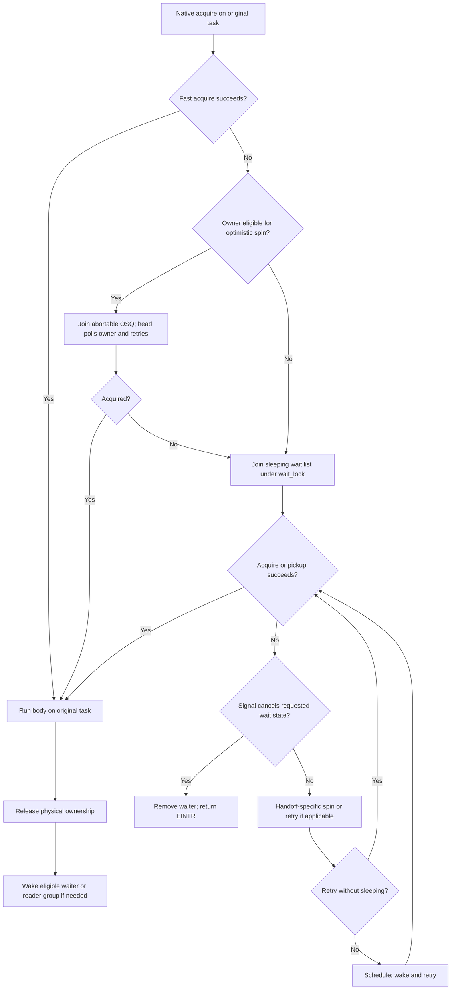
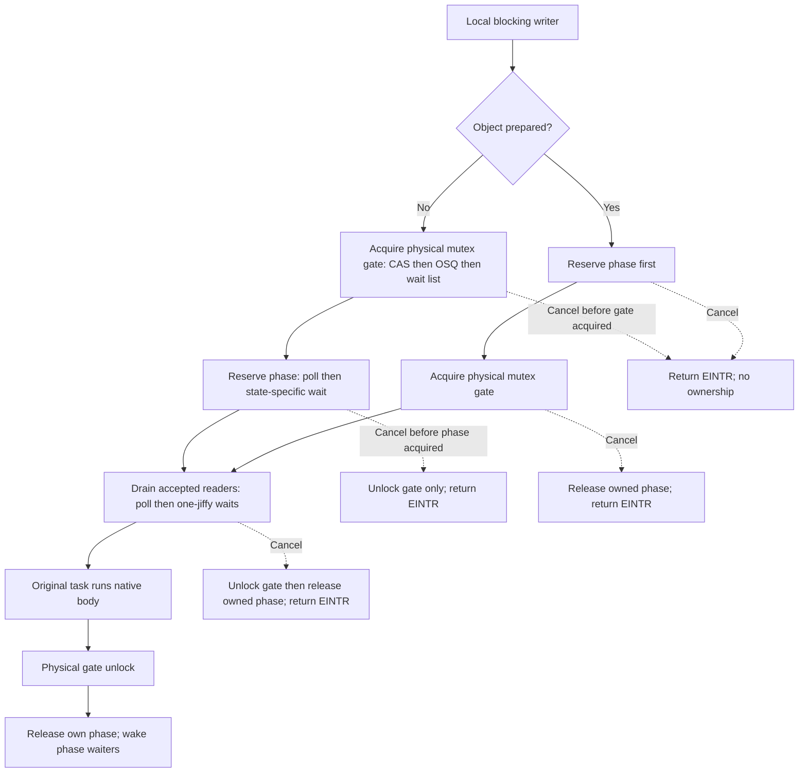
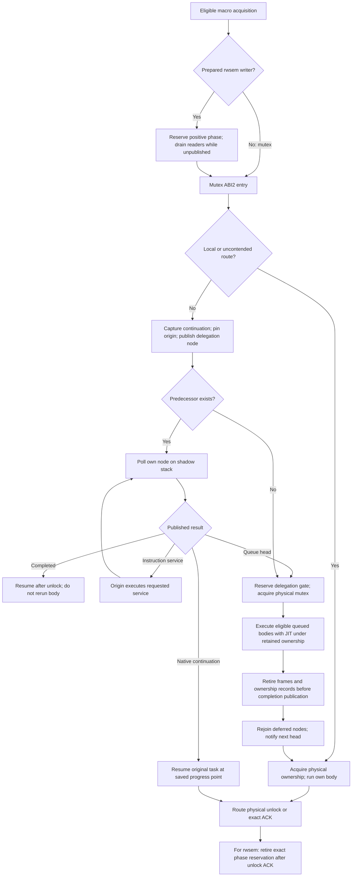
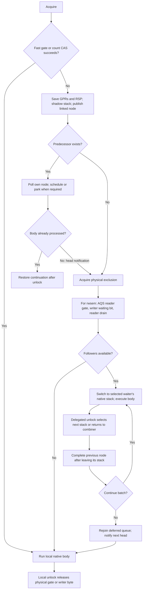
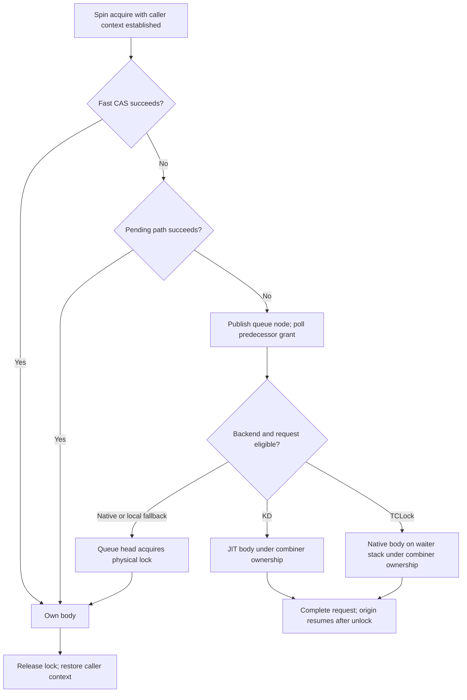
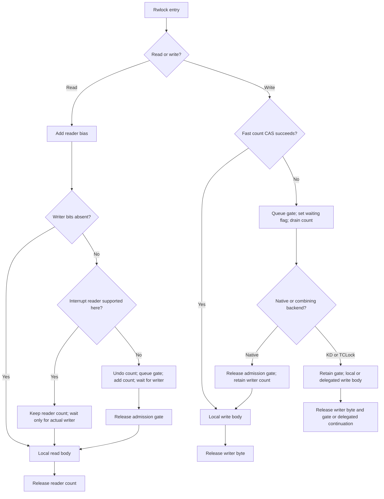

# Lock architecture audit: KD, Linux Native and TCLock

Source snapshot: `7231ddf0963ff2cc730590c09cc81e7f96f93095`, November 1, 2026.
This is a source and retained-evidence audit, not a new experiment or a proposed
protocol change. No builds, tests or benchmarks were run for this document.
The maintained overview remains [lock_protocols.md](lock_protocols.md); this
snapshot adds admission-loop detail and version-specific performance analysis.

## 1. Findings and evidence boundaries

1. **KD has two different rwsem writer protocols.** Unprepared, local blocking
   writers acquire the physical mutex gate before reserving the writer phase.
   Prepared objects reserve the phase first; eligible macro writers can then
   delegate through the mutex. Readers never delegate. The mmap backend uses
   local execution of the original MM bodies, not delegated MM bodies.
2. **The large mmap1 thread gains were against an older KD baseline.** At 20
   threads, `1b6f256b13e8743aa1fd7bdc958cc82ae7726463` measured 5.949551 times
   `f7a84065e84474380faa37eeadfdf534abd72a68`. The latest master-versus-Native
   campaign instead measured +3.35% thread geometric mean and +9.88% at 60.
3. **Gate-first admission gives contending local writers access to an
   owner-aware OSQ before phase waiting can put them to sleep.** This change is
   verified in code. Its contribution to the measured speedup is a supported
   explanation, not an isolated causal measurement: other code and emitted
   layout changed too.
4. **The 60-process loss has no established protocol-level cause.** Separate
   processes normally have separate mmap locks. Retained CPU accounting and
   worker extrema do not support explaining the loss as an extra 22% spent
   asleep. A later reader-only change loses again despite retaining gate-first
   admission. The latest fresh Native comparison is +0.15% at 60 processes;
   this does not erase the older KD-relative losses.
5. **There is no single universal spin budget.** KD phase/drain polling has a
   16,384-probe outer budget. Its physical mutex owner spinning is conditional,
   without a fixed iteration count. Published delegation waiters poll pinned
   without that budget. TCLock mutex/rwsem waiters have a park/wake handshake;
   Native uses owner spinning, a sleeping wait list and handoff rules.

Throughout this document, **verified** means inspected source or a specifically
identified retained measurement. **Inference** means a causal explanation not
established by event attribution. Source capability is not proof that a measured
point exercised that path.

## 2. Source identities and reading map

| Implementation/evidence | Identity and scope |
| --- | --- |
| KD inspected source | `7231ddf0963ff2cc730590c09cc81e7f96f93095`; production `kernel_module`, `include`, `daemon`, `disassem` have no Git diff from `66c68c17457c0ae60d09ff1f3d89b5fff16a500c` |
| Measured master merge | `1f10e050b204eb3ee747b5682211343213e3fb16`; MM/syscall harness `e97e218fb087093b31a9c65944622c32db09784e` |
| Native source | Ubuntu `linux=7.0.0-38.38`, Linux 7 non-RT source captured in the Linux 7 port record; not the retired Linux 6.1 comparator |
| Native mutex provenance distinction | KD's separately namespaced physical mutex derives from captured Linux 6.1.159 algorithms. That ancestry does not make it the current Linux 7 mutex or a call into Linux mutex APIs |
| TCLock | Maintained external-module port of `rs3lab/TCLocks`, `bbfb9f00a12af51dff6ca291cb9829a82960c2ef`, subtree `src/kernel/rcuht/`; see [port scope](../../tclock_backend/README.md) and [upstream hashes](../../tclock_backend/UPSTREAM.json) |
| Ordinary Nano kernel | `7.0.0-38-kdlock1`, Build ID `b61c7bef25d2068f2a05ca3c31a5714c20c4aa62` |
| Latest MM/syscall image | Recipe `9f9fb90e9de861fddeb498e068c0c31122919337`, Build ID `a3bd8cda22af4c668b952472822188c6f3708440`; Native/KD modes of the same scoped image |

Primary code references, relative to the repository root:

| Reference | Relevant source |
| --- | --- |
| K1 | [kernel_module/kd_rwsem.c](../../kernel_module/kd_rwsem.c): phase/drain polling, readers, local/prepared writers, rollback, downgrade |
| K2 | [kernel_module/kd_mutex_local.c](../../kernel_module/kd_mutex_local.c): `kd_try_common`, `kd_local_spin_common`, `kd_local_lock_slow_common`, physical release |
| K3 | [kernel_module/kd_mutex_osq.c](../../kernel_module/kd_mutex_osq.c): abortable OSQ, signal-aware entry, exact unlink/grant handling |
| K4 | [mutex/queue.inc](../../kernel_module/mutex/queue.inc), [waiter.inc](../../kernel_module/mutex/waiter.inc), [combiner.inc](../../kernel_module/mutex/combiner.inc): published delegation and completion |
| K5 | [include/kd_rwlock.h](../../include/kd_rwlock.h), [spin/wait.inc](../../kernel_module/spin/wait.inc), [spin/combiner.inc](../../kernel_module/spin/combiner.inc): spinning families |
| T1 | [tclock_backend/komb_rwsem.c](../../tclock_backend/komb_rwsem.c), [rwsem header](../../tclock_backend/include/rwsem/komb_rwsem.h) |
| T2 | [mutex/state.inc](../../tclock_backend/mutex/state.inc), [waiter.inc](../../tclock_backend/mutex/waiter.inc), [slowpath.inc](../../tclock_backend/mutex/slowpath.inc), [unlock.inc](../../tclock_backend/mutex/unlock.inc) |
| T3 | [tclock_backend/komb_rwlock.c](../../tclock_backend/komb_rwlock.c), [spin components](../../tclock_backend/spin) |
| N1 | [captured Linux 7 rwsem.c](../../bench/results/10.176.26.71/raw/tests/linux70-port-20261027/source-subset/kernel/locking/rwsem.c): 603–669 queued try, 689–935 optimistic spin, 1111–1207 writer slowpath, 1311–1393 entry/release |
| N2 | [captured Linux 7 mutex.c](../../bench/results/10.176.26.71/raw/tests/linux70-port-20261027/source-subset/kernel/locking/mutex.c): `mutex_optimistic_spin`, `__mutex_lock_common`, `__mutex_unlock_slowpath` |
| N3 | [captured qspinlock.c](../../bench/results/10.176.26.71/raw/tests/linux70-port-20261027/pristine-source/kernel/locking/qspinlock.c), [qrwlock.c](../../bench/results/10.176.26.71/raw/tests/linux70-port-20261027/pristine-source/kernel/locking/qrwlock.c) |

N1 SHA256: `5d030b8ab20d775f3e3cf92d307b56e8309d0a6d9c9a4d626af91a3ccd53ea65`.
N2 SHA256: `505bb63f541358c89fa85414db6e6f552839f33d90fd23bd0836ee87a5d93b80`.
These raw captures are local retained artifacts; distribution of only tracked
documentation may omit them. Their provenance is the
[Linux 7 port record](../../bench/results/10.176.26.71/tests/linux70-port-20261027/README.md).
Some older overview paragraphs explicitly describe Linux 6.1; they must not
replace N1/N2 when discussing the present Native comparator.

## 3. Protocol comparison by family

### 3.1 Mutex

| Phase | Linux Native, non-RT | KD | TCLock port |
| --- | --- | --- | --- |
| Uncontended | Acquire CAS owner from zero to `current` | Local physical path uses owner CAS; ordinary macro path additionally manages delegation admission/routing | CAS `locked` byte from 0 to 1 |
| First contention | Owner eligibility check, then OSQ; one speculative OSQ head polls owner | Local callers use KD OSQ and physical owner; eligible macro callers can publish a separate delegation node | Save six GPRs/RSP, switch to shadow stack, exchange queue tail and link predecessor |
| Continued wait | Sleeping wait list under `wait_lock`; top waiter can spin after wake | Physical wait list with WAITERS/HANDOFF/PICKUP; published delegation waiters instead poll their own node pinned | Poll node; on `need_resched()` schedule or attempt parking CAS |
| Body | Actual acquiring task | Actual owner locally, or combiner executing translated body for origin; runtime continuation retains exact ownership/ACK obligations | Actual caller or combiner executing native body on waiter's saved stack |
| Release | Release owner word; slow release wakes top waiter, honors handoff/pickup | Physical owner release plus exact public routing; delegated completion retires frame before waking origin; physical gate may be retained across batch | Delegated unlock switches continuation to next waiter/combiner; completion after leaving borrowed stack; eventual gate release/handoff |

KD's OSQ membership, physical sleeping wait list and delegation membership are
**three distinct mechanisms**, even where preallocated storage is shared. An
OSQ grant permits an ownership attempt; it does not complete a body. A delegation
completion means the body has already run and must not be rerun by the origin.

### 3.2 Rwsem

| Phase | Linux Native | KD local/unprepared | KD prepared delegation | TCLock port |
| --- | --- | --- | --- | --- |
| Reader entry | Shared count increment and writer/waiter tests; queued slowpath | Admission precheck, fully ordered reader increment, admission acquire recheck; rollback on conflict | Same local readers | Count add; rollback on writer bits; slow reader uses AQS gate |
| Writer fast route | CAS rwsem count from 0 to WRITER_LOCKED | Physical mutex gate acquisition, phase CAS `0 -> -1`, reader drain check | Positive phase reservation, reader drain, mutex ABI2 entry | CAS combined count `0 -> 0xff` |
| Contended writer queue | rwsem OSQ, then rwsem reader/writer wait list | Mutex OSQ, then physical mutex wait list; phase polling happens after gate ownership | Phase wait before mutex publication; delegation queue after drain | Writer linked queue, then queue head obtains AQS reader gate |
| Reader closure | Writer/handoff/waiter state in combined count and wait policy | Separate `admission = -1` | Positive exact reservation count closes reader admission for entire cohort | Add WAITING `0x100` to combined count, drain to that value, change to LOCKED |
| Drain/wait | Owner-aware/time-limited optimistic spin; then scheduler wait | 16,384 probes, then state-specific one-jiffy reader-drain waits | Same bounded drain before publication, uninterruptible | Acquire polling of combined count; selected writer-drain loop has no scheduler call |
| Writer release | Clear owner; release decrement of writer bit; wake queue | Physical unlock first, then `admission: -1 -> 0` and phase wake | Exact physical unlock/ACK before retiring each positive reservation; reopen at zero | Clear writer byte for local owner; stack-switch continuation for delegated body |
| Downgrade | Atomic exclusive-to-shared transition and reader wake | Publish own reader, unlock physical gate, reopen phase | Not supported for delegated writes | No claim of Native-equivalent downgrade in this ordinary-pair port |

K1's `admission` meanings are exact: `0` open, `-1` one local writer phase,
positive values the count of live delegated writer reservations. The physical
mutex owner is still separately authoritative. Owning the gate does not imply
that the caller has acquired a phase or drained readers.

### 3.3 Spinlock and rwlock

| Family | Linux Native | KD | TCLock port |
| --- | --- | --- | --- |
| Spin acquisition | Acquire CAS; pending-bit path for light contention; per-CPU MCS queue for heavier contention | Native/pending/MCS exclusion plus eligible translated continuation publication and combining | Fast/pending path plus queued native-stack combining |
| Spin waiting | Poll pending/own MCS node/count; benchmark `nopvspin` excludes PV wait/kick path | Published physical waiter polls on shadow stack with preemption pinned; no scheduling in that loop | Selected original RCUHT loop can enable preemption, schedule, then disable it again |
| Spin release | Release ownership byte, balance caller context | Exact ownership retirement and release; completed origins resume after unlock | Native unlock or stack-switch to next body/combiner, then completion/handoff |
| Rwlock reads | Increment shared count; task slow readers use queue gate; interrupt readers wait for actual writer, bypass pending gate | Same local-body principle; separate count/gate cachelines; interrupt reader special case retained | Local body; count plus queue gate; acquisition continuation can be combined |
| Rwlock writes | Direct count CAS or queue gate, set waiting flag and drain; release queue gate before body | Fast writer uses distinct count byte; queued writer holds KD spin gate through body and may delegate | Fast count CAS; queued writers can use saved-stack combining |
| Rwlock release | Reader release decrement / writer-byte release | Reader decrement; writer-byte release plus gate release for queued writer | Reader decrement; local writer release or delegated continuation switch |

This is not layout or binary interoperability. All participants in one object
must use the matching backend protocol. KD explicit spin/rwlock IRQ/BH variants
execute locally; task-context recursive rwlock reads, upgrades and NMI use remain
unsupported. The selected TCLock port's fixed-affinity and context limits are
narrower than arbitrary Linux kernel use. Neither alternative is an arbitrary
drop-in replacement for all Native lock uses or configurations.

## 4. Execution flowcharts

### 4.1 Native mutex and rwsem: own-task execution



The diagram is shared structure, not identical code. Native mutex top-waiter
spinning follows wakeup; Native rwsem can spin on its owner after a failed
queued attempt when `handoff_set` is true, before sleeping. Native rwsem also
has time-limited reader-owned spinning. Exact writer loops appear below.

### 4.2 KD local rwsem: the mmap writer path



Uncontended unprepared traversal is gate CAS → phase CAS → zero-reader check →
body → gate unlock → phase release. It has **no** mandatory OSQ publication,
delegation publication or schedule call. Even an uncontended write has separate
gate and phase transitions, unlike Native's combined rwsem count acquisition.

### 4.3 KD delegation: mutex and explicitly prepared rwsem writer



Queue-head notification is not physical ownership. A head still waits for the
delegation gate and physical mutex. The combiner can retain these for its own
original body after serving followers. A native continuation never restarts an
already partially executed body. It is not generally a complete exchange of
combiner/waiter roles: only the supported sole-outer-mutex case transfers that
owner; other retained-owner cases borrow execution and require an ACK.

### 4.4 TCLock mutex and rwsem writer



For rwsem, H/R together mean writer-queue head → AQS gate → combined count
ownership; there is no KD physical mutex before the AQS gate. TCLock's selected
rwsem prequeue bounded-spin option is compiled out.

### 4.5 Spinning families: fast and queued paths



Rwlock wraps writer exclusion with a shared count and drain:



The interrupt-reader branch applies to the inspected Native/KD algorithms;
it is not a claim of arbitrary interrupt support in the selected TCLock port.

## 5. Admission and spinning pseudocode

These are source-faithful transcriptions of the specified control loops, not
executable replacement implementations. Atomic operations retain their stated
ordering. Named helpers retain their source semantics; bookkeeping, diagnostic
counters and assembly register moves are omitted where explicitly stated.
In particular, wait helpers include enqueue/recheck/removal, not a bare sleep.

### 5.1 KD local rwsem writer and bounded condition polling (K1)

```text
poll_state(condition, state):
    budget = 16384
    do:
        if condition(): return true             // may consume a reservation
        if need_resched(): break
        if state != TASK_UNINTERRUPTIBLE and signal_pending(current): break
        cpu_relax()
    while --budget != 0
    return false

reserve_local(sem):
    if READ(sem.admission) != 0 or READ(sem.reader_osq.tail) != 0:
        return false
    return cmpxchg_full(sem.admission, 0, -1) == 0

wait_local(sem, state):
    if poll_state(lambda: reserve_local(sem), state): return 0
    // wait_event / wait_event_interruptible / wait_event_killable
    // Condition first; wait-state-specific signal handling; waiter removal.
    return state_specific_wait(sem.phase_wait, reserve_local(sem), state)

down_write_state(sem, state):
    if READ_ONCE(sem.prepared_writes):
        error = wait_local(sem, state)
        if error: return error
        error = lock_gate(sem, state)
        if error: release_local_phase(sem); return error
    else:
        error = lock_gate(sem, state)
        if error: return error
        error = wait_local(sem, state)
        if error: local_unlock(sem.gate); return error  // no phase owned
    error = drain_readers(sem, state)
    if error:
        local_unlock(sem.gate)
        release_local_phase(sem)
    return error

drain_readers(sem, state):
    if poll_state(lambda: load_acquire(sem.readers) == 0, state): return 0
    do:
        ret = state_specific_wait_timeout(sem.reader_drain,
                  load_acquire(sem.readers) == 0, state, 1 jiffy)
    while ret == 0
    return -EINTR if ret < 0 else 0
```

`lock_gate` calls `kd_mutex_local_lock` for uninterruptible writers, otherwise
`kd_mutex_local_lock_signal`. `kd_down_write_killable` selects `TASK_KILLABLE`.
Any pending signal stops signal-aware polling, but only the wait state's
cancellation predicate can return `-EINTR`; a nonfatal pending signal does not
by itself cancel a killable wait. Acquisition is attempted before cancellation.

The probe bound is **not** a wall-clock bound or a cap on all atomic retries.
The ordinary uninterruptible polling macro has the same budget without the
signal predicate. Writers are unpublished during phase/drain waits. A final
reader in atomic/IRQ-disabled context omits the queue wake; one-jiffy rechecks
prevent a sleeping writer from being stranded. A timeout never permits entry
while readers remain.

### 5.2 KD physical gate: optimistic and sleeping loops (K2/K3)

```text
local_gate_entry(lock, state, stop_signals):
    error = 0
    if READ(lock.owner) == 0 and CAS_acquire(lock.owner, 0, current): return 0
    preempt_disable()
    if try_common(lock, false) succeeds or spin_common(lock, false, stop_signals):
        preempt_enable(); return 0
    raw_lock(lock.wait_lock)
    if try_common(lock, false) succeeds: finish_without_enqueue()
    append exact task waiter; first waiter sets WAITERS
    set_current_state(state)
    forever:
        if try_common(lock, false) succeeds: break  // pickup before signal
        if signal_pending_state(state, current): error = -EINTR; break
        raw_unlock(lock.wait_lock)
        local_schedule()                          // balances preemption for schedule
        first = READ_ONCE(lock.wait_head) == my_waiter
        set_current_state(state)
        if try_common(lock, first) succeeds or
           (first and spin_common(lock, true, stop_signals)):
            raw_lock(lock.wait_lock); break
        raw_lock(lock.wait_lock)
    set state RUNNING; unlink exact waiter
    if wait list empty: clear WAITERS/HANDOFF/PICKUP flags
    raw_unlock(lock.wait_lock); preempt_enable(); return error

spin_common(lock, waiter, stop_signals):
    acquired = false
    if not waiter:
        if need_resched() or (stop_signals and signal_pending(current)): goto fail
        owner = owner_task(lock)
        if owner != NULL and not owner_on_cpu(owner): goto fail
        node = borrowed OSQ node or reserve temporary node
        if no node: goto fail
        if not OSQ_lock(lock.osq, node, stop_signals): goto release_node
    forever:
        owner = try_common(lock, false)
        if owner == NULL: acquired = true; break
        if stop_signals and signal_pending(current): break
        while owner_task(lock) == owner:
            compiler_barrier()                    // recheck before task dereference
            if not owner_on_cpu(owner) or need_resched() or
               (stop_signals and signal_pending(current)): goto spin_done
            cpu_relax()
        cpu_relax()
  spin_done:
    if not waiter: OSQ_unlock(lock.osq, node)
  release_node:
    release temporary node only after every OSQ unlink access completes
    if acquired: return true
  fail:
    if need_resched(): set state RUNNING; local_schedule()
    return false
```

`try_common` is an acquire-CAS loop over the owner pointer and three flag bits:
WAITERS=1, HANDOFF=2, PICKUP=4. It accepts PICKUP only for the designated current
task and clears that bit on acquisition. A first waiter may set HANDOFF on the
existing owner; that is not acquisition. A free owner can be acquired while
preserving appropriate flags. Unlock serializes with cancellation under
`wait_lock`, retains a task reference for wakeup, and honors designated pickup.

The OSQ follower polls until grant, `need_resched()`, signal when enabled, or a
preempted predecessor vCPU. **Grant wins if observed.** Cancellation stabilizes
predecessor/successor links; a racing grant can still return success. This is
not permission to abandon a node while another CPU can access it. These
ownership/retirement operations are intentionally represented by the named
OSQ helpers rather than replaced with a simplified queue.

There is no `16384` counter in `spin_common`. Public mutex signal APIs use the
ordinary local spin policy; the additional `stop_signals` policy is selected
by the private rwsem gate path, not universally by every mutex call.

### 5.3 KD readers and prepared reservations (K1)

```text
read_try(sem):
    if READ(sem.admission) != 0: return false
    atomic_long_inc_return(sem.readers)            // full ordering
    if load_acquire(sem.admission) == 0: return true
    up_read(sem)                                  // rollback speculative count
    return false

down_read(sem):
    retries = 8
    do:
        if read_try(sem): return
        if need_resched(): break
        cpu_relax()
    while --retries != 0
    if spin_read(sem): return
    wait_event(sem.phase_wait, read_try(sem))

spin_read(sem):
    acquired = false
    preempt_disable()
    if not need_resched() and a temporary node can be reserved:
        if OSQ_lock(sem.reader_osq, node):
            acquired = poll_without_signal(lambda: read_try(sem))
            OSQ_unlock(sem.reader_osq, node)
        retire temporary node after unlink
    preempt_enable()
    if READ(sem.reader_osq.tail) == 0:
        full_barrier(); wake_phase_if_waiters()
    return acquired                              // false unless acquisition succeeded

reserve_delegate(sem):
    phase = READ(sem.admission)
    while phase >= 0 and phase < LONG_MAX:
        if phase == 0 and READ(sem.reader_osq.tail) != 0: return false
        if try_cmpxchg_full(sem.admission, expected=phase, desired=phase+1):
            return true
        // failed CAS updates phase; recheck all predicates
    return false

delegate_enter(sem):
    require prepared_writes
    bounded poll, then wait_event until reserve_delegate succeeds
    drain_readers(sem, TASK_UNINTERRUPTIBLE)
    // only now may mutex ABI2 publish a delegated producer

write_release(sem):
    require physical unlock / exact unlock ACK already complete
    if READ(sem.admission) == -1:
        require xchg_full(sem.admission, 0) == -1; wake phase if waiters
    else:
        remaining = atomic_dec_return(sem.admission)
        require remaining >= 0
        if remaining == 0: wake phase if waiters
```

The reader OSQ reduces repeated shared-count attempts to its current head.
Ordinary readers get eight initial probes; signalable read APIs go directly
through their corresponding wait macros, not this eight-probe/OSQ function.
Reader bodies remain concurrent/local. The current returning increment restores
the f7 reader entry; the intervening nonreturning increment/outlined entry is
historical, not the inspected master implementation.

### 5.4 Native rwsem writer: owner spin, then queue (N1)

```text
down_write_common(sem, state):
    result = success
    preempt_disable()
    if not rwsem_write_trylock(sem):               // acquire count CAS 0 -> WRITER
        result = down_write_slowpath(sem, state)
    preempt_enable()
    return 0 or -EINTR from result

optimistic_spin(sem):
    taken = false; previous = OWNER_NULL; loop = 0; deadline = 0
    if not osq_lock(sem.osq): return false
    forever:
        state = spin_on_owner(sem)
        if state == OWNER_NONSPINNABLE: break
        taken = try_write_unqueued(sem)
        if taken: break
        if state == OWNER_READER:
            if previous != OWNER_READER:
                if NONSPINNABLE flag set: break
                readers = min(count >> READER_SHIFT, 30)
                deadline = sched_clock() + (20 + readers) * NSEC_PER_USEC / 2
                loop = 0
            else if (++loop & 0xf) == 0 and sched_clock() > deadline:
                set NONSPINNABLE; break
        if state != OWNER_WRITER:
            if need_resched(): break
            if rt_or_dl_task(current) and previous != OWNER_WRITER: break
        previous = state
        cpu_relax()
    osq_unlock(sem.osq)
    return taken

spin_on_owner(sem):
    owner, flags = sample_owner_and_flags()
    state = classify(owner, flags)
    if state != OWNER_WRITER: return state
    forever:
        new_owner, new_flags = sample_owner_and_flags()
        if new_owner != owner or new_flags != flags:
            return classify(new_owner, new_flags)
        compiler_barrier()
        if need_resched() or not owner_on_cpu(owner): return OWNER_NONSPINNABLE
        cpu_relax()

try_write_unqueued(sem):
    count = READ(sem.count)
    while not (count & (LOCK_MASK | HANDOFF)):
        if try_cmpxchg_acquire(sem.count, count, count | WRITER_LOCKED):
            set_owner(current); return true
    return false

down_write_slowpath(sem, state):
    if can_spin_on_owner(sem) and optimistic_spin(sem): return success
    waiter = {current, WRITE, jiffies + DIV_ROUND_UP(HZ, 250), handoff_set=false}
    raw_spin_lock_irq(sem.wait_lock)
    add waiter to rwsem wait list
    if not first: conditionally wake earlier eligible waiters
    else: atomic_or(WAITERS, sem.count)
    set_current_state(state)
    forever:
        if rwsem_try_write_lock(sem, waiter): break
        raw_spin_unlock_irq(sem.wait_lock)
        if signal_pending_state(state, current):
            set RUNNING; reacquire wait_lock; remove/wake waiter; return EINTR
        if waiter.handoff_set and spin_on_owner(sem) == OWNER_NULL:
            raw_spin_lock_irq(sem.wait_lock); continue
        schedule_preempt_disabled()
        set_current_state(state)
        raw_spin_lock_irq(sem.wait_lock)
    set RUNNING; raw_spin_unlock_irq(sem.wait_lock); return success
```

`can_spin_on_owner` rejects `need_resched()`, NONSPINNABLE, or a recorded writer
owner that is off CPU; it does not dereference a potentially stale reader owner.
The spin loop has a reader-owned time threshold of 10–25 microseconds checked
every 16 iterations after initialization. It does **not** have KD's signal
predicate inside that optimistic loop. Real-time scheduling classes in this
code are distinct from the unsupported `CONFIG_PREEMPT_RT` kernel variant.

For precision, the queued acquisition helper is:

```text
rwsem_try_write_lock(sem, waiter):              // wait_lock held
    first = first_waiter(sem)
    count = READ(sem.count)
    do:
        handoff = (count & HANDOFF) != 0
        if handoff and first.handoff_set and waiter != first: return false
        new = count
        if count & LOCK_MASK:
            if handoff or (not rt_or_dl_task(waiter.task) and
                           not time_after(jiffies, waiter.timeout)):
                return false
            new |= HANDOFF
        else:
            new |= WRITER_LOCKED
            new &= ~HANDOFF
            if list_is_singular(sem.wait_list): new &= ~WAITERS
    while not try_cmpxchg_acquire(sem.count, count, new)
    if new & HANDOFF:
        first.handoff_set = true
        return false
    unlink waiter; set_owner(current); return true
```

Native's count is acquired before entering the body; OSQ ownership alone never
constitutes rwsem ownership. Native's wake policy also admits reader groups.
There is no separate `admission=-1` phase variable and no KD physical mutex
held while waiting for those readers.

### 5.5 Native mutex optimistic loop (N2)

```text
mutex_optimistic_spin(lock, waiter):           // ordinary non-ww scope
    if waiter == NULL:
        if not mutex_can_spin_on_owner(lock): goto fail
        if not osq_lock(lock.osq): goto fail
    forever:
        owner = __mutex_trylock_or_owner(lock)
        if owner == NULL: break
        if not mutex_spin_on_owner(lock, owner, NULL, waiter):
            if waiter == NULL: osq_unlock(lock.osq)
            goto fail
        cpu_relax()
    if waiter == NULL: osq_unlock(lock.osq)
    return true
  fail:
    if need_resched():
        set state RUNNING
        schedule_preempt_disabled()
    return false
```

`mutex_spin_on_owner` rechecks owner identity before dereferencing the task and
checks owner running/scheduler eligibility; its additional ww checks do not
apply to this ordinary non-ww scope. The wait-list
path tests acquisition before pending signals, then schedules; after wake the
first waiter can request handoff and optimistically spin. Linux 7 additionally
maintains task `blocked_on` tracking around these operations. KD's separately
maintained mutex is not a line-for-line Linux 7 implementation.

### 5.6 TCLock reader/writer admission and park loop (T1/T2)

```text
TC_down_read(lock):
    count = atomic_add_return_acquire(R_BIAS=0x200, lock.cnts)
    if (count & W_WMASK=0x1ff) == 0: return
    atomic_sub_return_release(R_BIAS, lock.cnts)
    aqs_spin_lock(lock.reader_wait_lock)
    atomic_add_return_acquire(R_BIAS, lock.cnts)
    poll_acquire(lock.cnts, (value & W_WMASK) == 0)
    aqs_spin_unlock(lock.reader_wait_lock)
    // original task executes its read body

TC_down_write(lock):
    if cmpxchg_acquire(lock.cnts, 0, W_LOCKED=0xff) == 0: return locally
    // WRITE_BOUNDED_OPPORTUNISTIC_SPIN is 0; no enabled 512-probe stage
    disable preemption; save/switch stack; initialize request
    previous = xchg(lock.writer_tail, node)
    if previous:
        WRITE_ONCE(previous.next_rwsem, node)
        wait_node(node)
        if node.completed == PROCESSED: resume post-unlock continuation
    aqs_spin_lock(lock.reader_wait_lock)
    if READ(lock.cnts) == 0 and cmpxchg_relaxed(lock.cnts, 0, W_LOCKED) == 0:
        goto acquired
    atomic_add_return_acquire(W_WAITING=0x100, lock.cnts)
    do:
        poll_acquire(lock.cnts, value == W_WAITING)
    while cmpxchg_relaxed(lock.cnts, W_WAITING, W_LOCKED) != W_WAITING
  acquired:
    aqs_spin_unlock(lock.reader_wait_lock)
    if cmpxchg(lock.writer_tail, node, NULL) != node:
        wait for linked successor, scheduling on need_resched()
        combine followers via their saved stacks; retain terminal handoff
    restore own stack/context and execute own body

wait_node(node):                             // mutex and rwsem waiter policy
    forever:
        if READ_ONCE(node.locked) == 0: return
        cpu_relax()
        if need_resched():
            if single_task_running(): schedule_out_curr_task()
            else if READ_ONCE(node.completed) == UNPROCESSED: park_waiter(node)
            else: schedule_out_curr_task()

park_waiter(node):
    set state TASK_INTERRUPTIBLE
    if cmpxchg(node.completed, UNPROCESSED=0, PARKED=1) != UNPROCESSED:
        set state RUNNING; return
    schedule_out_curr_task()                 // enable preempt; schedule; disable
    set state RUNNING

wake_up_waiter(node):
    previous = xchg(node.completed, PROCESSING=2)
    if previous == PARKED:
        retain task reference; wake_up_process(node.task); release reference
```

The selected rwsem count-drain loop is an acquire poll, without an iteration
budget or a `schedule()` call inside it. This differs from the queued writer's
park-capable loop. TCLock mutex queue-head physical acquisition instead loops
on its `locked` byte, schedules on `need_resched()`, and CASes `0 -> 1`.

BRAVO is disabled. Do not describe the disabled 512-probe optional writer code
as current behavior. T1 contains functions named
`komb_rwsem_down_read_killable` and `komb_rwsem_down_write_killable` that merely
call ordinary acquisition and return zero: **they do not preserve Native
killable cancellation semantics**. The maintained port exports the ordinary
benchmark pairs, not a claim of full rwsem API equivalence.

### 5.7 KD published waiter and combining limits (K4/K5)

```text
KD_mutex_wait_for_result(node):               // preemption already disabled
    while load_acquire(node.locked) != 0:
        cpu_relax()
    // inspect completion / instruction request / native continuation / head grant

KD_mutex_head_get_physical_lock(lock, node):
    forever:
        while delegation_gate_state(lock) != 0: cpu_relax()
        if try_reserve_delegation_gate(lock):
            preempt_enable()
            kd_mutex_local_lock_node(lock, node)
            publish delegation gate HELD
            preempt_disable()
            return
        cpu_relax()
```

This is a pinned published waiter, not a selected-only pin policy and not the
16,384-probe unpublished phase poll. The spinlock physical waiter similarly
switches to its shadow stack before publication and executes an assembly
`locked` load / `pause` loop without C calls or scheduling.

Mutex combiner source sets `scan_left=64`, total body cap 1024 and NUMA count
boundary 1024. Nonlocal nodes with successors can be deferred while the scan
budget remains. At a terminal/locality boundary, a deferred cohort of at least
eight gets handoff; a smaller cohort is rejoined and subsequent work switches
to FIFO. Completion, native continuation, missing successor/image eligibility,
and early outer unlock can end a batch sooner. Thus **768 is removed**, but
there are still intentional early exits and a separate scan bound; a batch is
not guaranteed to process 1024 bodies. KD spin has its own 1024 body/scan bounds.
TCLock spin/mutex's configured 1024 with zero-based WWJUMP counting can execute
1025 bodies; this is not an identical batch definition.

## 6. Exactly where gate-first differs

There are two meanings of “gate” in KD: `sem->gate` is a physical KD mutex,
whereas that mutex also contains a delegation state gate. mmap local writer
admission uses the former, without publishing a delegation request.

```text
Old KD unprepared writer:
    phase CAS / phase_wait -> physical mutex -> drain readers -> body

Current KD unprepared blocking writer:
    physical mutex CAS / OSQ / wait list -> phase CAS / phase_wait
        -> drain readers -> original-task body

Current KD prepared local writer:
    exclusive phase CAS / phase_wait -> physical mutex -> drain -> local body

Current KD prepared delegating writer:
    positive phase reservation -> drain -> mutex ABI2 publication/exclusion
        -> local or delegated body -> unlock ACK -> reservation retirement

Native rwsem writer:
    count CAS -> rwsem OSQ/owner spin -> rwsem wait list/handoff -> own body

TCLock rwsem writer:
    count CAS -> writer linked queue -> AQS reader gate -> waiting bit/drain
        -> local or stack-delegated body
```

**Versus old KD:** phase contenders no longer have to win a separate phase race
before reaching owner-aware mutex serialization. After a busy writer releases,
an OSQ contender can acquire the gate while running, then reserve the phase.
Its predecessor may not yet have cleared `admission`; the successor must wait
for its own CAS, not assume that owning the gate conveys that phase.

**Versus Native:** Native already spins before sleeping. KD is not introducing
that idea to Native. KD routes contention through a separate mutex owner/OSQ,
then closes reader admission and drains readers through separate state and
queues. Native operates on its rwsem count/owner and shared rwsem waiter list,
with reader-owned time limits and handoff policy. KD may own its physical gate
while waiting for readers; the recorded mutex owner is then the waiting writer,
not evidence that those readers are running.

**Versus TCLock:** both can serialize writers before closing reader admission,
but TCLock's queue is a continuation/delegation queue, followed by a temporary
AQS reader gate and combined count. KD's local mutex queue neither delegates
MM bodies nor switches to waiter stacks. TCLock also has a direct count-only
writer fastpath; KD local blocking writers acquire the mutex even without
contention. Calling one “gate-first” and the other “not gate-first” would hide
these similarities and differences.

**Why prepared objects must remain phase-first:** a positive reservation can
belong to a producer that still needs the gate. If another writer took that gate
and then waited for the positive phase to clear, each could wait for the other.
Preparation is quiescent/object-wide. Try-write remains nonblocking phase-first:
it immediately rolls back if the gate or reader check fails. These orders are
correctness constraints, not merely tuning preferences.

## 7. Performance interpretation with separate baselines

### 7.1 Historical thread gains: verified measurements and plausible mechanism

Historical report is retained at Git commit
`710cfba70c8c0bab4b20784d6fa3c1e4d508c442`, path
`bench/results/10.176.26.71/bench/rwsem-writer-queue-20261031/README.md`.
That path is not present in this checkout; inspect the immutable record with:

```sh
git show 710cfba70c8c0bab4b20784d6fa3c1e4d508c442:bench/results/10.176.26.71/bench/rwsem-writer-queue-20261031/README.md
```

| mmap1 threads | f7 baseline pairs/s | 1b candidate pairs/s | Ratio |
| --- | ---: | ---: | ---: |
| 20 | 36,661.0 | 218,116.5 | 5.949551× |
| 32 | 24,643.5 | 196,922.0 | 7.990829× |
| 60 | 6,566.5 | 123,637.5 | 18.828524× |

**Verified:** thread workers share one mm and serialize mmap writers. The
candidate changes phase-first local writer admission to physical gate-first,
adds signal-aware owner spinning and bounded phase/drain polling, and also
changes reader entry. The report's whole-lifetime normalized CPU occupancy
rises from 37.839% to 98.639% at 20, 44.712% to 98.344% at 32, and 47.868% to
98.210% at 60. The accounting interval includes warmups and is longer than the
two scored seconds; it is not a measurement of exact lock parking events.

**Inference:** for short contended writer intervals, phase waiting in old KD
can schedule callers before they reach its useful mutex OSQ. Gate-first moves
those callers into owner-aware spinning and private-node queue polling,
allowing rapid successive acquisitions without sleep/wake latency on every
transfer. Avoiding many simultaneously competing phase waiters can also reduce
shared-state churn. Higher lifetime CPU occupancy supports this interpretation.
It does not quantify how many sleeps were avoided or isolate gate ordering from
the other changes.

**Not a valid explanation:** “JIT combines mmap bodies” or “the combiner keeps
all shared-mm bodies on one CPU.” These scoped MM bodies execute on their
original task, with local rwsem writers. Original mmap1 repeatedly maps and
unmaps an untouched 128 MiB anonymous range; it is not a page-touch/fault test.

### 7.2 Why the 60-process regression remains unresolved

Historical f7 → 1b at 60 processes is 1,577,534.0 → 1,224,388.5 pairs/s,
**−22.385920%**. Verified lifetime CPU occupancy is 98.401% versus 98.475%.
The old baseline's per-worker sample extrema are approximately 16.7k/291k;
the candidate's are approximately 20k/21k. Aggregate loss is associated with
the disappearance of a small fast-worker tail, not evidence that all workers
became 22% slower or spent 22% more time asleep.

The [retained investigation](../../bench/results/10.176.26.71/bench/reader-recovery-20261101/mm-investigation.md)
adds these constraints:

- Process workers use `fork()` and ordinarily have independent mm objects and
  writer gates. Cross-worker contention on one mmap lock is not the expected
  explanation, though no trace proves every acquisition uncontended.
- f7 → 1b did not change lock object layouts or the mmap backend-selection
  policy. A new object size or capacity-dependent Native substitution is not
  a supported explanation.
- Restoring reader entry in `66c68c17457c0ae60d09ff1f3d89b5fff16a500c` retains
  the same gate-first writer protocol yet loses **11.260800%** at 60 processes
  against a fresh 1b arm. The skewed fast-worker tail now appears in 1b itself.
  These separate cohorts cannot be multiplied into a synthetic f7 comparison.
- Both recovery arms again have roughly 98.4–98.5% lifetime CPU occupancy.
  Parking is not established as the cause. High CPU occupancy also cannot
  distinguish useful body execution from spinning.

**Plausible costs, not diagnosed causes:** gate/phase atomic work can matter
on private uncontended locks where there is no queueing benefit to amortize
it; emitted instruction placement and timing can change interaction with shared
kernel resources. However, f7 already had a physical gate and phase operations,
so “an extra gate was added” is incorrect. Reader restoration alone is not a
demonstrated write-side remedy.

One source-level lead is global commitment accounting: `vm_committed_as`
per-CPU batching can enter a global raw spinlock path even for independent
mms. The reached branch, actual `vm_committed_as_batch` value and contention
share are not measured in these results. This is not an observed hotspot and
does not justify a change. CPU/worker progress and call-site attribution would
be needed to decide between shared-resource contention, placement, code-layout
effects and other causes. No such new diagnostic was run for this audit.

### 7.3 Nano outliers: separate mechanisms and unchanged controls

Historical f7 → 1b worst whole-window Nano point is rwsem c01-w1 at eight
workers: 11.306312 → 8.988936 Mops/s, **−20.496300%**, `NO_JIT` in both arms.
Here c01 means one cacheline and w1 means 1% writes. It cannot be explained by
newly slower delegated-body execution at that point. The changed reader entry
and admission/coherence interaction are candidates, not proven causes.

The historical emitted-code inspection verified that 1b's ordinary read entry
changed from 820 bytes/194 instructions to 84 bytes/24 instructions plus a
783-byte outlined suffix, using `LOCK INC`. Smaller entry code did not guarantee
higher throughput. The physical mutex slowpath's emitted body also changed
despite preserving its ordinary policy; “all non-rwsem machine code is
unchanged” would be incorrect for that pair. Reader restoration subsequently
improved some means without eliminating individual losses.

Protocol costs that can explain a general crossover, but not establish the
cause of a particular measured outlier, include:

| Regime | Cost/benefit visible in source | Attribution limit |
| --- | --- | --- |
| Few workers, tiny body | Additional routing, count/phase transitions, continuation capture when selected, and failed speculative admission can dominate payload work | Need actual reached path and events; a cold/local point does not incur every JIT cost |
| Many writers sharing one object | Queued spinning and retained-owner batches can reduce repeated ownership/data movement and scheduling | MM local writers get queue benefits, not body-combining benefits |
| Read-heavy shared object | Reader count cacheline RMW traffic remains; closing phases can cause failed increments/rollback and slowpath entry | Reads never delegate; writer gate-first does not eliminate reader coherence traffic |
| Cross-NUMA | Owner/count/data lines move between nodes; deferral changes locality and service order | 1024/1024 removes the old 768 count cutoff, not topology costs or terminal handoff |
| TCLock mutex versus spin | Mutex can park and requires wake handshake; spin uses a different wait/batch path | Presence of parking code is not proof parks occurred at a given worker count |

Prepared Nano rwsem delegation retains phase-first order. It must not be
described as running the same local killable-writer admission as mmap1. Changes
in an rwlock Nano point also cannot be directly attributed to `kd_down_write_killable`,
which that family does not call. Single-round samples provide no variance
estimate; neither automatically dismiss outliers nor invent a deterministic
protocol cause for each one.

### 7.4 Latest fresh Native comparison: current scale of gains and losses

Source: [master campaign](../../bench/results/10.176.26.71/bench/master-native-20261101/README.md).
Exactly one round per point, workers 1–8 by one and 12–60 by four. Whole-run
Nano results below are separate from qualified peak rates in the original CSV.

| Nano workload | Geometric-mean change | Worst point | At 60 |
| --- | ---: | ---: | ---: |
| mutex-c01-w100 | +50.67% | −9.33% at 6 | +145.95% |
| mutex-c16-w100 | +61.42% | −11.71% at 3 | +175.33% |
| rwlock-c01-w1 | +7.59% | −7.05% at 8 | +10.00% |
| rwlock-c01-w20 | +19.77% | −0.07% at 3 | +8.71% |
| rwlock-c16-w1 | −4.26% | −21.24% at 48 | −12.20% |
| rwlock-c16-w20 | +11.17% | +0.12% at 1 | +8.60% |
| rwsem-c01-w1 | +93.44% | −16.80% at 3 | +164.39% |
| rwsem-c01-w20 | +149.92% | −22.95% at 3 | +214.28% |
| rwsem-c16-w1 | +142.45% | −17.60% at 2 | +309.05% |
| rwsem-c16-w20 | +150.27% | −5.78% at 1 | +232.17% |

| Actual application/API | Geometric-mean change | Worst point | At 60 |
| --- | ---: | ---: | ---: |
| mmap1 threads | +3.35% | −6.40% at 4 | +9.88% |
| mmap1 processes | −0.28% | −3.08% at 3 | +0.15% |
| setfd | +52.93% | −2.61% at 3 | +149.44% |
| FIONREAD | −15.71% | −38.87% at 5 | +7.10% |
| F_GETPIPE_SZ | +28.25% | −20.01% at 6 | +98.27% |

These are retained observations, not new measurements. The current comparison
does not show an 18.8-times gain over Native or a 22.39% loss to Native at 60
processes. It also does not remeasure or close the old KD-relative acceptance
gate. TCLock has no arm in this campaign and this external-module port has no
matched actual-MM integration, so this document makes no measured TCLock mmap
ranking. Nano and scoped-kernel application scores must not be pooled.

## 8. Semantics and remaining audit limits

- Success/pickup must precede pending-signal cancellation. Phase ownership,
  physical gate ownership and OSQ grant are distinct; cancellation must retire
  exactly the state already acquired. A nonfatal signal stopping a spin is
  different from killable acquisition returning `-EINTR`.
- A local writer's unlock precedes phase reopening. Downgrade publishes its
  reader before releasing gate/phase. Prepared writer reservations remain live
  through unlock ACK. Readers never infer ownership from an optimistic sample.
- A published KD waiter remains pinned in the inspected implementation.
  Physical acquisition and runtime local execution can schedule in their
  supported contexts. The requested selected-group-only pinning policy is not
  established by this maintained code; unpublished bounded polling is not its
  substitute.
- Native and KD/TCLock do not have identical fairness policies. KD's reader
  OSQ preference, separate phase queues and delegation cohorts differ from
  Native rwsem waiter/handoff rules. No new fairness or starvation guarantee
  is claimed, and fairness changes remain deferred.
- Direct replacement means rebuilding all users against the right API/object
  and preserving each critical section's context contract. It does not mean
  mixing layouts, arbitrary runtime symbol replacement or whole-kernel proof.
  KD refuses `CONFIG_PREEMPT_RT`, `CONFIG_DEBUG_MUTEXES`,
  `CONFIG_DEBUG_LOCK_ALLOC` and lockdep. Translated rwsem nesting and delegated
  downgrade remain unsupported; TCLock's ordinary benchmark interfaces do not
  imply full Native signal/IRQ/nesting equivalence.
- Instructions or calls requiring original-task execution must retain exact
  progress and ownership through runtime continuation. A non-proxyable branch
  is not permission to repeat a partial body. Native has no such delegation
  machinery; TCLock's stack switch is not equivalent to KD's JIT register/frame
  model or to changing hardware `current` to the waiter.

The useful next decision is therefore not to increase every spin duration.
Gate-first local writer admission has a defensible mechanism and strong older
KD-relative thread evidence. The private-process loss and individual Nano
outliers need path-specific attribution before another protocol change; the
existing results do not identify one common parking or NUMA-cutoff cause.
