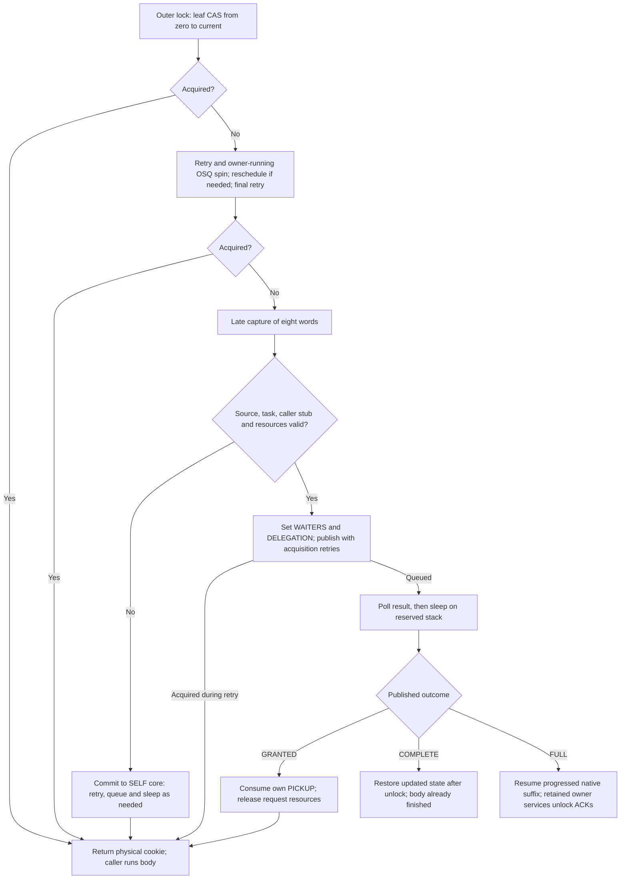
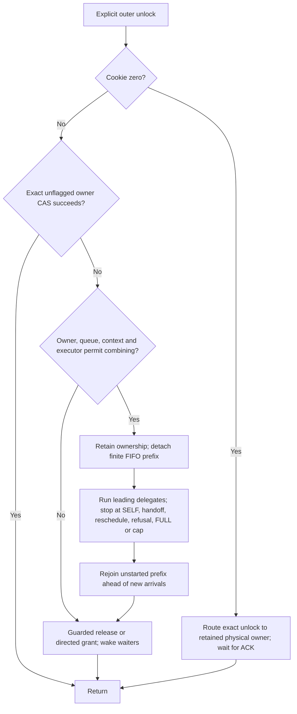
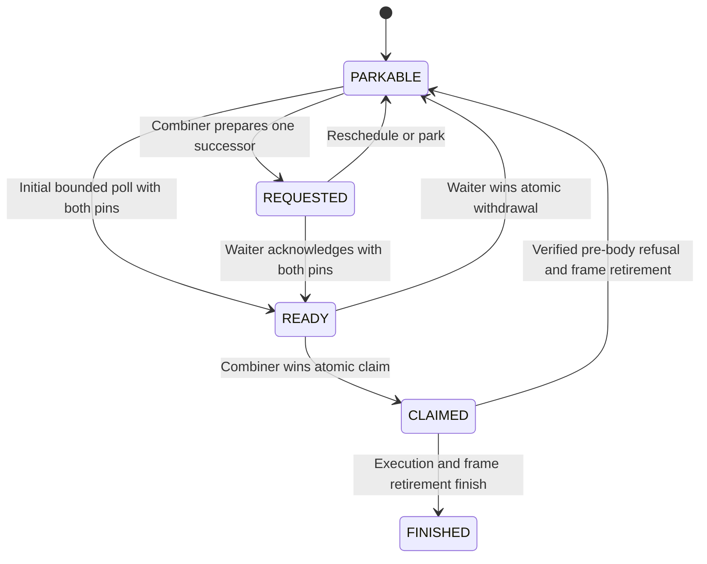

# Mutex implementation: KD, TCLock and Linux Native

Read [lock protocols](lock_protocols.md) for the algorithm/ownership comparison
and [KD locking](locking.md#kd-owned-mutex-ownership) for nested owner/ACK
details. This page maps the current ordinary mutex paths to their data and
source. [Spin implementation](spin_implementation.md) owns the shared wrapper,
code-pool and spin-continuation geometry; those allocations are not duplicated
per mutex request.

## Source and call paths

| Arm | Workload entry | Backend implementation |
| --- | --- | --- |
| Native | `(mutex_lock)` / `(mutex_unlock)` | Captured kernel `kernel/locking/mutex.c`, `include/linux/mutex.h` |
| TCLock | `komb_mutex_lock` / `komb_mutex_unlock` | [komb_mutex.c](../../tclock_backend/komb_mutex.c), [combiner.c](../../tclock_backend/combiner.c), [mutex_provider.c](../../tclock_backend/mutex_provider.c) |
| KD owned outer | `KD_OWNED_MUTEX_OUTER_LOCK/UNLOCK` | [kd_owned_mutex_direct.h](../../include/kd_owned_mutex_direct.h), [owned core](../../kernel_module/owned_mutex/core.c), [delegation](../../kernel_module/owned_mutex/delegation.c) |
| KD owned ordinary/nested | `kd_mutex_lock/unlock`, `KD_OWNED_MUTEX_DIRECT_LOCK/UNLOCK` | Owned SELF core; translated nested calls use [owned_mutex_calls.inc](../../kernel_module/lock/owned_mutex_calls.inc) |

The benchmark arms use distinct compiled functions in
[mutex_cacheline/module.c](../../workload_modules/mutex_cacheline/module.c).
The mutex translation unit reuses payload, ioctl runner and timing sources for
c01/c02/c04/c08/c16 and RCUHT;
there is no per-operation runtime `is_mutex` branch. Measurement runs through
[run_mutex.py](../../bench/tclock_compare/run_mutex.py), sharing reporting with
the spin runner. Registration and final context drain are outside measurement.

The existing kernel build is `/root/linux-6.1.159-kdclobber2` in the guest. Its
release, configuration, source/interface hashes and live Build ID are checked
by the [kernel identity verifier](../../bench/spin_cacheline/kernel_identity.py)
against the [captured baseline](../../kernel_baseline/README.md). Native source
paths above refer to that build, not to a second Linux implementation in this
repository.

## Linux Native implementation

`struct mutex` contains `owner`, `wait_lock`, an optimistic spin queue when
configured, and `wait_list`. With the captured configuration it is 32 bytes;
debug/RT configurations change the layout and implementation. Owner low bits
are WAITERS=1, HANDOFF=2, PICKUP=4; pointer comparisons mask all three.

The original lock function's successful owner CAS returns directly. Its
slowpath first retries acquisition and optimistic spinning, then installs a
stack `mutex_waiter` under `wait_lock`. Sleep state publication, rechecking
ownership and wait-list insertion prevent a missing unlock wake. A first
waiter can request handoff instead of repeatedly losing to a fresh contender.
The unlock slowpath preserves flagged state, prepares a wake queue and
performs handoff when requested; the receiving task consumes PICKUP with
acquire ordering.

The Native arm deliberately parenthesizes function names to bypass the
experimental caller-clobber macros. No KD selector is installed, so it reaches
the original Linux algorithm. It does not allocate a KD task record,
use a JIT frame, or move to a TCLock shadow stack.

## TCLock implementation

The fixed upstream source is commit
`bbfb9f00a12af51dff6ca291cb9829a82960c2ef`, retained byte-for-byte in
[upstream](../../tclock_backend/upstream/) with hashes in
[UPSTREAM.json](../../tclock_backend/UPSTREAM.json). The external module
replaces custom `task_struct` fields with
[tc_mutex_context](../../tclock_backend/mutex_compat.h). It retains ordinary
mutex parking, wakeup, NUMA selection and real stack switching. The provenance
and build boundary are in the [backend README](../../tclock_backend/README.md).

| Storage | Location and purpose |
| --- | --- |
| `komb_mutex` | 24 bytes; workload-owned pointer tail, state/locked byte and combiner task; no original Linux mutex owner |
| `tc_mutex_context` | 336 bytes, preallocated per possible CPU on its preferred NUMA node; registered task, stack pointer, waiter links, lock-address stack, batch counter, observations and embedded node |
| `komb_mutex_node` | 160 bytes embedded in that context; next/task/lock, CPU/socket, real RSP and completion/locked notification |
| Shadow stack | 8 KiB per possible CPU, NUMA-local allocation with allocator fallback; retained until controlled backend unload |
| Native context | Six callee-saved GPRs plus CALL return address on existing task/shadow stacks; no KD register packet or software frame |

These sizes are verified from the cleanup's guest-built DWARF. The node starts
at context offset 176; its completion/locked bytes are at node offsets 136/137.
The type has no KD-style 64-byte alignment/whole-line stride requirement.
Allocator overhead, alignment and existing task stacks are separate from
`sizeof`, and object geometry does not measure cache misses.

`tc_mutex_worker_register()` requires single-CPU affinity and an unused
context, takes a task reference, and binds the context before workers report
ready. `tc_mutex_task(task)` looks up by `task_cpu(task)`; registration and
fixed affinity are part of its correctness contract, not approximate
profiling information. Only ordinary operations on registered workers are
supported. Interruptible/killable/IO, rwsem and general unregistered kernel
callers are not ported APIs.

`komb_mutex_lock()` CASes the locked byte. On failure it disables preemption,
sets node CPU/socket/task identity, and enters `__komb_mutex_lock()`. The
assembly saves six GPRs, records RSP through the original implicit helper
CALLs, switches to the context shadow stack and calls the queue slowpath.
That slowpath exchanges `lock->tail`, links behind the predecessor and waits
on the node. Parking/scheduling follows the state machine in
[the protocol](lock_protocols.md#tclock-mutex); it is not a Linux mutex wait-list
implementation.

A queue head obtains the gate. A terminal follower with no successor is
handed physical control; otherwise the combiner records `combiner_task` and
calls `execute_cs()`. `komb_context_switch()` moves physical RSP to the
waiter's native acquisition return. On delegated unlock, WWJUMP records the
waiter's post-unlock RSP and either switches directly to the next eligible
waiter or returns to the combiner. Previous waiter completion is published
only after its stack is no longer executing. Out-of-order state/lock-address
handling remains in the port but does not expand the comparator's single-lock
validation scope.

NUMA selection walks linked successors, defers remote nodes in the context
list and rejoins that list before physical handoff. The default WWJUMP value
1024 is checked against a counter starting at zero, allowing 1025 bodies.
There is no separate KD-style scan limit. Selected waiter stacks receive six
`prefetchw` hints at saved RSP through RSP+320, plus a successor-node hint.
Switching stacks does not switch hardware task/GS identity.

`parks` counts actual successful parking transitions. `batches` and
`delegated` update once after a returned batch, using `counter_val + 1`.
Whole-session deltas prove delegation but do not identify the selected
300 ms peak's delegation share. They are observational values; context
lifetime is checked independently.

`tc_mutex_workers_drain()` requires all workers to have exited and the lock,
queue, saved waiter links, lock-address stack and shadow stack pointer to be
idle. A still-live exiting task yields EBUSY for a bounded retry outside
measurement. Only after cohort drain are task references released. Backend
unload frees preallocated contexts/stacks; no forced context release is used.

## KD-owned implementation (experimental)

`owned-v1` is a separate object protocol. It ports ordinary non-RT Linux
6.1.159 owner spinning, OSQ, sleeping and owner flags into KD, with exact captured
source hashes and port boundaries in [linux-source.json](../../kernel_module/owned_mutex/linux-source.json).
KD mutexes use `struct kd_mutex` exclusively. Every caller of that object uses
the KD API. Linux mutexes used by provider control code are separate objects;
existing kernel-owned `struct mutex` objects continue using Linux operations.

[kd_mutex.h](../../include/kd_mutex.h) statically checks size, alignment and
every field offset against the captured Linux type: 32 bytes, alignment 8,
owner at 0, wait lock at 8, OSQ at 12 and wait list at 16. This matches object
geometry, not measured cache behavior. Unsupported RT/debug layouts fail the
build.

The whole owner word is the sole ownership authority. WAITERS=1, HANDOFF=2 and
PICKUP=4 retain acquire/release ordering. The owned-only DELEGATION=8 guard uses
the captured task pointer's 16-byte alignment; pointer comparisons mask all four
bits. One FIFO under `wait_lock` contains
tagged SELF and DELEGATE waiters; each starts with the same 40-byte private
header. This header is outside the public 32-byte mutex object. ABI2 cold and
refused acquisitions use KD's optimistic SELF core; ABI4 tries local acquisition
first and commits to SELF waiting on later refusal. The OSQ head competes for a running owner; a waiter
sleeps if spinning cannot make progress. Ordinary SELF release permits barging
until handoff is requested. A delegated head receives directed PICKUP when it
cannot execute. Publication retries acquisition after setting WAITERS, covering
a fast owner release between the first retry and waiter insertion.

A single outcome word reports QUEUED, GRANTED, COMPLETE or FULL. SELF waiters
use their stack header's inline state; delegation packets point to their result
cacheline, away from the FIFO links. A directed delegated grant captures the
wake task reference and unlinks the packet under `wait_lock`, publishes the
exact task owner with PICKUP, then release-publishes GRANTED as its last packet
access. The producer consumes only its own PICKUP with an acquire CAS, without
retaking `wait_lock`. Concurrent WAITERS updates are preserved by the CAS retry.
Stack SELF waiters retain removal under `wait_lock`. Completion and FULL also
retire their packet ownership before publishing the same outcome word.

The outer cookie is an explicit outermost acquisition interface. The default
ABI2 caller's successful inline CAS records an approximate entry observation and
a nonzero physical-owner cookie. A failed attempt records one contention under a short pin, then uses
independent CPU and exact-address heat. `owned_mutex_entry_ratio_limit` is a
read-only power of two from 2 through 256, default 256; cadence remains 1,024
contentions, strict `(entries >> 10) < limit`, then 1,025 exact-address records.
Cold CPUs avoid table work between comparisons. No policy uses worker count.
`owned_mutex_self_route` is a diagnostic control, not a Linux fallback.

By default, a failed inline probe enters the original ABI2 capture endpoint,
which records the failed attempt exactly once before delegation admission.
`KD_OWNED_MUTEX_PREFLIGHT=1` is an optional caller build choice. It instead calls
an ordinary C-ABI gate to make that observation before capture. A cold caller
acquires through the owned SELF core there. The default caller emits no gate
call and reads no runtime preflight policy. Both entry symbols coexist in the
provider: the opt-in capture calls `kd_owned_mutex_outer_prepared_clobber_v1`,
which does not sample again; the original contended endpoint retains sampling. An admitted caller may first retry with
`owned_mutex_preflight_spins` (0, 64, 256, 1,024 or 4,096; default 0). The
optimistic candidate competes only as OSQ head, checks the running owner and
rescheduling state, and releases OSQ before returning. The separate opt-in
`owned_mutex_preflight_queue` joins an occupied OSQ and shares the budget between
queue observations and owner polling. On expiry it completes the existing OSQ
cancellation protocol; a racing grant must still be unlocked. Existing SELF
spinners retain their unbounded OSQ entry. The budget limits deliberate polling,
not required cancellation, successor publication or elapsed time. An admitted
BUSY result permits capture, but conveys no eligibility lease. Source, command
and active-task eligibility are checked once at prepared entry, before task
references, registration, packet reservation or publication. A refusal acquires
SELF and returns the physical-owner cookie; sampling is not repeated. No task
reference, packet or OSQ lease crosses the C preflight boundary. The compiler
may still spill callee-saved registers for the function's clobber branch.
The gate and both return-valued capture endpoints are outer-only controls and
are rejected inside translated bodies. Compiled caller identity distinguishes
capture-first from C-gate budget zero; neither is inferred from worker count.
The intermediate experimental caller that paired a gate with the old endpoint
must not be reused with this provider; replace the complete caller/provider/JIT
session, retaining archived binaries with their matching frozen sources.

`KD_OWNED_MUTEX_CABI=1` instead selects ordinary-C ABI4. A leaf owner CAS returns
the physical cookie without saving nonvolatile registers. On contention, the
private Linux SELF path retries and uses its cancelable OSQ queue while the
owner is running. There is no fixed owner-poll budget. Scheduler or owner state
can end optimism; required rescheduling and a final acquisition retry happen
before deciding to capture. Fast and optimistic successes perform no KD heat,
task-record, registry or packet work. This is a separate admission policy, not
ABI2's once-per-attempt entry ratio with delayed bookkeeping.

If local acquisition still fails, the C helper returns without an OSQ, pin,
published stack waiter or resource lease. The assembly then captures eight
words: actual post-CALL IP/SP, caller BP, RBX and R12–R15. Exact source/task
eligibility is checked once before acquiring delegation resources. Refusal
uses the committed SELF wait loop without restarting initial optimism. The
physical cookie remains nonzero; a synthetic delegated continuation receives
zero, preserving FULL owner-ACK routing. The [register ABI](../JIT_REGISTER_ABI.md#owned-mutex-ordinary-c-entry)
defines the fixed caller stub, updated-register completion and restore rules.
ABI4 is opt-in; ABI2 remains supported and the current caller default.

`owned_mutex_reuse_spins` is a read-only allowance of 0, 8, 32 or 128 PAUSEs,
default 0. The measured ABI4 profile selects 32. An optimistic OSQ spinner can
consume this allowance once after observing an entirely zero owner word, giving
the releasing owner an opportunity to reacquire. First sleeping SELF waiters
receive no allowance; flagged owner states do not start it. The allowance is
not a total owner-spin budget, an ownership guarantee or a thread-count policy.
It adds no field to the public object. Result polling uses the separate
`owned_mutex_spin_limit`, default 4,096, before sleeping on a reserved stack.

### Owned ABI4 acquisition and release flow

This is the opt-in local-first path used by the accepted c01 profile and the
[expanded mutex comparison](../PERFORMANCE.md#expanded-mutex-workloads). The OSQ
serializes optimistic spinners; it is separate from the tagged wait list under
`wait_lock`. ABI2's heat/capture path above remains a different caller policy.

Acquisition races that return SELF release temporary request resources before
returning. COMPLETE and FULL use different register-state contracts; neither
restarts the body. A FULL borrower has cookie zero and cannot release another
task's owner word directly.

The following release rules apply to both owned caller ABIs. Ordinary/nested
unlock never enters the combining branch. Optional refill takes further FIFO
snapshots under the same cumulative cap; it is off in the measured profile.

A delegate publisher sets WAITERS and DELEGATION under `wait_lock` before
linking, preserving its
post-publication acquisition retry. The guard remains set across detached
private batches and clears only at true drain. Without HANDOFF or DELEGATION,
slow SELF unlock can release the owner word before taking `wait_lock`, then
only wake a waiter; it cannot hand off on behalf of a newer owner. A guarded
release retains ownership until the tagged queue/batch is resolved. This keeps
Linux ownership reuse on SELF-only queues without stranding delegated requests.
The read-only provider identity is `owned_mutex_protocol=linux_local_first_v1`;
there is no optional early-release or budgeted native-first mode.

Ordinary and direct clobber calls are nestable SELF controls on their caller.
When translated, the dispatcher acquires/releases them through the exact frame
ledger. Their native acquisitions retain a task-local held count and one cached
task reference until the count drains. This prevents an early A unlock from
combining while its own native continuation still holds B: executing another
A body that takes B at that point would deadlock. Tracking exhaustion keeps
SELF acquisition available and disables new owned batches until unload;
existing tracked depths and published requests still drain. The outer cookie
does not pay for this ordinary/nested acquisition record.

Ordinary unlock never starts a batch, including when its tracked depth reaches
zero: an explicit outer acquisition may still be held outside that record.
It releases or hands off through the SELF core and retains borrower ACK routing.
Only explicit outer unlock can combine. This also prevents B's unlock from
executing a B waiter that needs the caller's still-held outer A.

Combining starts on explicit outer unlock, after the physical owner's own body. A combiner
reserves its independent executor stack and source/task references, then detaches
one finite FIFO snapshot while retaining owner and WAITERS. It executes only
the leading delegates, stops at SELF, handoff, reschedule, refusal, FULL/native
continuation, early release or the 1,024-body cap, and does not refill or reorder
by NUMA node. Unstarted requests rejoin ahead of newer arrivals. Atomic/IRQ-off
unlock and an occupied executor use the owned release/handoff path.

The opt-in `owned_mutex_refill=1` experiment amortizes executor setup over further
FIFO snapshots. Only an exhausted private prefix can refill; deferred wakes are
flushed first. The public head is checked under `wait_lock`, with ownership,
HANDOFF and reschedule conditions rechecked before detachment. A SELF head ends
the batch. One cumulative body count bounds all snapshots, and refusal, FULL or
early release keeps the same stop/rejoin behavior. This changes no object fields
and introduces no NUMA reordering. Its measured results remain separate from the
default finite-snapshot protocol.

Four producer packets and four 8 KiB waiter stacks are reserved per CPU, with
one separate 8 KiB executor stack. Packet size is 320 bytes, registers start at
128, and the completion result starts at 304. Large per-CPU identities use a
dynamic allocation at provider initialization; placing the pool in the static
module arena exceeded this kernel's 8 KiB reserve. Reusable `rcuwait` identities
outlive packets. Final result publication is the last packet access; deferred
wakes retain only those stable identities.

Registry kind 3 and entry ABI2 or ABI4 identify KD mutex images. Wire kind 2 is
reserved and rejected; its value is not reused for a different object protocol.
The two-word wrapper, reduced COMPLETE return, FULL detachment and logical-task
continuation remain shared. A FULL borrower never releases another task's owner
word: the physical executor performs each unlock and acknowledges it. Early
outer release rejoins pending requests and releases A once; the batch neither
reacquires A nor accesses its queue afterward while B finishes. Source retirement
requires producer slots, parked waits, executors, task references and frames to
drain independently of heat.

The synthetic benchmark selects this backend with `--mutex-implementation owned-v1`
and reports KD_SELF separately from JIT and Linux Native. Plain performance
workloads cover c01/c02/c04/c08/c16 and RCUHT; nested/early functional probes
remain limited to c01. The
[accepted profile](../PERFORMANCE.md#accepted-c01-18-worker-profile) is scoped to
64 post-work rounds and 1–8 workers on the regular 64-vCPU boot. The later
[1–64-worker comparison](../PERFORMANCE.md#fresh-c01-164-worker-comparison) used
the same implementation on a historical temporary 66-vCPU boot and missed the
three-worker peak gate. New runs require the fixed
[64-CPU placement](../../tools/vm/README.md#complete-164-worker-comparison).
The [expanded workload comparison](../PERFORMANCE.md#expanded-mutex-workloads)
measures all six synthetic payloads and five pipe/file API variants through
60 workers. Its workload/runner expansion leaves the provider algorithm and
general defaults unchanged. These descriptive measurements do not extend the
c01 optimization acceptance or resolve translator context/flags limits or
RT/WW/interruptible mutex APIs.

### Private pipe/file API adapter

The [API mutex module](../../workload_modules/real_api/mutex.c) uses an explicit
64-byte-aligned private `struct kd_mutex` and ABI4 outer pairs for pipe byte-count,
pipe capacity and SEEK_SET/SEEK_END bodies. It prepares the named continuation
with the matching owned entry ABI and checks object idleness before preparation
and after worker join. The [API runner](../../bench/real_api/README.md) verifies
the compiled imports, caller identity, provider policy, stable image publication
and final source/frame retirement.

The original embedded Linux mutex remains a distinct object. Native uses that
mutex; KD and TCLock use their private objects around the matched protected body.
Every measured access to the bound file or pipe follows the selected adapter,
and retained references survive worker join, source retirement and hook removal.
Concurrent unhooked consumers, pipe mutation and descriptor changes are outside
the controlled benchmark contract. This adapter does not provide interchangeable
Linux/KD mutex APIs or global kernel mutex replacement.

## Blocking waits and lifetime

Published delegates poll up to `owned_mutex_spin_limit` PAUSE iterations
(default 4096, range 0–1048576), then sleep uninterruptibly on their reserved
stacks while retaining migration pins. Zero requests immediate parking. This
budget is separate from SELF's Linux-style optimistic owner spinning.

Result waiters register in persistent `rcuwait` slots, publish their sleep state,
recheck the result and use `schedule_timeout(1)`. The timeout permits progress
when completion has been published but its wake is buffered behind another body.
A wake can end the sleep sooner; neither mechanism bounds scheduler latency.
Completion retires packet/frame ownership before publishing the outcome. Deferred
wakes retain stable notification identities and never read recycled packets.

The RCU task cache in [kd_mutex_tasks.c](../../kernel_module/kd_mutex_tasks.c)
retains exact acquisition references and ordinary/nested held counts. A zero
reference count disables routing immediately; inactive identities can remain
cached until eviction or controlled unload. The cache is part of owned mutex
execution and does not replace the physical owner, unlock ACK or frame ledger.

The [scheduler probe](../../tests/kernel/mutex/run_wait_selftest.py) checks queued
admission cooling, actual sleep, directed SELF pickup and exact drain. Its
constructed requests execute no JIT bodies. The [mutex runner](../../bench/tclock_compare/README.md)
checks returned JIT evidence separately, with nested/early/FULL probes in functional
mode. [Validation](../VALIDATION.md) and [performance status](../PERFORMANCE.md)
identify the exact source and scope of recorded checks.

Finite per-CPU reservations, independently runnable dependencies and controlled
drain remain required. Ordinary mutex calls are uninterruptible; the owned API
does not provide RT, WW, killable or interruptible acquisition. Selected checks
do not establish arbitrary oversubscription or starvation freedom.

## Conditional origin readiness and bounded NUMA selection

`owned_mutex_origin_spin=1` enables the separately audited GS subset.
`owned_mutex_numa=1` enables experimental NUMA selection. Both are off by default
after the [2026-10-15 comparison](../../bench/results/10.176.26.71/bench/mutex_owned/20261015-origin/README.md)
missed the regression gates. GS-independent images continue
to execute for sleeping producers with their existing FULL/native ACK behavior.
The public mutex is still 32 bytes; request registers remain at offset 128 and
the outcome at offset 304 in the 320-byte private packet. Readiness, origin CPU
and the persistent bypass count occupy the final twelve padding bytes.

READY is a release publication made with migration and preemption disabled.
The combiner binds the exact immutable image and excludes its own CPU before
claiming with an acquire CAS. The waiter's competing CAS makes withdrawal and
claiming exclusive. Unclaimed polling retains the configured 4,096-poll budget
and reschedule checks. A claimed waiter cannot schedule or revoke the claim on
timeout. Completion is published only after the frame retires and the claim is
released. A preparation wake is a request, never execution authority. Only the
combiner inspects queue links; it may prepare one prospective successor while
processing the current request.

NUMA mode examines at most eight delegates, stopping at SELF and HANDOFF
boundaries. It chooses the earliest eligible local-node request, otherwise the
earliest eligible remote request. Each overtaken predecessor increments its
persistent count when the selected request is dispatched. A count of four stops
selection from crossing that waiter, including after a private list is rejoined
and detached in another batch. An ineligible head at this barrier is rejoined
and granted physical ownership through KD's local protocol. Unselected links
retain their order. Cooling never invalidates already-published requests.

The origin claim excludes task scheduling, not interrupts or NMIs. It does not
make arbitrary per-CPU storage safe; admission must separately exclude conflicting
interrupt/NMI and unsynchronized remote accesses. See the
[Linux per-CPU operations contract](https://docs.kernel.org/6.1/core-api/this_cpu_ops.html).
