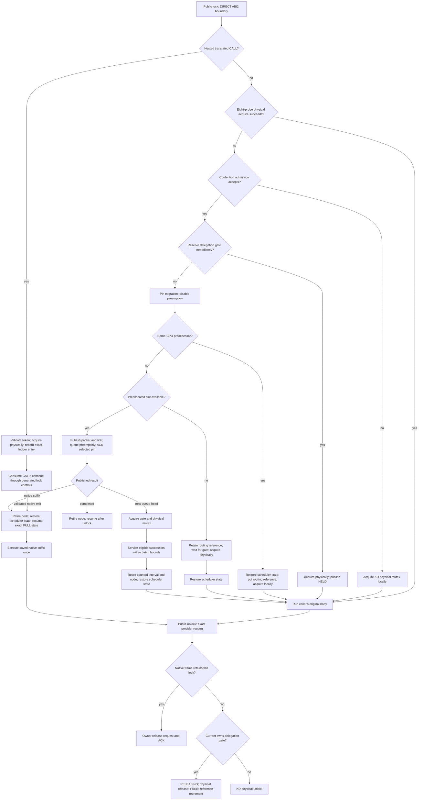

# Mutex implementation: KD, TCLock and Linux Native

The maintained baseline retains KD-only physical ownership and pinned published
delegation waiters. This branch carries the bounded selected-group candidate
below; its VM correctness and performance gates are pending. New delegation callers use ABI2; ABI0 remains an internal legacy
compatibility interface. The current OSQ and delegation queues share reserved
node storage while keeping independent memberships. The total cap and NUMA
locality boundary both default to 1024 bodies. Bounded NUMA selection retains
terminal/deferred handoff but has no earlier count-based local cutoff.
Immutable mutex images and generation-bound frames remain required. Production
now trusts kernel/module source and skips semantic admission; the
[compatibility backport](../history/legacy_mutex_compatibility.md) records its
earlier checked-analysis behavior.
The [KD-only extension](kd_only_mutex.md) embeds physical exclusion in a native-sized
KD object together with the delegation scheduling root.

Read [lock protocols](lock_protocols.md) for the algorithm/ownership comparison
and [KD locking](locking.md#mutex-delegation-protocol) for nested owner/ACK
details. This page maps the current ordinary mutex paths to their data and
source. [Register ABI](../JIT_REGISTER_ABI.md) defines the shared wrapper, and
[lifetimes](lifetimes.md) owns executable-image storage. The spin continuation
pool and mutex waiter stacks have separate layouts; shared execution machinery
does not imply copying a spin continuation into every mutex request.
The [lock catalog](../LOCKS.md) locates the other lock families;
[terminology](../TERMINOLOGY.md) defines the queue and machine-state terms.

## Source and call paths

| Arm | Workload entry | Backend implementation |
| --- | --- | --- |
| Native | `(mutex_lock)` / `(mutex_unlock)` | Captured kernel `kernel/locking/mutex.c`, `include/linux/mutex.h` |
| TCLock | `komb_mutex_lock` / `komb_mutex_unlock` | [komb_mutex.c](../../tclock_backend/komb_mutex.c), [combiner.c](../../tclock_backend/combiner.c), [mutex_provider.c](../../tclock_backend/mutex_provider.c) |
| KD public | `kd_mutex_lock/unlock`, ordinary blocking aliases and non-lockdep nested forms | [kd_mutex_api.h](../../include/kd_mutex_api.h), direct ABI2 entry and exact provider unlock routing |
| KD ordinary/local | `kd_mutex_local_lock/unlock` and ordinary API variants | [kd_mutex_local.c](../../kernel_module/kd_mutex_local.c), [kd_mutex_osq.c](../../kernel_module/kd_mutex_osq.c) |
| KD outer | `KD_MUTEX_OUTER_LOCK/UNLOCK` | [kd_mutex_direct.h](../../include/kd_mutex_direct.h), [mutex_calls.inc](../../kernel_module/lock/mutex_calls.inc) |
| KD general/nested | `KD_MUTEX_DIRECT_LOCK/UNLOCK` and internal ABI0/2 entries | Same routing file, [kd_mutex.c](../../kernel_module/kd_mutex.c), [native.inc](../../kernel_module/execution/native.inc) |

The Native, TCLock and KD benchmark arms use distinct compiled functions in
[mutex_cacheline/module.c](../../workload_modules/mutex_cacheline/module.c).
The mutex translation unit reuses payload, ioctl runner and timing sources;
there is no per-operation runtime `is_mutex` branch. Measurement runs through
[run_mutex.py](../../bench/tclock_compare/run_mutex.py), sharing reporting with
the spin runner. Registration and final context drain are outside measurement.

The current kernel build is
`/mnt/kdlock-builds/linux-7.0.0-38-kdlock1/build` in the guest. Its source is the
adjacent `source/` directory. The [kernel identity verifier](../../bench/spin_cacheline/kernel_identity.py)
checks the [Linux 7 schema-2 bundle](../../kernel_integration/linux70/IDENTITY.md),
including the live Build ID and runtime policy. Historical Native source
references and measurements retain their captured Linux 6.1 identity. KD keeps
its accepted, separately namespaced physical mutex/OSQ algorithm; the Linux 7
compatibility port does not replace it with Linux mutex API calls.

## Public KD API

[`kd_mutex.h`](../../include/kd_mutex.h) defines the object and callable operations.
[`kd_mutex_api.h`](../../include/kd_mutex_api.h) supplies the unified one-argument
public lock/unlock macros through the ABI2 direct interface.
[`kd_mutex_direct.h`](../../include/kd_mutex_direct.h) retains explicit direct
and outer-cookie calls. All use the same KD physical exclusion.

| Operation | Interface and result |
| --- | --- |
| Initialization and teardown | `DEFINE_KD_MUTEX`, `KD_MUTEX_INITIALIZER`, `kd_mutex_init`, non-lockdep `__kd_mutex_init`, and non-debug `kd_devm_mutex_init` / `__kd_devm_mutex_init`; `kd_mutex_destroy` diagnoses a busy object and does not drain users |
| Public blocking acquisition | Direct `kd_mutex_lock(lock)` / `kd_mutex_unlock(lock)` calls use ABI2 and permit delegation, including supported translated nesting |
| Explicit local acquisition | `kd_mutex_local_lock` / `kd_mutex_local_unlock`; executes the caller's body locally |
| Cancellable acquisition | `kd_mutex_lock_interruptible` or `kd_mutex_lock_killable`; local, zero on success, `-EINTR` on cancellation; unlock only after success |
| Trylock | `kd_mutex_trylock`; local, 1 on success, 0 otherwise; unlock only after success |
| I/O wait accounting | `kd_mutex_lock_io`; local acquisition with scheduler I/O accounting |
| Last-reference acquisition | `kd_atomic_dec_and_mutex_lock`; returns 1 with the local mutex held only when the count reaches zero; otherwise returns 0 without ownership |
| Ownership observations | `kd_mutex_is_locked` observes a physical owner; `kd_mutex_is_idle` additionally checks local/delegation state after all users join; neither acquires the lock |
| Outer delegation | `KD_MUTEX_OUTER_LOCK/UNLOCK`; opaque same-task cookie for one lexical acquisition |
| General direct delegation | `KD_MUTEX_DIRECT_LOCK/UNLOCK`; explicit clobber interface also recognized for supported nested translated controls |
| Scope cleanup | `guard(kd_mutex)` and `CLASS(kd_mutex, ...)` acquire locally; guard cleanup and `__free(kd_mutex)` use routed public unlock |

All successful public acquisition forms can use `kd_mutex_unlock`. Its provider
routing handles a local physical owner, a delegation gate owner and a native
continuation whose lock remains physically owned by an executor. The last case
requires an exact frame/lock match and an unlock ACK. Task membership is routing
state, not a new admission decision at unlock.

The public macros evaluate the lock expression once and provide a void
expression. Their internal numeric continuation requires no named label or
caller cookie. Calls through a function pointer, or with the function name
parenthesized, use the addressable ordinary-C-ABI lock function and execute locally;
the callable unlock function still routes exactly. Their assembler/export names
are `kd_mutex_api_lock/unlock`, keeping the public C names separate from the
captured kernel's legacy exports. Non-lockdep nested annotations
use the public blocking interface but do not implement lockdep classes.
Interruptible, killable, I/O, trylock and last-reference calls retain local
semantics and remain refused inside translated bodies.
The conventional public C entry points are also native-only admission
boundaries under their assembler names. The translator does not learn their C bodies;
nested JIT execution uses the direct control endpoints. Scope guards and cleanup
helpers intentionally use these conventional functions, without introducing a
hidden delegation boundary inside a constructor or destructor.

For explicit named direct continuations, use `kd_mutex_prepare` and
`KD_ENTRY_ABI_MUTEX_CLOBBER_V1` after the source module is live. The containing
function uses `noipa` to prevent duplicate global continuation labels.
The unified direct entry can register its own captured continuation when
contention admission accepts it; registration is not translation or proof of
executed JIT bodies. Source aliases in
[`kd_mutex_compat.h`](../../include/kd_mutex_compat.h) map to the unified public
interfaces and local task-sensitive variants.

The [replacement contract](kd_only_mutex.md) owns alias coverage and rebuild
requirements. Its [semantic differences and replacement limits](kd_only_mutex.md#semantic-differences-and-replacement-limits)
distinguish native-object compatibility, local execution and delegation admission.
There is no Linux mutex fallback. The outer cookie's nonzero value
records exact local ownership; zero means provider-routed unlock and can also
occur after a local fallback. It is not a delegation-success flag.

## KD implementation

### Physical exclusion for ordinary and delegated callers

The `owner` word stores the actual owning task plus three low flag bits:
`WAITERS=1` records a sleeping wait list, `HANDOFF=2` requests ownership transfer,
and `PICKUP=4` reserves that transfer for the selected task. A successful
zero-owner acquire compare-and-exchange grants the fast path. A busy caller
may optimistically spin while the owner is running, using a private optimistic
spin queue (OSQ) to order competing spinners.

When spinning cannot acquire, `kd_local_lock_slow` links a stack waiter under
`wait_lock`, publishes its sleep state and rechecks acquisition before sleeping.
Signal cancellation removes that waiter under the same lock. A designated
handoff must be picked up before checking signals, so cancellation cannot abandon
ownership already assigned to that task. Release clears the owner with release
ordering or wakes/transfers to the first sleeper; the wake queue retains a task
reference until wakeup. An ordinary optimistic spinner temporarily reserves a
slot from the preallocated mutex node pool, using only its OSQ subrecord; it
publishes no delegation request and creates no JIT frame. If all four local
slots are reserved, it skips OSQ and continues through the sleeping path.
An initial delegation head explicitly lends its already reserved slot during
physical acquisition. The OSQ membership retires before that acquisition sleeps
or returns, while the delegation reservation and exact waiter record remain live.
Early outer reacquisition uses an ordinary temporary reservation or the sleeping
fallback; it never borrows a completed waiter's node.

The delegation phase is separate from physical ownership. A queue head changes
FREE (0) to ACQUIRING (2), acquires the physical mutex, then publishes HELD (1).
COMBINER (3) marks batch execution. Unlock publishes RELEASING (4) before releasing
the physical owner, and FREE only afterward. Only current's physical acquisition,
with PICKUP clear and phase HELD/COMBINER, authorizes delegation unlock. This is
not a remote task ownership snapshot: physical acquire/release ordering is what
prevents an ordinary owner from observing an earlier delegate's HELD phase.
The batch path inlines this exact predicate while retaining its current-task,
physical-owner, PICKUP and phase checks and the separate physical-owner probes
at body entry and retirement.

| Stage | Source to follow |
| --- | --- |
| Local acquire, cancellation, unlock and idle | [kd_mutex_local.c](../../kernel_module/kd_mutex_local.c); private [OSQ](../../kernel_module/kd_mutex_osq.c) |
| Direct entry policy and exact unlock routing | [lock/mutex_calls.inc](../../kernel_module/lock/mutex_calls.inc); [kd_mutex_tasks.c](../../kernel_module/kd_mutex_tasks.c) retains task/acquisition references |
| Delegation phase and exact waiter records | [kd_mutex_state.h](../../include/kd_mutex_state.h); gate acquisition uses CAS, owner phase updates use release stores, and each reserved node owns its waiter record |
| Node reservation and physical-owner acquisition | [mutex/queue.inc](../../kernel_module/mutex/queue.inc), coordinated by [kd_mutex.c](../../kernel_module/kd_mutex.c) |
| Batch selection, execution and node retirement | [mutex/combiner.inc](../../kernel_module/mutex/combiner.inc) |
| Waiter execution stacks and continuation restore | [mutex/clobber.inc](../../kernel_module/mutex/clobber.inc), [mutex/waiter.inc](../../kernel_module/mutex/waiter.inc) |
| Object/per-CPU initialization and drain | [mutex/lifecycle.inc](../../kernel_module/mutex/lifecycle.inc) |

### Entry and native routing

The unified public pair expands to the direct ABI2 interface with an internal
continuation. Its provider first attempts physical acquisition, then uses the
same contention admission, queue and nested controls as explicit direct calls.
It supplies no outer cookie and does not inline the outer probe window below.
Public unlock always preserves exact routing; an addressable local lock call
therefore remains compatible with that same unlock interface.

The outer pair probes the KD `owner` word at most eight times, attempting an
acquire CAS only when the entire owner/flags word is zero. Each failed probe
pauses before the next attempt; a busy owner read does not modify that word, and a
racing owner still defeats the CAS. The active-combiner hint reads the embedded
phase inline, without a function call, lookup or reference operation. The existing active-combiner gate state (3) ends retries; a lone gate owner (state 1) may finish
during the bounded window.
The observed state is a hint and never grants ownership or retirement. This window
has no worker-count threshold. Success increments the CPU-local entry observation
and stores the exact native result in the lexical cookie. Unlock uses the
KD local function, preserving its owner/flag slowpath. Cookie zero routes to
KD, including native fallbacks after joining KD ownership routing.

After the bounded probes are exhausted,
`kd_mutex_outer_contended_clobber_v1()` does not repeat that probe window.
`kd_mutex_contended_acquire()` records that contention once and checks heat,
source OPEN, target comm, active-task routing and JIT policy before task/queue
work. A native-only result is returned only when this acquisition obtained no
KD routing reference. The general direct and internal entry APIs keep their void
contract; their unlock uses task membership, native requests and exact KD
physical ownership rather than a fresh admission decision.

`kd_mutex_prepare()` registers the named post-lock continuation with
`KD_ENTRY_ABI_MUTEX_CLOBBER_V1`. Translation/admission/control tables recognize
KD direct and local physical symbols. The direct admitted unlock can use
terminal COMPLETE; complex recovery uses checked generic FULL dispatch. The
outer returning entry has a separate physical C return and JIT continuation
which defines route zero, so a nested translated call never consumes an
unmodelled native result.

### Bounded selected-group candidate (October 29)

This source-only candidate starts from `1c86d6d1`, including the corrected single
native-acquisition custody event. The user approved a small group of immediately
selected requests after the strict single-request candidate
`658b918a05cb930d52ccf7307b8d44d54c6d6265` lost 42–54% at measured contended points.
The earlier timing result remains rejected evidence; no gain or parity has been
measured for this window.

[`pin_window.inc`](../../kernel_module/mutex/pin_window.inc) keeps at most four
exact `{node, count_seq}` descriptors on the combiner's stack. Queue reservation
retains node storage; the independent batch source lease retains executable text.
Neither changes the 32-byte mutex or 320-byte node layout. The window includes
current plus up to three consecutive, fully published ABI2 MINIMAL requests with
the same entry IP and local NUMA identity. It stops at another entry/ABI/packet,
an executor-CPU or duplicate-origin-CPU request, a missing link, or the remaining
batch budget. An existing deferred prefix is untouched: lookahead stops before
a terminal successor or the locality count boundary that would rejoin/hand off
that prefix. A first deferral after the locality boundary clamps selection to
current, avoiding unsigned budget underflow. It does not perform NUMA selection ahead of
the existing queue loop. Every current image is rechecked before execution.
The total and locality limits remain 1024/1024.

The origin stays migration-disabled while its slot is reserved, but a merely
queued `KD_MUTEX_WAIT` task can schedule. The combiner release-publishes
`KD_MUTEX_PROXY_REQUEST`; the selected origin disables preemption and
release-publishes `KD_MUTEX_PROXY_PINNED`. The executor acquire-observes that ACK
before delegated stack loads/stores or GS execution. Only stable published
metadata and private executor frame preparation overlap the handshake. Existing
successor `PREFETCHW` hints may touch still-reserved stack cache lines before ACK;
they do not read architectural stack values. Legacy stack decoding waits for its
single current ACK before decoding; generic/FULL paths select only current.

After each ordinary completion, the exact descriptor is removed before the
result wake permits node reuse. Remaining immediate requests can stay selected
and the window can refill. A non-complete short-wrapper return first acknowledges
and releases every future selection **before** calling the dispatcher, which may
sleep, execute a known service or hand execution to an origin. Generic setup,
early outer release, native handoff, role exchange, refusal and final queue
handoff obey the same boundary. Current remains pinned through its actual frame
retirement or native publication. Role exchange moves no window descriptors:
W receives the existing node/source custody, and C requeues its own node as WAIT.
W's later after-body combiner starts a new independent window.

Cancellation waits for every outstanding REQUEST to become PINNED before
publishing WAIT. It never overwrites an unacknowledged request, which could race
a late ACK. After WAIT, an origin can unpin or acknowledge a new selection; an
immediate head result still returns with the caller's expected one pin. Four
bounds outstanding selection descriptors, not the time to receive an ACK or the
number of CPUs momentarily finishing previously completed results. Same-CPU
refusal and reserved local predecessor checks remain. This is not an
oversubscription or fairness redesign, and arbitrary Native sleeping locks or
KD rwsem reads in a custody suffix retain the existing unsupported context limit.

Validation remains pending in the VM. Source-derived fixtures cover the real
origin wait/ACK/reselection loop, bounded refill and late cancellation, exact
identities and post-wake reuse, real combiner terminal/deferred/cap paths, failed
private preparation, FULL dispatcher entry with future pins drained, native and
early-outer paths, and actual queued custody transfer with a delayed future ACK.
Mutation checks retain the ownership/duplicate-acquisition BUG probes. Required
VM checks are basic plus `test_mutex_proxy_pin`, `test_mutex_pin_window`,
`test_mutex_resources`, `test_mutex_outer_progress`, `test_mutex_terminal`,
`test_mutex_policy`, `test_mutex_custody`, `test_mutex_custody_acquire`,
`test_mutex_batch_diag`, and the existing mixed/frame/source-lifetime checks.
Then run the five scoped role-exchange live cases and matched nano points with
identical workloads, call shells, topology and instrumentation. Source-only
fixtures do not establish scheduler progress, actual JIT returns or performance.

The separate ring candidate starts from `6b790cfd28d1e4cf8c95ff82e2f49bd4e791ab99`.
The frozen linear-window provider actually emits an external `memmove` for every
completion that retains successors, plus out-of-line selection and refill calls
with return-thunk epilogues. These are verified emitted costs, not proof of the
measured throughput loss. The ring keeps the same four exact descriptors, advances
an invocation-private head, and clears each consumed physical slot before wake.
Reverse cancellation clears tail slots while preserving current. Hot descriptor
helpers explicitly inline; frame, stack-switch and ownership boundaries retain
their existing ABI. No ACK, selection, source or delegation limit changes.
Fixtures cover every starting head, three full ring turns, empty reuse, reverse
cancellation, wrapped native/early release, and queued custody transfer at every
head. The composed actual `kd_mutex_execute_cs` FULL-resume fixture seeds its
private batch initializer with every head while retaining the real helper and
dispatch boundaries; body execution is substituted. These are protocol fixtures,
not generated JIT or scheduler evidence. Build, emitted-code verification and
matched timing remain pending for this candidate; no gain is claimed and no
diagnostic counter is added.

### Unified lock/unlock protocol

The following pseudocode describes control flow, not a replacement for the
atomic operations and lifetime checks in the source. `physical_lock` denotes
KD's owner/OSQ/sleeping-waiter implementation, not a Linux mutex call.

```text
kd_mutex_lock(A):
    capture compiler-spilled ABI2 continuation (SP, IP, BP)
    enter the recognized DIRECT control
    if this is a nested translated CALL:
        validate the CALL token and waiter stack bounds
        if a valid PENDING call lacks the 256-byte checkpoint window:
            hand back that unexecuted CALL to the original task
        snapshot the checkpoint; reject recursion or invalid state
        if a valid PENDING call exceeds lock capacity:
            hand back that unexecuted CALL to the original task
        acquire A physically as the executor
        publish A's exact frame ledger entry
        consume the CALL only after acquisition and ledger publication
        verify the original token and exact post-CALL IP/SP
        if checkpoint bytes are equal: resume JIT
        else: hand back AFTER the completed CALL, keeping all current effects
    else:
        check sleep context
        if the bounded eight-probe physical acquisition succeeds:
            return to the caller with A physically owned
        record contention once
        if heat/source/task admission refuses:
            physical_lock(A); return
        retain the exact task routing reference and register the continuation
        if the delegation gate can be reserved:
            acquire A physically; publish gate HELD; return
        pin migration and disable preemption before publishing any request
        if a same-CPU predecessor makes publication unsafe:
            restore scheduler state and drop the unused routing reference
            physical_lock(A); return
        reserve a preallocated node and shadow stack
        if reservation fails:
            wait for the delegation gate and acquire A physically
        else:
            initialize MINIMAL packet, task/GS identity and independent links
            exchange delegation_tail; record this exact counted interval
            if there is a predecessor:
                publish predecessor.next; enable preemption while unselected
                acknowledge a selected pin before proxy execution
                poll node.locked with acquire ordering; return with one pin
                if native_resume:
                    retire counted interval; preserve FULL before node reuse
                    release node; restore scheduler state; resume native suffix
                    retain routing until the exact owner/ACK obligations finish
                if completed:
                    retire counted interval; preserve COMPLETE coordinates or FULL
                    release node; restore scheduler state; put task reference
                    resume after the consumed matching unlock
            acquire the delegation gate and A physically
            retire this head's tail position or wait for its successor link
            if a successor exists: service the bounded delegation batch
            retire the counted interval and node
        restore scheduler state; return to execute this owner's original body

kd_mutex_unlock(A):
    if the current task has a routed native frame owning A:
        request release from that exact physical owner; wait for its ACK
    else if current physically owns A's live delegation gate:
        publish RELEASING; release physical A; publish FREE
        retire the matching task routing reference
    else:
        release physical A using the owner/flags and sleeping-waiter protocol
```

The batch decision uses the packet state and whether execution has already
started. A reduced packet is not permission to infer missing register values.

```text
service_one_queued_request(node):
    require the exact physical owner and a retained source lease
    if node has no linked successor and is not ABI2 MINIMAL:
        leave it uncompleted for the next queue head
    bind a checked frame, its lock ledger and an immutable image
    if pre-body admission refuses:
        leave the original request uncompleted for handoff
    invoke the checked body boundary once
    if the batch wrapper returns COMPLETE:
        retire completed body state; retire queue links
        set completed; release-store node.locked = 0
    else if the wrapper reports ENTRY_REFUSED:
        validate the pristine MINIMAL state and absence of body progress
        leave the unchanged request uncompleted for handoff
    else:
        dispatch the FULL return once, without rerunning the first body
        if it reaches the matching unlock:
            complete/retire frame; retire links
            set completed; release-store node.locked = 0
        else if it has a validated native continuation:
            detach borrowed packet storage; preserve FULL for the waiter
            retire every link that an enqueuer could still write
            set native_resume; release-store node.locked = 0
            never touch this node again
            service exact owner release requests and ACKs; then retire frame
        else:
            fail closed; do not replay an entered body
```

Successful nested JIT unlocks update the same exact frame ledger. A native
suffix requests an ACK instead of releasing an executor's mutex itself.
Releasing outer A before nested B invokes the existing outer-release hook;
the frame and B remain live until their obligations finish. The original
combiner then reacquires A for its own body. None of these paths replays an
already executed prefix.



The batch keeps a real tail while it temporarily defers remote-NUMA requests.
When reaching a terminal node with deferred work, eight or more deferred
requests cause handoff. A smaller deferred prefix rejoins ahead of the remainder,
which is then served in FIFO order within the total batch cap. The configurable
locality boundary defaults to the same 1024 bodies as the total cap, so it does
not impose an earlier count-based cutoff. Normal handoff elects the next queue head; the current owner
keeps physical A and HELD for its own original body until it unlocks.
Refusal before body execution hands off the unchanged request;
an entered body must reach its matching unlock or a validated forward native
continuation. Source leases, immutable images, frames and ACKs remain live
through that continuation. The OSQ links and cancellation path never remove a
published delegation node; its result and counted interval must retire before
the shared slot can be reused.

An unsupported entry may be refused before executing a body. For nested
controls, a valid PENDING `-E2BIG`/`-ENOMEM` result or an unavailable checkpoint
window can select native execution before the CALL. Recursion, invalid tokens
and unreadable state do not select that fallback. After the CALL, only an intact
token and exact post-CALL state permit a changed-checkpoint native continuation.
These cases do not authorize replay after progress: an invalid token or an
unrecoverable post-execution state remains an error. In generated execution,
the outer unlock can complete a delegated body while the combiner retains
physical A for the batch; it does not take the native public-unlock path shown
for the caller's original body or native suffix.

### Current storage and lookup

The public object is 32 bytes, aligned to 8 bytes on the captured non-RT x86-64
configuration. Its complete fields are:

| Field | Offset | Bytes | Purpose |
| --- | ---: | ---: | --- |
| `atomic_long_t owner` | 0 | 8 | Physical task pointer and WAITERS/HANDOFF/PICKUP flags |
| `raw_spinlock_t wait_lock` | 8 | 4 | Existing physical sleeping-waiter serialization |
| `struct optimistic_spin_queue osq` | 12 | 4 | Independent physical optimistic-spinning tail, encoding CPU and shared-pool slot |
| `struct kd_local_waiter *wait_head` | 16 | 8 | First real stack waiter in a circular doubly linked ring; NULL means empty |
| `atomic_t delegation_state` | 24 | 4 | Delegation phase: FREE, ACQUIRING, HELD, COMBINER or RELEASING |
| `u32 delegation_tail` | 28 | 4 | `(CPU + 1) << 4` combined with `slot << 2`; zero means empty |

The sleeping waiter remains a stack `list_head` plus task pointer (24 bytes).
Append, cancellation and head removal remain O(1) under `wait_lock`. The outside-
lock first-waiter check compares pointers only; it never follows a potentially
retired stack node. OSQ keeps the captured abortable-MCS unlink algorithm, using
explicit reserved nodes instead of a separate one-node-per-CPU allocation.
Internal list representation differs from Linux despite equal object geometry.

Each preallocated `kd_mutex_node` contains this independent OSQ subrecord in its
former padding, without increasing the 320-byte node or changing packet offsets:

| OSQ subrecord field | Node offset | Bytes | Purpose |
| --- | ---: | ---: | --- |
| `struct kd_mutex_osq_node *next` | 104 | 8 | OSQ successor; separate from delegation `next` at offset 0 |
| `struct kd_mutex_osq_node *prev` | 112 | 8 | OSQ predecessor for cancellation |
| `int locked` | 120 | 4 | Initial/waiting state 0, predecessor grant 1, retired IDLE state 2 |
| `u32 tail` | 124 | 4 | Immutable `(CPU + 1) << 4` combined with `slot << 2`, initialized with the pool |

OSQ acquisition, cancellation and unlock receive the explicit subrecord. The
queue's atomic tail uses that encoded identity; predecessor vCPU checks decode
the CPU separately from its slot. An empty-tail acquisition becomes OSQ head
without a predecessor grant, so its state remains 0 until retirement. An OSQ
member stays preemption-disabled until its unlink or handoff accesses complete.
Only then does it publish IDLE and
release a temporary reservation. A borrowed delegation head publishes IDLE but
keeps its original reservation, packet, waiter record and shadow stack. IDLE is
retirement evidence for the reservation owner, not physical mutex ownership.
Residual predecessor vCPU checks can read the immutable identity safely because
the pool storage remains resident and that identity never changes on reuse.
The two queue tails and their links remain independent; OSQ cancellation cannot
unlink or complete a published delegation request.

FREE to ACQUIRING uses full-word compare-and-exchange. Only the gate owner
changes an occupied phase, so subsequent phase changes use release stores.
HELD follows physical acquisition; RELEASING precedes physical release, and FREE
is the releasing owner's final gate access. Ordinary physical owners cannot
inherit authorization from an old HELD phase. The queue tail still uses the
existing encoded-node exchange and terminal compare-and-exchange.

Each reserved node records its exact counted interval in `counted_lock` at offset
96 and a nonwrapping 64-bit `count_seq` at offset 88. Both use existing padding;
the node remains 320 bytes. Only its pinned origin changes this record: entry
follows the queue-tail exchange and exit precedes every published queue-path return. A
combiner remains counted across early outer release and physical reacquisition;
queue removal or frame retirement alone does not clear the record. Ordered odd
and even sequence stores bracket each pointer change. No shared waiter counter
is updated by enqueue or completion.

The cold debug count allocates temporary sequence storage with GFP_ATOMIC and
collects every preallocated node's key and sequence, then verifies all sequences
again. Unchanged even sequences establish one common instant for the exact
count, including address reuse between scans. Eight unsuccessful attempts return
`-EAGAIN`; allocation failure returns `-ENOMEM`. Errors never become an estimated
count or zero. The hot path does not allocate or scan remote nodes. Per-object
idle checks scan exact records only after callers stop and join, as before.
There is no auxiliary hash, shared lock reference count, auxiliary registry lock
or auxiliary RCU mechanism, per-object allocation or retirement callback.

| Other storage | Lifetime |
| --- | --- |
| Task routing record | Existing task-keyed RCU cache with exact acquisition references; unchanged by this refactor |
| `kd_mutex_node` | Four independently reserved 320-byte, 64-byte-aligned slots per possible CPU; shared by OSQ and delegation, with independent links/status; packet offset 128, completion/polling offsets 304/305 |
| Shadow stacks | Four preallocated 8 KiB stacks per possible CPU |
| Execution frames | Existing per-CPU frame stack; borrowed packets detach before node reuse; native ACK and immutable image/source leases retain their existing lifetime |
| Batch | Executor stack stores mutex pointer, successor/retirement flag, deferred NUMA chain and outer-release hook |

The embedded root shares the caller-owned mutex's existing lifetime. Stop and join
callers and drain physical ownership, both queues, frames and ACKs before freeing
or reinitializing an object. No destroy call or new caller cleanup is required.
Provider drain checks each CPU's exact reservations, including temporary OSQ
users, its published delegation waiters and the existing exact task
acquisition records, including immediate gate owners without a node and detached
batches; independent frame/source/ACK checks remain. No approximate owner totals
replace these records. No auxiliary registry lock or RCU mechanism is introduced;
the pre-existing task routing cache and native-ACK serialization remain.

The previous hash/refcount design and its 65,536-slot, 16 MiB table are retained as
fixed Git evidence at `6341999`; its measured results remain under their original
source identity. They do not describe the embedded layout.

`kd_mutex_task_get()` first attempts an RCU lookup and atomic acquisition-reference
increment. Cache hits require neither allocation nor the bucket writer lock.
Misses allocate with GFP_ATOMIC, lock the bucket and recheck before publication.
The last put changes the exact count to zero, immediately disabling routing;
the inactive identity can remain cached. A bucket retains up to eight identities
unless live acquisitions require more. A zero-reference eviction CAS claims
the record with -1, arbitrating against concurrent reactivation, before unlinking
it. RCU then protects old readers until the callback drops the task ref and frees
storage. Inactive records also disappear during controlled provider unload.

Controlled drain counts records with positive references after callers stop.
Cached task lifetime does not extend routing membership or excuse an outstanding
owner ACK. Active overflow is pruned on the final put. Approximate heat/counter
values never replace these references. The allocation-fault switch remains
checked before cache lookup, using a read before its one-shot CAS.

Mutex heat has separate entry/contention counters from spin. Every 1024
contentions the accepted policy checks `(entries >> 10) < 256`, resets both
counters, then samples the clock. The earlier proposed limit 2 is not the
current mutex setting. CPU and exact-address heat windows remain separate;
see [heat and roles](../JIT_EXECUTION.md#heat-and-roles) for the full policy.

### Packet/cacheline and prefetch layout

The node's first line contains next, GS base, saved physical RSP, stack
base/top, lock, task and saved entry identity. ABI/packet/tail/slot state,
immutable NUMA identity, exact waiter record and the independent 24-byte OSQ
subrecord occupy the second line; `regs` begins at offset 128.
IP/SP/BP and five virtual GPR slots share its first aligned line.
`completed/locked/native_resume` occupy offsets 304/305/306, after the 168-byte
packet in the node's existing fifth line. Minimal packet and metadata writes
therefore do not invalidate the polling line. FULL recovery can touch the
packet's last line; the node remains 320 bytes. Linux `pt_regs` is unchanged.

The root frame's own hot header contains entry/lock identity and frame state.
For spin its inline IP/SP/BP share that first aligned line. A mutex simple
frame instead borrows `node->regs`; the frame header and node packet are
distinct objects. Caller stack memory keeps its original addresses/aliases
and is not relocated into either header. These are layout facts, not measured
cache misses or a claim that all request state occupies one line.

Before the current body, `kd_mutex_prefetch_successor()` reads the known-live
successor header and gives write hints for its aligned hot packet line and stack
addresses SP and SP-8. It avoids duplicate hints for SP/BP on the same line and
does not fetch the entire FULL packet on every minimal request. The pointer is queue-owned until wake; no successor or
current-node read is allowed after its completion/native publication. Prefetch
grants no ownership, admission or lifetime.

The embedded gate uses a read before its acquire CAS. The phase and encoded tail
occupy the last eight bytes; exact waiter records live in reserved nodes. Physical ownership
can share that cacheline; native alignment also permits the object to straddle
two lines. This trades cacheline separation for native geometry; performance
claims require the matching VM comparison, not an inference from fewer atomics.

### Queue, batch execution and recovery

[queue.inc](../../kernel_module/mutex/queue.inc) encodes `(CPU+1, slot)` into
the tail, reserves nodes, and acquires KD physical exclusion only after
the scheduling gate. A same-CPU reserved predecessor on that queue refuses
before publication so a pinned follower cannot prevent a sleeping head from
resuming. [clobber.inc](../../kernel_module/mutex/clobber.inc) switches to the
reserved waiter stack before publication and restores the post-completion
boundary without returning through potentially overwritten hook frames.

After acquiring physical exclusion, a queue head acquire-loads its successor
link first. A linked successor avoids touching the shared tail. If the link is
still absent, only a tail equal to this reserved slot needs a retirement CAS.
A different tail proves a publisher owes the link: the slot cannot be reused
while this invocation retains its reservation. Losing the CAS likewise waits
for that link. Acquire link reads preserve initialization ordering when the
full CAS is skipped; the producer's full tail exchange precedes publication.

[combiner.inc](../../kernel_module/mutex/combiner.inc) selects local requests
when built with NUMA enabled. It can defer at most 64 fully linked remote nodes;
an unlinked global tail is never detached. When the retained successor has no
link, deferred requests take priority. A separately configured locality boundary
can also trigger that rule, but its default 1024 equals the total cap and therefore
does not cut the default batch short by count. Eight or more
deferred requests receive physical handoff with the prefix rejoined first.
A smaller prefix is rejoined and serviced by the current owner, with FIFO
selection for the rest of the batch. The total cap remains 1024 by default.
The physical owner, source lease and frame checks remain authoritative throughout.
The finite scan budget can be exhausted, so a locality cohort is not a guarantee
that every executed request belongs to the owner's NUMA node.
All refusal, ordinary handoff and early-release exits rejoin deferred requests
before publishing a wake. These bounds constrain bypass within a batch; they
do not prove scheduler-independent starvation freedom.

The default total cap is exactly 1024 bodies. Independent build definitions
`KDLOCK_MUTEX_BATCH` and `KDLOCK_MUTEX_NUMA_BOUNDARY` select the total cap and
locality boundary; neither changes spin batching. The legacy `--kd-batch-size`
mutex runner explicitly forwards its cap and uses boundary 1024. The
[nano profiling guide](../../bench/nano/README.md#historical-mutex-profiling-runner)
documents separate bounded experiments for both values. Runners verify the
provider's `mutex_batch` and `mutex_numa_boundary` ELF metadata and retain the
policy with each result. A longer cohort can delay remote service; it does not
establish a throughput or latency improvement by itself.

The earlier user-selected 768 boundary followed the
[October 26 optimization study](../../bench/results/10.176.26.71/bench/mutex-profile-20261026/OPTIMIZATION.md).
Under the same frozen source, four 36/60-worker ordinary observations improved
8.41–15.95% over boundary 256, while both 16-worker bodies regressed. Separate
batch diagnostics showed fewer remote returned bodies at 36 and longer mostly
local batches at 60. Those exploratory observations describe the earlier policy.
On October 28 the user selected 1024/1024 to remove the earlier count-based local
cutoff; performance under that default requires separate measurements.
The total cap, deferred-handoff threshold, scan budget and exact ownership,
admission, cancellation and retirement rules remain unchanged. Historical
256- and 768-boundary measurements retain their original source and policy identities.

The combiner takes one enclosing source lease and uses
`kd_exec_frame_push_mutex_batch()` plus `kd_exe_mutex_batch_prepare()` for
eligible simple ABI2 roots. Each request still checks source OPEN and current
image readiness/publication/ABI; caching slot identity is not caching readiness.
The physical QUEUE_OWNER ledger is initialized before body entry. Cold
complex routing is materialized only when needed.

The first wrapper invocation either returns terminal COMPLETE and retires
through the dedicated mutex helper, or its returned FULL/refusal enters
`kd_exe_mutex_batch_resume()` once. It never reruns the first body. Packet
state and lock-ledger state are distinct: MINIMAL/COMPLETE only authorize the
documented clobber fields; FULL authorizes generic recovery GPRs. Retirement
reads ABI and packet state separately with field-width `READ_ONCE` loads. This
preserves every check while preventing a compiler-merged 64-bit comparison
from overlapping the wrapper's 32-bit packet-state store.

Committed terminal nodes retire before any wake: retain a linked successor,
or remove the exact tail by CAS; losing that CAS waits for the owed link.
The saved `current_retired` flag prevents repeated node reads after native
wake/reuse. Normal results retire/pop before release publication. FULL native
resume first detaches frame-owned state, copies the resume packet, retires the
queue node and publishes native readiness. The combiner then services the
exact physical-owner unlock/final ACK and pops the retained frame. Early A
release uses the same saved batch state and reacquires A for the combiner's
own operation after B finishes. [The detailed protocol](locking.md#nested-ab-and-native-continuation)
defines that ownership ordering.

Exact per-CPU active-waiter/reserved-node balances and slot bitmaps are
checked separately at drain; opposite imbalances on two CPUs cannot cancel.
The shared physical-owner ledger, task refs, nested waiters and ACKs keep
their own exact state. Pure observations are per-CPU totals read after drain.
KD physical mutex release precedes gate release. The batch source lease outlives
all native/ACK/frame processing.

Every returning combiner holds KD physical exclusion and normal gate value 1.
Refusal and ordinary completion publish that value before waking a successor;
early outer release reacquires it before returning. Terminal and outer-progress
fixtures check this contract independently of the caller's repeated restoration.

## Mixed ordinary spin acquisition

The `ee7ace66` candidate services recognized unpinned spin CALLs inside ABI2 mutex
images with one CAS and a generation-checked ticket. A successful acquisition
continues JIT; a miss preserves the pending CALL. Only a root with its sole outer
mutex can transfer physical ownership to the original waiter. The owner word
never opens during transfer, and the old executor retains source/frame state
through actual unlock ACK before reacquiring for its own body. Multi-owner chains
continue borrowing. The old executor is not immediately requeued for delegation,
and the recipient runs its native suffix rather than a new combiner loop. The
requested full queued role exchange remains unimplemented. This restricted
owner-handoff implementation has separate unit, live
failed-CAS and timing gates; it is not arbitrary mixed-family support. The
[ownership guide](locking.md#53-nested-ab-and-native-continuation) owns the detailed
transfer conditions, logical spin pins, ACK routing and bounded-chain limits.

## Linux Native implementation

`struct mutex` contains `owner`, `wait_lock`, an optimistic spin queue when
configured, and `wait_list`. With the captured configuration it is 32 bytes;
debug/RT configurations change the layout and implementation. Owner low bits
are WAITERS=1, HANDOFF=2, PICKUP=4; pointer comparisons mask all three.

The original lock function's successful owner CAS returns directly. Its
slowpath first retries acquisition and optimistic spinning, then installs a
stack `mutex_waiter` under `wait_lock`. Sleep state publication, rechecking
ownership and wait-list insertion prevent a missing unlock wake. A first
waiter can request handoff instead of repeatedly losing to a fresh contender.
The unlock slowpath preserves flagged state, prepares a wake queue and
performs handoff when requested; the receiving task consumes PICKUP with
acquire ordering.

The Native arm deliberately parenthesizes function names to bypass the
experimental caller-clobber macros. No KD selector is installed, so it reaches
the original Linux algorithm. It does not allocate a KD task record/shadow,
use a JIT frame, or move to a TCLock shadow stack.

## TCLock implementation

The fixed upstream source is commit
`bbfb9f00a12af51dff6ca291cb9829a82960c2ef`, retained byte-for-byte in
[upstream](../../tclock_backend/upstream) with hashes in
[UPSTREAM.json](../../tclock_backend/UPSTREAM.json). The external module
replaces custom `task_struct` fields with
[tc_mutex_context](../../tclock_backend/mutex_compat.h). It retains ordinary
mutex parking, wakeup, NUMA selection and real stack switching. The provenance
and build boundary are in the [backend README](../../tclock_backend/README.md).

| Storage | Location and purpose |
| --- | --- |
| `komb_mutex` | 24 bytes; workload-owned pointer tail, state/locked byte and combiner task; no original Linux mutex owner |
| `tc_mutex_context` | 336 bytes, preallocated per possible CPU on its preferred NUMA node; registered task, stack pointer, waiter links, lock-address stack, batch counter, observations and embedded node |
| `komb_mutex_node` | 160 bytes embedded in that context; next/task/lock, CPU/socket, real RSP and completion/locked notification |
| Shadow stack | 8 KiB per possible CPU, NUMA-local allocation with allocator fallback; retained until controlled backend unload |
| Native context | Six callee-saved GPRs plus CALL return address on existing task/shadow stacks; no KD register packet or software frame |

These sizes are verified from the cleanup's guest-built DWARF. The node starts
at context offset 176; its completion/locked bytes are at node offsets 136/137.
The type has no KD-style 64-byte alignment/whole-line stride requirement.
Allocator overhead, alignment and existing task stacks are separate from
`sizeof`, and object geometry does not measure cache misses.

`tc_mutex_worker_register()` requires single-CPU affinity and an unused
context, takes a task reference, and binds the context before workers report
ready. `tc_mutex_task(task)` looks up by `task_cpu(task)`; registration and
fixed affinity are part of its correctness contract, not approximate
profiling information. Only ordinary operations on registered workers are
supported. Interruptible/killable/IO, rwsem and general unregistered kernel
callers are not ported APIs.

`komb_mutex_lock()` CASes the locked byte. On failure it disables preemption,
sets node CPU/socket/task identity, and enters `__komb_mutex_lock()`. The
assembly saves six GPRs, records RSP through the original implicit helper
CALLs, switches to the context shadow stack and calls the queue slowpath.
That slowpath exchanges `lock->tail`, links behind the predecessor and waits
on the node. Parking/scheduling follows the state machine in
[the protocol](lock_protocols.md#tclock-mutex); it is not a Linux mutex wait-list
implementation.

A queue head obtains the gate. A terminal follower with no successor is
handed physical control; otherwise the combiner records `combiner_task` and
calls `execute_cs()`. `komb_context_switch()` moves physical RSP to the
waiter's native acquisition return. On delegated unlock, WWJUMP records the
waiter's post-unlock RSP and either switches directly to the next eligible
waiter or returns to the combiner. Previous waiter completion is published
only after its stack is no longer executing. Out-of-order state/lock-address
handling remains in the port but does not expand the comparator's single-lock
validation scope.

NUMA selection walks linked successors, defers remote nodes in the context
list and rejoins that list before physical handoff. The default WWJUMP value
1024 is checked against a counter starting at zero, allowing 1025 bodies.
There is no separate KD-style scan limit. Selected waiter stacks receive six
`prefetchw` hints at saved RSP through RSP+320, plus a successor-node hint.
Switching stacks does not switch hardware task/GS identity.

`parks` counts actual successful parking transitions. `batches` and
`delegated` update once after a returned batch, using `counter_val + 1`.
Whole-session deltas prove delegation but do not identify the selected
300 ms peak's delegation share. They are observational values; context
lifetime is checked independently.

`tc_mutex_workers_drain()` requires all workers to have exited and the lock,
queue, saved waiter links, lock-address stack and shadow stack pointer to be
idle. A still-live exiting task yields EBUSY for a bounded retry outside
measurement. Only after cohort drain are task references released. Backend
unload frees preallocated contexts/stacks; no forced context release is used.

## Scope and evidence

The maintained baseline pins published waiters; the bounded selected-group
candidate above remains unqualified. Both retain bounded NUMA queue grouping. Stack
allocation, request selection and KD physical ownership have separate roles.
TCLock supports parking, but this port's fixed-affinity context contract does
not validate arbitrary oversubscription. Both stack/context protocols require
independently runnable dependencies and controlled drain.

Reviewed special instructions can use the [checked instruction-exit contract](admission.md#checked-instruction-exits)
instead of rejecting an entire body because an untaken branch contains one.
If execution reaches the marker, the original waiter resumes before that
instruction and future delegation of the entry is disabled for the source
session. Other unsupported instructions remain refused. This translation policy
does not change the mutex queue, physical ownership or pinned-waiter protocol.
Current string callees use ordinary decoded CALL/RET under the selected
trusted-source policy; historical helper-specific routes are not selected.

The benchmark KD provider defaults to UBSAN off; a standalone provider build
inherits the existing kernel configuration. Backend/workload ELF identity
and instrumentation policy are recorded separately. The captured kernel is
unchanged. Build/use instructions belong in the
[workload README](../../workload_modules/mutex_cacheline/README.md) and
[runner README](../../bench/tclock_compare/README.md).

The [current Linux 7 catalog](../../bench/results/10.176.26.71/bench/catalog-linux70-complete-20261028/README.md)
includes both maintained mutex nano profiles and selected syscall/API cases.
[Performance](../PERFORMANCE.md) summarizes the actual curves without pooling
checked/trusted generations or treating local `NO_JIT` as returned execution.
The [normal basic run](../../bench/results/10.176.26.71/tests/linux70-normal-basic-20261028/README.md)
provides separate fixed-iteration public-mutex returned-body evidence.

Older compact-layout, shared-node, prefetch and 256-byte comparisons remain at
the [fixed implementation checkpoint](https://github.com/hailongeric/kdlock/blob/cbf0df6fa1acf9fd88a05795644a7b0a6c4c9773/docs/design/mutex_implementation.md#scope-and-evidence)
and in [history](../history/README.md). Their numeric outcomes and failures are
unchanged, but they do not qualify the current source/kernel. Deterministic
fixtures and source review do not prove all kernel schedules or starvation freedom.
