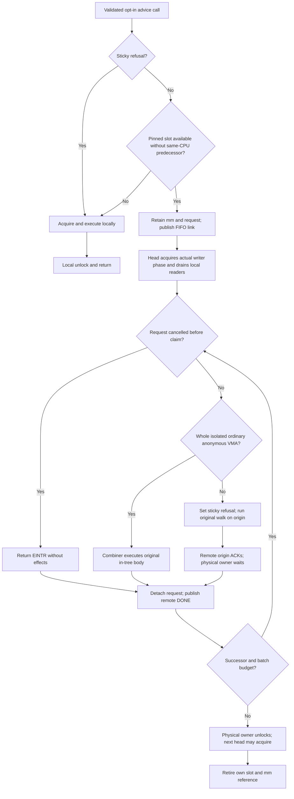

# Minimal actual-MM body experiment

Status: the minimal path passed serial Native/KD VM correctness checks and the
VM returned to its preserved recovery kernel. The KD run completed 1,690 bodies
on different executor tasks, 15 handbacks/ACKs, and 512 local post-refusal calls.
The [stage report](../../bench/results/10.176.26.71/tests/mm-body-20261022/README.md)
records commands, exact identities, artifacts and retained build/capture failures.
Preserve the
installed `kdmm1` local-only results and the `kdclobber2` recovery kernel.

The first supported in-tree body is `madvise_vma_behavior()` for DONTDUMP/DODUMP
over one complete, isolated, ordinary anonymous VMA. Admission checks run while
the combiner physically owns that mm's actual KD mmap write lock. Exact range
boundaries prohibit splitting; unmapped gaps prohibit merging. File/device
callbacks, special/huge/locked/growing VMAs, userfaultfd, named VMAs and memory
policies are refused before effects. The original in-tree helper performs the
flag update. This is fixed compiled-body execution, not a JIT-image claim or
general mmap syscall delegation.

An explicit test opt-in enables this entry for an existing KD mm without
changing its backend. Readers retain the concurrent local KD read protocol.
All other MM paths retain their prior routing. Newly created mms start with the
entry disabled; a refusal cannot be reset within the same mm lifetime.

The queue uses the existing per-CPU mutex nodes and independent OSQ/delegation
links. A node lends its OSQ membership to its own physical acquisition and
points to its caller's retained typed request; no packet or frame is copied.
Published producers poll with preemption disabled. A same-CPU predecessor or
exhausted slot refuses publication and permits a sleeping local acquisition.
The experimental queue is bounded FIFO (256 bodies per acquisition); it does
not change the loadable provider's existing NUMA policy or ABI2 interface.

Only the physical owner executes a supported body and releases the writer
phase. A refused queued request becomes permanently non-delegable for this mm
entry and is handed to its origin before any body effect. The origin's exact
slot, task, mm, state and physical-owner record authorize the native continuation.
The physical owner waits for its ACK, then releases the request for retirement.
No VMA pointer crosses a lock drop, and the retained mm reference outlives every
remote completion. Queued cancellation retains its link until the owner consumes
it before body admission. Cancellation after admission cannot replay effects.
Published cancellation is not an eager unlink: a cancelled waiter can return
only after its predecessor/owner consumes the link. Bounded signal-response
latency and general Linux killable-lock equivalence are not established for this
opt-in body entry. Ordinary mmap-lock killable APIs retain their local protocol.

The [focused probe](../../tests/kernel/mmap_lock/body/README.md) requires actual
different-task completion, exact business effects, shared readers, native
handback, sticky refusal and complete cleanup. Untouched mmap and page fault
remain separate workloads. The existing fault retry, completed-fault, remote-mm
and lifetime checks remain required; no unsupported TCLock MM workload is added.
Full arbitrary MM body delegation, general JIT integration and optimization
remain outside this minimal path. Performance tuning and p95 are deferred.

## Queue and ownership flow

| Storage | Purpose and retirement rule |
| --- | --- |
| Actual `mm->mmap_lock.kd` | One physical writer phase after local readers drain; ordinary readers remain concurrent. |
| Per-CPU reserved node | Independent `osq` and `next` memberships share preallocated storage; the slot remains reserved until both retire. |
| Stack `body_request` | Typed mm/range/behavior/result, originating task and borrowed physical-owner identity; retained mm reference outlives completion. |
| `delegation_tail` / `next` | FIFO publication and links; a successor still publishing its link must be observed before detaching. |
| `packet_state` | Exactly one transition from PENDING to RUNNING or CANCELLED before effects. |
| `locked` | WAIT, HEAD, NATIVE, ACK, DONE; DONE releases a remote request only after detach and any required ACK. |
| `body_native_only` | Sticky refusal for this mm's advice entry; future calls acquire locally. Statistics never authorize ownership or retirement. |



The flow omits the pre-acquisition failure edge: a killed head detaches its own
request and hands HEAD to its successor without claiming an acquisition. A local
head needs no remote ACK. Remote DONE can release that request while the head
continues its batch; the head's own slot lives through the physical unlock.

```text
origin:
    if sticky or publication cannot reserve a safe slot:
        acquire actual writer locally; try supported body or original walk; unlock
    else:
        retain mm, pin CPU, reserve node, publish typed request in FIFO
        poll HEAD / NATIVE / DONE
        HEAD: acquire killable writer phase; service at most 256 requests
        NATIVE: verify exact borrowed owner; execute original walk; publish ACK
        DONE: retire detached node, unpin CPU, drop mm reference, return result

physical owner, for each request:
    claim PENDING once; consume CANCELLED without effects
    if admitted and not sticky: execute original madvise_vma_behavior
    otherwise: set sticky; execute on origin; await its ACK if remote
    obtain successor, detach link, then publish remote DONE
    at batch end: release this physical acquisition; publish successor HEAD
```

## Repeating the validated checks

The original VM remains at recovery after this stage. The captured candidate
and its two one-shot boot entries remain installed. From `380G10`, the recorded
coordinator performs one boot and serial checks per command, verifies the exact
kernel and original topology, and preserves recovery. These are the commands
used for the completed stage; use fresh `--run` names for a later approved run:

```sh
python3 bench/results/10.176.26.71/tests/mm-body-20261022/validate.py --mode native --run native-1
python3 bench/results/10.176.26.71/tests/mm-body-20261022/validate.py --mode kd --run kd-1
python3 bench/results/10.176.26.71/tests/mm-body-20261022/validate.py --mode recovery --run recovery-1
```

The coordinator uses the same pinned Python environment and VM, checks the real
snapshot, restores the exact 73-module set, and remounts only the candidate's
split build directories before identity checks. Guest-only individual commands
are in the [body probe guide](../../tests/kernel/mmap_lock/body/README.md).
`mapping.py --writer-sites` requires the reviewed manifest for this exact ELF;
the old `kdmm1` proof stays intact. Native/KD mmap tests performed 81,000 untouched
cycles per mode with zero payload faults. Page-fault retry, remote-mm/fork/COW,
VMA split/lifetime and completed-fault tests ran as separate tasks.

Only the reviewed opt-in advice entry delegates. Mapping creation, arbitrary
callbacks, user-memory work and page-fault bodies remain local. Readers are never
delegated. This does not establish full Linux mutex replacement, arbitrary MM
delegation, RT/ww_mutex/lockdep support, oversubscription progress, performance
parity, variance or p95; the seven prior performance regressions remain unresolved.
