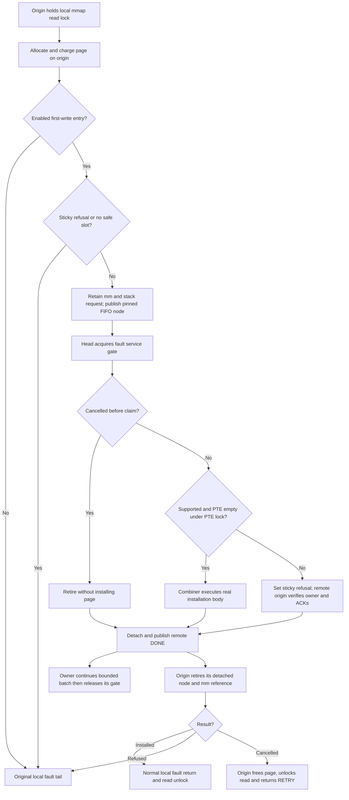

# Minimal anonymous write-fault body

Status: the narrow path passed serial Native/KD correctness in the original MM
VM on `kdmm3`. The combiner completed 129 real page installations; 16 sampled
completion records matched the originating thread and the installed physical
page. Memory contents, local concurrent readers, handback/ACK, sticky refusal,
cancellation, retry and cleanup passed. The VM returned to recovery.
The validated [VMA advice body](BODY.md), its installed `kdmm2` image and the
recovery kernel remain preserved. Performance, p95 latency and the seven mutex
regressions are deferred. See the [stage report](../../bench/results/10.176.26.71/tests/mm-fault-body-20261022/README.md)
for exact identities, failures, limitations and artifacts.

## Selected boundary

A virtual memory area (VMA) describes one mapping. A page-table entry (PTE) maps
one virtual page to physical memory. The real x86 fault route is
`exc_page_fault -> do_user_addr_fault -> handle_mm_fault -> handle_pte_fault ->
do_anonymous_page`. For a first write to an ordinary anonymous page, the selected
body is its final PTE installation, including reverse mapping and resident-page
accounting. The original local route and combiner call the same extracted
`do_anonymous_page_install()` body.

Page allocation, zeroing, memory-cgroup charging, throttling, access checks,
task fault accounting and subsequent retry handling remain on the caller.
The combiner receives an explicit originating task, mm (address space), fault
record, prepared page and PTE value. It rechecks eligibility and PTE emptiness
under the real PTE spinlock before effects. A successful installation transfers
the prepared page to that PTE exactly once. Remote resident-page accounting
targets the explicit mm, avoiding the executor's deferred per-task counter.

Support is limited to private anonymous first-write faults in an explicitly
enabled address interval with `MADV_NOHUGEPAGE`. File/device callbacks, huge or
locked mappings, growing stacks, userfaultfd, memory policies and remote-access
faults are refused. Read faults remain entirely local. Multi-generation LRU
(a page-reclaim policy) uses implicit caller state; that configuration is refused
and is disabled in the captured kernel. The captured x86-64 `update_mmu_cache`
helper is empty. No arbitrary fault callback or JIT image is admitted.

The entry is reached only by anonymous first-write faults inside the enabled
interval. File faults, swap-in and copy-on-write (COW, copying a shared page on
write) follow other native fault branches and do not count as refused or
delegated requests here. Unsupported operations that reach this entry, such as
a locked anonymous mapping or a userfaultfd missing-page operation, set its
sticky refusal. Userfaultfd lets a userspace handler resolve selected faults.
The interface remains experimental: a kernel control call must enable the
interval under actual mmap write ownership; ordinary applications do not opt in
automatically. Each new mm starts disabled.

## Readers, ownership and handback

The advice queue takes mmap write ownership. Reusing that gate for faults would
deadlock against the originating tasks' retained mmap read acquisitions. The
fault path instead uses a separate per-mm KD physical mutex and its independent
delegation queue, sharing the existing preallocated CPU/slot nodes and OSQ links.
OSQ is the optimistic-spin queue used to acquire the physical mutex. This gate
serializes only opted-in write-fault installation requests; mmap readers retain
their local acquisitions and can run concurrently with the combiner.

Each synchronous request retains its mm and caller stack until its queue link
and both node memberships retire. Only the exact physical gate owner may execute
the body. Unsupported requests set a permanent native-only flag for this mm's
fault entry. The advice entry has a separate flag and remains unchanged.

For a remote refusal, the origin verifies its exact node, mm, task and physical
owner before acknowledging the refusal. The ACK (acknowledgment) ends that
borrowed request; the physical owner then detaches it and publishes DONE. Only
after DONE and node retirement does the origin resume the existing native fault
tail. In particular, the combiner never waits for a userfaultfd handler while
retaining its own read share: that handler can require a mmap writer. This ACK
records refusal/ownership retirement, not completion of a native fault body.

A pending fatal-signal cancellation stays linked until consumed by the owner.
Before effects, cancellation leaves the prepared page with the origin. Only
the origin frees it, releases its exact mmap read acquisition and returns
`VM_FAULT_RETRY`. This edge is available only when retry can release the lock;
`RETRY_NOWAIT` is excluded. Cancellation after admission cannot replay effects.
No bounded cancellation latency or general oversubscription progress is claimed.

## Validation and commands

Use only the original `10.176.26.71:2222` MM VM, one writer, and serial checks.
Keep Native control, advice preservation, actual page-fault body, cancellation,
fault retry/lock release and untouched mmap workloads distinct. Actual completion
requires differing origin/executor task IDs, the installed PTE's physical page
number, resulting memory contents and exact queue/owner/ACK cleanup. Local
fallback and control callbacks do not count as delegated bodies.

The [probe guide](../../tests/kernel/mmap_lock/fault_body/README.md) gives runnable
guest commands. The source-side coordinator repeats both controls, advice
preservation and the directly affected tests, with one boot and serial checks
per command. These fresh run names must not already exist:

```sh
python3 bench/results/10.176.26.71/tests/mm-fault-body-20261022/validate.py --mode native --run native-2
python3 bench/results/10.176.26.71/tests/mm-fault-body-20261022/validate.py --mode kd --run kd-2
python3 bench/results/10.176.26.71/tests/mm-fault-body-20261022/validate.py --mode recovery --run recovery-2
```

Run each command only after its predecessor has passed and drained. The recorded
stage used `native-1`, `kd-1` and `recovery-1`. The new kernel source lives entirely
on root ext4; no candidate build-directory remount is needed.

## Fault protocol

| State/storage | Purpose |
| --- | --- |
| Actual mmap read acquisition | Remains on each origin until normal fault completion or the origin's retry unlock. No exclusive mmap writer is acquired by the fault service. |
| `fault.gate` | Separate KD physical mutex with exact owner and its own delegation tail; serializes only the admitted installation bodies. |
| Shared preallocated node | Independent OSQ and delegation links; both memberships must retire before slot reuse. |
| Stack `fault_request` | Explicit mm, origin, fault record, prepared page, PTE value, request ID and borrowed physical owner; its mm reference survives remote completion. |
| PENDING/RUNNING/CANCELLED claim | Decides admission or cancellation once before any installation effect. |
| WAIT/HEAD/NATIVE/ACK/DONE | Queue and refusal handshake; DONE follows detach and any required exact ACK. |
| `fault.native_only` | Permanent refusal for this mm's enabled fault entry, independent of the advice flag. Counters only observe progress. |



A local head needs no remote ACK. A killable physical-acquisition failure hands
HEAD to its successor without claiming an owner. A temporary slot shortage
returns locally without banning a semantically supported body. Unsupported body
admission, including a raced nonempty PTE, sets the sticky flag.

```text
origin after preparing an anonymous page:
    if entry disabled/outside interval/not a first write: use original tail
    if sticky or no safe publication slot: use original tail
    retain mm, pin CPU, publish typed request and poll HEAD/NATIVE/DONE
    HEAD: acquire fault gate; consume at most 256 requests
    NATIVE: verify node, mm, task and exact physical owner; publish refusal ACK
    DONE: retire slot and retained mm reference
    INSTALLED: return normally; the page now belongs to its PTE
    LOCAL: run original fault tail, including any userfaultfd lock release/retry
    CANCELLED: free prepared page, release own read lock, return VM_FAULT_RETRY

physical owner:
    atomically claim PENDING or consume CANCELLED before effects
    if eligible and not sticky:
        lock real PTE; recheck emptiness; execute shared in-tree installation
    otherwise:
        set sticky; request and await exact remote refusal ACK if needed
    detach link, then publish remote DONE
    unlock only this physical acquisition; hand HEAD to bounded remainder
```

## Smallest mmap/munmap extension

The follow-up [whole-VMA munmap stage](UNMAP.md) implements the small extension
identified after this fault milestone: real removal of one isolated anonymous
VMA under actual mmap write ownership. It prepares caller-dependent maple-tree
allocations on the origin and admits only ranges whose top-level page-directory
entries are absent. Its `kdmm4` validation recorded 15 remote removals and kept
this fault implementation unchanged. Its sources and results are separate from
the `kdmm3` results above.

Creating a mapping is a larger step: the current `do_mmap()` and
`__mmap_region()` use `current->mm`, caller address selection, resource/security
checks and `perf_event_mmap()` notifications. No general mmap, munmap or
page-fault body support is claimed from these narrow milestones.
